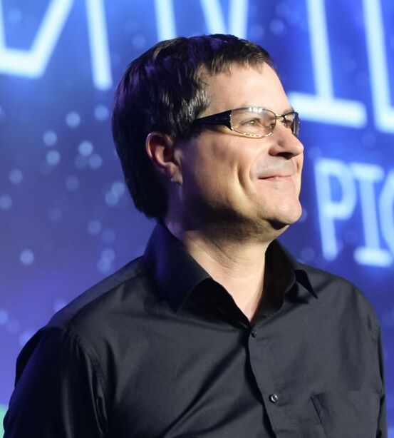

Дэвид Джон Брэбен (англ. David John Braben; род. 1964 год, Ноттингем) — британский программист, президент и основатель компании Frontier Developments и сооснователь Raspberry Pi Foundation.
Наиболее известен как соавтор компьютерной игры Elite, популярной в начале 1980-х годов.

Почётный доктор технологии Абертейского университета (2013).

