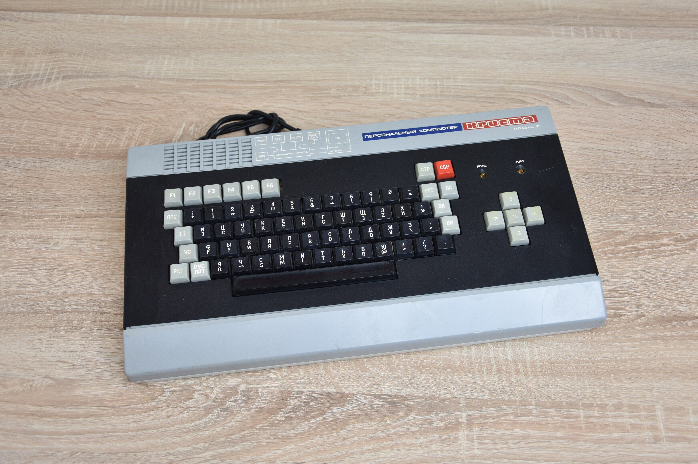

## История

Компьютер «Криста-2» это предыдущая, промежуточная версия компьютера [Вектор 06Ц](../vector06c). Отличительные особенности этого компьютера от «Вектор 06Ц»:

- Центральный процессор работает на более низкой частоте, которая составляет 2,5 МГц.
- Изображение, формируемое компьютером, на стандартном телевизоре не может быть отображено полностью по ширине.
- Нет возможности изменять палитру цветов. У компьютера 16 фиксированных цветов.
- Формат хранения программ на магнитной ленте с «Вектор 06Ц» несовместим.
- Видеорежим высокого разрешения 512×256 несовместим. Отличается порядок расположения точек в байте.
- Есть дополнительный видеорежим 1024×256.

## Программы и документация

- [Криста BASIC](./basic)
- [Уроки Бейсика (Криста-2)](./basic_lessons)
- [Прошивки ПЗУ «Криста-2»](./bootloader)
- [Гиббон (Криста-2)](./gibbon)
- [Графический редактор](./graphed)
- [Конфетти](./konfetti)
- [Крестики-нолики (Криста-2)](./krestiki)
- [Руководство к «Криста-2»](./manual)
- [Схемы ПК «Криста-2»](./schematics)
- [Комплексный тест компьютера](./test)
- [Тетрис (Криста-2)](./tetris)
- [Текстовый редактор](./texteditor)
- [Криста ассемблер](./transassembler)
- [Картотека](./ukart)
- [Руководство ПК «Криста-2»](./usermanual)
