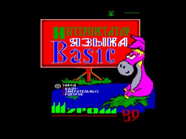
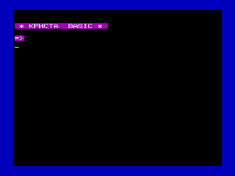

Интерпретатор языка BASIC.

Входит в состав ПО базовой кассеты ПК «Криста-2».

Файлы:

B02-BASIC.wav — формат «Криста-2» (с заставкой)

B02-BASIC.r0m — для запуска с адреса 0000h

Файлы получены из wav c оригинальной кассеты (оцифровал fan):

[http://sblive.narod.ru/ZX-Spectrum/Krista2/Krista2.htm](http://sblive.narod.ru/ZX-Spectrum/Krista2/Krista2.htm)

Эта версия Бейсика представляет сбой [Basic v(1.3) Color](../../vector06c/basic/1.3) с удаленными признаками авторства и измененным названием.

