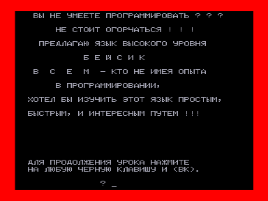
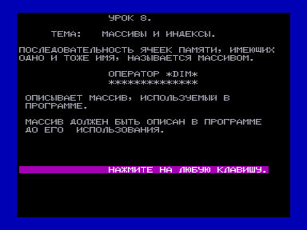

Краткий обучающий курс для [Криста BASIC](../basic) или [Basic v(1.3) Color](../../vector06c/basic/1.3).
Для загрузки и автозапуска урока нужно набрать MLOAD и нажать ВК.
Обратите внимание, что тактовая частота процессора должна быть как на Кристе-2 - 2,5 МГц.

Файлы получены из wav c оригинальной кассеты (оцифровал fan):

[http://sblive.narod.ru/ZX-Spectrum/Krista2/Krista2.htm](http://sblive.narod.ru/ZX-Spectrum/Krista2/Krista2.htm)

