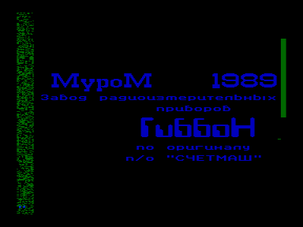
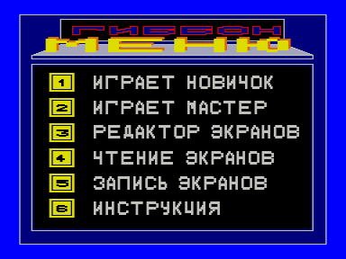

«Гиббон» на основе игры [Йети](../jeti).

Входит в состав ПО базовой кассеты ПК «Криста-2»

Файлы:

A04-Gibbon.wav — формат «Криста-2» (с заставкой)

A04-Gibbon.rom — для запуска с адреса 100h

Файлы получены из wav c оригинальной кассеты (оцифровал fan):

[http://sblive.narod.ru/ZX-Spectrum/Krista2/Krista2.htm](http://sblive.narod.ru/ZX-Spectrum/Krista2/Krista2.htm)

См. также [Super Gibbon](../../vector06c/sgibbon).

