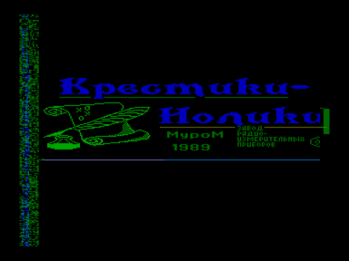
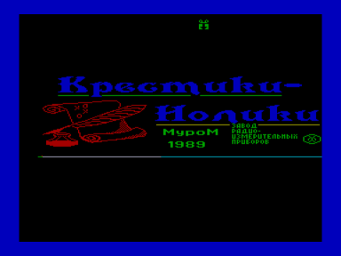

Игра «[Крестики-нолики](../kresnull)».

Входит в состав ПО базовой кассеты ПК «Криста-2».

Файлы:

A05-Krestiki-Noliki.wav — формат «Криста-2» (с  заставкой)

A05-Krestiki-Noliki.r44 — для запуска с адреса 4400h

Файлы получены из wav c оригинальной кассеты (оцифровал fan):

[http://sblive.narod.ru/ZX-Spectrum/Krista2/Krista2.htm](http://sblive.narod.ru/ZX-Spectrum/Krista2/Krista2.htm)

Первый скриншот сделан из программы [Загрузчик MBR (версия 4.0)](../mbr), второй из [Копия Б](../a10_copyb).

См. также Крестики-нолики

