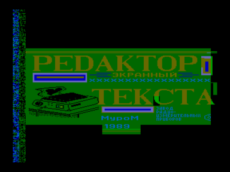

Текстовый редактор, Муром, 1989

Входит в состав ПО базовой кассеты ПК «Криста-2»

Файлы:

A06-TextEditor.wav — формат «Криста-2» (с заставкой)

A06-TextEditor.r57 — для запуска с адреса 5700h

Файлы получены из wav c оригинальной кассеты (оцифровал fan):

[http://sblive.narod.ru/ZX-Spectrum/Krista2/Krista2.htm](http://sblive.narod.ru/ZX-Spectrum/Krista2/Krista2.htm)

