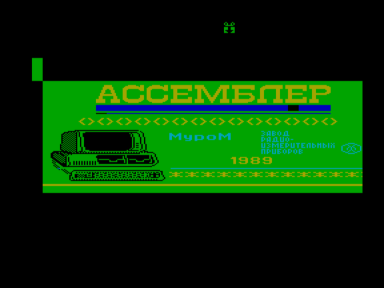

Криста ассемблер, Муром, 1989

Входит в состав ПО базовой кассеты ПК «Криста-2»

Файлы:

A08-TransAssembler.wav — формат «Криста-2» (с заставкой)

A08-TransAssembler.r0m — для запуска с адреса 0000h

Файлы получены из wav c оригинальной кассеты (оцифровал fan):

[http://sblive.narod.ru/ZX-Spectrum/Krista2/Krista2.htm](http://sblive.narod.ru/ZX-Spectrum/Krista2/Krista2.htm)

