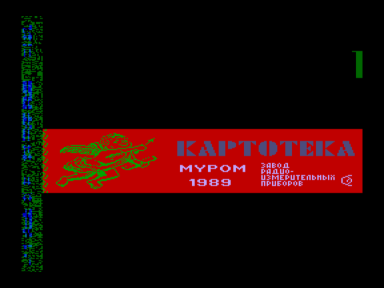
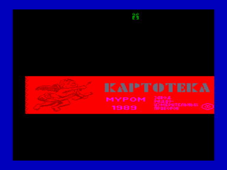

База данных «Картотека».

Входит в состав ПО базовой кассеты ПК «Криста-2».

Файлы:

A07-UKart.wav — формат «Криста-2» (с заставкой)

A07-UKart.r0m — для запуска с адреса 0000h

Файлы получены из wav c оригинальной кассеты (оцифровал fan):

[http://sblive.narod.ru/ZX-Spectrum/Krista2/Krista2.htm](http://sblive.narod.ru/ZX-Spectrum/Krista2/Krista2.htm)

Первый скриншот сделан из программы [Загрузчик MBR (версия 4.0)](../mbr), второй из [Копия Б](../a10_copyb).

