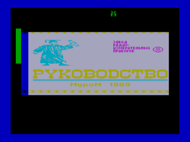

Электронное руководство пользователя.

Входит в состав ПО базовой кассеты ПК «Криста-2»

Файлы:

B01-UserManual.wav — формат «Криста-2» (с заставкой)

B01-UserManual.r03 — для запуска с адреса 300h

Файлы получены из wav c оригинальной кассеты (оцифровал fan):

[http://sblive.narod.ru/ZX-Spectrum/Krista2/Krista2.htm](http://sblive.narod.ru/ZX-Spectrum/Krista2/Krista2.htm)

