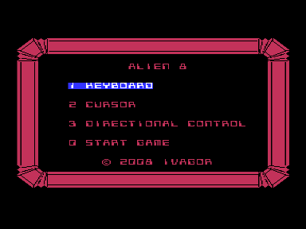
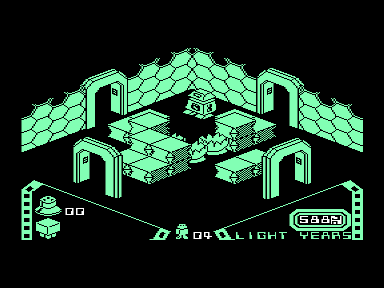

Адаптированная с MSX «псевдотрехмерная» игрушка.
Нужно найти и расставить в соответствующие гнезда предметы разной формы.
В этом Вам будут мешать активные и пассивные препятствия.

[http://vector06c.narod.ru](http://vector06c.narod.ru) (см. архив с играми для Z80)

См. также: [порт Alien 8 с ZX Spectrum](../likhachev/) для обычного Вектора-06Ц и [Knight Lore](../../knight_lore/) — другая изометрическая игра Ultimate.

