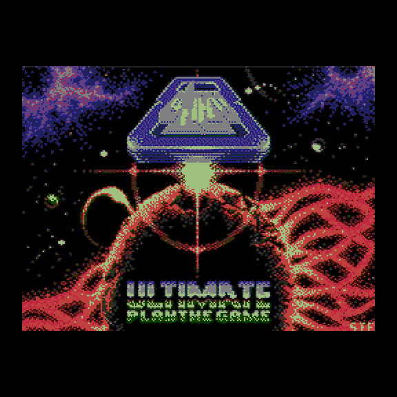
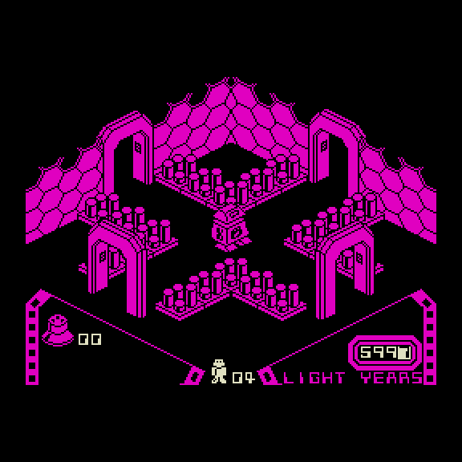

# Alien 8

Порт изометрической приключенческой игры Ultimate Play The Game, выпущенной в 1985 году для ZX Spectrum. Роботу Alien 8 предстоит исследовать космический корабль и расставить предметы в соответствующие гнёзда, преодолевая препятствия.

Версия для Вектора-06Ц переведена с Z80 на КР580ВМ80А и работает на машине с 64 КБ памяти, без Z80-платы и квазидиска.

## Образы

Файлы из [релиза 1.0](https://github.com/reqw41/alien8-v06c/releases/tag/v1.0):

- [С заставкой](alien8.r0m) — 16-цветная заставка с мелодией C64; игра распаковывается по нажатию клавиши.
- [Без заставки](alien8-nosplash.r0m) — сразу переходит к меню.
- [Образ с адреса 0100h](alien8-0100.rom) — без заставки, для обычных ROM-загрузчиков и Вектора Турбо+ под CP/M.

Файлы `.r0m` — снимки памяти размером 64 КБ, загружаемые с адреса `0000h` в совместимых эмуляторах и ядре Vector-06C для MiSTer. Для запуска на Турбо+ скопируйте образ с адреса `0100h` на диск как `ИМЯ.COM` и выполните `ИМЯ -V T3`.

## Управление

В меню клавишами **1**, **2** или **3** выбирается раскладка, **0** запускает игру.

| Раскладка             | Поворот / направление           | Вперёд            | Прыжок              | Взять / бросить |
| --------------------- | ------------------------------- | ----------------- | ------------------- | --------------- |
| 1 KEYBOARD            | Z C B M — влево; X V N — вправо | A S D F G H J K L | Q W E R T Y U I O P | 0–9             |
| 2 CURSOR              | ← / → — поворот                 | ↑                 | Пробел              | ↓               |
| 3 DIRECTIONAL CONTROL | Стрелки — направление движения  | —                 | Пробел              | 0–7             |

**ВК** — пауза. Поддерживается джойстик «П» во всех раскладках: направления соответствуют стрелкам, первая кнопка — прыжок, вторая — взять или бросить предмет. Любая кнопка джойстика запускает игру из меню или пропускает заставку.

## Скриншоты

## См. также

- [Alien 8 — адаптация с MSX](../ivagor/) для Вектора с Z80.
- [Knight Lore](../../knight_lore/) — другая изометрическая игра Ultimate, адаптированная с MSX для Вектора с Z80.
- [Quazatron](../../quazatron/) — изометрическая игра, портированная на обычный Вектор-06Ц.

Исходный код, инструкции по сборке и подробности порта — в [репозитории проекта](https://github.com/reqw41/alien8-v06c). Alien 8 © 1985 Ultimate Play The Game.
