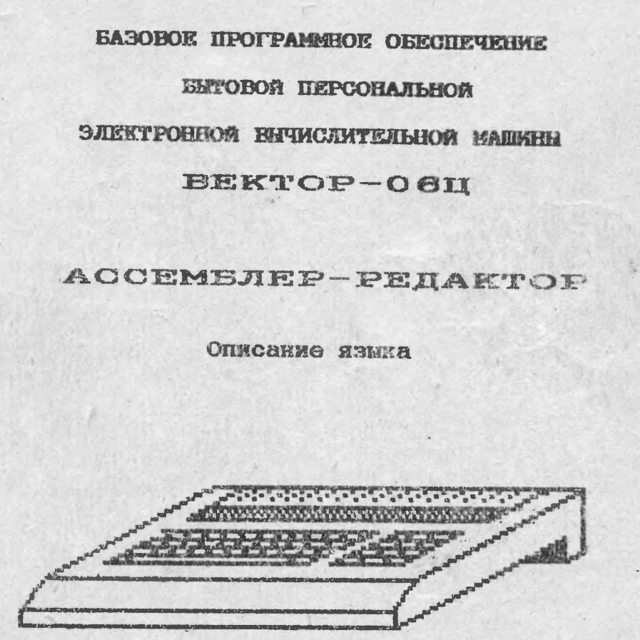

# АССЕМБЛЕР-РЕДАКТОР

**Описание языка**

БАЗОВОЕ ПРОГРАММНОЕ ОБЕСПЕЧЕНИЕ БЫТОВОЙ ПЕРСОНАЛЬНОЙ ЭЛЕКТРОННОЙ ВЫЧИСЛИТЕЛЬНОЙ МАШИНЫ "ВЕКТОР-06Ц"

**УТВЕРЖДЕН**
МВАИ 00020-01 35 01-ЛУ

Обозначение: **МВАИ 00020-01 35 01** · Листов: 107 · Год: 1988


---

## АННОТАЦИЯ

Если вы хотите познать радость наиболее полного общения с ЭВМ, нужно понимать ее машинный код. Язык Ассемблера представляет собой набор команд машинного кода, представленный в доступном для чтения формате. Программирующий на языке Ассемблера имеет в своем распоряжении все средства ЭВМ. Чтобы в полной мере ими воспользоваться, нужно иметь четкое представление о всех деталях машинного кода.

Даже тот, кто обычно не программирует на языке Ассемблера, выиграет от более близкого знакомства с ЭВМ.

С БПЭВМ "ВЕКТОР-06Ц" поставляется ассемблер-редактор, представляющий программисту набор средств для ввода в ЭВМ и редактирования текста программы на языке Ассемблера, трансляцию ее в объектную программу в машинных кодах, пригодную для выполнения и записи программы на МЛ.

Данное руководство содержит сведения о редакторе, языке Ассемблера и трансляторе. Описаны возможности БПЭВМ "ВЕКТОР-06Ц", используемые Ассемблером; приведены элементы Ассемблера, псевдокоманды, дано подробное описание системы команд с примерами; приведены руководство по эксплуатации Ассемблера, список сообщений транслятора.

## СОДЕРЖАНИЕ

- 1. Общие сведения — 5
- 2. Элементы языка — 15
  - 2.1. Описание языка ассемблера — 15
    - 2.1.1. Описание основных элементов языка — 15
    - 2.1.2. Принятые обозначения в командах — 17
    - 2.1.3. Набор команд — 18
      - 2.1.3.1. Псевдокоманды (ORG,DS,EQU,END,DB,DW) — 19
      - 2.1.3.2. Формирование флага переноса (CMC,STC) — 24
      - 2.1.3.3. Однорегистровые команды (INR,DCR,CMA,DAA,NOP) — 26
      - 2.1.3.4. Команды передачи данных (MOV,STAX,LDAX) — 30
      - 2.1.3.5. Команды с аккумулятором и регистрами или памятью (ADD,ADC,SUB,SBB,ANA,XRA,ORA,CMP) — 33
      - 2.1.3.6. Команда сдвига содержимого аккумулятора (RLC,RRC,RAL,RAR) — 44
      - 2.1.3.7. Команды с парами регистров (PUSH,POP,DAD,INX,DCX,XCHG,XTHL,SPHL) — 49
      - 2.1.3.8. Команды с непосредственным заданием данных (LXI,MVI,ADI,ACI,SUI,SBI,ANI,XRI,ORI,CPI) — 57
      - 2.1.3.9. Команды с прямой адресацией (STA,LDA,SHLD,LHLD) — 68
      - 2.1.3.10. Команды перехода (PCHL,JMP,JC,JNZ,JZ,JNZ,JM,JP,JPE,JPO) — 72
      - 2.1.3.11. Команды обращения к подпрограммам с подготовкой возврата (CALL,CC,CNC,CZ,CNZ,CM,CP,CPE,CPO) — 79
      - 2.1.3.12. Команды возврата из подпрограмм (RET,RC,RNC,RZ,RNZ,RM,RP,RPE,RPO,RST) — 85
      - 2.1.3.13. Команды управления маской прерываний (EI,DI) — 91
      - 2.1.3.14. Команды ввода-вывода (IN,OUT,HLT) — 93
    - 2.1.4. Некоторые приемы программирования — 96
  - 2.2. Команды редактора — 100
  - 2.3. Команды транслятора — 104
  - 2.4. Сообщения редактора — 106
  - 2.5. Сообщения транслятора — 106

## 1. ОБЩИЕ СВЕДЕНИЯ

Ассемблер-редактор предназначен для разработки на БПЭВМ "ВЕКТОР-06Ц" программ, позволяющих наиболее эффективно использовать все возможности ЭВМ.

Ассемблер-редактор обеспечивает возможность:

- писать программы на символическом машинно-ориентированном языке (языке ассемблера);
- редактировать программы на ЭВМ;
- преобразовывать исходные программы в объектные, готовые к выполнению (выполнять трансляцию).

Основными элементами БПЭВМ "ВЕКТОР-06Ц", которые обеспечивают работу ассемблера являются:

- микропроцессор КР580ВМ80А;
- оперативная память.

В оперативной памяти могут находиться команды и(или) данные. Память состоит из адресуемых ячеек. Адреса байтов памяти могут быть от 0 до 65535=FFFFH.

Программа состоит из последовательности команд. Каждая команда дает возможность выполнить элементарную операцию, такую как пересылка байта данных, арифметическую или логическую операцию над байтом данных или изменение порядка выполнения команд. Программа записывается в память как последовательность битов, которые представляют команды программы и которые представлены шестнадцатеричными цифрами. Адрес памяти со следующей выполняемой командой находится в программном счетчике. Непосредственно перед выполнением каждой команды в программный счетчик помещается адрес следующей команды.

Программа выполняется последовательно, если не выполняется команда передачи управления (переход, вызов или возврат), которая устанавливает новое значение адреса программного счетчика. Затем выполнение продолжается последовательно с нового адреса.

Изучая содержимое байта памяти, нельзя различить находится в этом байте код команды или данные. Только исходя из логики программы, можно достоверно отличить данные от кодов команд.

Машинные команды могут требовать 1, 2 или 3 байта для кода команды; в каждом таком случае программный счетчик автоматически увеличивается на соответствующее число до адреса следующей команды.

Чтобы избежать ошибок программист должен быть уверен, что за командой не идет байт данных, когда ожидается следующая команда.

Для выполнения действий над данными и управления выполнением команд в ЭВМ имеются:

- рабочие регистры;
- программный счетчик;
- указатель стека;
- байт состояния.

Описание этих элементов приведено в таблице 1.

**Таблица 1**

_Элементы ЭВМ предназначенные для выполнения действий над данными и управления выполнением команд._

| наименование             | описание                                                                                                                                                                                                                                                                                                                                                                                                                                   |
| ------------------------ | ------------------------------------------------------------------------------------------------------------------------------------------------------------------------------------------------------------------------------------------------------------------------------------------------------------------------------------------------------------------------------------------------------------------------------------------ |
| Рабочие регистры         | Микропроцессор имеет восьми битовый аккумулятор, обозначаемый цифрой 7 или буквой A, и шесть восьми битовых регистров. Эти регистры обозначаются цифрами 0,1,2,3,4,5 или буквами B,C,D,E,H,L. Все действия над данными могут производиться в регистрах.                                                                                                                                                                                    |
| Регистровые пары         | Некоторые операции можно производить с парами регистров. Может применяться четыре пары регистров B, D, H, и PSW:<br>`B` — B и C<br>`D` — D и E<br>`H` — H и L<br>`PSW` — A и байт состояния                                                                                                                                                                                                                                                |
| Байт состояния           | Специальный байт, который отражает текущее состояние машинных флагов.                                                                                                                                                                                                                                                                                                                                                                      |
| Программный счетчик (PC) | 16-ти битовый регистр, который доступен программисту и содержимое которого указывает адрес следующей выполняемой команды                                                                                                                                                                                                                                                                                                                   |
| Указатель стека (SP)     | Стек представляет собой область памяти, выделяемую программистом. Стековые операции выполняются по принципу "раньше вошел - позже вышел". В стек могут заноситься или из стека могут считываться данные или адреса. Наличие стека облегчает обращение к подпрограммам и обработку прерываний. Начальный адрес стека задается программистом с помощью специального 16-ти битового регистра, называемого указателем стека (SP-STACK POINTER) |

Адресация памяти может осуществляться следующими способами:

- прямая адресация;
- адресация с помощью пары регистров;
- адресация с помощью указателя стека;
- непосредственная адресация.

Описание способов адресации приведено в таблице 2.

**Таблица 2**

_Описание способов адресации_

| Наименования                        | Описание                                                                                                                                                                                                                                                                                                                                                                                                                                                                     |
| ----------------------------------- | ---------------------------------------------------------------------------------------------------------------------------------------------------------------------------------------------------------------------------------------------------------------------------------------------------------------------------------------------------------------------------------------------------------------------------------------------------------------------------- |
| Прямая адресация                    | При прямой адресации в команде указан точный адрес ячейки памяти. Пример: "Загрузить в аккумулятор содержимое ячейки памяти с адресом 1F2A". В памяти это будет выглядеть так:<br>`адрес команды` — `содержимое`<br>`K` — 3A<br>`K+1` — 2A<br>`K+2` — 1F<br>Эта команда занимает три байта оперативной памяти (K,K+1,K+2), причем второй и третий байты содержат адрес ячейки памяти.                                                                                        |
| Адресация с помощью пары регистров  | Адрес ячейки памяти может быть задан содержимым регистровой пары. Для большинства команд в этом случае используются регистры H и L. Регистр H содержит старший байт адресов, а регистр L — младший байт. Рассмотрим вышеприведенную команду с использованием регистровой адресации:<br>`память` — `7F` (выполняемая команда); регистры: `H` — 1F, `L` — 2A<br>Кроме того есть две команды (STAX, LDAX), которые используют для адресации памяти пары регистров B и C и D и E |
| Адресация с помощью указателя стека | Для адресации памяти можно также использовать 16-ти битовый регистр - указатель стека (SP). Две команды работают непосредственно со стеком: запись в стек осуществляется командой PUSH, а вызов данных из стека командой POP. Программист может загрузить SP некоторым значением с помощью команды LXI. Программист должен следить за содержимым SP, чтобы избежать переполнения стека.                                                                                      |
| Непосредственная адресация          | Ряд команд содержит данные в самой команде. Пример непосредственной адресации: "загрузить в аккумулятор число 2Ah".<br>`память`:<br>`3E` &larr; загрузить аккумулятор непосредственно<br>`2A` &larr; загружаемое число<br>Эта команда содержит данные непосредственно в следующем за кодом байте.                                                                                                                                                                            |

Результат элементарной операции над данными отражается пятью битами (флагами) специального байта состояния.

Все флаги, кроме флага вспомогательного переноса, могут быть опознаны командами, влияющими на последовательность выполнения программы. Флаг считается "установленным", когда он равен 1, и "сброшенным", когда он равен нулю. Описание флагов байта состояния приведено в таблице 3.

**Таблица 3**

_Описание флагов байта состояния_

| Номер бита | Обозначение | Наименование флага      | Описание флага                                                                                                                                                                                                                                                                                                                                                                                                                                     |
| ---------- | ----------- | ----------------------- | -------------------------------------------------------------------------------------------------------------------------------------------------------------------------------------------------------------------------------------------------------------------------------------------------------------------------------------------------------------------------------------------------------------------------------------------------- |
| 0          | CY          | Перенос                 | Флаг переноса устанавливается и сбрасывается целым рядом операций над данными, и его состояние может быть непосредственно программно проверено. На флаг переноса влияют команды сложения, вычитания, сдвига и логические операции. Если, например, в результате сложения возник перенос из старшего (7) разряда, то он устанавливает флаг переноса. Если же в результате сложения переноса из старшего разряда нет, то флаг переноса сбрасывается. |
| 1          |             | Свободен (всегда 1)     |                                                                                                                                                                                                                                                                                                                                                                                                                                                    |
| 2          | P           | Паритет (четность)      | После некоторых команд производится подсчет количества битов результата, содержащих единицы. Если количество таких битов четное, то устанавливается флаг паритета. В противном случае он сбрасывается.                                                                                                                                                                                                                                             |
| 3          |             | Свободен (всегда 0)     |                                                                                                                                                                                                                                                                                                                                                                                                                                                    |
| 4          | AC          | Вспомогательный перенос | Этот флаг свидетельствует о возникновении переноса из третьего разряда в четвертый. Состояние флага вспомогательного переноса нельзя проверить программно. Его наличие или отсутствие влияет на выполнение только одной команды DAA.                                                                                                                                                                                                               |
| 5          |             | Свободен (всегда 0)     |                                                                                                                                                                                                                                                                                                                                                                                                                                                    |
| 6          | Z           | Нуль                    | Флаг нуля устанавливается в результате выполнения арифметических и логических операций.                                                                                                                                                                                                                                                                                                                                                            |
| 7          | S           | Знак                    | Байт данных можно интерпретировать как число со знаком. В этом случае, по соглашению, седьмой бит считается знаковым. Таким образом, в одном байте может быть число от -128 до +127. Флаг знака устанавливается после выполнения операции в соответствии со значением седьмого бита результата.                                                                                                                                                    |

Пример (таблица 3, флаг AC):

```
Номер бита  7 6 5 4 3 2 1 0
  2E      = 0 0 1 0 1 1 1 0
+ 74      = 0 1 1 1 0 1 0 0
------    -----------------
  A2      = 1 0 1 0 0 0 1 0
           |       |
           |       |--> AC=1
           |--> CY=0
```

Минимальный комплект оборудования, необходимый для работы программы ассемблер-редактор состоит из:

- телевизора;
- микропроцессора;
- клавиатуры.

Ассемблерная программа состоит из последовательности предложений.

Каждое предложение принадлежит одной из трех групп:

- команд;
- псевдокоманд;
- приказов ассемблера.

Каждая команда состоит из четырех отдельных и отличающихся друг от друга полей, расположенных в следующем порядке:

1. поле имени;
2. поле кода;
3. поле операндов;
4. поле примечаний.

Ассемблер допускает свободный формат в исходных предложениях: это означает, что различные поля могут отделяться друг от друга произвольным числом пробелов.

Описание элементов ассемблерных предложений приведено в таблице 4.

**Таблица 4**

_Описание элементов ассемблерных предложений_

| Наименование    | Описание                                                                                                                                                                                                                                                                                                                                                                                                                                                                                                                                                                                                                                                                                                                                                                                                                                              |
| --------------- | ----------------------------------------------------------------------------------------------------------------------------------------------------------------------------------------------------------------------------------------------------------------------------------------------------------------------------------------------------------------------------------------------------------------------------------------------------------------------------------------------------------------------------------------------------------------------------------------------------------------------------------------------------------------------------------------------------------------------------------------------------------------------------------------------------------------------------------------------------- |
| Поле имени      | Поле имени является необязательным. Если имя присутствует, то это символическое имя, после которого следует двоеточие (:). В этом случае значение имени есть текущее значение счетчика адреса. Имена используют для того, чтобы можно было ссылаться на адрес команды, поэтому в программе нельзя использовать одинаковые имена для разных команд или псевдокоманд. Например, в следующей последовательности команд:<br>`HERE: JMP THERE`<br>` ---`<br>` ---`<br>`THERE: MOV C,D`<br>` ---`<br>` ---`<br>`THERE: CALL SUB`<br>ассемблер не сможет определить, какой адрес подставить в команду JMP.<br>Одна команда может иметь несколько имен. Пример:<br>`LOOP1: ;первое имя`<br>`LOOP2: MOV C,D ;второе имя`<br>` ---`<br>` ---`<br>` JMP LOOP1`<br>` ---`<br>` JMP LOOP2`<br>обе эти команды JMP передадут управление одной и той же команде MOV. |
| Поле кода       | Это поле содержит код, идентифицирующий машинную операцию, которую надо выполнить (сложение, вычитание, переход и т.д.). Всего имеется 78 различных основных операций, каждая из которых обозначается определенным мнемоническим кодом, содержащим от двух до четырех букв. Ассемблер вместо мнемокода подставляет соответствующее числовое значение. Поле имени не обязательно отделять от поля кода пробелами. Если операционный код требует наличия операндов, то поле кода от поля операндов должно быть отделено по крайней мере одним пробелом.                                                                                                                                                                                                                                                                                                 |
| Поле операндов  | Это поле содержит информацию, используемую совместно с кодом для того, чтобы точно знать операцию, которую надо выполнить по данной команде. В зависимости от содержимого поля кода поле операндов может отсутствовать или содержать один или два операнда, разделенных запятой(,). В поле операндов может быть 7 видов информации:<br>— регистр;<br>— регистровая пара;<br>— ссылка на память;<br>— данные;<br>— 16-ти битовый адрес памяти;<br>— символическое имя;<br>— выражение.                                                                                                                                                                                                                                                                                                                                                                 |
| Поле примечания | Это поле является необязательным. Если примечания присутствуют, то они должны начинаться со знака точка с запятой (;) и могут продолжаться до конца строки. В примечаниях могут употребляться любые знаки, кроме "возврата каретки". "Возврат каретки" означает конец примечания. Примечания могут занимать всю строку.                                                                                                                                                                                                                                                                                                                                                                                                                                                                                                                               |

**Примеры.**

```asm
    имя    код       операнды             примечание
;использование в качестве операндов регистра и непосредственно
;данных
HERE:      MVI        C,0BAH            ;загрузить в регистр C
                                        ;шестнадцатеричное число BA
;использование в качестве операндов пары регистров и адреса
           LXI        B,0257H           ;загрузить в пару регистров B и
                                        ;C шестнадцатеричный адрес
                                        ;ячейки (это число можно
                                        ;интерпретировать как
                                        ;константу)
;использование в качестве операндов имен, выражений и ссылки на
;память
LOOP1:     LXI        H,0B28H           ;загрузить в пару регистров H
                                        ;и L адрес 0B28H
LOOP2:     MVI        A,'S'             ;загрузить в аккумулятор
                                        ;константу S
           MOV        M,A               ;переслать содержимое
                                        ;аккумулятора в ячейку памяти,
                                        ;адрес которой находится в паре
                                        ;регистров H и L
           JMP        LOOP1+3           ;безусловный переход к
                                        ;инструкции с адресом LOOP1+3
                                        ;(в данном случае
                                        ;LOOP1+3=LOOP2)
           LXI                          ;загрузить в регистровую пару B
                                        ;и C, адрес соответствующий
                                        ;имени LOOP2
```

Представление чисел в дополнительном коде позволяет действие вычитания в ЭВМ заменить действием сложения, что упрощает схему ЭВМ.

Дополнительный код положительного числа по определению равен самому числу. Дополнительный код отрицательного числа формируется следующим образом:

1. каждый бит числа инвертируется, то есть 1 меняется на 0, а 0 на 1
2. в самый младший разряд получившегося числа прибавляется 1, игнорируя возможный перенос из старшего разряда.

**Пример 1.**

Получим дополнительный код от числа -10.

```
+10 = 0 0 0 0 1 0 1 0   инвертируем каждый бит и получим
      1 1 1 1 0 1 0 1,  теперь прибавим в младший разряд 1
        1 1 1 1 0 1 0 1
      +               1
        ---------------
        1 1 1 1 0 1 1 0 = F6H
```

Отсюда видно, что дополнительный код числа 10 равен F6H.

(отметим, что седьмой бит - бит знака - установлен в 1; это признак отрицательного числа).

Таким образом, вместо вычитания одного числа из другого вычитаемое представляют в дополнительном коде и прибавляют к уменьшаемому.

**Пример 2.**

Вычтем из числа 37H число -15H число -15H представлено в дополнительном коде:

1 1 1 0 1 0 1 1. Перед вычитанием надо получить дополнительный код вычитаемого:

1. поразрядно инвертируем число

```
1 1 1 0 1 0 1 1
0 0 0 1 0 1 0 0
```

2. прибавляем в младший разряд 1

```
  0 0 0 1 0 1 0 0
+               1
  ---------------   ---
  0 0 0 1 0 1 0 1 = 15H
```

Теперь производим сложение:

```
  0 0 1 1 0 1 1 1 = 37H
+ 0 0 0 1 0 1 0 1 = 15H
  ---------------
  0 1 0 0 1 1 0 0 = 4CH
```

## 2. ЭЛЕМЕНТЫ ЯЗЫКА

### 2.1. Описание языка Ассемблера.

Программа, написанная на ассемблере, представляет собой последовательность строк, каждая из которых содержит или приказ ассемблера, или команду, или константу, или псевдокоманду.

Программа, написанная на ассемблере программистом, называется исходной программой. Ассемблер преобразует исходную программу в эквивалентную объектную программу, которую можно загрузить в ОЗУ и выполнять. Каждая преобразованная команда или константа получает свой адрес, величина которого определяется значением внутренней переменной, называемой счетчиком адреса.

При последовательном преобразовании команд значение счетчика адреса каждый раз увеличивается на величину, соответствующую количеству байтов, занимаемому в памяти данной командой или константой.

```
Пример.
исходная программа                  объектная программа
NOW: MOV  A,B                       78
     CPI  'C' --> преобразуется --> FE43
     JZ   LER     ассемблером в     CA7C3D
     -                              -
LER: MOV  M,A                       77
```

#### 2.1.1. Описание основных элементов языка.

##### Символы

Все сложные элементы языка ассемблера формируются из символов. В качестве символов могут использоваться:

- буквы латинского алфавита от A до Z;
- цифры от 0 до 9;
- специальные знаки + - , ; ( ) ' пробел;
- в примечаниях можно использовать любые графические символы.

##### Числа и константы

В ассемблере есть три вида чисел: двоичные, десятичные, шестнадцатеричные. Десятичные числа образуются из цифр от 0 до 9. Шестнадцатеричные числа образуются из цифр от 0 до 9 и букв от A до F. Шестнадцатеричное число должно обязательно начинаться с цифры и оканчиваться буквой H. Все виды чисел могут иметь знак + или -, отрицательные числа в памяти представляются в дополнительном коде, поэтому однобайтовое число, рассматриваемое как целое со знаком, может быть в диапазоне от -128 до +127.

Двухбайтовое целое со знаком будет заключено в диапазоне от -32768 до +32767. Однобайтовое целое без знака будет в диапазоне от 0 до 255. А двухбайтовое целое без знака будет в диапазоне от 0 до 65535. Константой называется символ, заключенный в апострофы.

**Примечание.**

ЭВМ сама не может отличить -1 от +255, т.е. является ли седьмой бит знаковым или просто старшим битом числа.

**Примеры.**

```
допустимые константы             внутреннее представление
                                 (шестнадцатеричное)
     100                                 0064
    -100                                 FF9C
     1234H                               1234
    -1234H                               EDCC
     65535                               FFFF
    -1                                   FFFF
     32767                               7FFF
     32768                               8000
    -32768                               8000
     'A'                                 0041
```

##### Символические имена

Символическим именем называется последовательность букв и цифр, начинающаяся с буквы. Количество букв в имени не ограничено, но идентифицируют имя только первые шесть знаков.

Поэтому имена ABCDE11 и ABCDE12 будут трактоваться ассемблером как одно и то же имя. Если при трансляции символическое имя получит числовое значение, то оно будет определенным именем; в противном случае символическое имя будет неопределенным.

Неопределенные символические имена можно использовать там же, где и определенные, за исключением:

- выражения не могут содержать неопределенные имена;
- псевдокоманды ORG, DS, EQU не могут содержать в качестве операндов неопределенные имена.

```
Примеры.
Допустимые символические имена
      A
      AB
      XYZ
      C1234
      A1X2B
      LONGLABEL
```

##### Выражения

Выражения состоят из чисел, имен и/или констант, соединенных арифметическими операторами + и -. Величина выражения определяется как арифметическая сумма величин имен и чисел. Все имена, включенные в выражение, должны быть определены.

Неопределенные имена не допускаются.

```
Примеры:
Допустимые выражения (имена предполагаются определенными).
      A+10
      IFH+AB
      XYZ-A+25
      LABEL-100H
      'A'-'Z'+1
```

#### 2.1.2. Принятые обозначения в командах

**Флаги (биты) условий.**

| Обозначение | Значение                |
| ----------- | ----------------------- |
| `CY`        | перенос                 |
| `P`         | паритет (четность)      |
| `AC`        | вспомогательный перенос |
| `Z`         | ноль                    |
| `S`         | знак                    |

**Регистры**

| Имя | Код | Название                                                           |
| --- | --- | ------------------------------------------------------------------ |
| `B` | 000 | регистр B                                                          |
| `C` | 001 | регистр C                                                          |
| `D` | 010 | регистр D                                                          |
| `E` | 011 | регистр E                                                          |
| `H` | 100 | регистр H                                                          |
| `L` | 101 | регистр L                                                          |
| `M` | 110 | ссылка на ячейку памяти, адрес которой находится в регистрах H и L |
| `A` | 111 | аккумулятор                                                        |

Если флаг установлен, то будем писать, что он равен 1, иначе, что он равен 0.

Обозначения, принятые при описании команд:

| Обозначение     | Значение                                                                                |
| --------------- | --------------------------------------------------------------------------------------- |
| `R`, `R1`, `R2` | один из регистров A, B, C, D, E, H, L или ссылка на память - M                          |
| `RP`            | регистровая пара B, D, H или PSW                                                        |
| `SSS`           | код регистра-источника                                                                  |
| `DDD`           | код регистра-приемника                                                                  |
| `XXX`           | код регистра                                                                            |
| `SP`            | регистр - указатель стека                                                               |
| `PC`            | программный счетчик                                                                     |
| `DATA`          | байт данных                                                                             |
| `ADR`           | адрес данных, занимающих два байта                                                      |
| `( )`           | содержимое регистра, регистровой пары или ячейки памяти, адрес которой указан в скобках |

Нумерация битов одного байта:

```
нумерация битов одного байта   -> 7 6 5 4 3 2 1 <-
                               |                  |
                               |                  |
                  старший бит --        младший бит
```

Все команды могут иметь метки и примечания. В дальнейшем это будет подразумеваться. Некоторые команды не требуют операндов. В каждом случае это будет оговорено.

В конце описания каждой команды перечислены флаги условий, на состояние которых может повлиять данная команда.

#### 2.1.3. Набор команд

##### 2.1.3.1. Псевдокоманды (ORG, DS, EQU, END, DB, DW)

Псевдокоманды предназначены для указаний АССЕМБЛЕРУ и для задания значений имен в ассемблерной программе. Псевдокоманды не генерируются в объектные коды. В ассемблере ASSM имеются следующие псевдокоманды:

| Мнемоника | Описание                                      |
| --------- | --------------------------------------------- |
| `ORG`     | установить начальное значение счетчика адреса |
| `DS`      | резервирование области памяти                 |
| `EQU`     | задать значение символического имени          |
| `END`     | конец исходной записи                         |
| `DB`      | задать байт данных                            |
| `DW`      | задать слово данных                           |

###### ORG

**Назначение:** Установить начальное значение счетчика адреса.

Чтобы установить начальное значение счетчика адреса, необходимо написать следующее предложение:

```asm
 имя  код    операнд    примечания
NAME: ORG   выражение  ;установить адрес
```

где имя и примечание необязательны, а "выражение" есть число, символическое имя или выражение. В качестве операнда допускаются только определенные имена.

**Описание:** Следующая команда будет ассемблироваться с адреса, определяемого величиной "выражения".

Значение "имени" будет равно значению счетчика адреса перед выполнением псевдокоманды ORG.

###### DS

**Назначение:** Зарезервировать область памяти.

Чтобы зарезервировать некоторое число байтов памяти для хранения данных, необходимо написать следующее предложение:

```asm
  имя  код    операнд    примечания
LABEL: DS    выражение  ;задать память
```

где имя и примечание необязательны, а "выражение" есть число, символическое имя или выражение.

**Описание:** Допускаются только определенные имена. При ассемблировании в эту область памяти не будут заноситься данные: программист ни в коем случае не должен ожидать, что в эту область занесутся нули или какие-либо специальные значения.

Следующая команда будет ассемблироваться с адреса, вычисляемого как сумма адреса данной области и величины "выражения".

###### EQU

**Назначение:** Задать значение символического имени.

Чтобы ранее неопределенному имени присвоить некоторое значение, применяется псевдокоманда EQU:

```asm
 имя  код    операнд    примечания
NAME: EQU   выражение  ;приравнять имя
```

где примечания необязательны.

**Описание:** Ассемблер присваивает имени "NAME" значение "выражения". Каждый раз, когда имя "NAME" будет встречаться при дальнейшем ассемблировании, будет использоваться присвоенное значение.

Если на имя были ссылки ранее, но оно не было определенно, то таблица неопределенных имен будет скорректирована и значение имени "NAME" будет поставлено во все места, где была ссылка на данное имя.

Примечание: в псевдокоманде EQU в поле имени не должны быть имена, совпадающие с мнемокодами команд и псевдокоманд.

###### END

**Назначение:** Конец исходной записи.

Предложение END сообщает ассемблеру, что достигнут конец одной физической записи программы и что генерацию программы из этой записи следует закончить. Предложение имеет следующий формат:

```asm
 имя  код    примечания
NAME: END   ;конец записи
```

где имя и примечание необязательны.

**Описание:** Одна запись программы по определению есть последовательность строк, заканчивающаяся предложением END. Ассемблерная программа может состоять из нескольких записей, каждая из которых должна заканчиваться предложением END.

###### DB

**Назначение:** Задать байт данных.

Для того, чтобы задать последовательность однобайтовых элементов данных, необходимо написать предложение следующего формата:

```asm
 имя  код    операнд    примечания
NAME: DB     список    ;задать байт
```

где имя и примечания необязательны, а "список" является списком:

1. чисел, имен и выражений, которые преобразуются в восьмибитовые элементы данных.
2. знаков КОИ-7, заключенных в апострофы.

Различные элементы списка должны разделяться запятыми.

**Описание:** Восьмибитовые значения, вырабатываемые списком данных, будут последовательно запоминаться в памяти, начиная с байта, адресованного "именем".

**Пример:** Таким образом, предложение:

```asm
LABEL: DB   7H, 'TEXT', 99
```

потребует 6 байтов оперативной памяти и следующая инструкция будет ассемблироваться с адреса "LABEL+6".

###### DW

**Назначение:** Задать слово данных.

Для того, чтобы задать последовательность двухбайтовых элементов данных (слов данных), необходимо написать предложение следующего формата:

```asm
 имя  код    операнд    примечания
NAME: DW     список    ;задать слово
```

где имя и примечание необязательны, а "список" является списком чисел, имен и выражений, которые преобразуются в шестнадцатибитовые элементы данных. Разные элементы списка должны отделяться запятыми.

**Описание:** Двухбайтовые значения, вырабатываемые из списка данных, будут последовательно запоминаться в оперативной памяти, начиная с байта, адресованного "именем", причем младший значащий байт будет расположен перед старшим.

**Пример:** Таким образом, предложение:

```asm
LABEL: DW   1234H,999
```

потребует четырех байтов оперативной памяти и следующая инструкция будет ассемблироваться, начиная с адреса "LABEL+6".

##### 2.1.3.2. Команды формирования флага переноса (CMC, STC)

Эти команды формируют флаг (бит) переноса - CY и имеют следующую структуру:

```
0 0 1 1 X 1 1 1
        ^
        |       0 для STC
        |------ 1 для CMC
```

операндов у этих команд нет. Команды занимают 1 байт.

###### CMC

**циклов:** 1 · **флаги условий:** CY · **байтов:** 1

**Назначение:** Инверсия флага переноса.

**Формат:** `CMC`

**Описание:** Если CY=0, то установить CY=1. Если CY=1, то сбросить CY=0.

###### STC

**циклов:** 1 · **флаги условий:** CY · **байтов:** 1

**Назначение:** Установка флага переноса.

**Формат:** `STC`

**Описание:** Установить CY=1.

##### 2.1.3.3. Однорегистровые команды (INR, DCR, CMA, DAA, NOP)

Ниже описаны команды, работающие с одним регистром или с ячейкой памяти. Если задана ссылка на ячейку памяти, то подразумевается, что адрес этой ячейки находится в регистрах H и L, причем в регистре H находится старший байт адреса, а в регистре L - младший байт адреса. Эти команды занимают один байт.

###### INR

**циклов:** 3 · **флаги условий:** Z, S, P, AC · **байтов:** 1

**Назначение:** Инкремент содержимого регистра или памяти.

**Формат:** `INR R`

```
0 0 X X X 1 0 0
      ^
      |-------- код регистра или ссылка на память
```

**Описание:** К содержимому заданного регистра прибавляется 1.

**Пример:** Пусть (C)=99H. Тогда после выполнения команды INR C

```
(C)=9AH.
```

###### DCR

**циклов:** 3 · **флаги условий:** Z, S, P, AC · **байтов:** 1

**Назначение:** Декремент содержимого регистра или памяти.

**Формат:** `DCR R`

```
0 0 X X X 1 0 1
      ^
      |-------- код регистра или ссылка на память
```

**Описание:** Содержимое заданного регистра или ячейки памяти уменьшается на 1.

**Пример:** Пусть (H)=3AH, (L)=7CH и (3A7C)=40H.

Тогда после выполнения команды DCR M (3A7C)=3FH.

```
 Регистры             память до              память после
 H и L                DCR M                  DCR M
 3A  7C
 указывает на ячейку |---> 40                3F
памяти   ------------|
```

###### CMA

**циклов:** 1 · **флаги условий:** не изменяются · **байтов:** 1

**Назначение:** Инверсия аккумулятора.

**Формат:** `CMA`

Операндов нет

```
0 0 1 0 1 1 1 1
```

**Описание:** Каждый бит аккумулятора инвертируется, то есть 1 меняется на 0, а 0 на 1. Флаги условий не изменяются

**Пример:** Пусть (A)=51H, тогда после выполнения команды CMA в аккумуляторе будет число 0AEH.

```asm
до CMA      (A) = 0 1 0 1 0 0 0 1 = 51H
после CMA   (A) = 1 0 1 0 1 1 1 0 = AEH
```

###### DAA

**циклов:** 1 · **флаги условий:** Z, S, P, CY, AC · **байтов:** 1

**Назначение:** Десятичное преобразование аккумулятора.

**Формат:** `DAA`

Операндов нет

```
0 0 1 0 0 1 1 1
```

**Описание:** Восьмибитовое число, находящееся в аккумуляторе, преобразуется из шестнадцатеричной системы счисления в две двоично-десятичные цифры по следующим правилам:

1. если в младших четырех битах аккумулятора стоит число, больше 9, или флаг AC=1, то к содержимому аккумулятора прибавляется 6;
2. если теперь в старших четырех битах получилось число, большее 9, или флаг CY=1, то к старшим четырем битам аккумулятора прибавляется 6.

Если при выполнении п.1 будет перенос из третьего бита в четвертый, то установится флаг AC.

В противном случае он сбросится. Аналогично, если при выполнении п.2 будет перенос из старшего (7) разряда, то установится флаг CY. В противном случае состояние флага CY не изменяется.

**Примечание.**

Эта команда используется при сложении десятичных чисел. Это единственная команда, выполнение которой зависит от состояния флага AC.

**Пример:** Пусть (A)=9BH и CY=AC=0. Тогда команда DAA будет выполняться так:

1. так как биты 0-3 содержат число, большее 9, то к содержимому аккумулятора прибавится 6. Это сложение вызовет перенос из третьего разряда в четвертый, поэтому установится флаг AC

```
Номер бита        7 6 5 4 3 2 1 0
Аккумулятор    =  1 0 0 1 1 0 1 1 = 9BH
        + 6               0 1 1 0
                  ---------------
                  1 0 1 0 0 0 0 1 = A1H
                          |
                          |--> AC=1
```

2. так как теперь биты 4-7 содержат число, больше 9, то к этим битам также будет прибавлено число 6. Это сложение вызовет перенос из старших четырех битов и установит флаг CY.

```
Номер бита       7 6 5 4 3 2 1 0
Аккумулятор   =  1 0 1 0 0 0 0 1 = A1H
         +6   =  0 1 1 0
                 ---------------
           1     0 0 0 0 0 0 0 1
           |-----> перенос = 1
```

Таким образом, теперь (A)=1 и оба флага переноса равны 1.

###### NOP

**циклов:** — · **флаги условий:** — · **байтов:** —

**Назначение:** Отсутствие операции.

**Формат:** `NOP`

Операндов нет

```
0 0 0 0 0 0 0 0
```

**Описание:** Никаких действий не происходит; все флаги условий сохраняют свое значение. ЭВМ переходит к выполнению следующей команды.

##### 2.1.3.4. Команды передачи данных (MOV, STAX, LDAX)

Ниже описаны команды, осуществляющие передачу данных между регистрами и памятью. Команды этого класса занимают один байт и выглядит так:

1. команда MOV:

```
0 1 D D D S S S
```

**примечание.**

DDD и SSS одновременно не могут быть равны 110.

2. остальные команды:

```asm
                      0 1 0 X X 0 1 0
                            ^ ^
0 для пары регистров B  ----| |---- 0 для STAX
1 для пары регистров D              1 для LDAX
```

###### MOV

**циклов:** 2 · **флаги условий:** не изменяются · **байтов:** 1

**Назначение:** Пересылка.

**Формат:** `MOV R1,R2`

```
0 1 D D D S S S
```

**Описание:** Один байт данных пересылается из регистра R2(регистр-источник) в регистр R1 (регистр-приемник). Содержимое регистра-источника не изменяется.

**Пример 1.**

```asm
MOV A,E   ;переслать содержимое регистра E в
          ;аккумулятор
MOV D,D   ;переслать содержимое регистра D в
          ;регистр D, то-
          ;есть пустая операция.
```

**Пример 2.**

Пусть (H)=2BH, а (L)=E9H. Тогда команда MOV M,A перешлет содержимое аккумулятора в ячейку памяти с адресом 2BE9H.

###### STAX

**циклов:** 2 · **флаги условий:** не изменяются · **байтов:** 1

**Назначение:** Запись в память содержимого аккумулятора.

**Формат:** `STAX RP`

```
0 0 0 X 0 0 1 0
      ^
      |---------- 0 для пары B,C
                  1 для пары D,E
```

**Описание:** Содержимое аккумулятора пересылается в ячейку памяти, адрес которой находится в заданной регистровой паре (B или D).

**Пример:** Пусть (B)=3FH, а (C)=16H. Тогда команда STAX B запомнит содержимое аккумулятора в ячейке памяти с адресом 3F16H.

###### LDAX

**циклов:** 2 · **флаги условий:** не изменяются · **байтов:** 1

**Назначение:** Загрузка в аккумулятор из памяти.

**Формат:** `LDAX RP`

```
0 0 0 X 1 0 1 0
```

**Описание:** Содержимое ячейки памяти, адрес которой находится в регистровой паре B или D, загружается в аккумулятор.

##### 2.1.3.5. Команды с аккумулятором и регистрами или памятью (ADD, ADC, SUB, SBB, ANA, XRA, ORA, CMP)

Ниже описаны команды, которые производят некоторые действия с аккумулятором, используя байт данных, находящийся в другом регистре или в памяти. Эти команды занимают один байт.

```asm
        10 К О Д S S S
             ^     ^
             |     |---- код регистра или ссылки на память
000  ADD     |
001  ADC     |
010  SUB     |
011  SBB ----|
100  ANA
101  XRA
110  ORA
111  CMP
```

###### ADD

**циклов:** 1 · **флаги условий:** CY, S, Z, P, AC · **байтов:** 2

**Назначение:** Сложение.

**Формат:** `ADD R`

```
1 0 0 0 0 S S S
```

**Описание:** Байт, находящийся в заданном регистре, прибавляется к содержимому аккумулятора.

**Пример 1.**

Пусть (D)=2EH, а (A)=6CH. Тогда команда ADD D выполнит следующее действие:

```
  2EH = 0 0 1 0 1 1 1 0
+ 6CH = 0 1 1 0 1 1 0 0
  ---------------------
  9AH = 1 0 0 1 1 0 1 0
```

Флаги условий Z и CY сбросятся. Установятся флаги условий P, S и АС (так как был перенос из третьего разряда в четвертый). Теперь в аккумуляторе число 9AH.

**Пример 2.**

Команда ADD A удвоит содержимое аккумулятора.

###### ADC

**циклов:** 1 · **флаги условий:** CY, S, Z, P, AC · **байтов:** 1

**Назначение:** Сложение с переносом.

**Формат:** `ADC R`

```
1 0 0 0 1 S S S
```

**Описание:** Байт, находящийся в заданном регистре, складывается с содержимым аккумулятора и к результату прибавляется значение флага (бита) переноса CY. Флаги условий: CY, S, Z, P, и AC.

**Пример:** Пусть (C)=3DH, а (A)=42H и CY=0. Тогда команда ADC C выполнит сложение так:

```
3DH = 0 0 1 1 1 1 0 1
42H = 0 1 0 0 0 0 1 0
CY  =               0
---------------------
7FH = 0 1 1 1 1 1 1 1
```

В результате (A)=7FH, CY=0, S=0, Z=0, P=0, AC=0. Если бы перед выполнением команды CY=1, то результат был бы иным:

```
3DH = 0 0 1 1 1 1 0 1
42H = 0 1 0 0 0 0 1 0
CY  =               1
---------------------
80H = 1 0 0 0 0 0 0 0
```

В результате (A)=80H, CY=0, S=1, Z=0, P=0, AC=1.

###### SUB

**циклов:** 1 · **флаги условий:** CY, Z, S, P, AC · **байтов:** 1

**Назначение:** Вычитание.

**Формат:** `SUB R`

```
1 0 0 1 0 S S S
```

**Описание:** Байт, находящийся в заданном регистре, вычитается из содержимого аккумулятора, используя дополнительный код (сначала происходит внутреннее получение дополнительного кода вычитаемого). Если при этом не возник перенос из старшего разряда, то, следовательно, был заем и устанавливается флаг переноса CY. В противном случае флаг переноса CY сбрасывается. Флаги условий: CY, Z, S, P, AC.

**Пример:** Пусть (A)=3EH. Тогда команда SUB A вычтет содержимое аккумулятора само из себя и получится ноль:

```
    3EH = 0 0 1 1 1 1 1 0
+(-3EH) = 1 1 0 0 0 0 0 1
                        1
    ---------------------
     0H = 0 0 0 0 0 0 0 0
```

Так как был перенос из старшего разряда, то SY=0.

Так как был перенос из третьего разряда в четвертый, то AC=1, P=1, S=0.

Таким образом, команду SUB A можно использовать для сброса CY и обнуления аккумулятора.

###### SBB

**циклов:** 1 · **флаги условий:** CY, Z, S, P, AC · **байтов:** 1

**Назначение:** Вычитание с заемом.

**Формат:** `SBB R`

```
1 0 0 1 1 S S S
```

**Описание:** Флаг (бит) переноса CY прибавляется к байту, содержащемуся в заданном регистре. Результат вычитается из содержимого аккумулятора, используя дополнительный код. Эта команда вместе с командой ADC используется для сложения и вычитания чисел, занимающих несколько байтов.

**Пример:** Пусть (L)=2, а (A)=4 и CY=1. Тогда команда SBB L выполнит следующее:

```
1) 02H + CY  = 03H
2) дк от 03H = 1 1 1 1 1 1 0 1
3) 04H       = 0 0 0 0 0 1 0 0
             + 1 1 1 1 1 1 0 1
               ---------------
               0 0 0 0 0 0 0 1 = 01H
```

Перенос при вычитании сбрасывает CY.

```
Окончательно: (A) = 01H, CY = 0, Z = 0, AC = 1, P = 0,
S = 0.
```

###### ANA

**циклов:** 1 · **флаги условий:** CY, Z, S, P · **байтов:** 1

**Назначение:** Логическое "и".

**Формат:** `ANA R`

```
1 0 1 0 0 S S S
```

**Описание:** Производится поразрядное логическое "и" содержимого аккумулятора и байта, содержащегося в заданном регистре. Функция логическое "и" от двух битов равна 1 тогда и только тогда, когда каждый бит равен 1. Флаги условий: CY, Z, S, P.

**Пример:** Пусть (C)=0FH и (A)=0FCH. Тогда команда ANA C выполнит следующее:

```
0FCH = 1 1 1 1 1 1 0 0
 0FH = 0 0 0 0 1 1 1 1
       ---------------
 0CH = 0 0 0 0 1 1 0 0
```

Эта команда часто используется для обнуления группы битов.

###### XRA

**циклов:** 1 · **флаги условий:** CY · **байтов:** 1

**Назначение:** Исключающее "или".

**Формат:** `XRA R`

```
1 0 1 0 1 S S S
```

**Описание:** Производится поразрядное исключающее "или" содержимого аккумулятора и байта, содержащегося в заданном регистре. Флаг условий CY сбрасывается.

Функция исключающее "или" от двух битов равна 1 тогда и только тогда, когда содержимое этих битов разное. Так как исключающее "или" бита с самим собой равно 0, то эту функцию можно использовать для обнуления аккумулятора.

**Пример 1.**

```asm
XRA   A
MOV   B,A
MOV   C,A
```

Эта последовательность команд обнулит аккумулятор и регистры B и C.

**Пример 2.**

Так как исключающее "или" любого бита с 1 дает его дополнение, то с помощью этой команды можно получить дополнение числа.

Пусть (A)=0FFH. Тогда XRA B дает дополнение аккумулятора.

**Пример 3.**

Проверка изменения состояния. Часто некоторый байт используется для хранения состояния нескольких (до восьми) условий внутри программы.

Каждый бит соответствует "истинности" или "ложности" данного условия. В этом случае исключающее "или" позволяет быстро определить какие биты изменили свое состояние.

```asm
LA:    MOV   A,H  ;STAT2 в аккумулятор
       INX   H    ;адрес следующей
                  ;ячейки
LB:    MOV   B,M  ;STAT1 в регистр B
CHNG:  XRA   B    ;исключающее "или"
                  ;STAT1 и STAT2
STAT2: ANA   B    ;"и" результата и
                  ;STAT1
STAT2: DS    1
STAT1: DS    1
```

Предположим, что где-нибудь в другом месте программа прочла статус восьми условий, запомнила байт единицами и нулями и записала его в ячейку STAT1. А позже прочла новый статус тех же условий и записала его в STAT2. Также предположим, что в регистры H и L был занесен адрес ячейки STAT2.

Исключающее "или" в точке CHNG выявит изменения, происшедшие между формированием STAT1 и STAT2 Например:

```
Номер бита  : 7 6 5 4 3 2 1 0
STAT1 = 5CH = 0 1 0 1 1 1 0 0
STAT2 = 78H = 0 1 1 1 1 0 0 0
EX - OR     = 0 0 1 0 0 1 0 0 = результат
```

Отсюда видно, что условия, связанные с битами 2 и 5 изменили свое состояние. Зная это, программа может определить были ли эти биты установлены или сброшены с помощью логического "и".

```
Результат = 0 0 1 0 0 1 0 0
STAT1     = 0 1 0 1 1 1 0 0
END       = 0 0 0 0 0 1 0 0
```

Отсюда видно, что в промежутке между формированием STAT1 и STAT2 был сброшен бит 2 и установлен бит 5.

###### ORA

**циклов:** 1 · **флаги условий:** CY, Z, S, P · **байтов:** 1

**Назначение:** Логическое "или".

**Формат:** `ORA R`

```
1 0 1 1 0 S S S
```

**Описание:** Производится логическое "или" содержимого аккумулятора и байта, содержащегося в заданном регистре.

Логическое "или" от двух битов равно нулю тогда и только тогда, когда каждый битов равен нулю.

**Пример:** Так как "или" любого бита с 1 дает 1, а "или" с 0 не изменяет содержимое бита, то эта команда часто используется для установки группы битов в 1.

Пусть (C)=0FH и (A)=33H.

Тогда команда ORA C выполнится так:

```
(A) = 1 1 1 1 1 1 0 0 = 33H
(C) = 0 0 0 0 1 1 1 1 = 0FH
      ---------------
(A) = 0 0 0 0 1 1 0 0 = 3FH
```

###### CMP

**циклов:** 1 · **флаги условий:** CY, Z, P, S, AC · **байтов:** 1

**Назначение:** Сравнение.

**Формат:** `CMP R`

```
1 0 1 1 1 S S S
```

**Описание:** Байт, содержащийся в заданном регистре, сравнивается с содержимым аккумулятора. Сравнение производится путем внутреннего вычитания содержимого регистра из аккумулятора (содержимое регистра и аккумулятора не изменяется) и установка флагов условий в зависимости от результата. В частности флаг нуля Z устанавливается, если операнды равны, и сбрасывается в противном случае.

Так как совершается вычитание, то устанавливается флаг CY, если не было переноса из седьмого разряда, т.е. если содержимое регистра больше содержимого аккумулятора. В противном случае флаг CY сбрасывается.

**Примечание.**

Если сравниваемые величины имеют разные знаки, то смысл флага CY меняется на обратный.

Флаги условий: CY, Z, P, S, AC.

**Пример 1.**

Пусть (A) = 0AH и (E) = 05H.

Тогда по команде CMP E будет произведено следующее:

```
   (A) = 0AH = 0 0 0 0 1 0 1 0
+ (-E) = -5H = 1 1 1 1 1 0 1 1
               ---------------
             1 0 0 0 0 0 1 0 1 = результат
```

Есть перенос, значит, CY = 0 Содержимое аккумулятора и регистра E не изменилось, а CY = 0 и Z = 0, следовательно, (E) < (A).

**Пример 2.**

Пусть (A) = 2H и (E) = 5H Теперь команда CMP E будет работать так:

```
   (A) = 02H = 0 0 0 0 0 0 1 0
+ (-E) = -5H = 1 1 1 1 1 0 1 1
             0 1 1 1 1 1 1 0 1 = результат
```

Переноса нет, следовательно CY = 1 Z = 0, CY = 1 значит, (E) > (A).

**Пример 3.**

Пусть теперь (A) = -1H и (E) = 5H.

Команда CMP E даст следующий результат:

```
  (A) = -1BH = 1 1 1 0 0 1 0 1
+ (-E) = -5H = 1 1 1 1 1 0 1 1
             1 1 1 1 0 0 0 0 0 = результат
```

Есть перенос, значит CY = 0. Так как сравнивались числа с разными знаками, то CY = 0 свидетельствуют, что (E) > (A).

##### 2.1.3.6. Команды сдвига содержимого аккумулятора (RLC, RRC, RAL, RAR)

Ниже описаны команды, которые сдвигают содержимое аккумулятора. Память или другие регистры в этих командах не используются. Операндов у этих команд нет. Команда сдвига занимает один байт и представлена в нем так:

```asm
0 0 0 X X 1 1 1
       ^
       |        00 для RLC
       |        01 для RRC
       |------- 10 для RAL
                11 для RAR
```

###### RLC

**циклов:** 1 · **флаги условий:** CY · **байтов:** 1

**Назначение:** Циклический сдвиг влево.

**Формат:** `RLC`

**Описание:** Флаг (бит) CY принимает значение старшего (7) бита аккумулятора. Содержимое аккумулятора сдвигается на один бит влево, а старший (7) бит передается на место самого младшего (0) бита.

**Пример:** Пусть (A)=0F2H. Тогда команда RLC выполнится так:

```
   до выполнения RLC CY        аккумулятор
                     X  <--| 1 1 1 1 0 0 1 0 <--|
                           |                    |
                           ----------------------
после выполнения RLC CY        аккумулятор
                     1  <--| 1 1 1 0 0 1 0 1 <--|
                     CY=1  |   (A) = 0E5H       |
                           ----------------------
```

###### RRC

**циклов:** 1 · **флаги условий:** CY · **байтов:** 1

**Назначение:** Циклический сдвиг вправо.

**Формат:** `RRC`

**Описание:** Флаг (бит) CY принимает значение самого младшего (0) бита аккумулятора. Содержимое аккумулятора сдвигается вправо на один бит, а младший бит передается на место старшего (7).

**Пример:** Пусть (A)=0F2H. Тогда команда RRC будет выполняться так:

```
до выполнения RRC
           аккумулятор         CY
    ---> 1 1 1 1 0 0 1 0  ---> X
    |                     |
    -----------------------
```

```
после выполнения RRC
           аккумулятор         CY
    ---> 0 1 1 1 1 0 0 1  ---> 0
    |    (A)=79H          |    CY=0
    -----------------------
```

###### RAL

**циклов:** 1 · **флаги условий:** CY · **байтов:** 1

**Назначение:** Сдвиг влево через "перенос".

**Формат:** `RAL`

**Описание:** Содержимое аккумулятора сдвигается на один бит влево. Старший (7) бит при этом поступает в бит (флаг) переноса, а бит (флаг) переноса поступает в самый младший (0) бит аккумулятора.

**Пример:** Пусть (A)=0B5H. Тогда команда RAL будет выполняться так:

```
до выполнения RAL
        CY        аккумулятор
    --- 0  <--- 1 0 1 1 0 1 0 1  <---
    |                               |
    ---------------------------------
после выполнения RAL
        CY        аккумулятор
    --- 1  <--- 0 1 1 0 1 0 1 0  <---
    |   CY=1    (A)=6AH             |
    ---------------------------------
```

###### RAR

**циклов:** 1 · **флаги условий:** CY · **байтов:** 1

**Назначение:** Сдвиг вправо через "перенос".

**Формат:** `RAR`

**Описание:** Содержимое аккумулятора сдвигается на один бит вправо, причем самый младший (0) бит поступает в бит (флаг) переноса, в то время как бит переноса поступает в самый старший (7) бит аккумулятора.

**Пример:** Пусть (A)=6AH. Тогда команда RAR будет выполняться так:

```
до выполнения RAR
          аккумулятор           CY
    --> 0 1 1 0 1 0 1 0 --->    1 ----
    |                                |
    ----------------------------------
```

```
после выполнения RAR
          аккумулятор           CY
    --> 1 0 1 1 0 1 0 1 --->    0 ----
    |   (A)=0B5H                CY=0 |
    ----------------------------------
```

##### 2.1.3.7. Команды с парами регистров (PUSH, POP, DAD, INX, DCX, XCHG, XTHL, SPHL)

Ниже описаны команды, которые выполняют действия только с регистровыми парами. Эти команды занимают один байт.

###### PUSH

**циклов:** 3 · **флаги условий:** не изменяются · **байтов:** 1

**Назначение:** Запись данных в стек.

**Формат:** `PUSH RP`

```
      |
      |----> B,D,H или PSW
1 1 R P 0 1 0 1
     |
     |-----> 00 для пары B,C
             01 для пары D,E
             10 для пары H,L
             11 для PSW (для флагов и A)
```

**Описание:** Содержимое указанной пары регистров записывается в два байта оперативной памяти по адресу, находящемуся в регистре - указателе стеке (SP).

Содержимое первого регистра пары записывается по адресу на единицу меньшему, чем адрес, находящийся в SP; содержимое второго регистра пары записывается по адресу на двойку меньшему, чем адрес, находящийся в SP; после этого адреса, находящегося в SP вычитается 2. Если в качестве пары регистров указано PSW, то в первый байт памяти записывается содержимое аккумулятора, а во второй байт памяти записывается байт состояния.

Соответствие байтов показано ниже:

```
номер бита  7 6 5 4 3 2 1 0
                  A       C
            S Z 0 C 0 P 1 Y
```

**Пример 1.**

Пусть (DE)=BF9DH и пусть (SP)=3A2CH. Тогда команда PUSH D запишет содержимое регистра D по адресу 3A2BH, содержимое E - по адресу 3A2AH и, после этого, содержимое SP, станет равно 3A2AH.

```
    до PUSH     шестнадцатиричный   после PUSH
    память        адрес               память
       FF          3A29                 FF
       FF          3A2A                 9D <-- SP
       FF          3A2B                 BF
SP --> FF          3A2C                 FF
   D    E                               D  E
   BF  9D                               BF 9D
```

**Пример 2.**

Пусть (A)=1FH, (SP)=502AH, CY=Z=P=1, S=AC=0.

Тогда по команде PUSH PSW содержимое аккумулятора будет записано по адресу 5029H, а число 47H, соответствующее байту состояния, будет записано по адресу 5028H, после чего в SP станет адрес 5028H

###### POP

**циклов:** 3 · **флаги условий:** не изменяются · **байтов:** 1

**Назначение:** Загрузка данных в стека.

**Формат:** `POP RP`

```
      |
      |-------> B,D,H или PSW
1 1 R P 0 0 0 1
     |
     |-----> 00 для пары B,C
             01 для пары D,E
             10 для пары H,L
             11 для PSW (для флагов и A)
```

**Описание:** Два байта из памяти, адресованные содержимым SP, загружаются в заданную регистровую пару следующим образом: байт, адресованный SP, загружается во второй регистр пары, а байт с адресом на 1 больше - в первый регистр пары. Если в качестве RP задано PSW, то второй байт устанавливает содержимое флагов условий. Содержимое SP увеличивается на 2.

Флаги условий изменяются только в том случае, если в качестве регистровой пары задано PSW.

**Пример 1.**

Пусть (1239H)=3DH, (123AH)=93H, а (SP)=1239H.

Тогда команда POP H загрузит в регистр L число 3DH, а в регистр H - 93H, после чего в SP станет адрес 123BH.

```
    до POP     шестнадцатеричный   после POP
    память          адрес          память
       FF           1238             FF
SP --> 3D           1239             3D
       93           123A             93
                    123B             .. <-- SP
       H    L                        H    L
       0F   F0                       93   3D
```

**Пример 2.**

Пусть (2C00H)=0C3H, (2C01H)=0FFH, а (SP)=2C00H, тогда команда POP PSW загрузит в аккумулятор число 0FFH и установит флаги условий:

```
        0C3H  = 1 1 0 0 0 0 1 1
S=1  <----------| | |       | |---> CY=1
Z=1  <------------| |       |-----> P=0
AC=0 <--------------|
```

###### DAD

**циклов:** 3 · **флаги условий:** CY · **байтов:** 1

**Назначение:** Сложение пары регистров с регистрами H и L.

**Формат:** `DAD RP`

```
      |
      |-------> B,D,H или SP
0 0 R P 1 0 0 1
     |
     |-----> 00 для пары B,C
             01 для пары D,E
             10 для пары H,L
             11 для регистра SP
```

**Описание:** Шестнадцатибитовое число, находящееся в заданной регистровой паре, прибавляется к числу, находящемуся в регистровой паре H и L. Результат помещается в пару H и L.

**Пример 1.**

Пусть (B)=33H, (C)=9FH, (H)=A1H и (L)=7BH.

Тогда команда DAD B выполнит следующее:

```
   (BC) = 339F
+  (HL) = A17B
   -----------
   (HL) = D51A
```

Так как не было переноса, то CY=0.

**Пример 2.**

Команда DAD H удваивает содержимое регистровой пары H и L. Это эквивалентно сдвигу содержимого пары влево на один разряд.

###### INX

**циклов:** 1 · **флаги условий:** не изменяются · **байтов:** 1

**Назначение:** Инкремент пары регистров.

**Формат:** `INX RP`

```
      |
      |-------> B,D,H или SP
0 0 R P 0 0 1 1
     |
     |-----> 00 для пары B,C
             01 для пары D,E
             10 для пары H,L
             11 для регистра SP
```

**Описание:** К шестнадцатибитовому числу, содержащемуся в заданной паре регистров, прибавляется 1.

Флаги условий не изменяются.

**Пример:** Пусть (DE)=38FFH. Тогда после выполнения команды INX D (DE)=3900H.

Если (SP)=0FFFFH, то после INX SP (SP)=0000H.

###### DCX

**циклов:** 1 · **флаги условий:** не изменяются · **байтов:** 1

**Назначение:** Декремент пары регистров.

**Формат:** `DCX RP`

```
      |
      |-------> B,D,H или SP
0 0 R P 1 0 1 1
     |
     |-----> 00 для пары B,C
             01 для пары D,E
             10 для пары H,L
             11 для регистра SP
```

**Описание:** Из шестнадцатибитового числа, содержащегося в заданной регистровой паре, вычитается 1.

Флаги условий не изменяются.

**Пример:** Пусть (HL)=9800H. Тогда после команды DCX H (HL)=097FFH.

###### XCHG

**циклов:** 1 · **флаги условий:** не изменяются · **байтов:** 1

**Назначение:** Обмен регистров H и L с D и E.

**Формат:** `XCHG`

Операндов нет

```
1 1 1 0 1 0 1 1
```

**Описание:** Пара регистров H и L обменивается содержимым с парой регистров D и E.

**Пример:** до XCHG после XCHG

```
D     E     D     E
33    55    00    FF
H     L     H     L
00    FF    33    55
```

###### XTHL

**циклов:** 5 · **флаги условий:** не изменяются · **байтов:** 1

**Назначение:** Обмен стека с регистрами H и L.

**Формат:** `XTHL`

Операндов нет

```
1 1 1 0 0 0 1 1
```

**Описание:** Содержимое регистра L обменивается с содержимым ячейки памяти, адрес которой находится в SP; содержимое регистра H обменивается с содержимым ячейки памяти, чей адрес на 1 больше адреса, содержащегося в SP.

**Пример:** Пусть (SP)=10ADH, (HL)=0B3C и (10ADH)=F00DH Тогда результат выполнения команды XTHL будет следующим:

```
     до XTHL   шестнадцатеричный    после XTHL
      память    адрес               память
        FF      10AC                FF
SP ---> F0      10AD                3C <--- SP
        0D      10AE                0B
        FF      10AF                FF
       H  L                        H  L
       0B 3C                       0D F0
```

###### SPHL

**циклов:** 1 · **флаги условий:** не изменяются · **байтов:** 1

**Назначение:** Пересылка из пары регистров H и L в SP.

**Формат:** `SPHL`

Операндов нет

```
1 1 1 1 1 0 0 1
```

**Описание:** Данные, содержащиеся в паре регистров H и L, пересылаются в регистр SP.

##### 2.1.3.8. Команды с непосредственным заданием данных (LXI, MVI, ADI, ACI, SUI, SBI, ANI, XRI, ORI, CPI)

Ниже описаны команды, производящие действия над данными, составляющими часть самих команд. Команды этого класса занимают 2 или 3 байта и выглядит так:

```
1) команда LXI (занимает 3 байта):
   1 байт               2 байт                3 байт
0 0 R P 0 0 0 1       младший байт        старший байт
     ^               00 для пары B и C
     |-------------- 01 для пары D и E
                     10 для пары H и L
                     11 для регистра SP
2) команда MVI занимает 2 байта:
      1 байт                          2 байт
      1 1 К О Д 1 1 0                 Д А Н Н Ы Е
            ^
            |------------------------ 000 для ADI
                                      001 для ACI
                                      010 для SUI
                                      011 для SBI
                                      100 для ANI
                                      101 для XRI
                                      110 для ORI
                                      111 для CPI
```

###### LXI

**циклов:** 3 · **флаги условий:** не изменяются · **байтов:** 3

**Назначение:** Непосредственная загрузка пары регистров.

**Формат:** `LXI RP, DATA`

```
0 0 R P 0 0 0 1    DATA2    DATA1
```

**Описание:** Содержимое третьего байта команды (8 старших битов непосредственно заданного шестнадцатибитового числа) загружается в первый регистр заданной пары, а содержимое второго байта команды загружается во второй регистр заданной пары. Если в качестве пары регистров задан SP, то содержимое второго байта загружается в младшие 8 битов регистра, а содержимое третьего байта-в старшие 8 битов регистра.

**Примечание.**

Только эта команда требует два байта для размещения данных; остальные команды данного класса требует один байт для данных.

**Пример 1.**

Пусть имени STRT соответствует число 103H.

Тогда команды:

```asm
код   операнды       ассемблированный текст
 LXI   H,103H               21 03 01
 LXI   H,259                21 03 01
 LXI   H,STRT               21 03 01
```

Выполняют одну и ту же операцию: загрузят в регистр H число 01H, а в регистр L число 03H.

**Пример 2.**

Команда: LXI SP, 3ABCH загрузит в SP число 3ABCH.

###### MVI

**циклов:** 3 · **флаги условий:** не изменяются · **байтов:** 2

**Назначение:** Непосредственная пересылка данных.

**Формат:** `MVI R, DATA`

```
0 0 X X X 1 1 0    DATA
```

**Описание:** Байт данных, заданный содержимым второго байта команды, загружается в указанный регистр или ячейку памяти. Флаги условий не изменяются.

**Пример:** Последовательность команд:

```asm
код   операнды       ассемблированный текст
MVI   H,3CH               26 3C
MVI   L,F4H               2E F4
MVI   M,FFH               36 FF
```

проделает следующее:

1. в регистр H загрузит число 3CH;
2. в регистр L загрузит число F4H;
3. запишет в ячейку памяти с адресом 3Cf4H (адрес задан содержимым регистров H и L) число FFH.

Прмечание.

Вместо первых двух команд можно было использовать одну:

```asm
LXI   H, 3CF4H.
```

###### ADI

**циклов:** 2 · **флаги условий:** CY, S, Z, P, AC · **байтов:** 2

**Назначение:** Непосредственное сложение.

**Формат:** `ADI DATA`

```
1 1 0 0 0 1 1 0    DATA
```

**Описание:** Байт данных, заданный содержимым второго байта команды, прибавляется к содержимому аккумулятора.

**Пример:** имя код операнд ассемблированный текст

```
A1:   MVI   A,20              3E 14
A2:   ADI   66                C6 42
A3:   ADI   -66               C6 BE
```

Команда с именем A1 загрузит в аккумулятор число 14H.

Команда с именем A2 проделает следующую операцию:

```
   (A) = 14H = 0 0 0 1 0 1 0 0
+ DATA = 42H = 0 1 0 0 0 0 1 0
               ---------------
результат    = 0 1 0 1 0 1 1 0 = 56H
```

P=1, остальные флаги сброшены.

Команда с именем A3 проделает следующую операцию:

```
   (A) = 56H = 0 1 0 1 0 1 1 0
+ DATA = BEH = 1 0 1 1 1 1 1 0
               ---------------
результат    = 0 0 0 1 0 1 0 0 = 14H
CY=1, AC=1, P=1, Z=0, S=0.
```

###### ACI

**циклов:** 2 · **флаги условий:** CY, S, Z, P, AC · **байтов:** 2

**Назначение:** Непосредственное сложение с переносом.

**Формат:** `ACI DATA`

```
1 1 0 0 1 1 1 0    DATA
```

**Описание:** По этой команде складывается:

1. содержимое аккумулятора;
2. значение флага переноса CY;
3. байт данных, заданий содержимым второго байта команды.

**Пример:** имя код операнд ассемблированный текст

```
C1:   MVI   A,56H             3E 56
C2:   ACI   -66               CE BE
C3:   ACI   66                C6 42
```

Предположим, что к моменту выполнения команды по адресу C2 флаг CY=0.

Тогда команда по адресу C2 будет выполнена так:

```
   (A) = 56H = 0 1 0 1 0 1 1 0
+ DATA = BEH = 1 0 1 1 1 1 1 0
               ---------------
результат    = 0 0 0 1 0 1 0 0 = 14H
CY=1, AC=1, P=1, Z=0, S=0.
```

Команда по адресу C3 будет выполнена так:

```
   (A) = 14H = 0 0 0 1 0 1 0 0
+ DATA = 42H = 0 1 0 0 0 0 1 0
   CY  = 1   =               1
               ---------------
результат    = 0 1 0 1 0 1 1 1 = 57H
CY=0.
```

###### SUI

**циклов:** 2 · **флаги условий:** CY, S, Z, P, AC · **байтов:** 2

**Назначение:** Непосредственное вычитание.

**Формат:** `SUI DATA`

```
1 1 0 1 0 1 1 0    DATA
```

**Описание:** Байт данных, заданный содержимым второго байта команды, вычитается из содержимого аккумулятора.

Так как производится вычитание, то флаг CY устанавливается, если не было переноса, и это свидетельствует, что был заем. Если был перенос, то флаг CY сбрасывается.

**Пример:** Команда SUI 1 эквивалентна команде DCR A, но в отличие от нее занимает два байта. Пусть (A)=0.

Тогда SUI 1 выполнится так:

```
 (A) = 00H = 0 0 0 0 0 0 0 0
DATA = -1H = 1 1 1 1 1 1 1 1
             ---------------
             1 1 1 1 1 1 1 1 = -1H
```

Так как при операции "вычитание" не было переноса, то CY=1. Значит был заем.

```
Z=0, AC=0, S=1, P=1, SY=1.
```

###### SBI

**циклов:** 2 · **флаги условий:** CY, S, Z, P, AC · **байтов:** 2

**Назначение:** Непосредственное вычитание с заемом.

**Формат:** `SBI DATA`

```
1 1 0 1 1 1 1 0    DATA
```

**Описание:** Флаг CY внутренним образом прибавляется к байту, заданному содержимым второго байта команды. Затем полученное число вычитается из содержимого аккумулятора. Эта команда вместе с командой SBB употребляется при многобайтовом вычитании. Так как производится вычитание, то CY=1, если не было переноса, и сбрасывается в противном случае.

**Пример:** Пусть CY=1 и (A)=0. Тогда команда SBI 1 выполнится так:

```
          CY   =                   1
          DATA = 1 = 0 0 0 0 0 0 0 1
                     0 0 0 0 0 0 0 0
дополнительный код = 1 1 1 1 1 1 1 0
               (A) = 0 0 0 0 0 0 0 0
                +  = 1 1 1 1 1 1 1 0
                     ---------------
         результат = 1 1 1 1 1 1 1 0 = -7H
```

переноса нет - значит CY=1, S=1, P=AC=Z=0.

###### ANI

**циклов:** 2 · **флаги условий:** CY, S, Z, P, AC · **байтов:** 2

**Назначение:** Непосредственное логическое "и".

**Формат:** `ANI DATA`

```
1 1 1 0 0 1 1 0    DATA
```

**Описание:** Производится поразрядное логическое "и" байта данных, заданного содержимым второго байта команды и содержимого аккумулятора.

**Пример:** код операнды ассемблированный текст

```asm
MOV   A,C             79
ANI   OFH             E8 0F
```

Содержимое регистра (C) пересылается в аккумулятор и затем старшие 4 бита аккумулятора обнуляются с помощью логического "и". Если в результате в аккумуляторе получится ноль, то установите флаг Z. Таким образом, если (C)=3AH, то после выполнения команды пересылка произойдет следующее:

```
           (A) = 3AH = 0 0 1 1 1 0 1 0
логическое "и" с 0FH = 0 0 0 0 1 1 1 1
                       ---------------
        результат    = 0 0 0 0 1 0 1 0 = 0AH
```

###### XRI

**циклов:** 2 · **флаги условий:** CY, S, Z, P · **байтов:** 2

**Назначение:** Непосредственное исключающее "или".

**Формат:** `XRI DATA`

```
1 1 1 0 1 1 1 0    DATA
```

**Описание:** Производится поразрядное исключающее "или" байта данных, заданного содержимым второго байта команды и содержимого аккумулятора. Флаг CY сбрасывается.

**Пример:** Пусть (A)=3BH. Тогда команда XRI 70H выполнится так:

```
               (A) = 3BH = 0 0 1 1 1 0 1 1
исключающее "или"    70H = 0 1 1 1 0 0 0 0
                           ---------------
               результат = 0 1 0 0 1 0 1 1 = 4BH
```

###### ORI

**циклов:** 2 · **флаги условий:** CY, S, Z, P · **байтов:** 2

**Назначение:** Непосредственное исключающее "или".

**Формат:** `ORI DATA`

```
1 1 1 1 0 1 1 0    DATA
```

**Описание:** Производится поразрядное логическое "или" байта данных, заданного содержимым второго байта команды и содержимого аккумулятора. Флаг CY сбрасывается.

**Пример:** Пусть (A)=0B5H. Тогда команда ORI 0FH выполнится так:

```
             (A) = 0B5H = 1 0 1 1 0 1 0 1
логическое "или" с  0FH = 0 0 0 0 1 1 1 1
                          ---------------
              результат = 1 0 1 1 1 1 1 1 = BFH
```

###### CPI

**циклов:** 2 · **флаги условий:** CY, S, Z, P, AC · **байтов:** 2

**Назначение:** Непосредственное сравнение.

**Формат:** `CPI DATA`

```
1 1 1 1 1 1 1 0    DATA
```

**Описание:** Производится сравнение байта данных, заданного содержимым второго байта команды, с содержимым аккумулятора. Сравнение производится путем внутреннего вычитания данных из аккумулятора (содержимое аккумулятора не изменяется). Так как производится вычитание, то установка флага переноса CY свидетельствует об отсутствии переноса из седьмого бита. В этом случае значение непосредственно заданных данных больше, чем содержимое аккумулятора. В противном случае флаг CY сбрасывается.

**Примечание.**

Если сравниваются величины с разными знаками, то смысл установки флага CY меняется на обратный.

**Пример:** Пусть (A)=4AH. Тогда по команде CPI 40H будет проделано следующее:

```
  (A) = 4AH = 0 1 0 0 1 0 1 0
      + 40H = 1 1 0 0 0 0 0 0
              ---------------
результат = 1 1 0 1 1 1 1 1 1 = BFH
            |
            |---> перенос, значит CY=0
```

Содержимое аккумулятора не изменилось, но теперь флаг Z=0, следовательно значение байта данных отличается от содержимого аккумулятора, и флаг CY=0, следовательно значение байта данных меньше содержимого аккумулятора.

##### 2.1.3.9. Команды с прямой адресацией (STA, LDA, SHLD, LHLD).

Ниже описаны команды, занимающие 3 байта и работающие с ячейками памяти, адреса которых указаны явно во втором и третьем байтах команды. ВНИМАНИЕ! Старшие 8 битов адреса находятся в третьем байте команды, а младшие 8 битов- во втором байте команды. Команды этого класса выглядят так:

```asm
0 0 1 КОД 0 1 0         младший байт            старший байт
       ^
       |                10 для STA
       |--------------- 11 для LDA
                        00 для SHLD
                        01 для LHLD
```

**Примечание.**

В качестве адреса может быть число, определенное имя или арифметическое выражение, содержащее определенные имена.

###### STA

**циклов:** 4 · **флаги условий:** не изменяются · **байтов:** 3

**Назначение:** Прямая запись в память содержимого аккумулятора.

**Формат:** `STA ADDR`

```
0 0 1 1 0 0 1 0    младший байт    старший байт
```

**Описание:** Содержимое аккумулятора записывается в ячейку памяти по адресу, указанному во втором и третьем байтах команды.

**Пример:** код операнд ассемблерный текст

```asm
STA   5B3H              32 B3 05
```

Эта команда запишет содержимое аккумулятора в ячейку памяти по адресу 5B3H.

###### LDA

**циклов:** 4 · **флаги условий:** не изменяются · **байтов:** 3

**Назначение:** Прямая загрузка в аккумулятор содержимого памяти.

**Формат:** `LDA ADDR`

```
0 0 1 1 1 0 1 0    младший байт    старший байт
```

**Описание:** Содержимое ячейки памяти, адрес которой содержится во втором и третьем байтах команды, загружается в аккумулятор.

###### SHLD

**циклов:** 5 · **флаги условий:** — · **байтов:** 3

**Назначение:** Прямая запись в память содержимого регистров H и L.

**Формат:** `SHLD ADR`

```
0 0 1 0 0 0 1 0    младший байт    старший байт
```

**Описание:** Содержимое регистра L записывается в ячейку памяти с адресом, содержащимся во втором и третьем байте команды, а содержимое регистра H записывается в соседнюю ячейку с адресом на 1 большим.

**Пример:** Пусть (H)=0AEH и (L)=29H. Тогда команда SHLD 10AH выполнится так:

```
до SHLD   шестнадцатеричный   после SHLD
 память         адрес           память
    00           109              00
    00           10A              29
    00           10B              AE
    00           10C              00
```

###### LHLD

**циклов:** 3 · **флаги условий:** — · **байтов:** 3

**Назначение:** Прямая загрузка из памяти регистров H и L.

**Формат:** `LHLD ADR`

```
0 0 1 0 1 0 1 0    младший байт    старший байт
```

**Описание:** Содержимое ячейки памяти с адресом, заданным во втором и третьем байтах команды, загружается в регистр L, а содержимое соседней ячейки, с адресом на 1 большим, загружается в регистр H.

**Пример:** Пусть (23BH)=FFH и (25CH)=03H. Тогда после выполнения команды LHLD 23BH (L)=FFH и (H)=03H.

##### 2.1.3.10. Команды перехода (PCHL, JMP, JC, JNC, JZ, JNZ, JM, JP, JPE, JPO)

Ниже описаны команды, которые могут изменять очередность выполнения команд. Переход осуществляется путем занесения в PC адреса той команды, начиная с которой надо продолжать выполнение программы. Команды перехода могут занимать один или три байта и имеют следующий формат:

1. команда PCHL (занимает один байт):

```
1 1 1 0 1 0 0 1
```

2. остальные команды (занимают три байта):

```asm
1 1 К О Д 0 1 X    младший байт    старший байт
      ^       ^
      |       |
      |       |----------------  1 для команды JMP
      |                          0 для остальных команд
      |
      |----------- 000 для JMP и JNZ
                   001 для JZ
                   010 для JNC
                   011 для JC
                   100 для JPO
                   101 для JPE
                   110 для JP
                   111 для JM
```

Трехбайтовые команды (кроме JMP) вызывают передачу управления в зависимости от состояния флагов условий. Если заданный флаг условия равен 1, то программа продолжает выполняться, начиная с адреса, заданного содержимым второго и третьего байтов команды. В противном случае выполняется очередная инструкция. В качестве адреса может быть задано число, определенное имя или выражение, содержащее только определенные имена.

###### PCHL

**циклов:** 3 · **флаги условий:** не изменяются · **байтов:** 1

**Назначение:** Пересылка из регистров H и L в PC.

**Формат:** `PCHL`

Операндов нет

```
1 1 1 0 1 0 0 1
```

**Описание:** Содержимое регистра H, пересылается в старшие 8 битов регистра PC, а содержимое регистра L пересылается в младшие 8 битов регистра PC. После этого программа продолжает выполняться, начиная с адреса, ставшего новым содержимым PC.

**Пример:** Пусть (H)=41H и (L)=3EH. Тогда, после выполнения команды PCHL, программа будет выполняться с адреса 413EH.

###### JMP

**циклов:** 3 · **флаги условий:** не изменяются · **байтов:** 3

**Назначение:** Безусловный переход.

**Формат:** `JMP ADR`

```
1 1 0 0 0 0 1 1    младший байт    старший байт
```

**Описание:** Команда передает управление по адресу, содержащемуся во втором и третьем байтах команды.

###### JC

**циклов:** 3 · **флаги условий:** не изменяются · **байтов:** 3

**Назначение:** Переход, если перенос.

**Формат:** `JC ADR`

```
1 1 0 1 1 0 1 0    младший байт    старший байт
```

**Описание:** Если установлен флаг переноса (CY=1), то управление передается по адресу, заданному содержимым второго и третьего байтов команды. В противном случае выполняется очередная команда.

**Пример:** абс.адрес имя код операнды ассемблированный памяти текст

```
3000            MVI    A,0B3H      3A B3
3002       A1:  ADI    7           C6 07
3004            JC     LOOP        DA AC 30
3007       A2:  ADI    OF2H        C6 F2
3009            JC     LOOP        DA AC 30
                .
                .
30AC     LOOP:  ADI    12H         C6 12
```

После выполнения команды с именем A1 CY=0, поэтому передачи управления не произойдет и будет выполняться следующая команда. После выполнения команды с именем A2 установится флаг переноса (CY=1), поэтому произойдет передача управления команде с именем LOOP, и далее будут выполняться команды, стоящие после команды с именем LOOP.

###### JNC

**циклов:** 3 · **флаги условий:** не изменяются · **байтов:** 3

**Назначение:** Переход, если нет переноса.

**Формат:** `JNC ADR`

```
1 1 0 1 0 0 1 0    младший байт    старший байт
```

**Описание:** Если CY=0, то произойдет передача управления по адресу, заданному содержимым второго и третьего байтов команды. В противном случае будет выполняться очередная команда.

###### JZ

**циклов:** 3 · **флаги условий:** не изменяются · **байтов:** 3

**Назначение:** Переход, если ноль.

**Формат:** `JZ ADR`

```
1 1 0 0 1 0 1 0    младший байт    старший байт
```

**Описание:** Если установлен флаг ноля (Z=1), то произойдет передача управления по адресу, заданному содержимым второго и третьего байтов команды. В противном случае будет выполняться очередная команда.

###### JNZ

**циклов:** 3 · **флаги условий:** не изменяются · **байтов:** 3

**Назначение:** Переход, если не ноль.

**Формат:** `JNZ ADR`

```
1 1 0 0 0 0 1 0    младший байт    старший байт
```

**Описание:** Если Z=0, то произойдет передача управления по адресу, заданному содержимым второго и третьего байтов команды. В противном случае будет выполняться очередная команда.

###### JM

**циклов:** 3 · **флаги условий:** не изменяются · **байтов:** 3

**Назначение:** Переход, если минус.

**Формат:** `JM ADR`

```
1 1 1 1 1 0 1 0    младший байт    старший байт
```

**Описание:** Если установлен флаг знака (S=1), то произойдет передача управления по адресу, заданному содержимым второго и третьего байтов команды. В противном случае будет выполняться очередная команда.

###### JP

**циклов:** 3 · **флаги условий:** не изменяются · **байтов:** 3

**Назначение:** Переход, если плюс.

**Формат:** `JP ADR`

```
1 1 1 1 0 0 1 0    младший байт    старший байт
```

**Описание:** Если S=0, то произойдет передача управления по адресу, заданному содержимым второго и третьего байтов команды. В противном случае будет выполняться очередная команда.

###### JPE

**циклов:** 3 · **флаги условий:** не изменяются · **байтов:** 3

**Назначение:** Переход, если паритет четный.

**Формат:** `JPE ADR`

```
1 1 1 0 1 0 1 0    младший байт    старший байт
```

**Описание:** Если установлен флаг паритета (P=1), то произойдет передача управления по адресу, заданному содержимым второго и третьего байтов команды. В противном случае будет выполняться очередная команда.

###### JPO

**циклов:** 3 · **флаги условий:** не изменяются · **байтов:** 3

**Назначение:** Переход, если паритет нечетный.

**Формат:** `JPO ADR`

```
1 1 1 0 0 0 1 0    младший байт    старший байт
```

**Описание:** Если P=0, то произойдет передача управления по адресу, заданному содержимым второго и третьего байтов команды. В противном случае будет выполняться очередная команда.

##### 2.1.3.11. Команды обращения к подпрограммам с подготовкой возврата (CALL, CC, CNZ, CZ, CNZ, CM, CP, CPE, CPO)

Ниже описаны команды обращения к подпрограммам. Они, подобно командам перехода, передают управление по заданному адресу, но кроме того, записывают в стек адрес возврата. Этот адрес возврата используется командами возврата для передачи управления назад, к команде, стоящей непосредственно после команды обращения к подпрограмме.

При выполнении команды обращения к подпрограмме происходит следующее:

1. содержимое регистра PC записывается по адресу, на 1 меньшему, чем адрес, находящийся в SP;
2. содержимое SP уменьшается на 2;
3. в PC загружается адрес, заданный содержимым 2 и 3 байтов команды, причем третий байт загружается в старшие 8 битов PC, а второй байт - в младшие 8 битов PC.

Команды этого класса имеют следующий формат:

```asm
1 1 К О Д 1 0 X    младший байт    старший байт
      ^       ^
      |       |
      |       |------- 1 для CALL
      |                0 для остальных команд
      |
      |----------- 000 для CHZ
                   001 для CZ или CALL
                   010 для CNC
                   011 для CC
                   100 для CPO
                   101 для CPE
                   110 для CP
                   111 для CM
```

###### CALL

**циклов:** 5 · **флаги условий:** не изменяются · **байтов:** 3

**Назначение:** Безусловный вызов подпрограммы.

**Формат:** `CALL ADR`

```
1 1 0 0 1 1 0 1    младший байт    старший байт
```

**Описание:** Происходит обращение к подпрограмме по адресу, заданному содержимым второго и третьего байтов команды.

###### CC

**циклов:** 3/5 · **флаги условий:** не изменяются · **байтов:** 3

**Назначение:** Вызов подпрограммы, если перенос.

**Формат:** `CC ADR`

```
1 1 0 1 1 1 0 0    младший байт    старший байт
```

**Описание:** Если установлен флаг переноса (CY=1), то происходит обращение к подпрограмме по адресу, заданному содержимым второго и третьего байтов команды. В противном случае выполняется очередная команда.

###### CNC

**циклов:** 3/5 · **флаги условий:** не изменяются · **байтов:** 3

**Назначение:** Вызов подпрограммы, если нет переноса.

**Формат:** `CNC ADR`

```
1 1 0 1 0 1 0 0    младший байт    старший байт
```

**Описание:** Если CY=0, то происходит обращение к подпрограмме по адресу, заданному содержимым второго и третьего байтов команды. В противном случае выполняется очередная команда.

###### CZ

**циклов:** 3/5 · **флаги условий:** не изменяются · **байтов:** 3

**Назначение:** Вызов подпрограммы, если ноль.

**Формат:** `CZ ADR`

```
1 1 0 0 1 1 0 0    младший байт    старший байт
```

**Описание:** Если установлен флаг ноля (Z=1), то происходит обращение к подпрограмме по адресу, заданному содержимым второго и третьего байтов команды. В противном случае выполняется очередная команда.

###### CNZ

**циклов:** 3/5 · **флаги условий:** не изменяются · **байтов:** 3

**Назначение:** Вызов подпрограммы, если не ноль.

**Формат:** `CNZ ADR`

```
1 1 0 0 0 1 0 0    младший байт    старший байт
```

**Описание:** Если Z=1, то происходит обращение к подпрограмме по адресу, заданному содержимым второго и третьего байтов команды. В противном случае выполняется очередная команда.

###### CM

**циклов:** 3/5 · **флаги условий:** не изменяются · **байтов:** 3

**Назначение:** Вызов подпрограммы, если минус.

**Формат:** `CM ADR`

```
1 1 1 1 1 1 0 0    младший байт    старший байт
```

**Описание:** Если установлен флаг знака (S=1), то происходит обращение к подпрограмме по адресу, заданному содержимым второго и третьего байтов команды. В противном случае выполняется очередная команда.

###### CP

**циклов:** 3/5 · **флаги условий:** не изменяются · **байтов:** 3

**Назначение:** Вызов подпрограммы, если плюс.

**Формат:** `CP ADR`

```
1 1 1 1 0 1 0 0    младший байт    старший байт
```

**Описание:** Если S=0, то происходит обращение к подпрограмме по адресу, заданному содержимым второго и третьего байтов команды. В противном случае выполняется очередная команда.

###### CPE

**циклов:** 3/5 · **флаги условий:** не изменяются · **байтов:** 3

**Назначение:** Вызов подпрограммы, если паритет четный.

**Формат:** `CPE ADR`

```
1 1 1 0 1 1 0 0    младший байт    старший байт
```

**Описание:** Если установлен флаг паритета (P=1), то происходит обращение к подпрограмме по адресу, заданному содержимым второго и третьего байтов команды. В противном случае выполняется очередная команда.

###### CPO

**циклов:** 3/5 · **флаги условий:** не изменяются · **байтов:** 3

**Назначение:** Вызов подпрограммы, если паритет нечетный.

**Формат:** `CPO ADR`

```
1 1 1 0 0 1 0 0    младший байт    старший байт
```

**Описание:** Если P=0, то происходит обращение к подпрограмме по адресу, заданному содержимым второго и третьего байтов команды. В противном случае выполняется очередная команда.

##### 2.1.3.12. Команды возврата из подпрограммы (RET, RC, RNC, RZ, RNZ, RM, RP, RPE, RPO, RST)

Ниже описаны команды, осуществляющие возврат из подпрограммы. Эти команды выполняются так:

1. в PC загружается содержимое области памяти, адрес которой содержится в SP;
2. содержимое SP увеличивается на 2;

Команды возврата не имеют операндов, занимают один байт и имеют следующий формат:

```asm
1 1 К О Д 0 0 X
      ^       ^
      |       |--------- 1 для RET
      |                  0 для остальных команд
      |
      |----------- 000 для RNZ
                   001 для RZ или RET
                   010 для RNC
                   011 для RC
                   100 для RPO
                   101 для RPE
                   110 для RP
                   111 для RM
```

###### RET

**циклов:** 1/3 · **флаги условий:** не изменяются · **байтов:** 1

**Назначение:** Безусловный переход.

**Формат:** `RET`

```
1 1 0 0 1 0 0 1
```

**Описание:** Происходит возврат по адресу, заданному содержимым стека.

###### RC

**циклов:** 1/3 · **флаги условий:** не изменяются · **байтов:** 1

**Назначение:** Возврат, если перенос.

**Формат:** `RC`

```
1 1 0 1 1 0 0 0
```

**Описание:** Если установлен флаг переноса (CY=1), то происходит возврат по адресу, заданному содержимым стека. В противном случае выполняется очередная команда.

###### RNC

**циклов:** 1/3 · **флаги условий:** не изменяются · **байтов:** 1

**Назначение:** Возврат, если нет переноса.

**Формат:** `RNC`

```
1 1 0 1 0 0 0 0
```

**Описание:** Если CY=0, то происходит возврат по адресу заданному содержимым стека. В противном случае выполняется очередная команда.

###### RZ

**циклов:** 1/3 · **флаги условий:** не изменяются · **байтов:** 1

**Назначение:** Возврат, если перенос.

**Формат:** `RZ`

```
1 1 0 0 1 0 0 0
```

**Описание:** Если установлен флаг ноля (Z=1), то происходит возврат по адресу, заданному содержимым стека. В противном случае выполняется очередная команда.

###### RNZ

**циклов:** 1/3 · **флаги условий:** не изменяются · **байтов:** 1

**Назначение:** Возврат, если не ноль.

**Формат:** `RNZ`

```
1 1 0 0 0 0 0 0
```

**Описание:** Если Z=0, то происходит возврат по адресу заданному содержимым стека. В противном случае выполняется очередная команда.

###### RM

**циклов:** 1/3 · **флаги условий:** не изменяются · **байтов:** 1

**Назначение:** Возврат, если перенос.

**Формат:** `RM`

```
1 1 1 1 1 0 0 0
```

**Описание:** Если установлен флаг знака (S=1), то происходит возврат по адресу, заданному содержимым стека. В противном случае выполняется очередная команда.

###### RP

**циклов:** 1/3 · **флаги условий:** не изменяются · **байтов:** 1

**Назначение:** Возврат, если плюс.

**Формат:** `RP`

```
1 1 1 1 0 0 0 0
```

**Описание:** Если S=0, то происходит возврат по адресу заданному содержимым стека. В противном случае выполняется очередная команда.

###### RPE

**циклов:** 1/3 · **флаги условий:** не изменяются · **байтов:** 1

**Назначение:** Возврат, если паритет четный.

**Формат:** `RPE`

```
1 1 1 0 1 0 0 0
```

**Описание:** Если установлен флаг паритета (P=1), то происходит возврат по адресу, заданному содержимым стека. В противном случае выполняется очередная команда.

###### RPO

**циклов:** 1/3 · **флаги условий:** не изменяются · **байтов:** 1

**Назначение:** Возврат, если паритет нечетный.

**Формат:** `RPO`

```
1 1 1 0 0 0 0 0
```

**Описание:** Если P=0, то происходит возврат по адресу заданному содержимым стека. В противном случае выполняется очередная команда.

###### RST

**циклов:** 3 · **флаги условий:** не изменяются · **байтов:** 1

**Назначение:** Возврат, если перенос.

**Формат:** `RST ADR`

```
1 N N N 1 1 1
```

**Описание:** Содержимое PC записывается в стек, по адресу на 1 меньшему, чем адрес в SP. После этого управление передается по такому адресу: 0000000000NNN0002 Значение ADR от 0 до 7.

Эта команда используется совместно подпрограммами обработки прерываний.

##### 2.1.3.13. Команды управления маской прерываний (EI, DI)

Ниже описаны команды, которые управляют состояниями специального триггера прерываний INTE. Эти команды занимают 1 байт и имеют следующий формат:

```asm
1 1 1 1 X 0 1 1
        ^
        |----------- 1 для EI
                     0 для DI
```

У этих команд нет операндов. Они не изменяют состояние флагов условий.

###### EI

**циклов:** 1 · **флаги условий:** не изменяются · **байтов:** 1

**Назначение:** Разрешение прерываний.

**Формат:** `EI`

```
1 1 1 1 1 0 1 1
```

**Описание:** Эта команда устанавливает в 1 триггер прерываний, разрешает все прерывания.

###### DI

**циклов:** 1 · **флаги условий:** не изменяются · **байтов:** 1

**Назначение:** Запрет прерываний.

**Формат:** `DI`

```
1 1 1 1 0 0 1 1
```

**Описание:** Эта команда сбрасывает в 0 триггер прерывания и запрещает прерывания.

##### 2.1.3.14. Команды ввода/вывода (IN, OUT, HLT)

Ниже описаны команды, которые позволяют вводить данные с внешних устройств и выводить данные на внешние устройства.

Команды ввода/вывода занимают 2 байта и имеют следующий формат:

```
1 1 0 1 X 0 1 1    номер устройства
        ^
        |
        |-------------- 1 для IN
                        0 для OUT
```

Номер устройства в диапазоне от 0 до 255.

Флаги условий этими командами не изменяются.

###### IN

**циклов:** 3 · **флаги условий:** не изменяются · **байтов:** 2

**Назначение:** Ввод данных с внешних устройств.

**Формат:** `IN НОМ`

```
1 1 0 1 1 0 1 1    номер устройства
```

**Описание:** Один байт данных читается с заданного устройства и помещается в аккумулятор.

###### OUT

**циклов:** 3 · **флаги условий:** не изменяются · **байтов:** 2

**Назначение:** Вывод данных на внешние устройства.

**Формат:** `OUT НОМ`

```
1 1 0 1 0 0 1 1    номер устройства
```

**Описание:** Содержимое аккумулятора выводится на заданное устройство ввода.

###### HLT

**циклов:** — · **флаги условий:** не изменяются · **байтов:** —

**Назначение:** Останов.

**Формат:** `HLT`

Операндов нет

```
0 1 1 1 0 1 1 0
```

**Описание:** Содержимое PC увеличивается на 1. Центральный процессор останавливается и ждет, пока не произойдет прерывание.

#### 2.1.4. Некоторые приемы программирования.

##### Программное умножение и деление

Так как в системе команд БПЭВМ "Вектор-06ц" нет команд умножения и деления, то приходится пользоваться специальными подпрограммами. Умножение двух положительных чисел может быть реализовано двумя способами:

1. многократным сложением;
2. сложением и использованием команд сдвига.

Первый способ более прост в программировании, но крайне неэффективен. Поэтому рассмотрим алгоритм умножения с использованием команд сдвига. При этом надо помнить, что сдвиг влево на один разряд соответствует умножению на 2.

Следующий алгоритм реализует перемножение двух однобайтовых чисел:

1. проверить самый младший значащий бит множителя, если 0, то перейти к п.3, иначе к п.2;
2. прибавить множимое к старшему значащему байту результата, перейти к п.3;
3. сдвинуть двухбайтовый результат вправо на один бит, перейти к п.4;
4. сдвинуть множитель вправо на 1 разряд, если все биты проверены, то конец, иначе перейти к п.1.

Ниже приведена программа, реализующая данный алгоритм.

Старший байт результата будет в регистре B, а младший байт результата - в регистре C. Множимое находится в регистре D, а множитель в регистре C.

```asm
имя    код  операнды    примечания
;C=множитель
;D=множимое
;DS=произведение
MULT:  MVI  B,0         ;инициализация старшего значащего
                        ;байта результата
       MVI  E,9         ;счетчик битов множителя
MULT0: MOV  A,C         ;сдвиг младшего значащего бита мно-
       RAR              ;жителя в CY и сдвиг младшего бита
       MOV  C,A         ;результата
       DCR  E           ;декремент счетчика битов
       JC   DONE        ;уход, если множитель просмотрен
       MOV  A,B
       JNC  MULT1       ;перехода, если бит равен 0
       ADD  D           ;прибавление множимого к старшему
                        ;байту результата, если бит был
                        ;равен 1
NULT1: RAR              ;сдвиг старшего байта результата
       MOV  B,A
       JMP  MULT0
DONE:  ...
```

Аналогичная процедура используется для деления одного беззнакового шестнадцатеричного числа на другое беззнаковое шестнадцатибитовое число. Только в этом случае сложение заменяется вычитанием, а сдвиг вправо сдвигом влево.

В приведенной ниже подпрограмме в регистрах B и C находится делимое, а потом частное; в регистрах D и E находится делитель и остаток; регистры H и L используются для временного хранения данных.

```asm
имя    код  операнды    примечания
;BC=делимое
;DE=делитель
;BC=частное
;DE=остаток
DIV:   MOV  A,D         ;изменение знака делителя
       CMA
       MOV  D,A
       MOV  A,E
       CMA
       MOV  E,A
       INX  D           ;для дополнительного кода
       LXI  H,0         ;начальное значение остатка
       MVI  A,17        ;инициализация счетчика
DV0:   PUSH H           ;сохранение остатка
       DAD  D           ;вычитание делителя
       JNC  DV1
       XTHL
DV1:   POP  H
       PUSH PSW         ;запоминание счетчика
       MOV  A,C         ;сдвиг влево через перенос четырех
       RAL              ;регистров
       MOV  C,A         ;CY-->C-->B-->L-->H
       MOV  A,B
       RAL
       MOV  B,A
       MOV  A,L
       RAL
       MOV  L,A
       MOV  A,H
       RAL
       MOV  H,A
       POP  PSW         ;восстановление счетчика
       DCR  A           ;декремент счетчика
       JNZ  DV0
;
;очистка после деления, сдвиг остатка вправо
;и возврат из подпрограммы
       ORA  A
       MOV  A,H
       RAR
       MOV  B,A
       MOV  A,L
       RAR
       MOV  E,A
       RET
```

##### Многобайтовое сложение и вычитание

Флаг переноса и команду ADC (сложение с переносом) можно использовать для сложения беззнаковых чисел, занимающих произвольное количество байтов. Рассмотрим в качестве примера сложение двух шестнадцатеричных чисел, занимающих по 3 байта:

```
 32AFBA
+84BA90
-------
 B76A4A
```

Для того, чтобы произвести сложение, необходимо сначала сложить 2 младших байта, используя команду ADD. команда ADD сформирует флаг CY для последующих сложений. Затем старшие байты будем складывать, используя команду ADC.

Следующая подпрограмма осуществляет сложение:

```asm
MADD: LXI   B,FIRST     ;загрузка адреса FIRST
      LXI   H,SECND     ;загрузка адреса SECND
      XRA   A           ;очистка флага CY
      MVI   E,4         ;инициализация счетчика
LOOP: LDAX  B           ;загрузка байта FIRST
      ADC   M           ;прибавление SECND
      STAX  B           ;запоминание результата в FIRST
      DCR   E           ;декремент счетчика
      JZ    DONE
      INX   B           ;переход к следующему байту
      INX   H
      JMP   LOOP
DONE: .     .
      .     .
FIRST:DB    90H
      DB    0BAH
      DB    64H
SECND:DB    6AH
      DB    0AFH
      DB    32H
```

Для вычитания многобайтовых чисел можно использовать аналогичную подпрограмму, только вместо команды ADC должна быть команда SBB.

##### Сложение десятичных чисел

Вместо работы с шестнадцатеричными числами иногда приходится производить действия с десятичными числами. Для изображения одной десятичной цифры необходимо 4 бита, таким образом, в одном байте может быть две десятичные цифры, представленные в так называемом двоично-десятичном коде. Но при сложении таких чисел может получиться шестнадцатеричное число, так как 4 бита допускают 16 различных комбинаций. Поэтому после каждого сложения необходимо использовать команду DAA. При сложении многобайтовых десятичных чисел каждый раз после сложения очередных двух байтов необходимо применять команду DAA. В качестве примера рассмотрим сложение двух десятичных чисел:

```
 2985
+4936
 ----
 7921
```

Процесс слолжения будет следующим:

**1)** очистить флаг CY, сложить с переносом 2 младшие цифры каждого числа

```
                 85=10000101
                 36=00110110
              CY   =       0
                 -----------
                   010111011
                   |   |
         CY=0 -----|   |----- AC=0
```

Теперь (A)=0BBH

**2)** произвести команду DAA.

Так как первые 4 бита содержат число, большее 9, то к аккумулятору прибавляется 6

```
         (A) = 10111011
          6  =     0110
               --------
               11000001
```

Так как в старших четырех битах число больше 9, то к ним также прибавляется 6

```
             (A) = 11000001
              6  = 0110
                   --------
                 1001100001
                 |
         CY=1 ---|
```

Теперь (A)=21H. Запомним эти две цифры.

**3)** сложим следующую группу цифр.

```
               29=00101001
               49=01001001
               CY=       1
                  --------
                 001110011
                 |   |
         CY=0 ---|   |--- AC=1
```

(A)=73H

**4)** снова произведем команду DAA

```
           (A)=01110011
            6 =    0110
               --------
              001111001
              |   |
      CY=0 ---|   |--- AC=1
```

Так как левые 4 бита содержат число, меньшее 9 и CY=0, то сложение окончено.

Окончательный результат : 7921.

### 2.2. Команды редактора

Редактор позволяет выполнять редактирование не только программ, но и любого текста непосредственно на экране дисплея.

Запуск редактора выполняется по директиве "G100" монитора.

Задание дают поочередным нажатием на клавиши АР2 и N (далее поочередное нажатие клавиш АР2 и какой-либо буквы латинского алфавита или символа будем именовать директивой и обозначать в виде алгебраической суммы, например, в данном случае- АР2+N). По этой директиве очистится экран, и на запрос РЕДАКТОРА NEW? можно ответить Y, что приведет к очистке текстового буфера в памяти компьютера и переводу РЕДАКТОРА в режим ввода строки (в начале первой строки появится псевдографический символ ">"), в противном случае установится режим редактирования (его отличительный признак - символ "*").

#### Режим ввода строк

Режим ввода строк используют для ввода текста с клавиатуры компьютера, причем строка может состоять не более чем из 78 символов. За восемь позиций до конца строки генерируется звуковой сигнал, предупреждающий оператора о том, что для продолжения ввода необходимо перейти на новую строку (кстати, точно также РЕДАКТОР отреагирует и на попытку ввода недопустимых при каких-либо ситуациях директив). Набор строки завершают нажатием на клавишу <ВК>, в результате чего она пересылается в текстовый буфер. Допущенную при вводе ошибку легко исправить, сместив курсор назад до нужного места клавишей ←. Во время возврата курсора назад предыдущие литеры стираются. После нажатия на клавишу <ВК> в текстовый буфер заносится символ, под которым находится курсор, и все символы, находящиеся в строке слева от него. Для перехода из режима ввода строки в режим редактирования достаточно ввести директиву СТР (если она вводится до нажатия на клавишу <ВК>, набранная строка не попадает в текстовый буфер).

#### Режим редактирования

Режим редактирования позволяет оперативно просмотреть введенный текст построчно или фрагментами, содержащими 24 строки.

Очередной фрагмент текста вводят на экран директивой АР2+↓. Для удобства восприятия текста в начале каждого нового фрагмента всегда отображаются две строки предыдущего. Директива АР2+↑ служит для просмотра фрагментов в обратном порядке. К началу или концу текста можно вернуться, дав РЕДАКТОРУ соответственно директиву АР2+B или АР2+E. Для перемещения курсора к началу первой строки текущего фрагмента пользуются клавишей ↖, внутри фрагмента клавишами →, ←, ↓, ↑. При попытке сместить курсор за пределы экрана вверх или вниз текст сдвигается на одну строку. Смещение курсора за его нижнюю границу приводит к автоматическому переходу РЕДАКТОРА в режим ввода строки, т.е. для продолжения ввода достаточно нажать на клавиши АР2+E, ↓.

#### Поиск группы символов

Чтобы найти какой-либо фрагмент текста, совсем не обязательно просматривать его весь : на этот случай в РЕДАКТОРЕ предусмотрена возможность автоматического поиска заданной группы символов.

Для этого после задания директивы АР2+L вводят группу символов, которую необходимо отыскать, и нажимают на клавишу <ВК> - на экране появится фрагмент текста, начиная со строки, в которой они впервые встретились. Воспользовавшись директивой АР2+R, можно найти и все последующие фрагменты с заданными символами. Если в тексте заданной группы символов нет, то прозвучит звуковой сигнал, на экране появится вопросительный знак и восстановится режим редактирования, а если вы, по рассеянности, забыли сообщить РЕДАКТОРУ, какие символы необходимо искать и нажмете клавишу <ВК> - на экране восстановится последняя из отображавшихся страниц текста.

Если задана директива АР2+L, и по какой-то причине нужно сразу выйти из этого режима, необходимо ввести директиву СТР.

Дальнейшие действия совпадают со случаем, когда не была найдена группа символов.

#### Средства исправления ошибок

Наиболее часто при редактировании текста возникает необходимость вставить в строку один или несколько новых символов, например, записать их взамен старых или ввести дополнительно. Для этого в РЕДАКТОРЕ предусмотрен режим автоматической раздвижки символов в строке. Включают автораздвижку директивой АР2+F4, а выключают - АР2+F2. Отдельные символы удаляют из строки установкой курсора под соответствующим знакоместом и нажатием на клавишу F2, а освобождают для пропущенного - клавишей F4. При вводе дополнительных символов необходимо помнить об ограничении на их количестве в строке.

Чтобы вставить в текст одну или несколько новых строк, к началу следующей за ними строки подводят курсор и сообщают РЕДАКТОРУ о своих намерениях директивой АР2+A. Если же их надо вставить перед новой строкой текста, то вначале нажимают на клавишу ↖, а уж затем вводят директиву АР2+A. В результате весь текст, следующий за помеченной строкой, стирается с экрана (но не из текстового буфера) и РЕДАКТОР переходит в режим ввода строк.

Выйти из этого режима можно нажатием на клавишу СТР

#### Удаление фрагмента текста

Для удаления фрагмента текста курсор помещают в начало его первой строки и нажимают на клавиши АР2+D. Затем, манипулируя клавишами ↓ или АР2 и ↓, перемещают курсор до строки, перед которой заканчивается удаляемый фрагмент текста (помеченная строка будет сохранена), и вновь вводят директиву АР2+D. Если данный фрагмент решено оставить, необходимо нажать на клавишу СТР

#### Работа с магнитофоном

Имеющийся в памяти компьютера текст можно записать на магнитофон, воспользовавшись директивой АР2+O. В ответ на нее РЕДАКТОР запрашивает имя текста, под которым он будет записан на магнитную ленту. Указав имя (впрочем, этого можно и не делать) и включив магнитофон в режим записи, нажимают на клавишу <ВК>.

Для приема текста с магнитной ленты вводят директиву АР2+I, а затем в ответ на запрос РЕДАКТОРА - имя нужного текста. После этого включают магнитофон на воспроизведение и нажимают на клавишу <ВК>. Если имя не указать, то с магнитной ленты в текстовый буфер компьютера будет введен первый встретившийся на ленте текст. По окончании ввода на экране отображается начальный фрагмент текста.

РЕДАКТОР может самостоятельно сравнить записанный на ленту текст с имеющимся в памяти компьютера. Для этого надо нажать на клавиши АР2+V и ввести текст с магнитной ленты. Если тексты не идентичны, на экране появится сообщение "ОШИБКА", а если полностью совпадают, - их начальный фрагмент. РЕДАКТОР позволяет компоновать текст из нескольких фрагментов, которые в этом случае вводят директивой АР2+M. Любую директиву работы с магнитофоном можно отменить, нажав на клавишу СТР.

Перечень директив редактора приведен в таблице 5.

**Таблица 5**

| Директива     | Выполняемые действия                                                                                                          |
| ------------- | ----------------------------------------------------------------------------------------------------------------------------- |
| `G100`        | Запуск РЕДАКТОРА по директиве МОНИТОРА                                                                                        |
|               | **НАЧАЛО РАБОТЫ**<br>Очистка экрана, при ответе Y на запрос NEW? - очистка текстового буфера и установка режима ввода строки. |
| `СТР`         | Выход в АССЕМБЛЕР                                                                                                             |
| `УС и E`      | Выход в МОНИТОР                                                                                                               |
|               | **РЕЖИМ ВВОДА СТРОК**                                                                                                         |
| `ВК`          | Ввод в память набранной строки                                                                                                |
| `←`           | Перемещение курсора для исправления ошибки                                                                                    |
| `СТР`         | Завершение ввода строк                                                                                                        |
|               | **РЕДАКТИРОВАНИЕ ТЕКСТА**                                                                                                     |
| `АР2+B`       | Переход к началу текста                                                                                                       |
| `АР2+E`       | Переход к концу текста                                                                                                        |
| `АР2+A`       | Ввод новой строки                                                                                                             |
| `АР2+↓`       | Просмотр фрагментов текста                                                                                                    |
| `АР2+↑`       | Просмотр фрагментов текста в обратном порядке                                                                                 |
| `↖`           | Перемещение курсора к началу первой строки                                                                                    |
| `АР2+J`       | Включение двойной ширины литер (38 литер в строке)                                                                            |
| `АР2+^`       | Включение одинарной ширины литер (78 литер в строке)                                                                          |
| `→, ↑, ←, ↓`  | Перемещение курсора к месту редактирования                                                                                    |
|               | **ПОИСК ГРУППЫ СИМВОЛОВ**                                                                                                     |
| `АР2+L`       | Ввод группы символов                                                                                                          |
| `ВК`          | Отображение фрагмента текста, в котором впервые встретилась заданная группа символов                                          |
| `АР2+R`       | Отображение следующего фрагмента текста с заданной группой символов                                                           |
|               | **ИСПРАВЛЕНИЕ ОШИБОК**                                                                                                        |
| `АР2+F4`      | Включение автораздвижки символов                                                                                              |
| `АР2+F2`      | Выключение автораздвижки символов                                                                                             |
| `F2`          | Удаление символа                                                                                                              |
| `F4`          | Освобождение места для пропущенного символа                                                                                   |
|               | **УДАЛЕНИЕ ФРАГМЕНТА ТЕКСТА**                                                                                                 |
| `↑, ↓, АР2+↓` | Перемещение курсора к началу первой строки удаляемого фрагмента текста                                                        |
| `АР2+D`       | Маркировка первой строки удаляемого фрагмента                                                                                 |
| `↑, ↓, АР2+↓` | Перемещение курсора к началу строки предшествующей последней удаляемой                                                        |
| `АР2+D`       | Удаление фрагмента текста                                                                                                     |
| `СТР`         | Отмена любой директивы удаления фрагмента текста                                                                              |
|               | **РАБОТА С МАГНИТОФОНОМ**                                                                                                     |
| `АР2+O`       | Вывод текста на магнитофон                                                                                                    |
| `АР2+I`       | Ввод текста с магнитофона                                                                                                     |
| `АР2+V`       | Сравнение текста, хранимого в ОЗУ, с введенным с магнитофона                                                                  |
| `АР2+M`       | Ввод дополнительного фрагмента текста к уже имеющемуся в ОЗУ                                                                  |
| `СТР`         | Отмена любой директивы работы с магнитофоном                                                                                  |

### 2.3. Команды транслятора.

Транслятор выполняет перевод (трансляцию) программы, написанной на языке ассемблера и расположенной в области текстового буфера ОЗУ, в машинные коды разрабатываемой программы и располагаемой в ОЗУ в области трансляции. Для отладки оттранслированной программы можно воспользоваться областью трансляции или перенести ее директивой монитора в другую область.

Трансляция начинается после нажатия на одну из следующих клавиш :

1 - программа транслируется с одновременным выводом на экран протокола трансляции, представляющего собой строки исходного текста программы, перед которым в шестнадцатеричной системе выводятся коды ошибок, адреса размещения команд и данных в ОЗУ компьютера и машинные коды транслируемой программы;

2 - после трансляции программы на дисплее отображается перечень встретившихся в ней имен меток в алфавитном порядке (для латинского алфавита) и их шестнадцатеричные адреса;

3 - исходный текст программы транслируется в машинные коды, и выводится сообщение о результатах трансляции; число ошибок, встретившихся в тексте, и два шестнадцатеричных числа.

Первое из них - адрес конца оттранслированной программы в той области, где она должна работать, второе, ограниченное символами "/", - в области трансляции. Это связано с тем, что в результате трансляции машинные коды программы всегда располагаются в области трансляции независимо от адресов, в которых они должны работать.

Поэтому, если начальный адрес транслируемой программы отличен от адреса начала области трансляции (эта область располагается с адреса 1800H по 27FFH), то перед отладкой или запуском ее необходимо переместить в рабочую область, определяемую псевдооператором ORG в начале программы.

Обычно, если нет каких-либо специфических особенностей в начале текста программы псевдооператор ORG 1100H можно не ставить. В этом случае рабочая область оттранслированной программы совпадает с областью трансляции. После отладки в одной области программу можно перетранслировать для использования в любой другой, изменив лишь начальный адрес, задаваемый псевдооператором ORG.

Трансляцию программы можно прервать нажатием на клавишу УС и С. Выйти из АССЕМБЛЕРА в МОНИТОР можно, нажав на клавиши УС и E (для этого можно также использовать клавишу O или любую другую, с кодом символа меньше 31H).

При нажатии клавиши СТР управление передается РЕДАКТОРУ.

Перечень директив транслятора приведен в таблице 6.

**Таблица 6**

| Директива | Выполняемые действия                                                                                |
| --------- | --------------------------------------------------------------------------------------------------- |
| `G800`    | Запуск АССЕМБЛЕРА по директиве МОНИТОРА                                                             |
| `1`       | Трансляция программы с отображением на экране протокола трансляции                                  |
| `2`       | Трансляция программы с отображением на экране таблицы меток                                         |
| `3`       | Трансляция программы с отображением на экране количества ошибок и адресов транслированной программы |
| `4`       | Трансляция программы с выводом на печать листинга                                                   |
| `5`       | Директива задания количества строк на листе листинга                                                |
| `СТР`     | Выход в РЕДАКТОР                                                                                    |
| `УС и E`  | Выход в МОНИТОР                                                                                     |

Примечание. Выполнение директив 1 и 2 автоматически сопровождается и выполнением директивы 3.

### 2.4. Сообщения редактора

Сообщения редактора приведены в таблице 7.

**Таблица 7**

_Сообщения редактора_

| Сообщения                      | Описание причины сообщения                                                                                                            |
| ------------------------------ | ------------------------------------------------------------------------------------------------------------------------------------- |
| `*ВЕКТОР-06Ц* РЕДАКТОР ТЕКСТА` | При запуске редактора командой G монитора                                                                                             |
| `NEW ?`                        | Запрос редактора на очистку текстового буфера. При ответе "Y" - текстовый буфер будет очищен и редактор перейдет в режим ввода строк. |
| `>`                            | Признак режима ввода строк.                                                                                                           |
| `*`                            | Признак редактирования.                                                                                                               |
| `ОШИБКА`                       | При несовпадении сравниваемых текстов на МЛ и в памяти ЭВМ                                                                            |

### 2.5. Сообщения транслятора

Если при трансляции объем ОЗУ компьютера окажется недостаточным, она прекратится и на экране появится сообщение МАЛО ОЗУ.

Во время трансляции АССЕМБЛЕРА анализирует также синтаксис исходного текста программы и при обнаружении ошибок выводит информацию о них в виде соответствующих кодов вместе с протоколом трансляции. Перечень обнаруживаемых ошибок приведен в таблице 8.

**Таблица 8**

_Перечень ошибок, обнаруживаемых транслятором_

| Код ошибки | Причина ошибки                                |
| ---------- | --------------------------------------------- |
| `01*`      | Двойное определение метки                     |
| `02*`      | Метка не была определена ранее                |
| `04*`      | Использована несуществующая мнемоника команды |
| `08*`      | Неправильно определен операнд                 |
| `10*`      | В имени метки применен недопустимый символ    |

Если в одной строке обнаружено несколько ошибок, выводится результирующий код, равный сумме кодов ошибок.

brill 2020 (:
