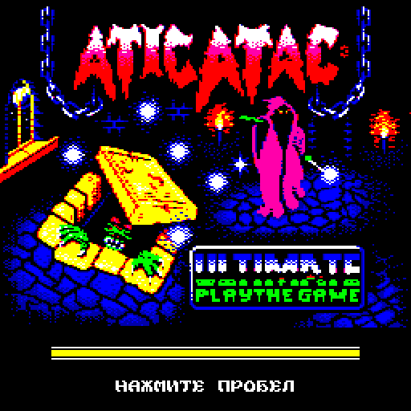
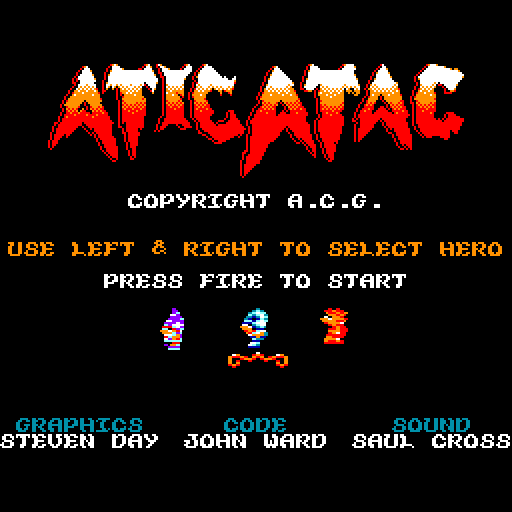
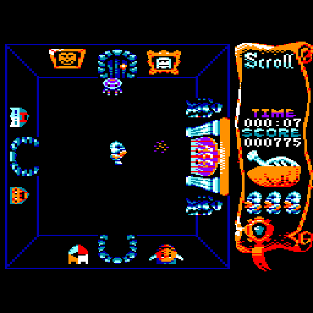
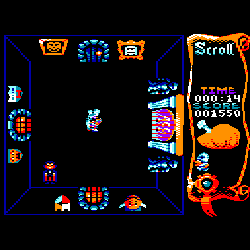

# Atic Atac

Порт приключенческой аркады Ultimate Play the Game, выпущенной в 1983 году для ZX Spectrum, по версии John Ward для Amstrad CPC. Герою предстоит исследовать замок, собирать предметы и найти выход.

Версия для Вектора-06Ц работает с 64 КБ ОЗУ, квазидиском 256 КБ и дисководом. Игра идёт с частотой 50 кадров в секунду. При наличии AY музыка и эффекты воспроизводятся через него, иначе — через ВИ53.

**Версия 0.9, бета:** игру можно пройти от меню до итогов, но не реализованы анимации появления и падения в люк, пауза, выход в меню и джойстик «П». Полное прохождение на реальном оборудовании не проверялось.

## Образ и запуск

[aticatac.fdd](aticatac.fdd) — загрузочная дискета МикроДОС на 820 КБ из [репозитория проекта](https://github.com/reqw41/aticatac-v06c/tree/2242bb2800df362c08abc05d03477485c7fb724a). Загрузка занимает около 23 секунд, после чего дискета больше не нужна.

- **Вектор-06Ц с НГМД / MiSTer:** подключить дискету и после появления штатного ПЗУ нажать БЛК+СБР (на MiSTer — Alt+F11).
- **Emu80:** `Emu80qt --platform vector --run aticatac.fdd`.
- **Вектор Турбо+:** при сбросе удерживать РУС/ЛАТ, выбрать `FDD 0`, затем `ATICATAC.COM` и дважды нажать ВК; либо из CP/M 4.0 запустить с дискеты A: команду `ATICATAC -V`.

На Турбо+ игра переключает машину в режим 06Ц и на 12 МГц. **Содержимое диска квазидиска CP/M будет потеряно:** игра использует квазидиск целиком.

## Управление

| Действие                | Клавиши      |
| ----------------------- | ------------ |
| Выбор героя в меню      | ← →          |
| Старт / огонь           | Пробел       |
| Движение                | Стрелки      |
| Взять / бросить предмет | Z или Я      |
| Бессмертие              | F1+F3 в меню |

## Скриншоты

## См. также

- [Knight Lore](../knight_lore/likhachev/) — другой порт игры Ultimate Play the Game от Бориса Лихачёва.
- [Alien 8](../alien_8/likhachev/) — порт другой игры Ultimate Play the Game.

Исходный код и подробности сборки — в [репозитории проекта](https://github.com/reqw41/aticatac-v06c). Оригинал — Ultimate Play the Game, 1983; версия для Amstrad CPC — John Ward; порт для Вектора-06Ц — Борис Лихачёв, 2026.
