# AY-3-8910: харьковский вариант

Трёхканальный музыкальный сопроцессор на AY-3-8910 для «Вектора-06Ц», разработанный харьковским центром «Тень» (описание Терентьева С.В., 1995 г.). В отличие от серийных решений плата не продавалась: по примечанию автора было выпущено небольшое количество плат, которые разошлись среди харьковских программистов, и одна плата была отправлена в г. Вышгород Кучеренко С.В. — автору газеты «Микро» и галереи картин Б. Вальехо для ПК «Вектор-06Ц» (1996–1997 гг.).

Материалы в каталоге — две вырезки из одного издания («ВЕКТОР-06Ц» — РЕКОНСТРУКЦИЯ, сплошная нумерация страниц 10–17). Первый файл содержит описание самого устройства, второй — практическую сборку платы и более позднее дополнение **Covox-D**. Это две разные реализации одного устройства (логика делителя частоты различается), поэтому сведения ниже разделены по версиям.

## Источники

| Файл                                 | Страницы | Содержание                                                                                                                                                                                                                                          | Автор                             |
| ------------------------------------ | -------- | --------------------------------------------------------------------------------------------------------------------------------------------------------------------------------------------------------------------------------------------------- | --------------------------------- |
| [Kharkov-AY-1.pdf](Kharkov-AY-1.pdf) | 10–12    | §1.5 «Программируемый генератор звука AY-3-8910 (харьковский вариант — центр „Тень“), плюс „Covox-D“»: принципиальная схема, делитель, перечень элементов, прошивка ПЗУ, печатная плата, схема Covox-D; в конце — начало §1.6 (посторонняя статья)  | Терентьев С.В., 1995 г.           |
| [Kharkov-AY-2.pdf](Kharkov-AY-2.pdf) | 15–17    | §1.7 «Домашнее задание: собрать плату „AY“ (харьковский вариант) и „Covox-D“ для ПК „Вектор-06Ц“»: односторонняя плата на К555ИЕ7, перемычки, разъёмы, питание, индикация, микшер Covox-D, технология изготовления платы; §1.8 — посторонняя статья | Демидов С.В.; §1.8 — В.П. Фиронов |

Оба файла — растровые сканы (600 dpi) страниц издания, собранные в PDF в Scribus в 2011 году; поверх сканов набран текстовый слой, который в местах обрыва колонок неполон. Все такие места отмечены в разделе «Замечания к источникам».

## Версия 1: схема с делителем на К555ТМ2 (Kharkov-AY-1)

### Состав и совместимость

Устройство построено на AY-3-8910 (или её аналоге YM2149F). Логика выполнена на ПЗУ КР556РТ4А — по формулировке источника «логика заменена микросхемой ПЗУ КР556РТ4А»; кроме неё задействована К555ЛА3. Делитель тактовой частоты собран на К555ТМ2 (рис. 2). Питание — от компьютера.

Автор указывает, что вариант (рис. 1) **полностью совместим** с «Sound-Tracker» В. Саттарова и с вариантом, опубликованным в журнале «Радиолюбитель» № 5 за 1995 год. Это заявление о совместимости по программному обеспечению и портам, а не утверждение об идентичности схем. Публикация 1995 года в «Радиолюбителе» № 5, имеющаяся в архиве, относится к [омскому варианту](../omsk/README.md); тождества этих схем источник прямо не утверждает.

### Принципиальная схема (рис. 1)

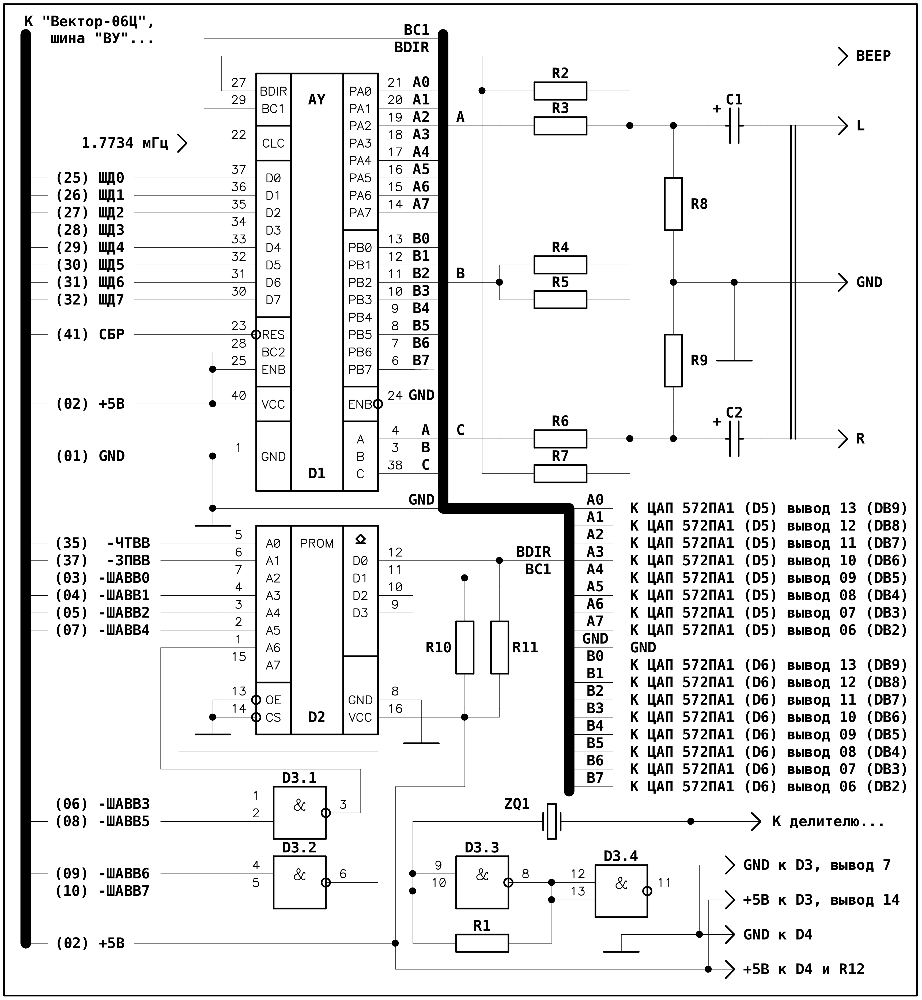

Схема озаглавлена «К „Вектор-06Ц“, шина „ВУ“»: плата подключается к шине «ВУ» компьютера. По читаемым на скане надписям линии ШД0–ШД7 заводятся на входы данных D0–D7 микросхемы AY-3-8910 (рядом с ними видны номера контактов 25–32), порты PA0–PA7 и PB0–PB3 выведены наружу, на тактовый вход (вывод 22) подаётся частота 1,7734 МГц с делителя. Часть подписей на скане читается неуверенно, поэтому назначение отдельных цепей следует проверять по самому рисунку.

Схема в архиве продублирована в низком разрешении: [AY1.jpg](AY1.jpg).

### Делитель частоты и перемычки (рис. 2)

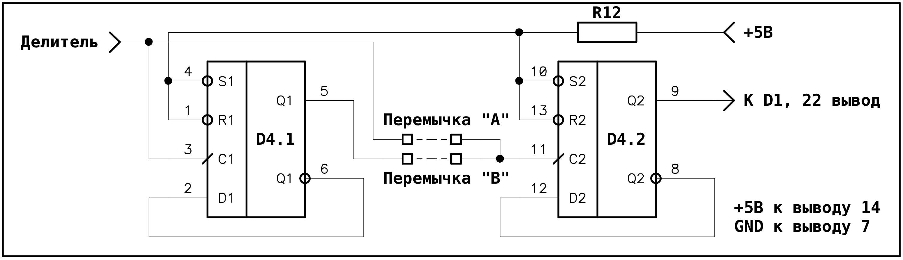

| Перемычка | Делитель | Кварц ZQ1 (по источнику) | Тактовая частота AY |
| --------- | -------- | ------------------------ | ------------------- |
| «А»       | на 2     | 3,5468 МГц               | 1,7734 МГц          |
| «В»       | на 4     | 7,0936 МГц               | 1,7734 МГц          |

Значения в последнем столбце — расчёт по приведённым в источнике частотам кварцев и коэффициентам деления; сам источник их не печатает. Отдельно автор замечает: «У меня стоял кварц на 3,58 МГц…» — то есть на практике применялся и кварц с отклонением от номинала, что даёт тактовую частоту около 1,79 МГц.

### Перечень элементов

| Позиция           | Наименование                                                      |
| ----------------- | ----------------------------------------------------------------- |
| D1                | AY-3-8910 (YM2149F)                                               |
| D2                | КР556РТ4А (ПЗУ, декоративная логика)                              |
| D3                | К555ЛА3                                                           |
| D4                | К555ТМ2 (делитель)                                                |
| R1, R10, R11, R12 | 470 Ом                                                            |
| R2, R7            | 4,7 кОм                                                           |
| R3, R6            | 5,1 кОм                                                           |
| R4, R5, R8, R9    | 10 кОм                                                            |
| C1, C2            | 10 мкФ × 16 В                                                     |
| ZQ1               | 3,5468 МГц (при делителе на 2) или 7,0936 МГц (при делителе на 4) |

### ПЗУ КР556РТ4А

Справочные сведения из описания:

- информационная ёмкость — 1024 бит, организация 256 слов × 4 разряда;
- время выборки адреса — не более 70 нс (при T = +25 °C);
- диапазон температур — от −10 до +70 °C;
- потребляемая мощность — не более 690 мВт;
- выход — открытый коллектор;
- совместимость с ТТЛ-схемами, корпус пластмассовый DIP-16;
- коэффициент программирования — не менее 0,9;
- начальное состояние соответствует логическому «0».

**Прошивка микросхемы ПЗУ D2 (КР556РТ4А).** В источнике приведена таблица 16 × 16: строка — старшая шестнадцатеричная цифра адреса, столбец — младшая, в клетке одна шестнадцатеричная цифра (4 бита данных). По тексту PDF все строки, кроме нулевой, заполнены нулями:

| Адрес \ Разряд | 0   | 1   | 2   | 3   | 4   | 5   | 6   | 7   | 8   | 9   | A   | B   | C   | D   | E   | F   |
| -------------- | --- | --- | --- | --- | --- | --- | --- | --- | --- | --- | --- | --- | --- | --- | --- | --- |
| 00             | 0   | 0   | 0   | 0   | 0   | 0   | 0   | 0   | 0   | 3   | 0   | 0   | 0   | 1   | 2   | 0   |
| 10 … F0        | 0   | 0   | 0   | 0   | 0   | 0   | 0   | 0   | 0   | 0   | 0   | 0   | 0   | 0   | 0   | 0   |

Единственные ненулевые значения — в адресах 09h (3), 0Dh (1) и 0Eh (2). Смысл этих кодов в тексте не расшифрован. Перед прошивкой микросхемы таблицу следует сверить с изображением таблицы в PDF: при извлечении текста возможна потеря части знаков.

Таблица истинности КР556РТ4А из описания (режим работы по входам `/CE`, `/CS`, где «M» — любая комбинация сигналов, кроме 00, «X» — безразличный уровень сигнала):

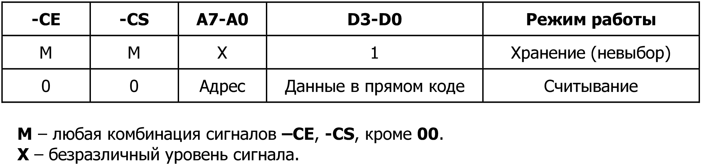

### Печатная плата

Рисунки приведены в описании как «рис. 3 (расположение элементов)», «рис. 4 (верх)» и «рис. 5 (низ)».

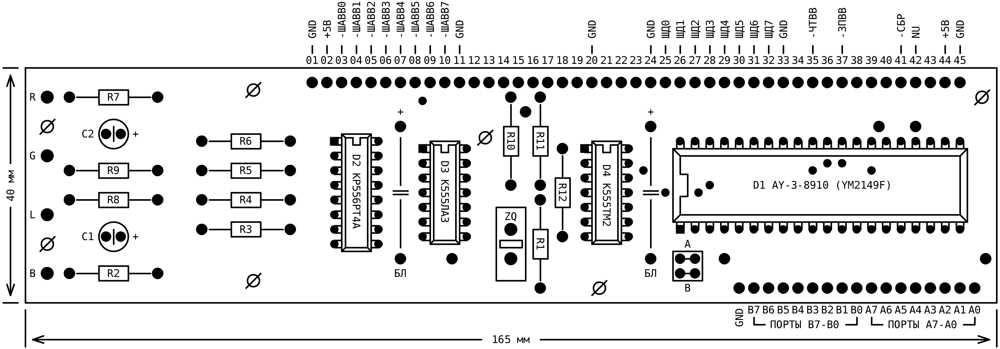

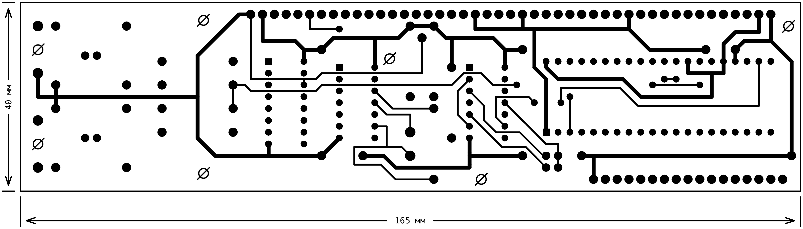

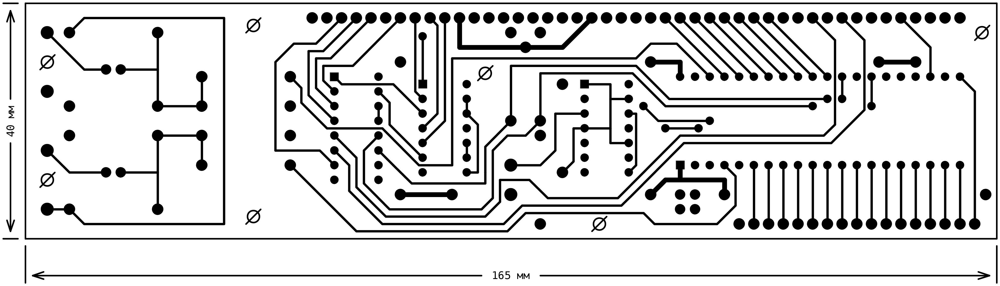

Примечание источника: чтобы получить зеркальное изображение платы, нужно распечатать страницу в файл с разрешением 600 dpi и отразить её в растровом редакторе (GIMP, Photoshop) инструментом «зеркало».

## Дополнение Covox-D

Цифроаналоговый тракт, которого в первоначальной схеме не было: подключение портов AY-3-8910 к ЦАП 572ПА1. Автор пишет, что использовал порты AY-3-8910 для подключения ЦАП позже, а идея заимствована из журнала «Радиолюбитель. Ваш компьютер» № 1 за 1996 год, стр. 18, статья «КОВОКСЫ — Из недр FIDONET». Для проигрывания wav-файлов применялась собственная программа автора «waveay».

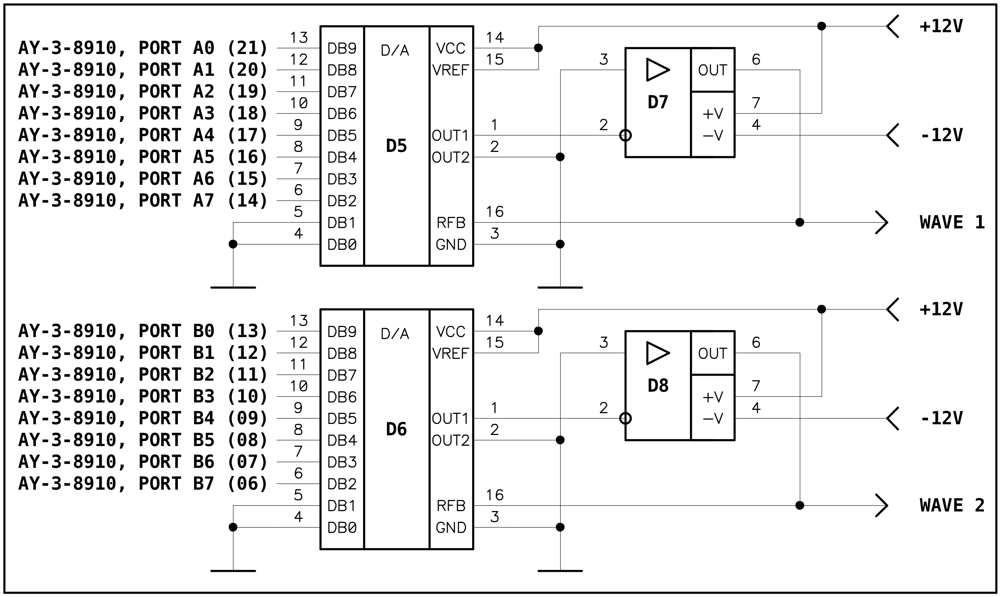

Элементы по описанию к рис. 6:

| Позиция | Наименование                                                                  |
| ------- | ----------------------------------------------------------------------------- |
| D5, D6  | КР572ПА1 (ЦАП)                                                                |
| D7, D8  | К140УД7 (операционный усилитель; автор предпочитает корпус DIP8 — КР140УД708) |

Два ЦАП и два операционных усилителя согласуются с двумя выходными каналами: в описании платы (второй файл) выходные сигналы обозначены как Wave 1 и Wave 2 (см. ниже раздел о разъёмах).

## Версия 2: плата «AY» + «Covox-D» на К555ИЕ7 (Kharkov-AY-2)

Практическая часть (Демидов С.В.) описывает ту же плату музыкального контроллера, но в другом исполнении: «Харьковский вариант» и «Covox-D» собраны на одностороннем текстолите (рис. 1, 2, 3). В качестве делителя частоты вместо К555ТМ2 применена микросхема К555ИЕ7 (D4); по указанию автора делитель ИЕ7 взят с [омского варианта](../omsk/README.md).

### Расположение элементов и печатная плата

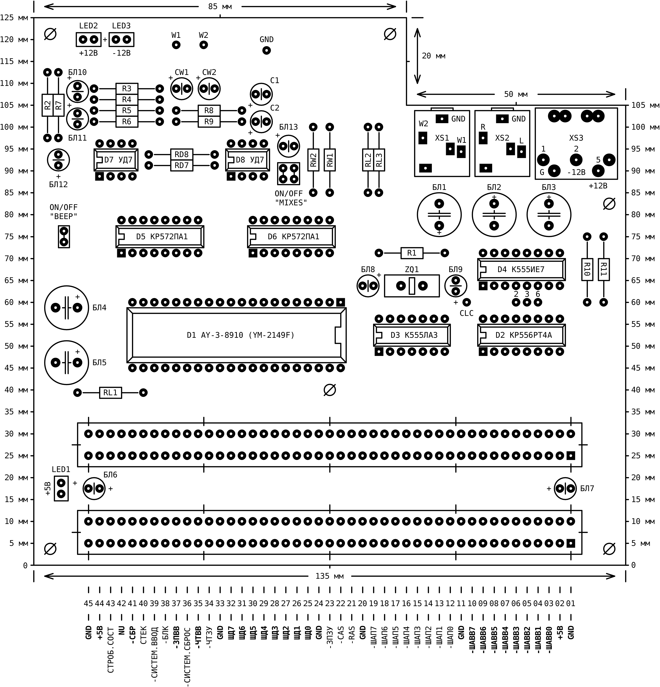

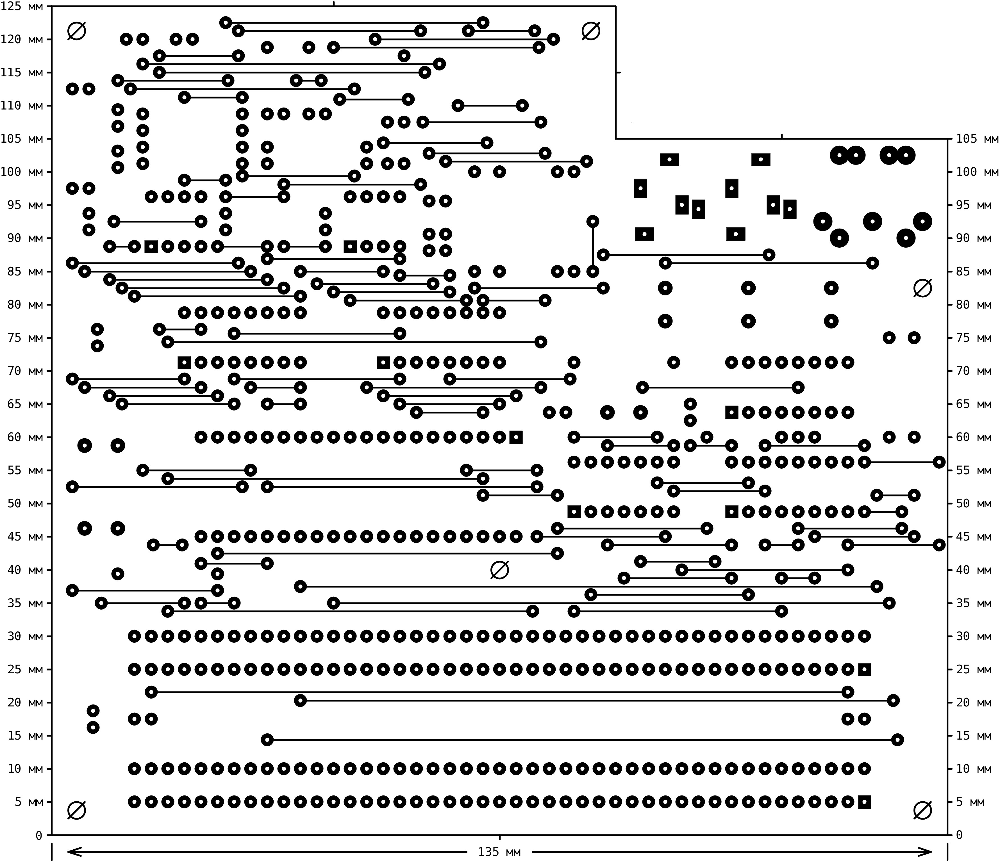

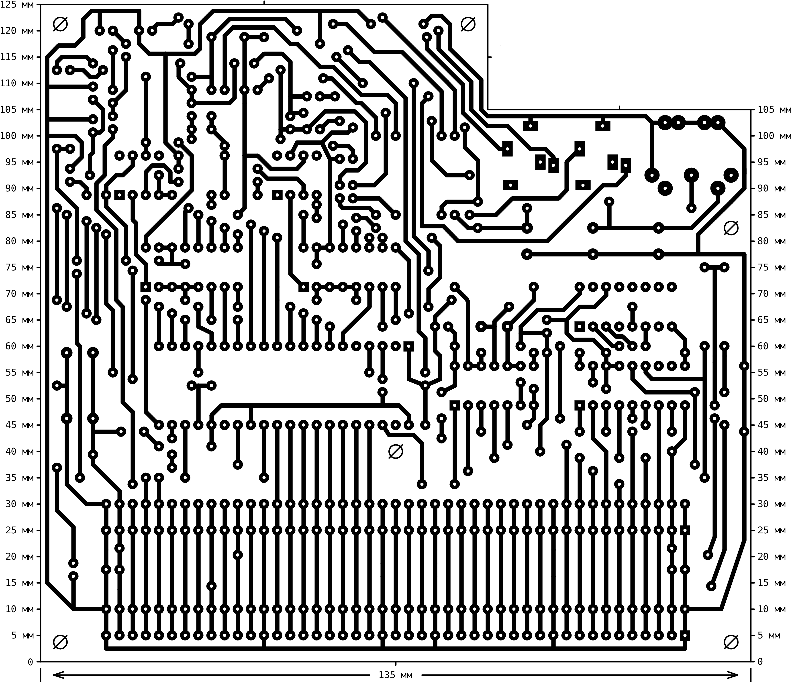

### Перемычки делителя на К555ИЕ7

На печатной плате возле ИЕ7 предусмотрены отверстия «CLC», «2», «3», «6». «CLC» — это вывод 22 микросхемы D1 (AY-3-8910), то есть её тактовый вход; «2», «3», «6» — выводы микросхемы D4 (К555ИЕ7).

| Перемычка | Делитель | Кварц ZQ1 (по источнику) | Тактовая частота AY |
| --------- | -------- | ------------------------ | ------------------- |
| CLC — 3   | на 2     | 3,5468 МГц               | 1,7734 МГц          |
| CLC — 2   | на 4     | 7,0936 МГц               | 1,7734 МГц          |
| CLC — 6   | на 8     | 14,1872 МГц              | 1,7734 МГц          |

Нумерация выводов 3, 2, 6 соответствует разрядам счётчика ИЕ7 (типовой аналог — 74193), что согласуется с указанными коэффициентами деления; прямо в тексте это соответствие не расписано. Значения тактовой частоты в последнем столбце — расчёт по данным источника.

### Разъёмы и питание

- **XS1** — сигналы W1 и W2 (Wave 1 и Wave 2); их можно подать на усилитель мощности, см. схему Covox-D.
- **XS2** — выход AY.
- **XS3** — разъём питания +12 В и −12 В (питание для Covox-D).

Плата музыкального контроллера запитывается от компьютера (+5 В). В скане эта фраза начинается с обрыва («…музыкального контроллера запитывается от компьютера (+5В)»), начало предложения утрачено при вёрстке/сканировании.

Блокировочные конденсаторы:

| Цепь питания | Позиции                      |
| ------------ | ---------------------------- |
| +5 В         | БЛ4, БЛ5, БЛ6, БЛ7, БЛ8, БЛ9 |
| +12 В        | БЛ2, БЛ3, БЛ12, БЛ13         |
| −12 В        | БЛ1, БЛ10, БЛ11              |

### Индикация и перемычка BEEP

- RL1 (200 Ом) ограничивает ток зелёного светодиода LED1 (+5 В).
- RL2 и RL3 (470 Ом) — на красные светодиоды LED2 и LED3 (+12 В и −12 В).
- Номиналы резисторов RL1, RL2, RL3 зависят от используемых светодиодов.
- Предусмотрена перемычка ON/OFF «BEEP».

Сохранившийся во втором файле фрагмент текста, начало которого утрачено: «…одной стороной заведена на R2 и R7, другой на 42-ой вывод разъема „ВУ“ (42-ой вывод свободный, к нему надо припаять сигнал с контакта „1“ магнитофоного разъема ПК)». По смыслу речь идёт о цепочке, связывающей сигнал BEEP с 42-м выводом разъёма «ВУ»; отнесение этой фразы именно к перемычке ON/OFF «BEEP» — реконструкция по соседству строк, а не явное утверждение источника.

### Микшер Covox-D (рис. 4)

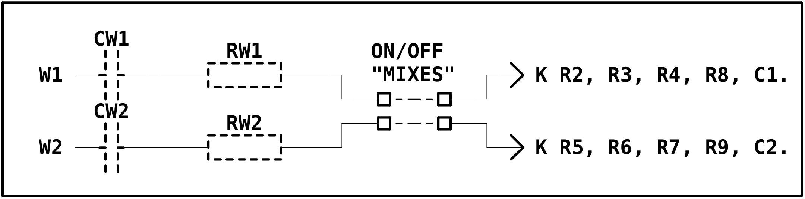

Конденсаторы CW1, CW2 и резисторы RW1, RW2 позволяют смикшировать сигнал от «Covox-D» на разъём AY-XS2 (рис. 4). Автор заключает: правильно собранная плата из исправных деталей начинает работать сразу.

### Изготовление платы

Примечание источника описывает лазерно-утюжную технологию: рисунок переносится на текстолит с термобумаги от факсимильного аппарата, обрезанной до формата A4 (сторону, которая темнеет, определяют нагретым утюгом по уголку листа), печать выполняется с максимальным контрастом; отпечаток прикладывают к фольге и гладят утюгом до равномерного просвечивания рисунка, дают остыть, вымачивают в тёплой воде 5–10 минут и скатывают бумагу пальцем, после чего травят в хлорном железе и сверлят. Для лучшего результата плату с термобумагой после просвечивания помещают в воду на 25–35 секунд и снова проглаживают — эффект «паровой бани», при котором тонер прикипает к фольге и отстаёт от бумаги.

## Программное обеспечение и применение

- Совместимость с «Sound-Tracker» В. Саттарова (см. [вариант Саттарова](../sattarov/README.md)).
- Совместимость с вариантом из «Радиолюбителя» № 5 за 1995 год.
- Для проигрывания wav-файлов через дополнение Covox-D автор использовал собственную программу «waveay».
- Автор отдельно отмечает демонстрационные программы, в которых музыка сочеталась с анимацией: `lyra4.rom` («танцующая девушка под музыку», авторы Виктор Саттаров, VS SOFTWARE, и Сергей Меринов, FMSSOFT) и `spiral.rom` (автор неизвестен).

## Сравнение двух версий

| Параметр           | Версия из Kharkov-AY-1                                          | Версия из Kharkov-AY-2                                                                 |
| ------------------ | --------------------------------------------------------------- | -------------------------------------------------------------------------------------- |
| Делитель частоты   | К555ТМ2 (D4)                                                    | К555ИЕ7 (D4), «с омского варианта»                                                     |
| Выбор коэффициента | перемычки «А» (÷2) и «В» (÷4)                                   | перемычки CLC–3 (÷2), CLC–2 (÷4), CLC–6 (÷8)                                           |
| Кварцы             | 3,5468 МГц (÷2) или 7,0936 МГц (÷4)                             | 3,5468 МГц (÷2), 7,0936 МГц (÷4) или 14,1872 МГц (÷8)                                  |
| Логика             | ПЗУ КР556РТ4А + К555ЛА3                                         | те же позиции (D1–D3); перечень элементов не повторяется                               |
| Плата              | рис. 3–5, сторона расположения элементов и две стороны печати   | односторонний текстолит, рис. 1–3, указаны разъёмы XS1–XS3 и индикация                 |
| Covox-D            | схема рис. 6 (КР572ПА1 ×2, К140УД7 ×2), подключение к портам AY | отдельно описаны разъёмы Wave 1/2, питание ±12 В и микшер CW1, CW2, RW1, RW2 на AY-XS2 |

## Соседние материалы в тех же файлах (к устройству не относятся)

| Материал                                                                                                                                                                                                                                                                                                                                                                                         | Где                          |
| ------------------------------------------------------------------------------------------------------------------------------------------------------------------------------------------------------------------------------------------------------------------------------------------------------------------------------------------------------------------------------------------------ | ---------------------------- |
| §1.6 «Ковоксы — из недр FIDONET» («Радиолюбитель. Ваш компьютер» № 1/1996) — обзор «ковоксов»: описание устройства, предложенного фирмой COVOX под названием «Spech Thing», наборы R-2R (Madis Kaal, Эстония, 2:490/30) и R-2R-4R (А. Заболотный, Кишинёв, 2:469/36.20), драйверы последнего автора для частичной эмуляции Sound Blaster и синтезатора TI SN76496N; в файле только начало статьи | Kharkov-AY-1.pdf, стр. 12    |
| Программа `Sound_Digitizer` на Turbo Pascal 4.0/5.0 для 12 МГц AT, (C) Tomi Engdahl (Клауккала, Финляндия), и примечание к рис. 5 об АЦП ADC0809 (тактовая частота 2,9 МГц против 10 кГц–1280 кГц по документации; выводы 9 OE, 22 ALE, 6 START в оригинальной схеме не подключены), об ОУ К1401УД1 (четверной, DIP-14, аналог LM2900/LM3900)                                                    | Kharkov-AY-2.pdf, стр. 15    |
| §1.7 — сборка платы «AY» и «Covox-D» (Демидов С.В.)                                                                                                                                                                                                                                                                                                                                              | Kharkov-AY-2.pdf, стр. 15–17 |
| §1.8 «Упрощённые схемы ковокса для ПК „Вектор-06Ц“» В.П. Фиронова (Москва), опубликовано в «ВЕКТОР-USER», № 16, стр. 2: схема на К555ЛА3 (R1 = 1,1 кОм, R2 = 2,2 кОм; соотношение в два раза, допустимо 0,5–10 кОм), выводы 2, 5, 10, 13 могут быть управляющими при соединении вместе; упрощённая схема без микросхем, с худшим качеством; рекомендация собирать схему на К572ПА1               | Kharkov-AY-2.pdf, стр. 17    |
| Хвост предыдущей статьи издания: о замене КР580ВМ80А на Z80, благодарности (О. Филатов, Минск; О. Бутович, Борисов; Г. Луппов, Киров), литература «AY-3-8910 и AY-3-8912. Краткое руководство. ASTER.SOFT Ltd., 1993»                                                                                                                                                                            | Kharkov-AY-1.pdf, стр. 10    |

## Файлы каталога

| Файл                                                                 | Что это                                                              |
| -------------------------------------------------------------------- | -------------------------------------------------------------------- |
| [Kharkov-AY-1.pdf](Kharkov-AY-1.pdf)                                 | Скан стр. 10–12 издания: описание устройства (Терентьев С.В., 1995)  |
| [Kharkov-AY-2.pdf](Kharkov-AY-2.pdf)                                 | Скан стр. 15–17: сборка платы и Covox-D (Демидов С.В.), а также §1.8 |
| [AY1.jpg](AY1.jpg)                                                   | Растровое изображение схемы в низком разрешении                      |
| [ay1-fig1-shema.png](ay1-fig1-shema.png)                             | Рис. 1 — принципиальная схема (600 dpi)                              |
| [ay1-fig2-delitel.png](ay1-fig2-delitel.png)                         | Рис. 2 — делитель на К555ТМ2, перемычки «А»/«В»                      |
| [ay1-fig3-plata-raspolozhenie.png](ay1-fig3-plata-raspolozhenie.png) | Рис. 3 — расположение элементов на плате                             |
| [ay1-fig4-plata-verh.png](ay1-fig4-plata-verh.png)                   | Рис. 4 — верх печатной платы                                         |
| [ay1-fig5-plata-niz.png](ay1-fig5-plata-niz.png)                     | Рис. 5 — низ печатной платы                                          |
| [ay1-fig6-covox-d.png](ay1-fig6-covox-d.png)                         | Рис. 6 — схема «Covox-D» для ПК «Вектор-06Ц»                         |
| [ay1-rt4-tablica.png](ay1-rt4-tablica.png)                           | Таблица истинности КР556РТ4А                                         |
| [ay2-fig1-plata-raspolozhenie.png](ay2-fig1-plata-raspolozhenie.png) | Рис. 1 — расположение элементов платы «AY» и «Covox-D»               |
| [ay2-fig2-plata-verh.png](ay2-fig2-plata-verh.png)                   | Рис. 2 — верх платы версии на К555ИЕ7                                |
| [ay2-fig3-plata-niz.png](ay2-fig3-plata-niz.png)                     | Рис. 3 — низ платы версии на К555ИЕ7                                 |
| [ay2-fig4-miksher.png](ay2-fig4-miksher.png)                         | Рис. 4 — микшер Covox-D на разъём AY-XS2                             |

Все PNG-файлы извлечены из PDF без пересжатия, в исходном разрешении 600 dpi; подписи рисунков сопоставлены с изображениями по координатам подписей в PDF. На стр. 17 второго файла есть ещё одно растровое изображение без подписи — оно осталось только в PDF.

## Замечания к источникам

- Прошивка ПЗУ восстановлена по тексту PDF: по нему заполнена только строка адресов 00h (значения 3, 1, 2 в адресах 09h, 0Dh, 0Eh), остальные строки нулевые. Смысл кодов и полнота таблицы в тексте не подтверждаются — перед прошивкой сверяйтесь с PDF.
- В Kharkov-AY-2.pdf утрачены начала нескольких фраз (обрыв колонки при вёрстке): о питании платы и о цепи «…одной стороной заведена на R2 и R7…». Реконструкция отнесения второй фразы к перемычке BEEP помечена в тексте.
- Часть страниц издания в каталоге отсутствует: продолжение §1.6 находится на стр. 13–14, которых в файлах нет; стр. 16 второго файла содержит только примечание и рисунки платы.
- Номер выпуска и год издания в файлах не указаны — известны только номера страниц (10–17) и даты в подписях авторов (1995 г.); упоминание событий 1996–1997 гг. означает, что издание вышло не ранее 1997 года.
- Раздел «1.5» первого файла и разделы «1.7»/«1.8» второго относятся к разным авторам и разным реализациям; схемы и перечни элементов между версиями не смешивались.
- Описание подключения по рис. 1 (ШД0–ШД7 → D0–D7, порты PA/PB, частота 1,7734 МГц) составлено по надписям, распознанным на скане; отдельные подписи читаются неуверенно.

## Другие варианты

- [Омский вариант](../omsk/README.md) — «Вектор-06Ц» и «Криста-2», публикация в «Радиолюбителе» № 5 за 1995 год; его делитель на ИЕ7 использован в версии из Kharkov-AY-2.
- [R-SOUND Костиневича](../kostinevich/README.md)
- [Вариант Саттарова](../sattarov/README.md) — совместимость с его «Sound-Tracker» заявлена в описании.
