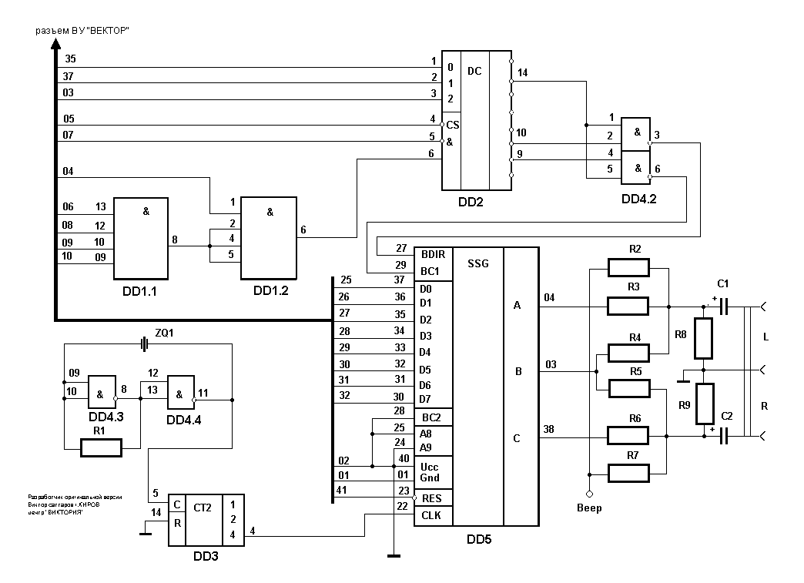

# Музыкальный сопроцессор: омский вариант

Трёхканальный стереофонический музыкальный сопроцессор на AY-3-8910 для персональных ЭВМ «Вектор-06Ц» и «Криста-2». Схема установки разработана в 1994 году в кировском центре «Байт», а описанный здесь вариант выполнен В.А. Шашковым (Омск, Spase Corporation) как полный функциональный аналог сопроцессора В. Саттарова (центр «Виктория», г. Киров).

В каталоге — два документа разного происхождения и одна заметка о доработке:

- автономное описание 1994 года со схемой и перечнем элементов ([Omsk-AY-1994.pdf](Omsk-AY-1994.pdf));
- публикация того же устройства в журнале «Радиолюбитель» № 5 за 1995 год, с. 11 ([RL-1995-05-11.pdf](RL-1995-05-11.pdf));
- страница «Вектор-USER» № 26-27 о несовместимости омской и кировской версий ([VU_26-27.jpg](VU_26-27.jpg)).

Материалы не смешиваются: сведения ниже разделены по документам, отличия и расхождения отмечены.

## Материалы

| Файл                                   | Что это                                                                                                                                                                                        |
| -------------------------------------- | ---------------------------------------------------------------------------------------------------------------------------------------------------------------------------------------------- |
| [Omsk-AY-1994.pdf](Omsk-AY-1994.pdf)   | Описание «Музыкальный стереофонический трехканальный сопроцессор для персональных ЭВМ „ВЕКТОР-06ц“ и „КРИСТА-2“. Омск, 1994. Spase Corporation»: схема, перечень элементов, указания по сборке |
| [RL-1995-05-11.pdf](RL-1995-05-11.pdf) | Скан страницы «Радиолюбителя» № 5 за 1995 год (с. 11): статья В. Шашкова с тем же устройством и таблицей распайки разъёма для «Кристы-2»                                                       |
| [VU_26-27.jpg](VU_26-27.jpg)           | Страница «Вектор-USER» № 26-27 (август 1995, дата оценочная): заметка Вячеслава Шашкова о доработке омской платы                                                                               |
| [ay-omsk-shema.png](ay-omsk-shema.png) | Принципиальная схема, извлечённая из Omsk-AY-1994.pdf без пересжатия (растровое изображение 1044 × 757)                                                                                        |
| [ay_omsk.jpg](ay_omsk.jpg)             | Та же схема в низком разрешении (384 × 288) — уменьшенная копия изображения из PDF                                                                                                             |
| [plata.jpg](plata.jpg)                 | Фотография печатной платы (1347 × 395)                                                                                                                                                         |
| [ay_omsk.zip](ay_omsk.zip)             | Исходный архив (664 КБ) с четырьмя файлами под исходными именами: `Музыкальный сопроцессор для ПЭВМ Вектор-06Ц и Криста-2.pdf`, `1995-05-11.pdf`, `plata.jpg`, `VU_26-27.jpg`                  |

## Описание устройства (Омск, 1994, Spase Corporation)

Текст перечня элементов и указаний взят из текстового слоя PDF; принципиальная схема в нём — растровое изображение (1-битный растр 152 dpi), оно вынесено в [ay-omsk-shema.png](ay-omsk-shema.png).

### Перечень элементов

| Позиция | Тип                 | Позиция | Номинал |
| ------- | ------------------- | ------- | ------- |
| DD1     | К555ЛИ6             | R1      | 330 Ом  |
| DD2     | К555ИД7             | R2      | 4,7 кОм |
| DD3     | К555ИЕ7             | R3      | 5,1 кОм |
| DD4     | К555ЛА3             | R4      | 10 кОм  |
| DD5     | AY-3-8910           | R5      | 10 кОм  |
| ZQ1     | 14 000 кГц          | R6      | 5,1 кОм |
| C1, C2  | 10,0 × 10 (мкФ × В) | R7      | 4,7 кОм |
|         |                     | R8      | 10 кОм  |
|         |                     | R9      | 10 кОм  |

В перечне источника номиналы резисторов записаны как `R2 – 4,7k`, `R3 - 5,1k` и т. д.; ёмкость конденсаторов — `C1C2 - 10,0x10`.

### Указания по сборке

Приводятся дословно по источнику:

- Напряжение питания DD1–DD4 прикладывается к выводам с максимальным номером, а общий провод — к выводам с вдвое меньшим номером. Желательно установить один-два блокировочных конденсатора.
- Допустима замена микросхем на м/с серии 155, 1533, 1531. Вместо DD1 можно применить К555ЛА1, в этом случае вывод 1 можно не подключать.
- В точку «Beep» подаётся сигнал с контакта «1» разъёма «Магнитофон» компьютера.
- Данная схема является полным функциональным аналогом сопроцессора, разработанного Саттаровым Виктором (г. Киров). О программировании его Вы можете прочитать в информационных выпусках «БАЙТ» 17, 23.

### Принципиальная схема



На чертеже есть заголовок «разъем ВУ „ВЕКТОР“», то есть подключение идёт к разъёму внешних устройств компьютера. По читаемым подписям: дешифратор портов DD2 К555ИД7, логика выбора на DD1 К555ЛИ6 и DD4 К555ЛА3, задающий генератор ZQ1 14 МГц со счётчиком К555ИЕ7, микросхема DD5 AY-3-8910 с шиной данных D0–D7 и сигналами управления BDIR/BC1, резисторная матрица R2–R7 с цепями R8, R9 и конденсаторами C1, C2 на выходах каналов A/B/C, формирующая стереовыходы, и вход BEEP. На поле чертежа есть пояснительная подпись со ссылкой на кировскую оригинальную версию (В. Саттаров, центр «Виктория»); она читается неуверенно и здесь не цитируется.

Часть подписей на растре неразборчива — назначение отдельных цепей следует проверять по самому изображению. Тот же рисунок в уменьшенном виде: [ay_omsk.jpg](ay_omsk.jpg).

### Программирование

Номер регистра AY заносится в порт `15h`, обмен данными идёт через порт `14h`. Набор из 16 регистров, их назначение и формулы расчёта частот приведены в описании [варианта Саттарова](../sattarov/README.md).

### Тактирование

Кварц ZQ1 — 14 МГц, счётчик К555ИЕ7. Коэффициент деления в перечне и указаниях не напечатан; при делении на 8 получается тактовая частота AY 1,75 МГц. Делитель на К555ИЕ7 с делением на 8 применён в кировской схеме, и, по указанию автора харьковской платы, делитель на ИЕ7 взят именно с омского варианта (см. [харьковский вариант](../kharkov/README.md)). Для сравнения: в описании Саттарова указана частота 1,7734 МГц, то есть расхождение с 1,75 МГц около 1,3 %.

## Публикация в «Радиолюбителе» № 5 за 1995 год

Страница 11 журнала. Скан не имеет текстового слоя; текст ниже восстановлен распознаванием и сверен с расшифровкой той же страницы в разделе [«Радиолюбитель», 1995, № 5, с. 11](../../radiolubitel/rl/1995_05_p11/README.md), где она приведена полностью.

### Текст статьи

> В 1994 г. в Кировском центре «Байт» была разработана схема установки в «Вектор-06Ц» музыкального сопроцессора AY-8910, применяемого в ПК типа «Sinclair-128». Подобной разработке и посвящены эти строки.
>
> Микросхема AY-3-8910 — это специально разработанная для синтеза звука микросхема. Она имеет три независимых канала, каждый из которых может синтезировать тональный сигнал с регулируемой амплитудой и огибающей и/или шум.
>
> Пассивным микшером формируется стереофонический сигнал. Приведённая схема является полным функциональным аналогом сопроцессора, разработанного В. Саттаровым (г. Киров). О программировании его можно прочитать в информационных выпусках «Байт» №№ 17 и 23, издаваемых центром «Байт» в г. Кирове.
>
> Чтобы записать/прочитать какой-либо регистр AY, его номер заносится в порт 15h, обмен данными происходит через порт 14h.

**Наладка схемы.** Правильно собранный из исправных деталей сопроцессор начинает работать сразу. Изредка приходится подбирать резистор R1 (220…470 Ом) для обеспечения устойчивой генерации (на выводе 11 DD4 должны присутствовать колебания частотой 14 МГц). В точку BEEP подаётся сигнал с контакта «1» магнитофонного разъёма ПК.

На схеме не показаны блокировочные конденсаторы. Желательно установить один-два конденсатора ёмкостью 0,47…0,1 мкФ.

Владельцы ПК «Криста-2» должны распаять разъём в соответствии с таблицей.

Схема в журнале повторена отдельным рисунком (дешифратор портов DD2 К555ИД7, логика выбора DD1 К555ЛИ6 и DD4 К555ЛА3, генератор ZQ1 14 МГц, счётчик К555ИЕ7, AY-3-8910 DD5 с шиной D0–D7 и адресными линиями A8/A9, матрица R2–R7 и цепи R8/R9 с C1/C2 на выходах каналов A/B/C — стереовыходы L и R, выход BEEP); изображение — в каталоге публикации.

### Соответствие сигналов на разъёмах «Криста-2» и «Вектор-06Ц»

| Вектор | 01  | 02  | 03  | 04  | 05  | 06  | 07  | 08  | 09  | 10  | 11  | 12  | 13  | 14  | 15  | 16  | 17  | 18  | 19  | 20  | 21  | 22  | 23  |
| ------ | --- | --- | --- | --- | --- | --- | --- | --- | --- | --- | --- | --- | --- | --- | --- | --- | --- | --- | --- | --- | --- | --- | --- |
| Криста | 38  | 39  | 37  | 36  | 35  | 34  | 33  | 32  | 31  | 30  | 38  | 26  | 22  | 24  | 27  | 25  | 23  | 29  | 09  | 38  | 03  | 21  | 28  |

| Вектор | 24  | 25  | 26  | 27  | 28  | 29  | 30  | 31  | 32  | 33  | 34  | 35  | 36  | 37  | 38  | 39  | 40  | 41  | 42  | 43  | 44  | 45  |
| ------ | --- | --- | --- | --- | --- | --- | --- | --- | --- | --- | --- | --- | --- | --- | --- | --- | --- | --- | --- | --- | --- | --- |
| Криста | 38  | 15  | 13  | 11  | 10  | 12  | 14  | 16  | 17  | 38  | 19  | 05  | 20  | 01  | 08  | 18  | 07  | 04  | 38  | 06  | 39  | 38  |

Номера выводов приведены как в источнике — двузначными числами (в том числе с ведущим нулём: `09`, `05`, `01`, `08`, `07`, `04`, `06`, `03`). Перед распайкой таблицу следует сверить со сканом страницы.

### Заметка об издании и авторе

Заметка прислана В.П. Фироновым (117335, г. Москва, а/я 101, тел. (095) 128-73-18) — издателем информационных выпусков «ВЕКТОР-USER», а также каталогов программного обеспечения ПК «Вектор-06Ц».

В. ШАШКОВ, г. Омск.

### Соседний материал на той же полосе

В нижней части страницы напечатана не относящаяся к «Вектору-06Ц» поправка к статье «Программатор ПЗУ К155РЕ3 и К556РТ4» («Радиолюбитель» № 12 за 1994 год, с. 6–8) с указанием опечаток в схеме и программе; подпись — читатель из г. Верхнедвинска (в расшифровке страницы поправка отмечена как нерасшифрованная). К музыкальному сопроцессору она отношения не имеет и здесь не приводится.

## Совместимость с кировским вариантом и доработка

Страница «Вектор-USER» № 26-27 (заметка Вячеслава Шашкова, г. Омск). Текст заметки:

> Кировская и Омская версии «музыкалки» (совместимость)
>
> Обнаружена маленькая несовместимость между Омским и Кировским вариантами схем музыкального сопроцессора AY8910. Заключается она в том, что в Омском варианте чтение регистров AY8910 возможно только через порт 15h, как это и документировано. А в Кировской версии возможно чтение и через порт 14h, что не документировано. Из-за этого на Омской плате не работают, например, индикаторы в программах MAN и INDIANA. Устранить дефект можно следующим:
>
> 1. Перерезать дорожку между выводом 9 м/схемы ИД7 (Д2) и выводом 4 м/схемы ЛА4 (Д4).
> 2. Далее соорудить вот такой монтаж:
>
> ```
> к 9/ИД7  <----|>|----+---[резистор]---> к 4/ЛА4
> ```
>
> Диоды любые (Д9, кд522 и т.п.), резистор 1…10 ком.

Заметка дублируется в расшифровке выпуска: [«Вектор-USER» № 26-27](../../vector_user/26-27/README.md), раздел «Кировская и Омская версии „музыкалки“».

Доработка меняет дешифрацию портов: последовательно с цепью выбора включается диод и резистор, из-за чего чтение регистров разрешается и по адресу `14h`, как в кировской версии. В заметке микросхема названа «ЛА4 (Д4)», тогда как в перечне элементов омского варианта стоит К555ЛА3 (DD4) — при доработке следует исходить из обозначений на конкретной плате.

## Файлы каталога

| Файл                                   | Что это                                                                                         |
| -------------------------------------- | ----------------------------------------------------------------------------------------------- |
| [Omsk-AY-1994.pdf](Omsk-AY-1994.pdf)   | Описание устройства, 1 страница A4: заголовок, перечень элементов, указания, схема              |
| [RL-1995-05-11.pdf](RL-1995-05-11.pdf) | Скан страницы журнала, 1 страница A4: статья, схема, таблица распайки, поправка к другой статье |
| [VU_26-27.jpg](VU_26-27.jpg)           | Страница «Вектор-USER» с заметкой о совместимости и схемой доработки                            |
| [ay-omsk-shema.png](ay-omsk-shema.png) | Принципиальная схема из PDF, исходное разрешение 1044 × 757, без пересжатия                     |
| [ay_omsk.jpg](ay_omsk.jpg)             | Уменьшенная копия той же схемы (384 × 288)                                                      |
| [plata.jpg](plata.jpg)                 | Фотография печатной платы                                                                       |
| [ay_omsk.zip](ay_omsk.zip)             | Исходный архив с четырьмя файлами                                                               |

## Замечания к источникам

- Описание 1994 года — единственный документ каталога с настоящим текстовым слоем: перечень элементов и указания прочитаны из PDF без распознавания, разночтений нет. Принципиальная схема в нём — отдельное растровое изображение; оно извлечено в [ay-omsk-shema.png](ay-omsk-shema.png) без пересжатия. Файл [ay_omsk.jpg](ay_omsk.jpg) — не фотография платы, как можно было бы предположить по имени, а уменьшенная копия этого же чертежа (сравнение изображений даёт совпадение структуры).
- Страница «Радиолюбителя» — скан без текстового слоя (растровое изображение 300 dpi внутри PDF). Текст восстановлен распознаванием; там, где шестнадцатеричная приставка `h` пропечатана неотчётливо, значения сверены с расшифровкой страницы в разделе «Радиолюбитель» и с описанием варианта Саттарова (порты `15h` и `14h`).
- В тексте наладки обеих журнальных публикаций указано «на выводе 11 DD4», хотя в перечне элементов омского описания AY-3-8910 — это DD5. Расхождение в обозначениях присутствует в самих источниках; номер вывода (11) в них совпадает.
- Ёмкость блокировочных конденсаторов напечатана как «0,47…0,1 мкФ» — диапазон в источнике убывающий; вероятна опечатка набора (обычно 0,047…0,1 мкФ), но в тексте оставлено как напечатано.
- Таблица распайки разъёмов ведёт происхождение от «Кристы-2» и «Вектора-06Ц»; при распознавании скана значения сверялись по отдельным клеткам и совпали с расшифровкой страницы. Тем не менее перед распайкой разъёма её следует проверить по изображению страницы: ошибка в номере вывода может привести к повреждению платы.
- Заметка «Вектор-USER» сохранилась только как изображение (JPG 484 × 392) без текстового слоя; её текст приведён по расшифровке выпуска, где указан автор «Вячеслав Мащков» (в других материалах — Шашков Вячеслав, Омск).
- В PDF-описании метаданные: автор «Tim0xA», создан 26.10.2008 в PDFCreator. Скан журнальной страницы: автор «Alex», создан 12.11.2008, исходный файл — `G--PROJECTS-V06C-LITERA-1995-05-11.tif`.
- Фотография [plata.jpg](plata.jpg) не содержит читаемых надписей; это снимок платы, а не чертёж.

## Другие варианты

- [Вариант Саттарова](../sattarov/README.md) — кировская разработка, функциональным аналогом которой является омская схема.
- [Харьковский вариант](../kharkov/README.md) — делитель на К555ИЕ7 в нём взят с омской платы.
- [R-SOUND Костиневича](../kostinevich/README.md)
