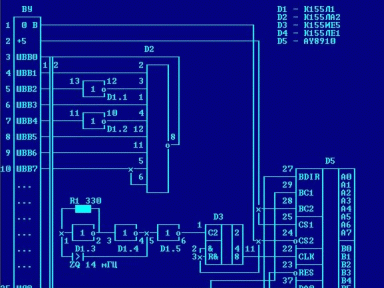

# AY-3-8910: вариант Саттарова

Музыкальный стереосопроцессор для «Вектора-06Ц», разработанный В. Саттаровым и представленный кировским компьютерным центром «Виктория». В числе применений автор указывает адаптацию музыки с ZX-Spectrum 128.

## Материалы

- [Архив оригинального описания и изображения схемы](ay8919sat.zip). Текст `ay8910.txt` в архиве записан в Windows-1251.

## Характеристики по оригинальному описанию

- Три независимых музыкальных канала и генератор белого шума.
- Два или один параллельный порт ввода-вывода.
- 16 градаций амплитуды и 16 форм огибающей.
- Основная частота — 1,7734 МГц; диапазон воспроизводимых частот — 27 Гц – 110 кГц.
- Частота огибающей — 0,1 Гц – 6 кГц; частота генератора шума — 3–110 кГц.

## Программирование

В описании указаны 16 внутренних регистров. Номер регистра задаётся четырьмя младшими битами и сохраняется до следующей команды фиксации адреса. Для этого варианта `OUT 15h` задаёт номер регистра, а `OUT 14h` — его значение.

| Регистры | Назначение по описанию                        |
| -------- | --------------------------------------------- |
| 0, 2, 4  | Младшие восемь бит частоты каналов A, B, C    |
| 1, 3, 5  | Старшие четыре бита частоты каналов A, B, C   |
| 6        | Частота генератора шума                       |
| 7        | Управление тоном, шумом и направлением портов |
| 8, 9, 10 | Амплитуда каналов A, B, C                     |
| 11, 12   | Младший и старший байты периода огибающей     |
| 13       | Форма огибающей                               |
| 14, 15   | Порты ввода-вывода                            |

В регистре 7 биты 0–2 управляют тоном каналов A–C, биты 3–5 — шумом каналов A–C: ноль включает соответствующий сигнал, единица выключает. Биты 6–7 управляют направлением портов A и B; единица означает вывод.

Оригинальный текст содержит формулы и таблицу форм огибающей, но в нём есть неоднозначности: например, указаны основная частота 1,7734 МГц и множитель 1 625 000 в формулах, а в строке амплитуды назван регистр 0 вместо 8. Для точного воспроизведения сведений см. исходный текст в архиве.

## Другие варианты

- [Омский сопроцессор](../omsk/README.md)
- [R-SOUND Костиневича](../kostinevich/README.md)
