Версии Бейсика для «Вектора-06Ц» (ПЗУ, дисковые, модификации) и документация по языку.

- [Дисковый Бейсик в1.1 (CPM7991)](1.1_disk)
- [Basic v(1.3) Color](1.3)
- [Basic v(2.5)](2.5)
- [Дисковая (RDS) версия «Бейсик v2.5»](2.5_disk)
- [BASIC 2.6 для 580ВМ1](2.6_wm1)
- [BASIC 2.891](2.891)
- [BASIC 2.997 для Вектора-06Ц](2.997)
- [Особенности Бейсика ПК-6128Ц](6128_manual)
- [BASIC КОРВЕТ в.1 МикроДОС](korvet)
- [BASIC КОРВЕТ в.1 МикроДОС](korvet_disk)
- [Basic M](m)
- [БЕЙСИК. Описание языка](manual)
- [Basic ПО «Сигнал»](signal)
- [Самоучитель Бейсика](tutorial)

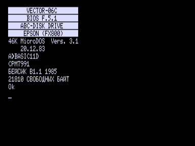

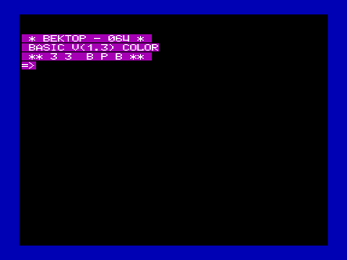

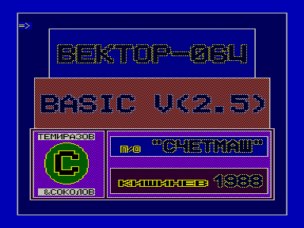

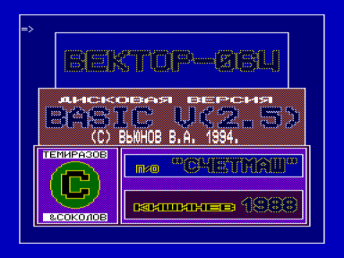

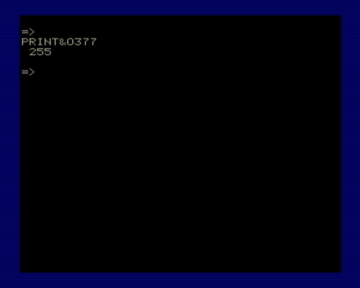

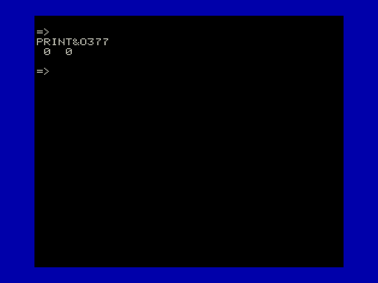

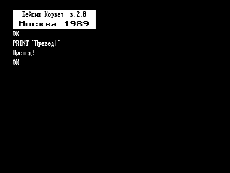

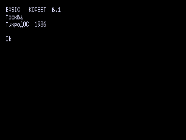

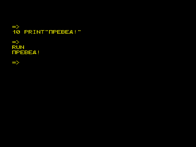

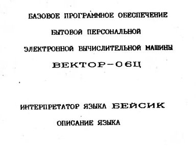

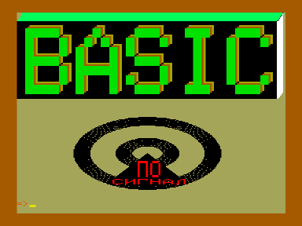

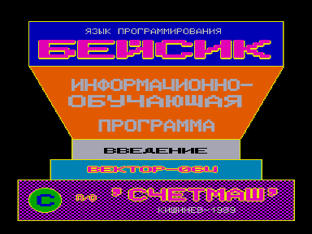
