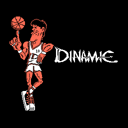
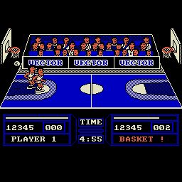

# Fernando Martín Basket Master

Порт баскетбольной игры Dinamic Software, выпущенной в 1987 году. Игровая логика перенесена с версии MSX Executive, а графика, музыка и эффекты — с Amstrad CPC. Порт Бориса Лихачёва работает на Векторе-06Ц с КР580ВМ80А и 64 КБ памяти, без квазидиска; звук воспроизводится на ВИ53.

Представлена версия [v0.7a](https://github.com/reqw41/basket-v06c/releases/tag/v0.7a) от 10 ноября 2026 года. Это альфа-версия: во время празднования попадания игра замедляется.

## Образы

| Язык       | Образ памяти с `0000h`         | ROM с `0100h`                            |
| ---------- | ------------------------------ | ---------------------------------------- |
| Английский | [basket.c00](basket.c00)       | [basket-0100.rom](basket-0100.rom)       |
| Русский    | [basket-ru.c00](basket-ru.c00) | [basket-ru-0100.rom](basket-ru-0100.rom) |

Образы `.c00` предназначены для ядра Vector-06C на MiSTer; для эмуляторов их можно использовать с расширением `.r0m`. Русская версия содержит переведённые меню и сообщения; имена игроков вводятся латиницей.

## Управление

На заставке нажмите любую клавишу или огонь джойстика. В меню: **1**, пробел или огонь — игра против компьютера; **2** — игра вдвоём; **3** — выбор сложности; **4** — изменение имён игроков.

В игре один игрок использует стрелки и пробел или любой из джойстиков «П». При игре вдвоём первый игрок использует стрелки и пробел или джойстик «П» Б, второй — джойстик «П» А. Огонь — бросок.

| Клавиша                 | Действие                    |
| ----------------------- | --------------------------- |
| ВК                      | Пауза                       |
| Любая клавиша в паузе   | Продолжить игру             |
| АР2 в паузе             | Выйти в меню                |
| Пробел во время повтора | Прервать повтор             |
| УС                      | Выключить или включить звук |

## Скриншоты

Исходный код и подробности порта — в [репозитории проекта](https://github.com/reqw41/basket-v06c). Код порта распространяется под MIT; права на оригинальную игру, графику и музыку принадлежат их правообладателям.
