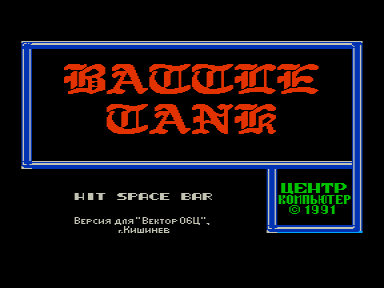
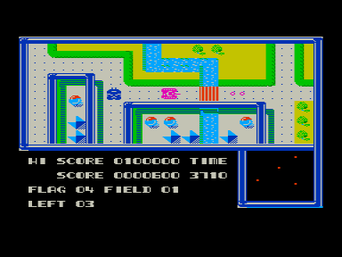

Первоначально игра считалась клоном игры с неизвестным именем и с неизвестной платформы.
Геймплеем она больше всего напоминает Tank Battalion.

Позже выяснилось, что это порт довольно редкой игры "Lonesome Tank" (MSX).

http://www.generation-msx.nl/msxdb/softwareinfo/87

