Прошивки ПЗУ начального загрузчика «Вектора-06Ц» и совместимых машин: базовые кишинёвские и минские, модификации разных авторов и их описания.

- [Masterpiece Boot](dboot)
- [Загрузчик Uniload v1.0](uniload1)
- [Загрузчик Uniload v2.0](uniload2)
- [Загрузчик «Вектор-06Ц.02» (базовый, 2048 байт, Кишинев)](kish2)
- [Загрузчик «Вектор-06Ц» (2048 байт, HDD)](hdd_boot)
- [Загрузчик «Вектор-06Ц» (2048 байт, Волгоград)](volgograd)
- [Загрузчик «Вектор-06Ц» (2048 байт, Киров?)](unzagr)
- [Загрузчик «Вектор-06Ц» (512 байт, FDD, COMAN)](loados)
- [Загрузчик «Вектор-06Ц» (512 байт, МППЗУ)](zagmlpzu)
- [Загрузчик «Вектор-06Ц» (базовый, 512 байт, Кишинев)](kish1)
- [Загрузчик «Вектор-06Ц» (базовый, 512 байт, Минск)](minsk)
- [Загрузчик «Вектор-06ц» (2 Кб, TimSoft)](boots3)
- [Загрузчик «Вектор-06ц» (32 Кб, TimSoft)](boot45)
- [Загрузчик «Вектор-06ц» «ПЗУ-2» (Гепард)](rom2)
- [Загрузчик «Вектор-06ц» «ПЗУ-8» (Гепард)](rom8)
- [Загрузчик «Игорь» (патченный Кишинев 2кб)](igor)
- [Загрузчик «ПК-6128Ц»](6128)
- [Описание ПЗУ-2, ПЗУ-8 «Гепард»](rom28_doc)

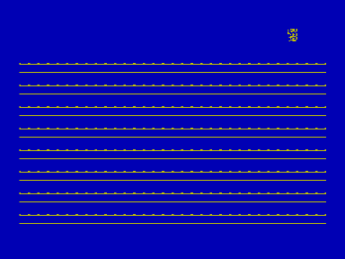
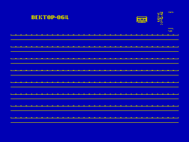
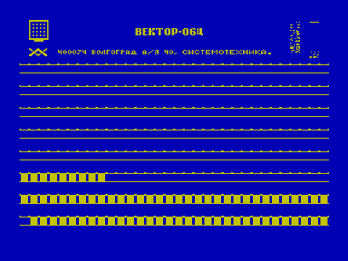

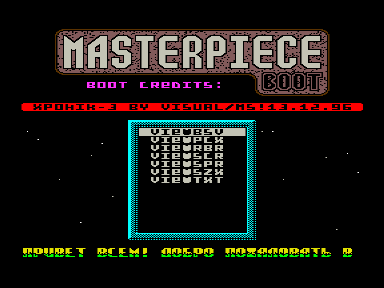
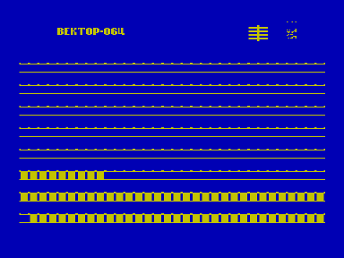
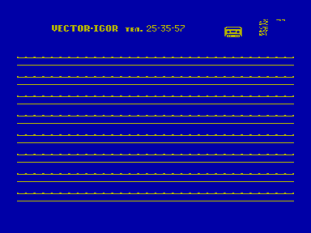

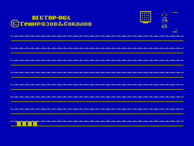
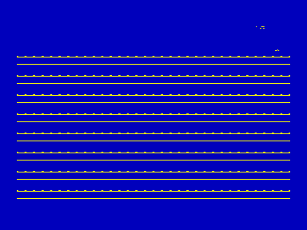

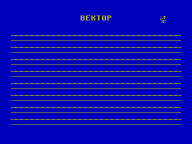
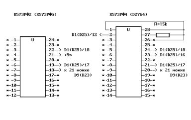
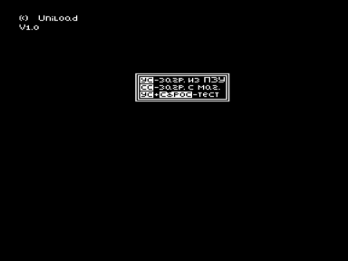
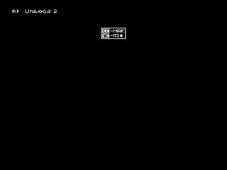
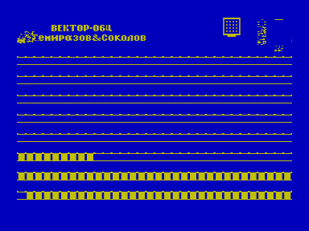
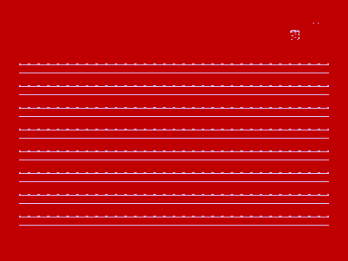
