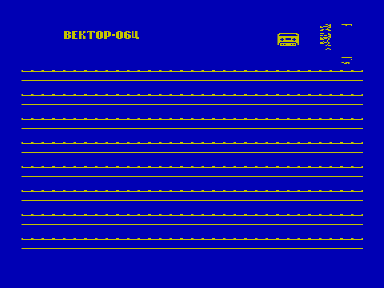

Начальный загрузчик для ПЭВМ «Вектор-06Ц» (2 Кб).

«boots» v3.0 - САМЫЙ универсальный загрузчик на 2 кБ для ПК «Вектор-06Ц».

В разработке использован код «Кишиневского» и «Кировского» загрузчиков, а также код загрузчиков неизвестного авторства и происхождения.

(c) Александр Тимошенко (aka TIMSoft), [http://vector06c.narod.ru](http://vector06c.narod.ru)

## 1. Лицензионное соглашение

Программа является freeware и может распространяться свободно при условии отсутствия прямой коммерческой выгоды.
Автор не несет никакой ответственности за последствия использования данной программы.

## 2. Комплект поставки

- `boots.bin` - файл загрузчика
- `boots.txt` - данное описание

## 3. Описание программы и принцип работы

### 3.1.

Программа «boots.bin» предназначена для начальной загрузки ПК «Вектор-06Ц» и прошивается в ПЗУ объемом 2 кБайт типа К573РФ5.

### 3.2. Поддерживаемые устройства

Перечислены в зависимости от приоритета при загрузке:

- электронный квазидиск
- дисковод
- жесткий диск
- сетевой адаптер (документально не описан, но в загрузчике предусмотрен)
- модуль внешнего ППЗУ
- магнитофон
- 0-модемное соединение с IBM PC (далее РС) через порты ПУ-LPT

Для поддержки 0-модемного соединения необходимо использовать программу «0modem», последнюю версию которой можно получить по адресу: [http://vector06c.narod.ru](http://vector06c.narod.ru)

### 3.3. Режимы работы

Задаются при перезагрузке путем удержания клавиш:

| Клавиша | Режим |
|---|---|
| нет | квазидиск |
| `F1` | магнитофон |
| `F2` | МППЗУ |
| `F1`+`F2` | дисковод |
| `F2`+`F3` | жесткий диск |
| `F1`+`F3` | сетевой адаптер |
| `АР2` | загрузка из РС через порты ПУ-LPT |

Если для загрузки выбрано неподключенное устройство, загрузка будет производиться со следующего подключенного устройства согласно приоритету.

Удерживание клавиши `УС` при перезагрузке отменяет очистку ОЗУ (кроме экранной области с адресами 0C000H-0DFFFH).

### 3.4. Некоторые примеры использования

а) Необходимо загрузить данные из РС:

- `АР2`+`ВВОД`+`БЛК` - ввод данных из РС
- `СБР`+`БЛК` - запуск

б) Необходимо загрузить данные из РС для обработки:

- загрузить монитор-отладчик
- `СБР`+`БЛК` - запуск, выбор режима
- `УС`+`АР2`+`ВВОД`+`БЛК` - ввод данных из РС
- `СБР`+`БЛК` - возврат в монитор

в) Необходимо загрузить данные с магнитофона для обработки:

- загрузить монитор-отладчик
- `СБР`+`БЛК` - запуск, выбор режима
- `УС`+`ВВОД`+`БЛК` - ввод данных с магнитофона
- `СБР`+`БЛК` - возврат в монитор

## 4. История разработки

### v3.0

- [+] добавлена поддержка загрузки с жесткого диска
- [+] оптимизирован код

### v2.0

- [+] подпрограммы работы с дисководом взяты из Кировского загрузчика, теперь загрузка ведется значительно быстрее.
  В отличие от Кишиневского загрузчика, Кировский предполагает, что все программы, загружаемые с диска, размещаются с адреса 0100Н.
  Если это в корне неверно - сообщите по адресу, указанному в п. 6, и пришлите образ диска.

## 5. Благодарности

- TMKSoft в лице Михаила Таланова за помощь с программным обеспечением для Вектора и информационную поддержку.
- Роману Пантелееву и Артему Навалону за их замечательный эмулятор ПК «Вектор-06Ц», который во многом облегчил работу, а также дал понять, что Вектор еще не забыт :-)

## 6. Координаты автора

Александр Тимошенко (aka TIMSoft)

- URL: [http://vector06c.narod.ru](http://vector06c.narod.ru)
- E-mail: timsoft at mail.ru
- ICQ UIN: #22350135 (Sherhan)

Ваши отзывы, замечания и пожелания будут с интересом рассмотрены.

г. Чернигов (Украина), 28.04.99
