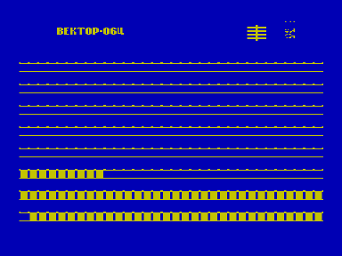

Начальный загрузчик ПЭВМ «Вектор-06Ц» (2048 байт, HDD).

Авторство неизвестно.

## Возможности загрузки (по приоритету)

1. Квазидиск
2. Винчестер
3. Дисковод (кишиневский и московский адаптеры)
4. Магнитофон
5. МППЗУ (?)

## Ручной выбор загрузки

| Клавиша | Устройство |
|---|---|
| `F1` | квазидиск |
| `F2` | винчестер |
| `F3` | дисковод |
| `F4` | магнитофон |
| ? | МППЗУ |

## Недокументированные возможности

- Клавиша `АР2` - ?
- МППЗУ - ?

## Автор материала

Материал подготовил: Александр Тимошенко, timsoft@mail.ru, [http://vector06c.narod.ru](http://vector06c.narod.ru)
