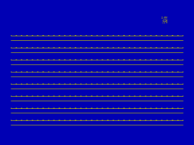

Базовый начальный загрузчик ПЭВМ «Вектор-06Ц» (512 байт).

НПО «Счетмаш», Кишинев, 1988.

## Возможности загрузки

1. Магнитофон

## Недокументированные возможности

1. Если нажать `ВВОД`+`БЛК`, удерживая `УС`, то перезапуск происходит без очистки ОЗУ.

   Данная возможность позволяет взламывать и дизассемблировать программы, защищенные от копирования и стартующие с адреса 0100H, по следующей методике:

   1. загрузить и запустить монитор-отладчик;
   2. нажать `ВВОД`+`БЛК`, удерживая `УС`;
   3. загрузить программу;
   4. нажать `БЛК`+`СБР`, управление передается в монитор-отладчик;
   5. программа расположена с адреса 100H, можно дизассемблировать/копировать.

## Автор материала

Материал подготовил: Александр Тимошенко, timsoft@mail.ru, [http://vector06c.narod.ru](http://vector06c.narod.ru)
