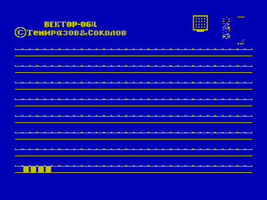

Базовый начальный загрузчик ПЭВМ «Вектор-06Ц», «Вектор-06Ц.02» (2048 байт).

НПО «Счетмаш», Кишинев.

## Возможности загрузки

1. Квазидиск
2. МППЗУ (8, 16, 32 Кб)
3. Дисковод (А)
4. Магнитофон

## Недокументированные возможности

1. Загрузка с адаптера локальной сети.
2. Если после загрузки программы нажать `F1`+`F3` - на экран будут выведены фамилии авторов.
3. Убрана возможность запустить загрузчик без очистки ОЗУ (удерживая `УС`).

## Примечание

1. Если в ПЭВМ сделана доработка, расширяющая адресное пространство ПЗУ (более 4К), то загрузка с дисковода будет невозможна, т. к. процедура работы с диском использует ОЗУ, начиная с адреса 1100H.

См. также [Замена ПЗУ 2кб в ПЭВМ «Вектор-06Ц»](../../boot_change).

## Автор материала

Материал подготовил: Александр Тимошенко, timsoft at mail.ru, [http://vector06c.narod.ru](http://vector06c.narod.ru)
