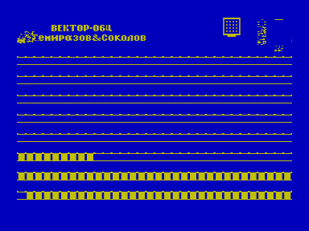

Начальный загрузчик ПЭВМ «Вектор-06Ц» (2048 байт, Киров?).

Модифицированный кишиневский загрузчик.

## Изменения

1. Более быстрые процедуры загрузки с диска.
2. Часть кода размещена в области данных об авторах (см. «Недокументированные возможности», п. 2).

## Возможности загрузки

1. Квазидиск
2. МППЗУ (8, 16, 32 Кб)
3. Дисковод (А)
4. Магнитофон

## Недокументированные возможности

1. Загрузка с адаптера локальной сети.
2. Если после загрузки программы нажать `F1`+`F3` - на экран будут выведены фамилии авторов (искажены из-за модификации).
3. Убрана возможность запустить загрузчик без очистки ОЗУ (удерживая `УС`).

## Автор материала

Материал подготовил: Александр Тимошенко, timsoft@mail.ru, [http://vector06c.narod.ru](http://vector06c.narod.ru)
