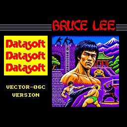
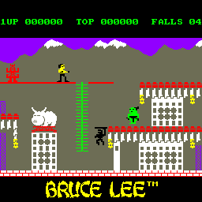

# Bruce Lee

Порт игры Datasoft 1984 года для Вектора-06Ц.
Игровая логика перенесена с ZX Spectrum, графика персонажей, палитры, музыка и эффекты — с Amstrad CPC.
Порт работает на КР580ВМ80А с 64 КБ памяти, без Z80-переходника и квазидиска; звук воспроизводится на ВИ53.

Представлена альфа-версия [v0.5.2a](https://github.com/reqw41/brucelee-v06c/releases/tag/v0.5.2a). В игре 20 комнат; можно играть одному или вдвоём, управляя Брюсом и Ямо.

## Образы

| Язык       | С заставкой, с `0000h`                       | Без заставки, с `0100h`                      |
| ---------- | -------------------------------------------- | -------------------------------------------- |
| Английский | [BruceLee-v06c.r0m](BruceLee-v06c.r0m)       | [BruceLee-v06c.rom](BruceLee-v06c.rom)       |
| Русский    | [BruceLee-v06c-ru.r0m](BruceLee-v06c-ru.r0m) | [BruceLee-v06c-ru.rom](BruceLee-v06c-ru.rom) |

Файлы `.r0m` — образы памяти размером 64 КБ для эмуляторов; для ядра Vector-06C на MiSTer их можно использовать с расширением `.c00`. Файлы `.rom` загружаются с адреса `0100h`; для запуска в CP/M их нужно переименовать в `.COM`. Из игры в CP/M возврата нет.

## Управление

На заставке нажмите любую клавишу или огонь джойстика. На титульном экране **1**, пробел или огонь — игра одному; **2** — вдвоём.

| Клавиша     | Действие                                |
| ----------- | --------------------------------------- |
| Стрелки     | Движение, прыжок, лестница и приседание |
| Пробел      | Удар                                    |
| ВК          | Пауза и продолжение игры                |
| АР2 в паузе | Выход на титульный экран                |
| УС          | Выключить или включить звук             |

Поддерживаются джойстики «П». При игре одному Брюсом можно управлять с клавиатуры или любого джойстика; при игре вдвоём Брюс использует клавиатуру и джойстик «П» Б, Ямо — джойстик «П» А. Для игры с неубывающими жизнями нажмите **Ф1 + Ф3** одновременно на титульном экране.

## Скриншоты

Исходный код и подробности порта — в [репозитории проекта](https://github.com/reqw41/brucelee-v06c).
