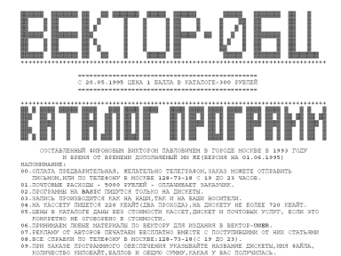
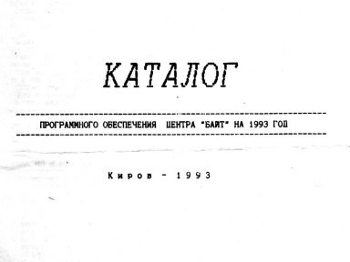
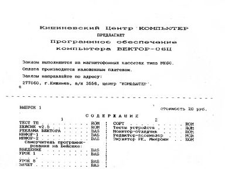
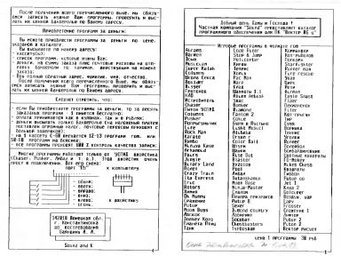

Каталоги программного обеспечения для «Вектора-06Ц», выпускавшиеся распространителями из разных городов.

- [Каталог (Фиронов, Москва)](fironov)
- [Каталоги «Байт» (Киров)](kirov)
- [Каталоги центра «Компьютер» (Кишинёв)](kishinev)
- [Каталог (Константиновка) и схема джойстика УСПИД](konstantinovka)
- [Каталог «Гепард» (Омск)](omsk)

