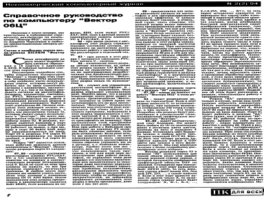
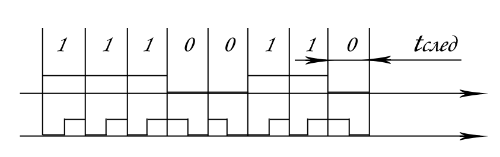

# Справочник по компьютеру «Вектор-06Ц»

**А. Ю. Черезов**, фирма «Системотехника», Волгоград.

Ниже приведён текст справочника из ODT в архиве [cherezov.zip](cherezov.zip): сохранены главы, таблицы, примеры и рисунок. В PDF совпадают название и перечень семи глав; DjVu-сканы не содержат текстового слоя, поэтому их полнота постранично не сверялась. Исторические формулировки и численные данные автора сохранены и не являются независимой проверкой характеристик.

## Публикации и источники

Данный справочник был опубликован в журнале «ПК для всех»:

- 2(2)’94 — состав и назначение портов ввода-вывода; структура изображения и режимы экрана; аппаратные прерывания.
- 7(3)’94 — управление принтером; опрос клавиатуры; взаимодействие с магнитофоном.

В номере 7(3)’94 анонсирована публикация о музыкальных возможностях «Вектора» в следующем номере. По замечанию составителя архива, этот номер ему неизвестен и, возможно, не выходил.

С полным вариантом справочника можно ознакомиться в [InVector](../invector):

invector19 — Глава 1. Состав и назначение портов ввода/вывода ПК «Вектор-06Ц»

invector20 — Глава 2. Байтовая структура изображения, режимы экрана, скроллинг экрана, кодирование цветов, бордюр

invector21 — Глава 3. Аппаратные прерывания БПЭВМ «Вектор-06Ц»

invector22 — Глава 4. Опрос клавиатуры

invector23 — Глава 5. Музыкальные возможности «Вектора-06Ц»

invector24 — Глава 6. Взаимодействие БПЭВМ «Вектор-06Ц» с магнитофоном

invector25 — Глава 7. Управление принтером

Также две главы были опубликованы в журнале Радиолюбитель:

09/92 — «Вектор-06Ц». Управление принтером

10/92 — Взаимодействие БПЭВМ «Вектор-06Ц» с магнитофоном

См. также [Секреты «Вектора» и «Кристы»](../vector_secrets) и [Секреты «Вектор-06Ц» и исходники игры «Болдер»](../bolder/secrets)



## Текст справочника

## Состав и назначение портов ввода-вывода

Схема дешифрации адреса может вырабатывать сигналы обращения к 16 портам с адресами 0..0FH. В таблице приведен список этих портов:

| Адрес    | Условное обозначение | Назначение                                                                                                                                      |
| -------- | -------------------- | ----------------------------------------------------------------------------------------------------------------------------------------------- |
| 00       | РУ PPI2              | Порт, управляющий работой микросхемы К580ВВ55А, содержащей три восьмиразрядных параллельных порта:                                              |
| 01       | PC PPI2              | Управление взаимодействием с магнитофоном, индикатором РУС/ЛАТ, определение состояния кнопок УС, СС и РУС/ЛАТ.                                  |
| 02       | PB PPI2              | Управление режимами экрана, цветом бордюра и опрос клавиатуры.                                                                                  |
| 03       | PA PPI2              | Управление скроллингом (сдвигом/прокруткой) экрана по вертикали и опрос клавиатуры.                                                             |
| 04       | РУ PPI1              | Порт, управляющий работой второй микросхемы К580ВВ55А, содержащий три порта:                                                                    |
| 05       | PC PPI1              | Управление внешними устройствами, подключаемыми к 30-контактному разъему “ПУ” (принтером, дисководом, джойстиком и т. п.), чтение внешнего ПЗУ. |
| 06       | PB PPI1              |                                                                                                                                                 |
| 07       | PA PPI1              |                                                                                                                                                 |
| 08       | РУ РТ                | Порт, управляющий работой трехканального таймера К580ВИ53.                                                                                      |
| 09       | СТ2 РТ               | Счетчик №2 интегрального таймера, задающий частоту звука, генерируемого каналом №2.                                                             |
| 0AH      | СТ1 РТ               | Счетчик №1 интегрального таймера, задающий частоту звука, генерируемого каналом №1.                                                             |
| 0BH      | СТ0 РТ               | Счетчик №0 интегрального таймера, задающий частоту звука, генерируемого каналом №0.                                                             |
| 0CH..0FH | DM                   | Четыре адреса одного и того же 8-разрядного порта, предназначенного для записи физического цвета в регистры цвета (16 8-разрядных регистров).   |

Рассмотрим подробнее способы управления аппаратурой “Вектора” с помощью этих портов.

Микросхема PPI2 включает в себя наиболее часто используемые порты, которые могут работать как на ввод (принимать сигналы с клавиатуры, магнитофона и т. д.), так и на вывод (выдавать сигналы на магнитофон, динамик, клавиатуру, светодиод РУС). Микросхема может программироваться на работу в нескольких различных режимах выдачей управляющего байта в порт управления 00. Полное описание этих режимов можно найти в справочной литературе, а здесь мы рассмотрим только те, которые имеет смысл использовать в “Векторе”. Их всего два, отличаются они только режимом работы порта 02. В режиме, который задается выводом в порт 00 управляющего кода 88H, порт 02 работает на вывод, а при выводе в порт 00 байта 8AH порт 02 программируется на ввод. Порт 03 и разряды 3-0 порта 01 запрограммированы на вывод данных, а разряды 7-4 порта 01 на ввод.

Режим “88” является основным рабочим режимом данной микросхемы в “Векторе”. Назначение разрядов порта 01 следующее:

| Разряды | Назначение                                                                                                                                                                                                                                                                                                                                                                                                                                                                                                                                                                                                                                                                                                                                                                                                                                                                                                                                                                                                                                                                                                                                                                                                                                                                                                                                                                                  |
| ------- | ------------------------------------------------------------------------------------------------------------------------------------------------------------------------------------------------------------------------------------------------------------------------------------------------------------------------------------------------------------------------------------------------------------------------------------------------------------------------------------------------------------------------------------------------------------------------------------------------------------------------------------------------------------------------------------------------------------------------------------------------------------------------------------------------------------------------------------------------------------------------------------------------------------------------------------------------------------------------------------------------------------------------------------------------------------------------------------------------------------------------------------------------------------------------------------------------------------------------------------------------------------------------------------------------------------------------------------------------------------------------------------------- |
| 07..05  | - отражают состояние регистровых клавиш РУС/ЛАТ, УС и СС соответственно. При нажатии на клавишу в соответствующем разряде устанавливается 0. Если ни одна из этих трех клавиш не нажата, то все три разряда содержат логические единицы. В любом месте программы вы можете узнать состояние этих клавиш с помощью команд IN 01 ANI 0E0H После выполнения этих команд процессором в аккумуляторе окажется байт 0E0H, если клавиши не нажаты; 60H, если нажат РУС/ЛАТ; 20H, если в данный момент одновременно нажаты клавиши УС и РУС/ЛАТ, и т. д.                                                                                                                                                                                                                                                                                                                                                                                                                                                                                                                                                                                                                                                                                                                                                                                                                                            |
| 04      | - при вводе данных с магнитофона этот разряд отражает текущее состояние сигнала, записанного на магнитную ленту. Детально работу с магнитофоном мы рассмотрим в отдельной главе.                                                                                                                                                                                                                                                                                                                                                                                                                                                                                                                                                                                                                                                                                                                                                                                                                                                                                                                                                                                                                                                                                                                                                                                                            |
| 03      | - при записи в этот разряд 1 загорается светодиод РУС. При записи нуля — гасится.                                                                                                                                                                                                                                                                                                                                                                                                                                                                                                                                                                                                                                                                                                                                                                                                                                                                                                                                                                                                                                                                                                                                                                                                                                                                                                           |
| 02      | - назначение этого разряда автору неизвестно: на схеме этот разряд назван СО КЛВ, но никуда не подключен. Возможно он зарезервирован разработчиками под предполагаемое расширение возможностей “Вектора”. Прикладными программами этот разряд никак не используется.                                                                                                                                                                                                                                                                                                                                                                                                                                                                                                                                                                                                                                                                                                                                                                                                                                                                                                                                                                                                                                                                                                                        |
| 01      | - служит для управления двигателем магнитофона. 0 — включить, 1 — выключить. Этот разряд управляет специальным реле. Имейте в виду, что в вашем компьютере этого реле может и не быть: производители “Вектора” оставили за собой право не устанавливать его на всех выпускаемых “Векторах”. Определить наличие или отсутствие реле в конкретном ПК очень просто: составьте программу, выводящую в этот разряд чередующиеся с низкой частотой 0 и 1 (при высокой частоте реле просто не успеет среагировать на команду). При выполнении этой программы реле возвестит о себе щелчками. Или при работе с Бейсиком при нажатиях на клавишу F5 должны быть слышны щелчки, если реле установлено. Если реле есть, то вы можете замкнуть на него низковольтную цепь питания двигателя вашего магнитофона и таким образом управлять им не вручную, а с помощью компьютера. Удобно это или нет — судить вам, но нужно отметить, что подавляющее число программ, в той или иной мере использующие при работе магнитофон, не управляют этим реле и держат его постоянно включенным или выключенным (а некоторые даже постоянно переключающемся!), что создает серьезные проблемы пользователям, рискнувшим выполнить такую переделку своего магнитофона. Поэтому, чтобы не добавлять им неприятностей, не забывайте правильно устанавливать этот разряд в ваших программах, даже если у вас нет реле. |
| 00      | - предназначен для записи двоичного сигнала на магнитофон и для программирования звуковых эффектов. О записи данных будет сказано в отдельной главе, здесь отметим, что данный разряд редко используется программистами для исполнения мелодий, т. к. для этой цели в “Векторе” имеются специальные более мощные средства, о которых будет сказано позже. Он обычно используется для создания шумовых эффектов путем вывода в этот разряд чередующихся со звуковой частотой нулей и единиц. При написании такой программы следует учесть, что обычная работа процессора прерывается 50 раз в секунду для выполнения программы обработки прерывания. Поэтому, если не запретить прерывания на время извлечения звука командой DI, то вы при выполнении программы услышите нежелательные шумы, внесенные из-за задержек на обработку прерываний. Данный разряд подключен к разъему “магнитофон” и к внутреннему динамику “Вектора”, поэтому звук можно прослушивать и через встроенный динамик, и через магнитофон, включенный на запись.                                                                                                                                                                                                                                                                                                                                                     |

Назначения разрядов порта 02 в режиме “88” следующее:

| Разряды | Назначение                                                                                                                                                                                                                                                                                                                                                                                              |
| ------- | ------------------------------------------------------------------------------------------------------------------------------------------------------------------------------------------------------------------------------------------------------------------------------------------------------------------------------------------------------------------------------------------------------- |
| 07..05  | - никак не влияют на работу ”Вектора 06Ц” в этом режиме.                                                                                                                                                                                                                                                                                                                                                |
| 04      | - задает разрешение экрана по горизонтали. Если в этот разряд записать 0, то установится режим, при котором возможно отображение 256 точек в строке, а при записи 1 — 512 точек. Подробно оба режима будут рассмотрены в специальной главе, посвященной графическим возможностям ”Вектора”.                                                                                                             |
| 03..00  | - задает математический цвет бордюра. Он может быть любым из 16-ти занесенных ранее в регистры цвета цветов, поэтому на него и выделено 4 разряда. Установить цвет бордюра можно в любом месте программы командой OUT 02. Кроме того эти четыре разряда являются адресом ячейки в ОЗУ цвета при записи в него физического цвета. Мы еще вернемся позднее к более подробному рассмотрению этого вопроса. |

Восемь разрядов порта 03 в режиме ”88” используются для одной общей цели: они задают номер верхней строки экрана, с которой начинается отображение графической области ОЗУ на дисплей. Стандартно при инициализации в этот порт выводится байт 0FFH (255), т. е. верхняя строка имеет номер 255, под ней 254, 253, ..., а самая нижняя 0. Если в этот порт вывести какое-то другое число X, то нумерация строк (сверху вниз) будет следующей: X, X-1, X-2, ..., 2, 1, 0, 255, 254, ..., X+1, то есть экран мгновенно сдвинется по вертикали без каких-либо изменений в экранной области памяти. Этот способ очень удобен в тех случаях, когда необходим быстрый вертикальный сдвиг изображения (например, при прокрутке текста на экране), так как программное перенесение 32К байт намного медленнее. При использовании этой аппаратной возможности сдвига следует помнить, что если производить вывод нового числа в порт 03 во время прямого хода луча в кадре, то возможно мигание изображения на экране, что, конечно, нежелательно, кроме тех случаев, когда вы хотите достичь какого-то спецэффекта. Поэтому лучше производить сдвиг, выполняя команду OUT 03 во время обратного вертикального хода луча. Эта возможность существует благодаря аппаратным прерываниям, которые возникают как раз в это время. Следовательно, лучше выполнять сдвиг в программе обработки прерываний, а если ваша программа работает без прерываний (с запрещенными прерываниями), то следует дождаться прерывания с помощью пары команд EI HLT, предварительно записав 0C9H в ячейку с адресом 0038H. Подробнее об этом будет рассказано в разделе, описывающем работу с прерываниями.

Режим “8A” применяется только в случае, когда нам необходимо опросить клавиатуру. После выполнения микропроцессором команд

```text
MVI A,8AH
OUT 00
```

порт 02 переключается с вывода на ввод данных. Порт 01 будет работать в режиме “8A” точно также, как в режиме “88”. Порт 03, работая тоже по-прежнему, примет на себя новую работу — опрос клавиатуры совместно с портом 02. Нули в разрядах порта 03 “активизируют” соответствующие столбцы матрицы клавиш. При этом состояние восьми клавиш из этого столбца переписывается в порт 02 и может быть оттуда прочитано командой IN 02. Если в этот момент нажата клавиша в этом столбце, то в соответствующем разряде порта 02 запишется 0. Если в этом столбце не нажата ни одна клавиша, то прочитанным значением будет 0FFH. Последовательно прогоняя 0 по разрядам порта 03 и прочитав 8 раз порт 02, программа сможет определить, какие клавиши были нажаты пользователем в момент опроса клавиатуры. Составляя программу опроса клавиатуры надо учесть, что, так как мы меняем состояние порта 03, на экране могут появиться помехи в изображении (ведь порт 03, как было сказано выше, управляет скроллингом изображения). Поэтому программу опроса клавиатуры обычно тоже включают в программу обработки прерываний. Она выполняется во время обратного хода луча в кадре и поэтому никак не влияет на изображение. Опросу клавиатуры тоже будет посвящена отдельная глава.

Еще два замечания об управляющем порте 00. Первое: он позволяет изменять значения отдельных разрядов порта 01, не меняя остальные. Для этого существует специальное управляющее слово для записи в порт 00. Младший разряд этого байта должен содержать значение, записываемое в выбранный разряд порта 01, а разряды 03..01 должны содержать номер этого разряда (от 0 до 7). Это очень удобно, хотя в “Векторе” этим способом можно изменять только четыре младших разряда, так как остальные работают на ввод. При выдаче такого управляющего слова старший бит должен обязательно равняться 0, иначе микросхема воспримет его как команду переключения режимов портов 01, 02 и 03. Второе: при изменении режимов портов путем выдачи кодов 88H и 8AH в порт 00 выходные регистры портов 01, 02 и 03 сбрасываются в нулевое состояние, поэтому программисту следует позаботиться о восстановлении их прежнего содержимого сразу после команды OUT 00, тогда погасание светодиода РУС, если он был включен, будет незаметно, реле, управляющее работой двигателя магнитофона не успеет включиться, а режим экрана и цвет бордюра примут свои прежние состояния.

В программировании микросхемы PPI1 нам предоставлена полная свобода действий: на работу аппаратной части “Вектора” порты 04-07 никак не влияют, все зависит от того какое периферийное устройство подключено к разъему “ПУ”, и как мы хотим им управлять. Поэтому трудно дать универсальные рекомендации. Наиболее часто к разъему “ПУ” подключают принтер или внешнее ПЗУ объемом до 32К (возможно подключение и ПЗУ большей емкости, но это вряд ли целесообразно). При подключении принтера порт 06 не используется, порт 07 и старшие четыре разряда порта 05 работают на вывод информационных и стробирующих сигналов, а младшие четыре разряда порта 05 на ввод сигналов готовности принтера. Поэтому в управляющий порт 04 выводят код 81H. Более подробно о программах для управления принтером будет сказано позже. При загрузке программы из внешнего ПЗУ в оперативную память “Вектора” порты 07 и 05 настраиваются на вывод, а порт 06 на ввод выдачей в порт 04 управляющего байта 82H. В порт 07 выводится младший байт адреса для чтения из ПЗУ, а в порт 05 — старший байт адреса. Из порта 06 производится чтение байта, содержащегося в ПЗУ по этому адресу. Этот вариант чтения ПЗУ предложен разработчиками “Вектора”. В некоторых ПК даже заменено ПЗУ внутреннего загрузчика на ПЗУ с загрузчиком, осуществляющем ввод как ROM-файлов с магнитофона, так и из внешнего ПЗУ. Эти компьютеры можно отличить от “нормальных”, по красному цвету фона карты загрузки, рисуемой этим загрузчиком.

Музыкальные возможности “Вектора”, которые обеспечиваются таймером ВИ53 (порты 08..0BH), и способы исполнения музыки будут описаны в специальном разделе.

Порт 0CH также заслуживает отдельного разговора, о нем в следующей главе.

## Байтовая структура изображения, режимы экрана, скроллинг, кодирование цветов и бордюр

Экранная область памяти (часть оперативной памяти ”Вектора“, с помощью которой формируется изображение на экране дисплея) занимает ровно половину всей памяти в ПК и расположена в адресах 8000H . . . 0FFFFH. В графическом режиме 256*256 экран может быть условно представлен в виде четырех независимых плоскостей: каждой графической точке на экране соответствует четыре бита в экранной области памяти — по одному в каждой плоскости. Эти четыре бита задают математический цвет точки, один из шестнадцати возможных. Адреса левых нижних байтов плоскостей экрана:

3-я плоскость 0E000H;

2-я плоскость 0C000H;

1-я плоскость 0A000H;

0-я плоскость 08000H.

Нумерация плоскостей, конечно, условная. Байт с этим адресом будет левым нижним только в том случае, если в порт 03 был выведен код 0FFH. Адреса байтов в каждой плоскости возрастают снизу-вверх и слева-направо. Поэтому адреса байтов в нижней строке будут следующими: 8000H, 8100H, 8200H ... 8F00H, 9000H, 9100H ... 9F00H (для 0-й плоскости), в верхней строке те же самые, но второй байт адреса будет равен 0FFH: 80FFH и т. д. Для остальных плоскостей адреса отличаются от приведенных только в 14 и 13-ом разрядах. Можно сказать, что 14-ый и 13-ый разряды адреса задают номер плоскости, 12..8-й разряды указывают номер столбца байтов, а 7..0-й разряды — строку байтов. 15-ый разряд всегда равен 1.

Число, выведенное в порт 03, задает номер строки, которая будет на экране верхней, оно равно младшему байту адресов байтов в верхней строке. Поэтому в приведенном выше примере верхний левый байт на экране имел адрес 80FFH. Если бы мы записали в порт 03, например, число 0A3H, то в верхний левый угол экрана попало бы изображение байта с адресом 80A3H, а в левый нижний 80A4H, над ним байт с адресом 80A5H и так далее, то есть произойдет сдвиг изображения на экране. Сдвинутся все плоскости одинаково и одновременно. Аппаратной возможности сдвинуть какие-то отдельные плоскости, не передвигая остальные, в ”Векторе“ нет. Такой сдвиг можно достаточно просто, хоть и не достаточно быстро осуществить программно.

Чтобы избежать возможных искажений, менять значение в порте 03 лучше в программе обработки прерываний. Если ПЗУ не отключено, то можно применить последовательность команд:

```text
EI
HLT
MVI   A,NEWBYTE
OUT   03
```

Если увеличивать или уменьшать значение NewByte каждый раз на какую-то небольшую величину, то экран будет плавно сдвигаться вниз или вверх соответственно. Если постепенно менять и значение приращения, то будет изменяться скорость сдвига.

Чтобы отобразить на экране 256*256 точек при 16 цветах, возможных для каждой точки, необходима экранная память объемом 256*256*4бита=256Кбит=256/8=32Кбайт. В “Векторе” так и сделано. Но есть и возможность распорядиться этой памятью несколько по-другому: 32К=256*512*2бита. Это графический режим 256*512 точек при 4-х возможных цветах каждой точки (на каждую точку на экране приходится 2 бита в памяти, эти 2 бита могут быть в 4-х возможных состояниях, обеспечивая отображение 4-х цветов). Как перевести дисплей “Вектора” в режим 256 строк по 512 точек?

Как уже упоминалось при общей характеристике портов, графический режим задается состоянием 4-го разряда порта 02. Этот порт работает на вывод во всех случаях, кроме тех моментов, когда мы с его помощью опрашиваем клавиатуру. Если в 4-ом разряде порта 02 записан 0, то установлен режим 256*256; если 1, то режим 256*512.

Чем отличается байтовая структура экрана в режиме 256*512 от режима 256*256? Ведь теперь на месте каждой точки должны отображаться уже две точки. Как это происходит? В режиме 256*256 при отображении каждой точки одновременно выбирались 4 бита из экранной области памяти, по одному из каждой плоскости. Эти четыре бита являются адресом в ОЗУ цвета (это ОЗУ цвета содержит 16 байт — физических цветов, поэтому адрес 4-х разрядный). Из ОЗУ цвета выбирается по этому адресу байт — физический цвет, и он задает цвет точки на экране. Вся эта процедура производится аппаратно для каждой точки на экране. Для режима 256*512 эти операции выглядят по-другому: за тот же отрезок времени, за который раньше отображалась одна точка, и на том же месте экрана теперь отображаются две точки. Математический цвет левой из этих двух точек, он же адрес для ОЗУ цвета, имеет следующий вид в двоичном коде: 00XY. Здесь X – бит из плоскости 2 (0C000-DFFFH), Y – бит из 3-ей плоскости. Для правой точки цвет VU00, V – бит из плоскости 0, U – бит из плоскости 1. Следовательно каждая точка, стоящая в четной позиции экрана (“левая”), может иметь один из математических цветов: 0, 1, 2, 3. Точка, стоящая в нечетной позиции (“правая”), может иметь цвет 0, 4, 8 или 0CH. То есть каждая точка может быть окрашена только в один из четырех, а не из 16-ти, как раньше, цветов. Байты на экране имеют те же самые адреса, что и для режима 256*256, только теперь они как бы полупрозрачные: четные точки из плоскостей 2 и 3, нечетные из 0 и 1, нижние плоскости “проглядывают” сквозь “отверстия” в верхних плоскостях; там где раньше четыре байта из разных плоскостей давали изображение восьми точек, теперь те же самые 4-байта дают изображение уже 16-ти точек. Конечно, рисовать при таком режиме заметно сложнее, поэтому программисты пользуются им сравнительно редко. Попробуйте нарисовать какое-то изображение в режиме 256*256, а затем переключить экран в режим 512 выводом единицы в 4-й разряд порта 02, - получите интересный результат, все будет зависеть от того, какие физические цвета были ранее занесены в ячейки 0, 1, 2, 3, 4, 8, 0CH ОЗУ цвета. Поэтому перейдем к описанию способов кодирования цветов.

Сначала о том, что такое вообще физический цвет, и как формируются цвета в “Векторе”. Любой цвет, в который окрашивается изображение на экране телевизора или монитора, состоит из смеси трех основных цветов: красного, синего и зеленого. В зависимости от яркости каждого из них получается тот или иной цвет или оттенок. Поэтому компьютер должен иметь средства для управления яркостью каждого из трех основных цветов. Физический цвет как раз для этого и предназначен: это код, в разрядах которого задается яркость каждого цвета. Разбираться в том, как на резисторах складываются для этого уровни напряжения, мы не будем: для нас важна модель этого процесса не с точки зрения электронщика, а с точки зрения программиста, т. е. программная модель. В “Векторе” на физический цвет отводится байт. Разряды 7 и 6 этого байта задают яркость синего цвета (11 — самый яркий, 00 — наименее яркий синий, точнее, 00 означает, что синий вообще не присутствует в кодируемом цвете). Три разряда с 5-го по 3-ий задают яркость зеленого цвета (восемь градаций яркости зеленого цвета — от 000 до 111). И оставшиеся три разряда управляют красным цветом. Четыре возможных синих цвета, 8 зеленых и 8 красных цветов могут дать при разных вариантах смешивания 4*8*8=256 различных цветов.

У нас на одну точку отводится максимум 4 бита, поэтому мы можем одновременно наблюдать на экране только 16 цветов из 256. Программист заносит выбранные физические цвета в ОЗУ цвета (или регистры цвета, что одно и то же), которое как раз содержит 16 8-разрядных ячеек, адресуемых 4-х разрядным адресом — математическим цветом. Таким образом устанавливается таблица соответствий между математическими и физическими цветами. Эту таблицу часто называют палитрой. Программист выбирает одну подходящую ему палитру из множества возможных. Часто программисту предоставляется возможность выбирать лишь из ограниченного набора палитр. Так в простейших CGA-мониторах для IBM PC всего 4 четырехцветные возможные палитры. В “Векторе 1200”, близком родственнике нашего “Вектора 06Ц”, есть 32 зашитые в ПЗУ 16-цветные палитры. А в страстно всеми любимом (именно из-за якобы выдающихся графических возможностей!) ПК “ZX Spectrum” всего одна восьмицветная фиксированная палитра. Давайте вместе посчитаем, сколько различных палитр имеет “Вектор 06Ц”. В ОЗУ цвета 16 ячеек, в каждой из ячеек можно разместить любой из 256 возможных физических цветов. По правилам комбинаторики число размещений из 256 по 16 вычисляется по формуле: A(16,256)=256*255*254*...*(256-16+1)! По моим подсчетам это около 2*10^38, проверьте. Это примерно соответствует числу электронов во Вселенной. Вот такой “монстр” стоит на вашем столе!

Итак, из этого астрономического числа возможных палитр программисту, допустим, понравилась какая-то одна. Как ему занести эти выбранные 16 цветов в ОЗУ цвета?

Первый способ, традиционный. Поместить соответствующую программу в программу обработки прерываний. Почему туда, и как она должна выглядеть? Чтобы ответить на этот вопрос, нам сначала придется разобраться с бордюром.

Бордюр — это часть изображения на экране, на которую программа не может повлиять, изменяя байты в экранной области памяти. Для управления бордюром в “Векторе” предназначен порт 02. Как уже отмечалось, младшие 4 разряда этого порта задают математический цвет бордюра. Но это утверждение справедливо только при установленном режиме 256*256 (0 в 4-ом разряде этого же порта). В режиме 256*512 точки на бордюре подчиняются тем же правилам, что и все точки на экране вообще: на месте каждой “большой” точки появятся две “маленькие”, цвет которых определяется уже не четырьмя, а двумя разрядами. Например, если вывести в порт 02 байт 0001VUXY, то установится режим 256*512, и все “левые” точки окрасятся в математический цвет 00XY, а “правые” в математический цвет VU00. При этом, если в соответствующих этим цветам ячейках ОЗУ цвета будут находится разные физические цвета, то на бордюре появятся чередующиеся вертикальные полосы двух цветов. Полоски в режиме 256*512 настолько узкие, что на дисплеях с недостаточным горизонтальным разрешением вы можете даже не различить их, увидев просто смесь этих двух цветов. Дальше, говоря о бордюре, мы будем иметь в виду только режим 256*256.

Если выводить различные математические цвета в разряды 3..0 порта 02 во время прямого хода луча в кадре, то бордюр будет в это же время менять свой цвет и это будет отражаться на экране в виде горизонтальных полос на бордюре. Если дождаться прерывания описанным ранее способом, затем, выждав с помощью программной задержки время до выхода луча на экран для рисования очередного кадра, начать в этот момент менять цвет бордюра, то эти полоски будут жестко “привязаны” к началу кадра, и, подбирая задержки между сменами цветов, можно даже попытаться изобразить что-нибудь на бордюре. Вряд ли можно извлечь из этого “трюка” какую то практическую пользу, но он интересен не только с точки зрения предельных возможностей “Вектора”, но и потому, что с его помощью мы вплотную подошли к способу записи физических цветов в ОЗУ цвета.

Когда компьютер вырисовывает на экране бордюр и во время обратного хода луча в кадре (что условно тоже можно считать рисованием бордюра) математический цвет бордюра “стоит” на шине адреса ОЗУ цвета, и поэтому, записав байт в порт 0CH, мы автоматически запишем этот байт, как в физический цвет, в адресуемую ячейку ОЗУ цвета. Определить момент, когда компьютер рисует бордюр, можно только с помощью прерывания, поэтому обычно программу записи физических цветов записывают в программу обработки прерываний. Вот эта программа:

```text
LXI  B,1000H
LXI  H,TABLCOL
LOOP: MOV  A,C
OUT  02
MOV  A,M
INX  H
MVI  D,3
REP:  OUT  0CH
DCR  D
JNZ  REP
INR  C
DCR  B
JNZ  LOOP
```

По адресу TablCol должны быть записаны 16 байт — физические цвета для математических цветов с 0-го по 15-ый. Это стандартная программа, используемая почти всеми программистами, пишущими программы на ассемблере. Но может быть вам покажется расточительным выполнять эту программу 50 раз каждую секунду вместо того, чтобы выполнить ее один раз в начале программы. Или, может быть, ваша программа с автозапуском, и ПЗУ ей мешает реализовать прерывания. Тогда вам пригодится второй способ кодирования цветов, вне программы обработки прерываний:

```text
SCOL: PUSH PSW
PUSH D
PUSH H
LXI  H,TABLCOL
MVI  E,10H
LOOP: XRA  A
OUT  02
EI
HLT
MVI  A,10H
SUB  E
OUT  02
MVI  D,3
MOV  A,M
REP:  OUT  0CH
DCR  D
JNZ  REP
INX  H
DCR  E
JNZ  LOOP
LDA  RBORD
OUT  02
POP  H
POP  D
POP  PSW
RET
```

Эта подпрограмма готова к использованию, в ячейке RBord должен содержаться байт, в 3..0 разрядах которого записан нужный цвет бордюра, а в 4-ом разряде бит 0 или 1, указывающий режим экрана 256*512.

Может быть вам бросилась в глаза общая “нерациональная” черта обеих программ: зачем повторять три раза команду OUT 0CH (цикл на REP)? Во многих случаях это действительно не нужно. Мой компьютер, например, “понимает” эту команду с первого раза, и я раньше писал эту подпрограмму без цикла REP. Но как оказалось впоследствии, далеко не все компьютеры так “понятливы”, и эта программа не срабатывала, навлекая на меня недовольство пользователей. В этих случаях необходим более длительный цикл записи. Поэтому не пренебрегайте и вы этой “нерациональной” деталью программы.

С помощью описанных алгоритмов записи можно получить достаточно интересные эффекты. Можно, например, увидеть на экране одновременно все 256 цветов, которые способен отобразить “Вектор”. Для этого заполните нулями всю экранную область памяти, выведите 0 в порт 2 и циклически выводите в порт 0CH байты от 0 до 0FFH (физические цвета). Экран заполнится разноцветными горизонтальными линиями. Экспериментируя с задержкой между командами OUT 0CH, можно менять длину этих линий и добиться, чтобы она была равна длине строки, тогда каждая из 256 строк будет окрашена в один из 256 цветов. Чтобы полученная картинка не “плыла” по экрану ее можно “привязать” к началу кадра с помощью прерываний, как это уже описывалось.

Вам, конечно, известно, что в “Векторе” есть возможность “отключения” любых экранных плоскостей и освобождения, таким образом, памяти для программ и данных. Каждая плоскость имеет объем 8 Кбайт, поэтому в тех случаях, когда нет необходимости рисовать многоцветные изображения, каждая отключенная плоскость может дать достаточно весомую прибавку столь дефицитной памяти. Но на аппаратном уровне нет возможности запретить дисплейному узлу использовать данные из какой-либо плоскости. Мы можем лишь помешать ему делать это путем такой перекодировки цветов, при которой биты, появляющиеся в “отключенной” плоскости, не приводили к появлению изменений в изображении на экране. Например, нам необходимо отключить плоскость 0 (8000H...9FFFH); мы знаем, что бит из этой плоскости дает для точки на экране старший бит ее математического цвета, следовательно, поставив в соответствие математическим цветам вида 1XYZ (8..0FH) те же самые физические цвета, которые соответствуют математическим цветам вида 0XYZ, мы сделаем так, что биты из этой плоскости не будут влиять на изображение, но этим мы и сократим вдвое количество возможных цветов: теперь лишь математические цвета 0..7 будут иметь свой собственный физический цвет, а цвета 8..0FH – их копии.

Описанный способ отключения плоскостей может быть полезен не только для расширения памяти, доступной для программы, но и для временного отключения плоскостей на время, пока программа рисует в этих плоскостях изображение. Если изображение достаточно крупное, или если алгоритм его построения достаточно сложен, то на построение может уйти много времени. Поэтому, если мы захотим “скрыть” от пользователя процесс построения изображения, мы сможем сделать это, отключив все или отдельные плоскости экрана. Из-за некоторого разброса параметров деталей, входящих в узел формирования цвета ПК “Вектор”, на многих дисплеях может быть заметно изображение в отключенных плоскостях (в виде “теней”), поэтому желателен темный цвет фона, т. к. эти “тени” на темном фоне практически не видны.

И еще один узел, где разброс параметров может оказать влияние на изображение: это узел, который включается в работу только в режиме 256x512. Функцией этого узла, образно говоря, является деление “большой” точки режима 256 на две “маленькие” для режима 512. Приведенная ниже программа покажет вам, что это деление не всегда происходит “поровну”. Причина этого в том, что в эту схему входит линия задержки на RC-цепочке (резистор и конденсатор). Для резисторов и конденсаторов разброс параметров в пределах 20% считается приемлемым. И каждый радиолюбитель знает, что спаять из них две линии с одинаковой задержкой практически невозможно. Поэтому линии задержки, которые управляют в нашей схеме делением точки, будут по-разному ее делить на разных компьютерах. У кого-то будут шире точки, стоящие в строке на четной позиции, у кого-то на нечетной. Скорее всего, и у разработчиков “Вектора” точки в режиме 512 не были равновеликими: номиналы радиоэлементов составляют дискретный ряд, а не непрерывный, поэтому нельзя подобрать детали, которые давали бы задержку, в точности равную расчетной. Чтобы узнать, насколько вам “повезло” с задержкой, загрузите Монитор-отладчик, выберите распределение (1) и с помощью директивы “A” введите следующую программу, которая делает бордюр “вертикально-полосатым” в режиме 256x512 (этот трюк был описан выше):

```text
8000: DI
MVI  A,CD
STA  FEOC
LXI  H,8014
SHLD FEOD
LXI  H,0000
SHLD FEOF
EI
RET
8014: MVI  A,0A
ORI  10
OUT  02
RET
```

Эта программа при запуске командой C8000 вставит в конце программы обработки прерываний Монитора-отладчика команду вызова подпрограммы, расположенной по адресу 8014H. Теперь 50 раз в секунду бордюру будет задаваться математический цвет 0AH, но так как установлен режим 512 (командой ORI 10), то точки бордюра примут 2 цвета: 1000 и 0010 (8 и 2). Математический цвет 8 в Мониторе соответствует физическому цвету фона, а 2 — цвету изображения. Поэтому на бордюре появятся чередующиеся вертикальные линии двух цветов, что на большинстве телевизоров будет выглядеть, как окраска бордюра в цвет, средний между цветом фона и цветом изображения. Если же теперь поменять директивой S8015 байт 0A на 0D, то линии на бордюре поменяются цветами. Понятно, что если ширина четных и нечетных вертикальных линий одинакова, что имеет место только при равной ширине всех точек в режиме 512, то и яркость бордюра после выполнения директивы “S” не изменится. Если же яркость изменилась (на моем “Векторе”, например, бордюр стал ярче почти в два раза), то увы, точки на вашем экране в режиме 512 не равны по ширине. Эффект более заметен, если установить черно-белый режим директивами NF00 и NCFF Монитора-отладчика. Убрать полосы с бордюра и окрасить его полностью в цвет изображения можно, если директивой “S” заменить теперь байт 0D на 0F; окрасить в цвет фона, если заменить его на 00. Эти эксперименты могут привести вас к мысли, что бордюр просто окрашивается в 4 разных цвета (или в 3 в идеальном случае), но это только результат того, что большинство мониторов не могут достаточно качественно отображать 512 точек в строке. В ОЗУ цвета мы ничего не меняли: там по-прежнему только два физических цвета — цвет фона в ячейках 0, 1, 8, 9, а в остальных цвет изображения.

## Аппаратные прерывания

Как уже стало ясно из предыдущих глав, правильная работа большинства функциональных узлов “Вектора” в значительной степени зависит от прерываний. Так как некорректная работа таких узлов выражается в искажении изображения на дисплее, то совершенно логично выглядит программно-аппаратный способ синхронизации работы этих узлов и дисплея с помощью прерываний. Программе необходимо знать момент начала обратного хода луча в кадре, чтобы в этот момент выполнить действия, которые могли бы испортить изображение, без отражения последствий этих действий на экране. Программа “узнает” об этом посредством прерываний “от дисплея”. Так как частота кадровой развертки большинства отечественных телевизоров и дисплеев равна 50Гц (она соответствует частоте переменного тока в питающей сети), частота прерываний тоже 50Гц.

Несмотря на то, что процессор 580ВМ80А может работать с восьмиуровневыми прерываниями RST0..RST7, в “Векторе” аппаратно реализовано только прерывание RST 07. Реализация аппаратной поддержки остальных семи уровней привела бы к значительному удорожанию ПК, но не добавило бы новых полезных возможностей. Прерывания — это удобное средство взаимодействия процессора с системой, работающей в реальном масштабе времени. В “Векторе” к таким системам относятся таймер и узел дисплея: они работают независимо от процессора, и прерывания позволяют синхронизировать их совместную работу. Дисплей имеет преимущество перед процессором при доступе к общим ресурсам (экранной области памяти), он не может “ждать”, так как это внесет искажения в изображение. Таймер управляется процессором, но счет ведет независимо от него, параллельно с работой процессора. Поскольку прерывания от дисплея позволяют организовать не только бесконфликтную работу процессора и дисплея, но и эффективно управлять таймером, то оказалось вполне достаточно одноуровневого прерывания. Выбрано именно прерывание RST7, так как проще реализуется: код этой команды 0FFH, и не нужно ставить специальный узел, который выдавал бы этот код в нужный момент, это, можно сказать, получается “автоматически”. Да к тому же исторически так сложилось, что для систем, построенных на таком процессоре прерывание RST 07 стало стандартом.

Итак, если прерывания не были запрещены командой DI, то 50 раз в секунду процессор прерывает выполнение программы и, оставив на стеке адрес возврата в прерванную программу, переходит к выполнению программы, которая находится по адресу 0038H. Программист должен позаботиться о том, чтобы там была расположена программа обработки прерывания. Перед выполнением эта программа должна сохранить все регистры процессора, чтобы не помешать дальнейшему выполнению прерванной программы, затем выполнить необходимые в данный момент действия (опросить клавиатуру, например), затем восстановить регистры и вернуться в прерванную программу командой RET. Перед возвратом надо обязательно выполнить команду EI, разрешающую дальнейшие прерывания, так как процессор их автоматически запрещает, переходя к выполнению программы обработки прерывания, и больше не будет реагировать на прерывания от дисплея до тех пор пока не встретится команда EI.

Программа обработки прерывания должна выполняться достаточно быстро, если программист хочет, чтобы она завершилась до начала прямого хода луча в кадре и не влияла на качество изображения на экране. Таким образом, пока электронные лучи рисуют картинку на экране, выполняется основная программа, а когда электронный поток возвращается из правого нижнего угла в левый верхний (не оставляя при этом следов на экране), выполняется программа обработки прерывания. Человек не замечает мигания изображения, так как частота его регенерации (50Гц) достаточно велика. Точно также мы не замечаем “обмана” со стороны компьютера, выполняющего две программы одновременно, и нам кажется, что они выполняются одновременно: одновременно опрашивается клавиатура и выполняется основная программа. Поэтому можно считать, что так оно и есть, и писать программу обработки прерывания в расчете на то что она будет выполняться одновременно с ходом основной программы.

При разработке программы надо учесть, что в момент произведения каких-либо действий над содержимым ячеек 0038H..003AH (например, при записи туда команды перехода) может произойти прерывание, и его действие тогда будет непредсказуемым. Поэтому любая модификация программы обработки прерывания, должны быть обязательно обрамлены парой команд DI..EI: DI перед модификацией, EI после нее. Команды DI и EI здесь выступают в роли команд реализации метода взаимоисключений по аналогии с взаимоисключением, применяемым для параллельных процессов при входе их в свои критические участки (параллельные процессы реализуются на профессиональных ЭВМ). На “Векторе” мы имеем два параллельных процесса: основная программа и программа обработки прерываний. Так как эти процессы неравноправны, то лучше подходит аналогия (тоже из области профессиональных ЭВМ) с фоновыми процессами. Программа обработки прерывания — это фоновый процесс. Эта программа может выполнять в фоновом режиме (то есть одновременно с выполнением основной программы) многие функции, не только упомянуты выше, но и более “экзотические”, такие как печать на принтере в фоновом режиме без остановки основной программы. О том как это сделать, будет рассказано в главе, посвященной работе с принтером.

После того, как автором этой книги в 1991 году был разработан способ автоматического запуска ROM-файла после загрузки без нажатия клавиш БЛК+ВВОД и популяризации этого метода с помощью данной книги (и не исключено, что где-то на необъятных просторах СНГ кем-нибудь был разработан аналогичный ROM-автозапуск), появятся программисты, желающие использовать автозапуск в своих программах. В связи с этим нужно отметить следующее обстоятельство: ПЗУ загрузчика, находящееся в младших адресах памяти “Вектора”, программно отключить невозможно, поэтому нельзя и записать команду перехода на программу обработки прерывания. В ПЗУ есть подпрограмма, начинающаяся с адреса 0038H, но она не выполняет функций, полезных после этапа загрузки. Кроме того, она не сохраняет регистры и не выполняет команду EI, то есть совершенно не подходит в качестве программы обработки прерываний. Поэтому приходится работать без прерываний. Как же тогда опрашивать клавиатуру, записывать физические цвета в регистры цвета, сдвигать по вертикали изображение?! Первый способ, самый простой: попросить пользователя нажать БЛК+СБР, выдав в нужный момент соответствующее сообщение на экран. После нажатия БЛК+СБР ПЗУ исчезнет из адресного пространства вместе со всеми проблемами, которые оно вызывало. А если программист не хочет “утруждать” пользователя лишний раз? Или более прагматичный вопрос: как быть, если процесс загрузки программы продолжается после автоматического запуска ее первой части, и программист хочет сделать дальнейшую загрузку более привлекательной, чем простое рисование “кубиков” на сине-желтом экране? Ведь в этом случае пользователь может просто не успеть нажать БЛК+СБР. Но эта проблема имеет достаточно простое решение: мы не можем применить программу обработки прерываний, но программа может дождаться прерывания, остановив процессор с разрешенными прерываниями командами EI HLT. Максимальная задержка составит при этом 1/50-ю часть секунды, что в сотни раз меньше времени реакции пользователя на просьбу “Нажмите БЛК+СБР”. Прерывание выведет процессор из состояния останова, процессор выполнит короткую подпрограмму, расположенную в ПЗУ по адресу 0038H, снова запретив при этом прерывания, и вернется к выполнению команд, расположенных после EI HLT. Здесь мы и можем выполнить те действия, которые обычно выполняет программа обработки прерываний (кодирование цветов и т. п.), так как подпрограмма в ПЗУ, хоть и выполнила бесполезные действия, все же отняла не так уж много времени, и электронный луч все еще не вышел на экран. Вот полный текст этой подпрограммы из ПЗУ:

```text
0038: LDA 0DEF6H
003B: DCR A
JNZ 003BH
IN  01
ANI 10H
MOV E,A
RET
```

По неблагоприятному совпадению это как раз программа задержки: при загрузке в ячейку памяти 0DEF6H помещается константа чтения. Чтобы обеспечить минимальное время выполнения этой подпрограммы, полезно будет записать в ячейку 0DEF6H байт 01 до выполнения команд EI HLT.

К способам “борьбы с ПЗУ” мы еще вернемся в главе, посвященной опросу клавиатуры.

## Управление принтером

Принтер все еще остается для многих пользователей БПЭВМ неосуществимой мечтой. Но если вам все-таки удалось его купить, то сведения излагаемые в этой главе, будут для вас небесполезными.

Принтеры как правило продаются без соединительного шнура, а если и с ним, то можете быть уверены, что разъем, который находится на этом шнуре, не подойдет к разъему “ПУ” вашего “Вектора”. Поэтому вам придется взяться за паяльник, и, в связи с этим, напомню стандартную раскладку сигналов, которая требуется для нормальной работы принтера под управлением “Вектора”:

| Контакты разъема XS5 | Назначение сигнала                 |
| -------------------- | ---------------------------------- |
| A02..A09             | Данные: 7..0 разряды байта данных  |
| C05                  | Строб передачи                     |
| C09                  | Готовность принтера к приему байта |
| C01, A10             | Общий                              |

Соответствующие сигналы на разъеме принтера найдете по эксплуатационной документации вашего принтера. Если временная диаграмма работы интерфейса вашего принтера не соответствует стандарту Centronix (ИРПР-М), то у вас могут возникнуть серьезные проблемы с подключением принтера, и вам, скорее всего, придется даже паять специальную схему сопряжения. Этот случай здесь не будет рассматриваться.

Сигналы с контактов разъема “ПУ” идут к следующим разрядам портов 05 и 07 (06 не задействован):

| Контакты разъема XS5 | Порт [разряды] |
| -------------------- | -------------- |
| A02..A09             | 07 [7..0]      |
| C05                  | 05 [4]         |
| C09                  | 05 [0]         |

Следовательно, порт 07 и разряды 7..4 порта 5 работают на вывод данных, а разряды 3..0 порта 05 на ввод. Чтобы задать этот режим работы микросхеме PPI1 (580ВВ55А), нужно записать в управляющий порт 04 байт 81H.

Передача байта (информационного байта или кода команды) в принтер должна сопровождаться стробирующим сигналом. Активный уровень стробирующего сигнала — 0, минимальная его длительность должна составлять около 0.5 микросекунды, поэтому вполне достаточно для формирования строба следующих четырех команд:

```text
MVI  A,0EFH
OUT  05
MVI  A,0FFH
OUT  05
```

Или, с учетом возможности поразрядного управления портом 05 из управляющего порта 04, эти команды можно заменить такими:

```text
MVI  A,08
OUT  04
MVI  A,09
OUT  04
```

Даже второй вариант предпочтительней, так как не влияет на остальные разряды порта 05, и их можно было бы использовать для других целей. Перед выполнением этих команд передаваемый байт нужно поместить в порт 07 командой OUT 07. А еще раньше необходимо проверить разряд готовности принтера, чтобы согласовать маленькую скорость работы принтера с быстрой работой процессора. Обычно говорят “сигнал готовности”, хотя правильнее, на мой взгляд, было бы назвать его “сигнал занятости”: он установлен в 1 на протяжении всего времени, пока принтер занят обработкой поступившей ранее информации (или в случае, если пользователь принудительно привел принтер в это состояние, выключив “ON LINE”). До тех пор, пока в 0-м разряде порта 05 содержится 1, компьютер не должен производить передачу данных в принтер, т. к. эти данные не будут восприняты принтером. Поэтому следует проверить этот разряд на равенство нулю до выполнения команд OUT 07 и OUT 05:

```text
WAIT: IN   01
RLC
JNC  Выход…
IN   05
RAR
JC   WAIT
```

Эта проверка также поможет пользователю прекратить печать нажатием клавиши УС, если он по каким-то причинам хочет это сделать.

Надо отметить, что при выключении принтера сигнал занятости сбрасывается в 0 (если бы мы называли, как принято, этот сигнал сигналом готовности, то получилось бы, что в выключенном состоянии принтер готов к печати!). Это обстоятельство позволяет прерывать печать выключением принтера: программа “не заметит” этого и благополучно закончит печать, не останавливаясь в цикле WAIT. Выключение принтера также поможет очистить его буфер, когда это необходимо. А это необходимо в том случае, когда то, что уже передано в принтер, не должно быть напечатано; простое выключение “ON LINE” здесь не поможет, т. к. переданная информация обязательно будет напечатана при попытке продолжения печати включением “ON LINE” (кроме тех случаев, разумеется, когда новая печатаемая информация содержит в себе коды инициализации принтера или сброса буфера).

Если “ON LINE” выключен, а программа производит передачу информации в принтер, то принтер будет ее принимать до заполнения его буфера, а затем установит сигнал занятости 1. Программа остановится в цикле WAIT, и передача возобновится только в том случае, если пользователь разрешит печать включением “ON LINE”. В этом случае потери информации не произойдет, т. к. программа контролирует занятость принтера. Но если пользователь перед печатью забыл включить принтер, то будет произведена “печать” на незанятом (но выключенном!) принтере. В этом случае велика вероятность потери ценных данных. Как предупредить пользователя о необходимости включения принтера? Можно, конечно, перед началом печати спрашивать “Включен ли принтер?”, но пользователь быстро привыкает к этому вопросу и на запрос программы автоматически, не задумываясь, отвечает “да”. Есть ли возможность проверить это программно? В подавляющем большинстве принтеров есть специальный сигнал — подтверждение приема информации, но, к сожалению, стандарт (см. начало главы) не предлагает пользователям задействовать этот сигнал, и у нас нет оснований надеяться, что все пользователи сделают это “по собственной инициативе”. Поэтому надо искать другой способ. Мы можем судить о состоянии принтера только на основании сигнала занятости, т. к. он единственный идет от принтера к компьютеру: если в этом разряде происходит смена битов 0/1, значит принтер “жив”, т. е. включен в сеть. В выключенном принтере там 0, поэтому мы должны попробовать “заставить” его установить там 1. Конкретный способ в значительной степени зависит от типа принтера, но есть два общих принципа, на которых можно основываться и которые сработают на большинстве принтеров. Первый: задать принтеру выполнение какой-либо длительной операции (например, инициализации или прогона бумаги) и сразу после этого проверить сигнал занятости. Но если буфер принтера был пуст, то он сможет принимать данные (т. е. не установит 1 в разряде занятости) даже во время инициализации. Поэтому первый принцип можно комбинировать со вторым: заполнить буфер данными, которые не могут быть напечатаны, например, командами установки режимов печати, затем проверить разряд занятости, и если он = 1, то инициализировать принтер и произвести печать; иначе — выдать сообщение пользователю о том, что принтер выключен. Чтобы программа работала надежно независимо от обмена буфера, заполняйте его до появления единичного сигнала занятости, а сообщение выдавайте только при исчерпании предполагаемого максимального объема буфера. Эти способы не абсолютно надежны, поэтому применяйте их только в обоснованных случаях.

Принтеры могут иметь разные наборы печатаемых символов, которые отличаются не только своим графическим изображением (что редко бывает существенно), но и кодировкой. Это последнее обстоятельство часто создает пользователям большие проблемы. Обычно принтеры поддерживают кодовую таблицу ASCII или КОИ-8, или даже только КОИ-7. ASCII и КОИ-8 полностью совпадают в своих левых половинах, символы в которых имеют коды меньше 128. Правая половина в коде КОИ-8 содержит русские буквы. А правая половина в ASCII может их не содержать, а если и содержит, то их кодировка в любом случае не совпадет с КОИ-8. Многие распространенные прикладные программы для “Вектора” перед печатью спрашивают у пользователя тип используемого принтера Robotron/Epson. Но ответ на этот вопрос обычно не приводит к желаемому результату. Так, если вы ответите “Epson”, то это означает, что программа не будет заниматься какой-либо перекодировкой символов: если они были в коде КОИ-8, то в таком виде и пойдут на принтер, несмотря на то, что Epson использует код ASCII, тогда правильной печати следует ожидать только для левой половины кодовой таблицы, а попавшиеся буквы кириллицы могут привести к непредсказуемому поведению принтера. Если вы ответите “Robotron”, то старший бит данных будет сбрасываться в 0, и символы с кодами в интервале 60H..7FH будут перекодированы в соответствии с представлениями программиста о том, какая кодировка используется в принтерах известной немецкой фирмы “Robotron”, и вовсе не обязательно совпадает с кодировкой символов вашего конкретного принтера, даже если у вас именно Robotron. Что касается команд управления принтером, то здесь вообще ничего нельзя гарантировать, особенно при печати графического изображения: команды установки графических режимов на разных принтерах значительно различаются. Поэтому, если вы, как программист, решили оснастить свою программу средствами работы с принтером, то прежде всего постарайтесь изучить как можно большее число принтеров (хотя бы по эксплуатационной документации) и пользоваться, по возможности, только общими для всех принтеров командами, а при печати тестов спрашивать у пользователя не тип принтера, а тип кодовой таблицы его принтера. А если пользователь предполагается такой “бестолковый”, что не знает этого, то уж предоставьте ему возможность выбирать из более полного списка принтеров (представьте, что у пользователя, например, принтер Ravi или D100M: ему определить, Epson ли это или Robotron будет, наверное, не легче, чем прочитать в документации тип кодовой таблицы ASCII/КОИ-8/КОИ-7).

А если вы, как пользователь с принтером, столкнулись с проблемой неработоспособности каких-то программ с вашим принтером, то вы можете достаточно легко переделать их на свой вкус: подпрограммы печати в них можно найти по “сигнатуре” OUT 07 с помощью директивы “Q” Монитора-отладчика.

Быстродействие матричных принтеров ударного типа (наиболее распространенного вида принтеров) редко превосходят 180 сим/с. И это в обычном режиме печати. А при печати в режиме повышенного качества скорость печати может резко снизиться вплоть до 12 зн/с и менее. Снижение скорости отмечается также при уплотненной или расширенной печати, а также при печати в графических режимах. Очевидно, что процессор обречен на непроизводительные потери времени при ожидании в цикле WAIT, так как его быстродействие на 3-4 порядка выше быстродействия принтера. Как согласовать их скорости с наименьшими потерями для процессора? Есть два основных способа. Первый уже реализован в вашем принтере — в нем установлен буфер для печатаемых данных объемом в несколько килобайт (в некоторых старых моделях на несколько сотен байтов): компьютер может быстро заполнить этот буфер и продолжать свои вычисления параллельно с печатью. Но так как объем запоминаемой принтером информации примерно соответствует 1 странице текста, то при печати больших текстов или при графической печати процессор все равно будет ожидать готовности принтера, и буфер позволит сэкономить только несколько минут (или даже секунд). Второй способ: вместо того, чтобы, вертясь в цикле WAIT, проверять занятость принтера каждые несколько микросекунд, мы можем делать это намного реже, если вспомним о прерываниях от экрана. Частота этих прерываний 50Гц, что примерно соответствует средней скорости печати. Поэтому подпрограмму печати логично будет включить в подпрограмму обработки прерываний: в момент возникновения прерывания процессор проверит разряд занятости принтера, и если он готов к приему, то передаст ему очередной байт для печати, а если принтер занят, то процессор без ожидания готовности может продолжить выполнение программы “зная” что он еще вернется к печати не позднее, чем через 1/50 секунды. Здесь полностью исключены задержки на ожидание готовности принтера. Если в установленном режиме скорость печати не более 50 символов в секунду, то мы можем считать, что практически идеально согласовали скорости работы процессора и принтера, и печать идет одновременно с выполнением основной программы, отвлекая процессор еще меньше, чем опрос клавиатуры. Ну, а если принтер может печатать 180 символов в секунду? Он будет простаивать, так как мы даем ему всего 50 символов. Здесь простой выход, если вспомнить опять о буфере в принтере: благодаря буферу он сможет принять данных больше, чем сможет напечатать. Если программа обработки прерываний будет передавать принтеру по 4 символа за раз, то мы полностью удовлетворим “запросы” принтера и даже перекроем их на 4*50-180=20 символов в секунду. Эти 20 символов не будут успевать обрабатываться и поэтому будут накапливаться в буфере. Таким образом, буфер при его объеме, например, 2 Кбайт, будет заполнен уже примерно через 100 секунд после начала печати и выставит 1 в разряде занятости. Программа обработки прерываний, “увидев” эту 1, временно прекратит передачу и возобновит ее только тогда, когда при очередном прерывании обнаружит 0 в разряде занятости. Очевидно, что такая организация полностью исключает простой с обеих сторон: и принтер, и процессор работают с полной загрузкой. Но для нас важно, что не простаивает и третий, главный участник — пользователь. Он может продолжать работу на компьютере (например, редактировать текст, если он работает в текстовом редакторе), не останавливаясь из-за печати так же, как он не останавливается из-за опроса клавиатуры. Печать производится в фоновом режиме.

Есть и третий способ взаимодействия процессора и принтера. Этот способ на первый взгляд самый эффективный — в нем используются прерывания от принтера, принтер сам сообщает процессору о своей готовности как дисплей информирует его о начале очередного кадра. Но аппаратной возможности для этого нет, но и необходимости в его реализации тоже нет: как мы могли убедиться, предыдущий способ полностью снимает проблему. Третий способ оказался бы намного эффективнее только в том случае, если принтер, обладая высоким быстродействием, имел бы в то же время маленький буфер. Этот способ применяется в основном на больших ЭВМ, где печатающие устройства часто имеют буфер только на одну строку при скорости печати в несколько строк в секунду. Передачей данных в таком случае обычно занимается не процессор, а специальные устройства (процессор только дает команду начать передачу). Поэтому прерывания от принтера здесь намного более удобны. Проводить сравнение ПЭВМ и больших ЭВМ не очень “корректно”: у них разные цели, и эти цели достигаются очень разными средствами, поэтому аналогии лучше искать в мире персональных компьютеров. В IBM PC фоновая печать также производится не по прерываниям от принтера, хотя теоретическая возможность для этого имеется, а по прерываниям от таймера, которые имеют частоту 18.2Гц. Прерывания от дисплея в “Векторе” тоже можно назвать прерываниями от таймера, суть от этого не изменится. Пожалуй, “Вектор” может работать с принтером ничуть не менее эффективно, чем IBM PC (в самом процессе передачи, когда объем ОЗУ ПК не имеет никакого значения), а за счет того, что в IBM PC велики задержки на “посторонние нужды”, даже эффективнее этого ПК. Справедливости ради надо отметить, что частота прерываний от таймера в IBM PC может быть программно изменена (и, таким образом, есть возможность подстоить ее под скорость принтера), но практически этого никто не делает, так как в результате может быть нарушена работа дисководов, отсчет системного времени (на старых моделях) и другие процессы, использующие прерывания от таймера.

## Опрос клавиатуры

Клавиатура ПК “Вектор 06Ц” представляет собой матрицу 8*8 из шин, на пересечении которых расположены 64 клавиши. Кроме того, есть регистровые клавиши УС, СС, РУС/ЛАТ, полная информация о которых уже была дана. Клавиши ВВОД, БЛК СБР служат для перезапуска процессора, а также для управления внутренним ПЗУ загрузчика; они не используются при обычной работе с клавиатурой, поэтому здесь рассмотрены не будут.

Расположение клавиш в матрице 8*8 (см. рисунок) дает возможность опросить клавиатуру с помощью двух портов, один из которых работает на вывод и установкой нуля в каком-либо разряде активизирует соответствующий столбец клавиатуры, а второй порт служит для чтения состояний восьми клавиш в этом столбце (0 — нажата). Роль первого из этих портов играет порт 03, второго — 02. В порт 00 для настройки этих портов на режим опроса клавиатуры выводится управляющий байт 8AH.

Ниже приведена таблица, которая позволяет определить, какой байт нужно вывести в порт 03, чтобы узнать состояние клавиш из определенного столбца.

| Байт для вывода в порт 3. | Клавиши, соответствующие битам порта 2. |
| ------------------------- | --------------------------------------- |
| 7FH                       | [ ] [Ч^] [Щ}] [Э\] [Ш{] [ЗZ] [ЫY] [ЬX]  |
| 0BFH                      | [ВW] [ЖV] [УU] [TТ] [СS] [РR] [ЯQ] [ПP] |
| 0DFH                      | [ОO] [НN] [МM] [ЛL] [КK] [ЙJ] [ИI] [ХH] |
| 0EFH                      | [ГG] [ФF] [ЕE] [ДD] [ЦC] [БB] [АA] [Ю@] |
| 0F7H                      | [/?] [>.] [=-] [,<] [;+] [:*] [9)] [8(] |
| 0FBH                      | [7’] [6&] [5%] [4$] [3#] [2”] [1!] [0 ] |
| 0FDH                      | [F5] [F4] [F3] [F2] [F1] [АР2][СТР][HM] |
| 0FEH                      | [DN] [RT] [UP] [LT] [ЗБ] [ВК] [ПС][ТАБ] |

Например, чтобы узнать, нажата ли в данный момент клавиша [UP] (“вверх”) достаточно выполнить последовательность команд:

```text
MVI  A,0FEH
OUT  03
IN   02
ANI  20H
JZ   нажата...
```

В более общем случае требуется опрос всей клавиатуры. Обычно используют следующую программу для этого:

```text
LXI  B,0FE08H
LXI  D,0800H
MOV  A,B
COPR:  OUT  03
IN   02
CMA
ANA  A
JZ   CNEN
NAV:   RAR
JC   CR
INR  E
JMP  NAV
CNEN:  MOV  A,E
ADD  D
MOV  E,A
MOV  A,B
RLC
MOV  B,A
DCR  C
JNZ  COPR
CR:    MOV  A,E
CPI  40H
JNZ  CREADY
NOPR:  MVI  A,0FFH
CREADY:...
```

Данная программа вырабатывает коды 0..3FH в зависимости от состояния клавиш на клавиатуре. В приведенной таблице левая верхняя клавиша (пробел) будет приводить при нажатии к появлению кода 3FH, клавиша “Ч” даст код 3EH, и т. д., а клавиша “ТАБ” - код 0.

Если ни одна из клавиш не нажата или если клавиша была нажата в момент начала опроса, но отпущена до того как до нее дошла очередь, то вырабатывается код 0FFH.

Если вам неоходимо, чтобы программа выдавала стандартные коды клавиш, то вам придется добавлять в эту программу средства для перекодировки. Проще всего это делается с помощью таблицы, в которой определяется соответствие между полученными кодами сканирования и стандартными кодами. А если клавиатура должна работать в режимах “русские/латинские”, “строчные/прописные”, то необходимо добавить и логику, которая управляла перекодировкой в зависимости от состояния регистровых клавиш. Как конкретно — зависит от потребностей программиста и его “вкуса”.

Как уже неоднократно отмечалось, порт 03 управляет скроллингом экрана, и изменение его в произвольные моменты времени не пройдет бесследно: могут появиться помехи на экране. Поэтому программу опроса клавиатуры обычно вставляют в подпрограмму обработки прерываний. Можно и вне прерываний, но обеспечить синхронизацию с экраном, как уже описывалось ранее. И не забывайте восстанавливать содержимое портов 01..03 после работы с портом 00!

В тех случаях, когда предполагается, что пользователь набирает текст на клавиатуре быстрее, чем программа успевает их обрабатывать, принято помещать коды нажимаемых клваиш в специальный “кольцевой буфер” из 8-16 байт. Помещают в этот буфер и выбирают из него коды с помощью специальных указателей на свободный байт буфера (куда помещать код) и текущий используемый байт (откуда брать код следующей нажатой клавиши). Эти указатели циклически перемещаются по кольцевому буферу, и их равенство будет означать, что буфер пуст. Такие буферы достаточно подробно описаны в литературе, посвященной основам программирования, поэтому здесь рассматриваться не будут. Кроме того, мне кажется, что частое необоснованное применение буферов при опросе клавиатуры во многих программах может привести в заблуждение пользователя, когда символы появляются “ниоткуда”. Особенно это проявляется в динамических играх. Вообще, в большинстве случаев использовать буфер нет необходимости: лично мне за последние два года ни разу не пришлось использовать его; вполне достаточно оказалось, чтобы программа обработки прерывания записывала код последней нажатой клавиши в одну специальную ячейку памяти, откуда его и будет брать основная программа. Если же опрос клавиатуры производится вне программы обработки прерываний, то вопрос о буфере вообще не появляется: программа опрашивает клавиатуру не 50 раз в секунду, а тогда, когда ей действительно требуется.

Если опрос клавиатуры применяется не для управления игрой, а для ввода текста, то возникает вопрос, как бороться с “дребезгом” контактов клавиатуры и как сделать автоповтор на клавишах. Ведь если не учесть этих факторов, то каждое нажатие клавиши будет приводить к появлению на экране целой строки одинаковых символов. Если опрос клавиатуры делается в прерываниях, то символы будут появляться с частотой 50 символов в секунду. Очевидно, что собственно дребезг контактов здесь совершенно не причем: “дребезжат” прерывания. Дребезг контактов более высокочастотный, чем дребезг прерываний и полностью подавляется прерываниями. Кроме того во многих “Векторах” опрос клавиатуры, как утверждается, основан на “емкостном принципе”, т. е. и контактов-то нет! То есть дребезг контактов я обвинил в начале этого абзаца больше по традиции (как в других БПЭВМ). Но программный способ подавления дребезга общий для всех его видов, поэтому его источник, вообще говоря, нам здесь безразличен. А способ подавления дребезга очень прост и состоит в следующем: мы должны дописать программу опроса так, чтобы она, приняв код, реагировала на следующий такой же код после некоторой задержки, или без задержки если этот новый код не равен старому (нажата другая клавиша). Вот словесное описание алгоритма:

1. Если клавиша не нажата (код 0FFH), то устанавливаем 50 в счетчик задержки (если нужна задержка в одну секунду).

2.Если нажата: а) если та же самая и счетчик задержки 0 (задержка прошла), то выводим символ на экран;

б) если та же самая и счетчик не равен 0, то уменьшаем его на единицу (отрабатываем задержку);

в) если другая, то выводим символ на экран и снова устанавливаем 50 в счетчик.

Реализация данного алгоритма зависит от условий применения, но в любом конкретном случае не составит труда.

## Взаимодействие с магнитофоном

Домашние компьютеры традиционно используют для хранения программ и данных такой относительно дешевый вид носителей информации как магнитные ленты. Установка дисковода требует довольно значительных затрат: удорожание схемы ПК за счет добавления контроллера дисковода, да и сам дисковод стоит в среднем в 4 раза дороже простого кассетного магнитофона. К тому же магнитофон есть практически в каждой семье, поэтому покупка компьютера без дисковода обходится более чем в 2 раза дешевле. Но не только дешевизна является преимуществом “ленточного варианта”. Обычная 60-минутная кассета может вместить при рациональном использовании от 500 килобайт до 1 мегабайта информации, тогда как стандартная емкость дискеты (при использовании доступных дисководов) колеблется в пределах 360..720 Кбайт при вдвое более высокой стоимости. Надежность хранения информации при работе с качественной лентой и магнитофоном не уступает надежности хранения на дискете. Преимущество магнитных дисков только в скорости доступа к информации, т. е. в большем удобстве для пользователей. Надо полагать, что, несмотря на постепенное распространение дисководов, магнитофон еще долго будет сохранять ведущие позиции как периферийное устройство домашнего компьютера, поэтому изучение принципов взаимодействия ПК и магнитофона не будет для вас бесполезным.

Коротко остановимся на физических принципах записи данных на магнитный носитель. Как вам, очевидно, известно, звук, для записи которого и предназначен магнитофон, является не цифровым, а аналоговым сигналом. Он является для магнитофона “родным”, и ничего другого он не станет записывать. Следовательно, если мы хотим записать на ленту числовую информацию, то мы должны позаботиться о том, чтобы она была приведена к аналоговому виду, причем так, чтобы, прочитав затем этот аналоговый сигнал, мы смогли бы абсолютно точно восстановить из него исходную числовую информацию. Как магнитофон записывает звук — в магнитной головке проходит ток различного уровня и направления, форма этого тока соответствует форме звуковой волны, этот переменный ток вызывает возникновение магнитной индукции в магнитной головке, магнитный поток “замыкается” на магнитной ленте и перемагничивает ее в соответствии с формой тока. При движении магнитной ленты вдоль головки на ней появляются участки с разной степенью и направлением намагниченности. При воспроизведении все происходит в обратной последовательности: лента при движении вдоль головки индуцирует в ней магнитный поток, который, в свою очередь, наводит индукционный ток в катушках магнитной головки, этот ток усиливается усилителями и направляется в динамик и на линейный выход магнитофона. Процесс записи-воспроизведения здесь описан схематично, но этого будет достаточно для понимания дальнейшего изложения.

Как превратить число (например, байт) в аналоговый сигнал для записи его на магнитофон? Мы знаем, что байт — это число от 0 до 255, но попытка представить каждый байт своим уровнем напряжения (или тока, все-равно) не удалась бы: пришлось бы разделить диапазон используемых при записи токов на 256 уровней, а при чтении распознавать эти уровни. Очевидно, что здесь очень велика вероятность ошибки, да и аппаратная часть была бы очень сложной. Даже если бы мы ограничились четырьмя уровнями (для кодирования пары бит), то и в этом случае невозможно надежно распознать эти уровни. Магнитные носители информации используются уже не первый десяток лет, и опыт их использования показал, что надежно с ними можно работать, только применяя два уровня “0” и “1”. Следовательно, запись и чтение мы должны производить побитно. Но это обычный, последовательно передаваемый цифровой сигнал. Непосредственно записать его на ленту нельзя, и физическую причину этого мы уже с вами выяснили — при записи-воспроизведении используется магнитная индукция, которая вплотную связана с переменным током, так как не вызывается постоянным током, поэтому и записать на ленту постоянный ток(который получился бы при записи подряд нескольких единиц или нескольких нулей) нельзя. Значит, каждый бит нам придется представлять чередующимися 0 и 1, иначе на ленте может не остаться и следа от записываемой информации. Более того, эти 0 и 1 должны чередоваться со звуковой частотой, так как только для таких частот приспособлены магнитофон и магнитная лента. Еще одна серьезная трудность — это проблема синхронизации: без нее мы не сможем определить, где на ленте начинается бит, а также где тот бит, с которого начинается байт и где тот байт, с которого начинается файл! Известно, что даже на магнитофонах самого высокого класса магнитная лента движется не со строго постоянной скоростью, поэтому, даже “поймав” с помощью какого-либо способа необходимый байт начала файла, мы рискуем сбиться в процессе чтения, пропустив один бит, или приняв его за два, тогда дальнейшее чтение файла становится бесполезным. В специализированных накопителях на магнитных лентах применяют специальную синхродорожку: бит с информационной дорожки читают в момент появления синхронизирующего бита на синхродорожке. Мы себе не можем позволить такой “роскоши”, поэтому приходится искать так называемые самосинхронизирующиеся способы записи.

Таких способов достаточно много (не менее двух десятков), но на БПЭВМ традиционно применяются только два самых простых классических способа в той или иной модификации: частотное кодирование и фазовое кодирование (часто вместо “кодирование” пишут “модуляция”, но термин “модуляция” все-таки больше подходит применительно к каналам связи). Эти два способа позволяют нам сразу “убить двух зайцев”: они обеспечивают самосинхронизацию и, кроме того, дают сигнал, меняющийся по частоте или по фазе, что дает нам возможность непосредственно записывать его на магнитную ленту. Первоначально домашние компьютеры использовали частотное кодирование, его применяли на ПК “Sinclair” (в частности, на известном “Спектруме”), “Atari”, “TI” и даже на первых IBM PC, которые первоначально предназначались для использования совместно с бытовым телевизором и магнитофоном, имея в базовом исполнении оперативную память 16К (это было в 1981 году). Первые отечественные промышленные ПК, которые, конечно, создавались не без оглядки на Запад, тоже применяют этот способ, который часто называют способом “Cansas City”, очевидно, по “городу-первооткрывателю”. Его вы можете обнаружить, например, на “Агате” и “Корвете”. А вот на более поздних отечественных, действительно домашних компьютерах, таких как РК-86, “Орион”, “Специалист” и т. п. Используется уже способ фазового кодирования, который тоже, наверное, придуман не у нас, так как называется “Manchester”. Это более прогрессивный способ, так как позволяет достичь вдвое большей скорости записи (а значит и информационной емкости кассеты или бобины) при той же физической плотности записи и той же надежности, что и в частотном способе. В “Векторе” применяются оба способа, но так как частотное кодирование используется у нас только в “Бейсике-Корвет” (чтобы иметь возможность читать файлы записанные “Корветом”), мы подробно рассмотрим только фазовое кодирование.

Способ фазового кодирования иллюстрируется рисунком. Договоримся называть период записи одного бита просто периодом. При записи бита период делится на две равные части: в первом полупериоде записывается инверсное значение бита, а вот втором — его действительное значение. Таким образом, в середине каждого периода обязательно происходит смена состояния: из 1 в 0 при записи бита нуля, из 0 в 1 при записи единицы, (а на границе между двумя периодами может и не быть). Теперь понятно, почему этот способ называется фазовым кодированием: в сигнале присутствует одна частота (при записи только нулей или только единиц будет слышен звук одного тона, и частота его будет равна 1/период), и этот сигнал меняется только по фазе на 180 градусов (человеческое ухо слабо восприимчиво к фазовым искажениям). То обстоятельство, что в середине периода всегда присутствует перепад 0/1 или 1/0, как раз и используется для синхронизации. Программа чтения дожидается этого перепада и сразу после него читает значение бита, затем ждет окончания текущего периода, читает значение, записанное в первом полупериоде следующего периода, снова ждет смены этого состояния (т. е. ищет середину периода), и все повторяется сначала. Из прочитанных битов формируются байты. Как же формируются “периоды” программой? Ответ вы знаете — с помощью “константы записи”.



Константа записи — это число, от которого зависит длина периода. Записав в порт 01, а значит и на магнитофон, инверсное значение бита, программа, уменьшая на 1 значение константы записи до тех пор, пока она не станет нулем, ждет окончания первого полупериода, затем выдает в порт 01 реальное значение бита и снова просчитывает до нуля значение константы записи. Запись следующего периода идет аналогично. Еще одна константа — константа чтения — нужна при считывании битов: после чтения значения бита из второго полупериода нам необходимо попасть в середину первого полупериода следующего периода, чтобы оттуда “начать ждать” очередной синхронизирующий перепад. Именно в середину полупериода, чтобы возможные колебания скорости ленты не вывели нас из его границ. Возможные перепады на границе между периодами не несут полезной для нас информации, и они пропускаются во время просчитывания константы чтения. Очевидно, что константа чтения должна быть в полтора раза больше константы записи. Так оно и есть: вспомните, например, стандартные константы Монитора-отладчика — 32H и 4BH (50 и 75). Хотя, в принципе, константа чтения может заметно отклоняться от “идеального” значения, лишь бы она выполнила свою основную функцию — помогла пропустить возможный перепад на границе между периодами, чтобы он не был воспринят как синхронизирующий.

Пришла пора привести подпрограммы записи и чтения байта, а затем уже выяснять как при чтении разбираться, где начало байта в потоке битов, и где начало файла в потоке байтов. Вот подпрограмма записи байта, она уже стала стандартной:

```text
OUTBYTE: PUSH D
PUSH B
PUSH PSW
MOV  D,A
MVI  C,8
CBIT:    MOV  A,D
RLC
MOV  D,A
MVI  A,1
XRA  D
ANI  01
OUT  00
CALL WWAIT
MVI  A,0
XRA  D
ANI  01
OUT  00
CALL WWAIT
DCR  C
JNZ  CBIT
POP  PSW
POP  B
POP  D
RET
WWAIT:   LDA  NW
CNW:     DCR  A
JNZ  CNW
RET
```

При вызове подпрограммы OutByte аккумулятор должен содержать записываемый байт, а ячейка NW – константу записи. Биты выводятся в нулевой разряд порта 01 через порт 00, чтобы не менять состояние других разрядов порта 01.

Нужно отметить, что разные магнитофоны могут содержать различно количество усилителей записи. А усилители, как известно, - это инверторы. Поэтому нет гарантии, что на ленту запишется именно те сигналы, которые сформирует подпрограмма OutByte: все может быть записано в инверсном виде. При чтении информация тоже инвертируется несколько раз, и прочитанное значение будет зависеть от количества инверторов-усилителей (четного или нечетного). Поэтому ко всему букету проблем, которые нам еще предстоит решить, добавляется еще одна: как узнать, нужно ли инвертировать прочитанную с магнитофона информацию?

Чтобы отметить начало файла (или другой логически самостоятельной записи на ленте), принято применять “синхробайт”. Это обычный байт, записываемый той же подпрограммой OutByte, но значение этого байта известно подпрограмме чтения: при чтении происходит поиск (ожидание) синхробайта, и собственно чтение записи начинается сразу после того, как этот синхобайт найден. При частотном кодировании применяют синхробайт 0E5H, а при фазовом байт 0E6H (почему именно эти значения - автору неизвестно). Как происходит поиск синхробайта? Подпрограмма чтения после вычисления константы чтения (она может быть и фиксированной, заранее заданной) последовательно читает биты с ленты и “вдвигает” их в аккумулятор (или любой другой регистр). Аккумулятор выступает в роли восьмибитового “окна”, скользящего вдоль цепочки битов на ленте. Как только в этом “окне” покажется байт 0E6H или его инверсная копия 19H – синхробайт найден, найдено начало следующего байта, который является началом файла (или части файла, синхронизируемой независимо). По виду прочитанного синхробайта можно легко определить, нужно ли инвертировать информацию, поступающую с ленты: если прочитали синхробайт 19H, но нужно (ведь записывали 0E6H). Чтобы быть абсолютно уверенными, что “выловленный” байт действительно является синхронизирующим, а не просто случайным байтом 0E6H из середины файла, этот байт дополняют слева и справа (или только слева) дополнительными служебными байтами. Например, слева (перед синхробайтом) записывают 256 нулевых байтов, а справа 4 байта 0D2H. Если при чтении после синхробайта будут прочитаны эти четыре 0D2H, значит это действительно синхробайт. В принципе, внутри файла может оказаться последовательность байт 0E6H, 0D2H, 0D2H, 0D2H, 0D2H, и она может быть ошибочно воспринята как начало файла, но вероятность такого совпадения не больше 1/(256^5). Кроме того, 256 нулей в начале файла легко определяются пользователем на слух, так как при их воспроизведении слышен звук одного тона, а не шум, как при воспроизведении файла.

Можно сказать, что подпрограмма чтения байта с ленты тоже уже стала стандартной, от этого стандарта отступают немногие программисты. Подпрограмма работает в двух “режимах”: 1) чтение байта с поиском синхробайта (прочитанный байт будет в этом случае первым байтом после синхробайта); 2) чтение без поиска синхробайта — это обычный режим чтения всех байтов файла, когда синхробайт уже был найден ранее и синхронизация обеспечена. При входе в подпрограмму аккумулятор должен содержать 0FFH для первого режима или 08 для второго. При выходе прочитанный байт находится в аккумуляторе.

```text
INBYTE: PUSH B
PUSH D
MVI  C,0
MOV  D,A
INSTAT: IN   01
ANI  10H
MOV  E,A
SYN:    IN   01       ; ожидание перепада в середине периода
ANI  10H
CMP  E
JZ   SYN
RLC
RLC
RLC
RLC           ; вдвиг прочитанного бита в перенос
MOV  A,C
RAL
MOV  C,A      ; добавление прочитанного бита в регистр C
LDA  NR
RWAIT:  DCR  A        ; задержка на константу чтения
JNZ  RWAIT
MOV  A,D
ORA  A
JP   WITHOUT  ; если (D)<80H, то чтение без поиска синхр.
MOV  A,C
CPI  0E6H
JNZ  C19
XRA  A
STA  NEGATE   ; не инвертировать
JMP  RBYTE
C19:    CPI  19H
JNZ  INSTAT
MVI  A,0FFH
STA  NEGATE   ; инвертировать
RBYTE:  MVI  D,09
WITHOUT:DCR  D
JNZ  INSTAT
LDA  NEGATE
XRA  C        ; если (Negate)=0FFH, то байт инвертируется
POP  D
POP  B
RET
```

Вам, конечно, известно, что разные системные и прикладные программы работают на “Векторе” с файлами различного формата: программы на Бейсике записываются в своем формате, текстовые файлы программы RETEX – в своем, и т. д. Все эти форматы записаны одним и тем же способом фазового кодирования, для их записи-чтения подходят приведенные подпрограммы OutByte и InByte. Различаются они только расположением синхробайтов и другой служебной информации, а также константами чтения и записи. Рассмотрим для примера два формата: MON и ROM.

Для удобства договоримся о простой “нотации” для записи формата. Запись x[y] будет означать, что при записи файла в описываемом формате x раз производится запись данных из скобок […], например, “256[00]”-это запись 256 нулей.

Формат MON – один из самых простых форматов на “Векторе”, но он достаточно надежен и удобен. Можно сказать, что это “формат второго поколения”, если “форматом первого поколения” считать формат Монитора РК-86 или формат Монитора-1200.

Формат Монитора-отладчика для ПК “Вектор 06Ц”:

```text
256[00],[E6],4[D2],
[имя(11байт),3[00],
256[00],[E6],
[#1,#2],[#3,#4],
[data],
[#5].
```

Здесь data – это собственно записываемая информация, #1 и #2 – старший и младший байты адреса расположения данных соответственно, #3 и #4 – старший и младший байты адреса конца данных (последнего записываемого байта). #5 – контрольная сумма, которая является результатом простого суммирования всех байтов блока data с помощью команды ADD. Эта контрольная сумма служит для контроля правильности считанной информации: если сумма, высчитанная при записи, не совпадает с суммой, высчитанной при чтении, то это означает, что произошла ошибка при чтении, причиной которой может быть искажение данных на ленте, случайные помехи при передаче, неисправность магнитофона и т. п. Имя может иметь не меньше 11 символов: при чтении Монитор читает имя до первого нуля (но не больше одиннадцати байтов), а затем проверяет наличие еще двух нулей. Вам известно, что Монитор может производить взаимодействие с магнитофоном в разных режимах чтения и записи, так, например, есть формат MON без имени, он практически совпадает с форматом Монитора РК-86, но по-разному вычисляются контрольные суммы: в РК-86 применяются двухбайтовые контрольные суммы, поэтому из Монитора-отладчика может быть прочитан файл РК-86, но сообщение “Ошибка” будет выдано даже в случае безошибочного чтения.

Надо также отметить, что формат MON поддерживает и некоторые другие программы. Например, популярный графический редактор КАРАНДАШ записывает свои файлы именно в этом формате: имя файла всегда ГРАФБЛОК (не 11, а 8 символов), адрес начала — один из двух — 434AH или 7FC0H. Таким образом, изображение, сформированное программой КАРАНДАШ, может быть использовано в программах, которые пишутся с помощью Монитора-отладчика или Редактора-Ассемблера.

Надежность формата MON заметно снижается при записи файлов большого объема (десятки Кбайт). Это и понятно: при большой длине файла вероятность сбоя в самосинхронизации повышается. При этом, если сбой происходит в каком-то одном бите, то дальнейшее чтение файла уже идет полностью неправильно. Этим сбойным битом файл делится как бы на две половины: левее этого бита — правильная, правее – неправильная (полностью!). Если файл так и не удалось считать без ошибок, и запасной копии у него не было, то можно считать файл потерянным: в лучшем случае (если файл текстовый) можно восстановить левую его половину. Если бы можно было установить точное место в файле, где произошла ошибка, то можно было бы восстановить его полностью, за исключением байта, содержащего ошибочный бит. Если записывать большой файл небольшими частями, то вероятность ошибки резко снизится, а вероятность восстановления при возникновении ошибки повысится, так как эта ошибка будет более локализована. За счет этого можно повысить скорость записи (уменьшив константу записи) и компенсировать избыток служебных байтов. Повышается и надежность записи, и скорость. Именно так и сделано в формате ROM, который можно причислить к “третьему поколению форматов”. Это самый удачный из всех известных автору форматов записи на магнитную ленту.

В формате ROM каждые 32 информационных байта снабжаются своим синхробайтом 0E6H и “защищаются” своей контрольной суммой. Назовем эту информационную единицу “подблоком” (автору не встречалась информация о том, как это принято называть по-другому, поэтому он считает возможным придерживаться своей собственной терминологии, хотя, возможно, кое-кто из читателей, знакомых с форматами записи на диск, найдут здесь аналогии с “кластерами”, “блоками”, “секторами” или просто “записями” на дисках). Восемь таких подблоков объединены в более крупную единицу — блок. Блок содержит 256 информационных байтов, остальные — служебные. Программа чтения (загрузчик, расположенный в ПЗУ) при загрузке изображает на экране прочитанный блок прямоугольником 6*8 точек, подблоки в этом прямоугольнике изображаются горизонтальными полосками длиной 6 точек. Эта картина помогает пользователю следить за процессом загрузки, но основное назначение этой карты загрузки — сохранять для программы чтения информацию о том, правильно ли был прочитан тот или иной подблок (байт (полоска) на экране, соответствующий подблоку, равен 7EH (те самые 6 точек), если подблок прочитан правильно (совпали контрольные суммы), или 00, если он прочитан неправильно, или не был прочитан вовсе).

Для контроля правильности следования блоков в файле блоки нумеруются. Последний блок имеет номер 1, после его успешного прочтения загрузка завершается. Номер блока записан в специальном служебном подблоке, который автор привык называть “именным”, так как в нем содержится еще и имя файла (т. е. имя файла записано в каждом блоке). Кроме имени файла и номера блока именной подблок содержит полную информацию о расположении и обмене файла: адрес загрузки (только старший байт, так как длина блока 256 байт) и общее количество блоков в файле. Загрузчик следит за тем, чтобы номера последовательно идущих блоков отличались не более чем на единицу. Для управления записью подблоков в память каждый подблок (кроме именного) тоже имеет свой номер: от 0 до 7. Они не обязательно должны следовать в строгом порядк, так как адрес для записи 32 байт вычисляется в зависимости от этого номера. Главное, чтобы в блоке присутствовали все 8 информационных подблока, иначе чтение следующего (с номером на 1 меньше) блока уже не будет производиться. Блоки могут дублироваться: если номера блоков совпадают, то они будут читаться в одну и ту же область памяти, и если в только что прочитанном блоке есть “пустые места” (это загрузчик проверяет по картинке на экране, где правильно прочитанные подблоки отобразились “полосками”), то следующий блок, если он дублирующий, может восполнить эту недостачу. Если же номер следующего блока на 1 меньше, а текущий блок прочитан не полностью (не все подблоки), то дальнейшее чтение не имеет смысла и загрузчик очищает память для нового чтения. Можно, в принципе, записать каждый блок и по три раза (загрузчику “все-равно”), но это нецелесообразно, так как дублирование и так доводит надежность этого формата практически до 100%.

Константа записи не задана строго, она может быть любой в пределах 15H..33H, обеспечивая скорость записи 900..2500 бод. Надо уточнить, что, хотя поток битов действительно будет идти с такой скоростью, поток информационных битов будет примерно на треть ниже, так как треть всего потока составляет служебная информация (на каждые 256 байт информации 113 служебных байтов — имя файла, номера блоков и подблоков, контрольные суммы и т. д.). Поэтому при минимальной константе записи обеспечивается информационный поток около 200 байт в секунду, то есть примерно 1600 бод, или 1 блок в секунду.

Вот описание формата ROM:

```text
4[ 25[00], 25[55H] ],

16[00],
4[55],[E6],                          ; #1-старший байт адреса
2[00],                     ;    загрузки
[имя(25 байт)],       ; #2-общее количество
2[00],                     ;    блоков
[#1],[#2],[#3],            ; #3-номер текущего
[#4];                          ;    блока
; #4-контрольная сумма
4[00],[E6],                          ; 34-х байт именного
[80],[#4],                 ; подблока данного
[data1(32 байта)],         ; блока
[#5];                          ; Для первого блока #2=#3

4[00],[E6],
[81],[#4],
[data2(32 байта)],
[#6];

4[00],[E6],
[82],[#4],
[data3(32 байта)],
[#7];
...
4[00],[E6],
[87],[#4],
[data8(32 байта)],
[#12];

16[00],
4[55],[E6],
2[00],
[имя (25 байт)],
2[00],
[#1],[#2],[#3-1],
[#13];

4[00],[E6],
[80],[#13],
[data9(32 байта)],
[#14];
...
```

Как видите, файл начинается с длинного маркера начала файла, по нему загрузчик вычисляет константу чтения (подсчитывает длительность 32-х полупериодов, делит это число на 32, то есть находит среднее арифметическое, а затем умножает на полтора). Каждый блок начинается с маркера из 16 нулей, каждый подблок из маркера в четыре нуля, именной подблок имеет маркер из четырех 55H. После синхробайта идет [номер подблока+80H], а в случае именного подблока байт 00. В дублирующем блоке к номерам подблоков прибавляют 88H, но загрузчик все равно игнорирует старшие 5 битов этого байта. Контрольная сумма “защищает” 34 байта между синхробайтом и самой суммой. Обратите внимание, что после номера подблока в информационном подблоке записана контрольная сумма именного подблока этого же блока (#4): таким образом загрузчик может определить принадлежность подблока данному блоку.

Надо отметить, что программы, работающие с ROM-файлами, не отдают на имя файла все 25 байт, как здесь написано; обычно эти 25 байт распределяются следующим образом: первые 14 байт — служебная информация (первоначально она использовалась для организации защиты от копирования, но сейчас эта “защита” игнорируется почти всеми копировщиками), оставшиеся 11 байт — имя файла. В первых 14 байтах часто записывают имя системы, производившей первую запись данного файла, или только дату разработки этой системы. Начальным загрузчиком эти 25 байт полностью игнорируются.

При чтении ROM-файла загрузчиком рисуется не только карта загрузки. В экранную область памяти помещены также все служебные ячейки загрузчика и его стек. Это делает процесс загрузки еще более наглядным. Стек “растет”, начиная с адреса 0DCF0H. Константа чтения (NR) записывается в ячейку 0DEF6H (она самая верхняя в правом столбце), число NEGATE (00/FF) записывается под ней в ячейке 0DEF4H, и вы можете видеть, инвертирует ли компьютер байты, поступающие с магнитофона. Начиная с ячейки 0DED0H, до ячейки с числом NEGATE расположен буфер объемом 35 байт для чтения в него подблоков (35 байт = 34 байта и контрольная сумма); если контрольные суммы в прочитанном в этот буфер информационном подблоке совпадают, то из буфера 32 байта переносятся в основную память.

Очевидно, что ROM-формат предоставляет возможность чтения не обязательно всего файла, но и любого блока на выбор (при наличии соответствующей программы для чтения), также прочитать имя файла и номер блока из любого блока этого файла, что позволяет легко ориентироваться на кассете с ROM-файлами. Программа, осуществляющая эти действия, должна уметь вычислять константу чтения не по маркеру начала файла, а по самому “телу” файла. Все это осуществимо, и автором разработаны соответствующие программы. А по самому ROM-загрузчику надо отметить, что он оставляет возможность автоматического запуска файла после загрузки. Программы, реализующие и использующие ROM-автозапуск, также разработаны автором данного справочника.

## Музыкальные возможности

Так же как и графические, музыкальные возможности “Вектора” незаурядны. В этом он превосходит IBM/XT/AT и стоит в одном ряду с новыми разработками данной фирмы, а также с современными западными домашними компьютерами.

Как вам известно, для генерации звука в “Векторе” используется микросхема К580ВИ53 — трехканальный интегральный таймер. Каждый канал таймера может быть запрограммирован на генерацию звука своей частоты независимо от двух других: таким образом, можно добиваться сложных звуковых эффектов. Сигналы с трех каналов таймера суммируются и усиливаются на общем транзисторе, и общий сигнал подается на встроенный динамик и на вход магнитофона. Кроме того, к этому сигналу добавляется сигнал, создаваемый путем манипуляции битом 0 в порту 01 (об этом уже говорилось в самом начале данного справочника), то есть к чистому музыкальному звуку таймера может подмешиваться шум произвольной формы или 4-й музыкальный канал. Таймер ВИ53 не отвлекает процессор от работы: звук может генерироваться параллельно с работой процессора — процессор “нужен” ему только в моменты смены частоты при переходе от одной ноты к другой.

Таймер может работать в шести различных режимах, и если вы хотите разобраться во всех шести, то советую вам прочитать какой-либо специализированный справочник, описывающий работу интерфейсных БИС 580-ой серии, например “Справочник по цифровой схемотехнике” (авторы В.И.Зубчук, В.П.Сигорский, А.Н.Шкуро, издательство “Техника”; Киев, 1990г.). Здесь же мы рассмотрим только два режима, используемых при генерировании звука.

Основной режим в этом случае — режим 3 — генератор меандра. Меандр — это прямоугольные импульсы со скважностью 2, то есть положительные и отрицательные (“1” и “0”) полупериоды имеют одинаковую длительность. Это не идеальный синусоидальный сигнал, который нужен для генерации музыкального тона, но усилитель и динамик “сглаживают” прямоугольность импульсов и он становится близким к синусоиде.

Частота каждого канала задается двухбайтным счетчиком. В режиме 3 частота выходного сигнала равна f/n, где f – частота входного сигнала (на “Векторе” она одинакова для всех каналов и равна 1.5МГц), а n – число (двухбайтное), загруженное в счетчик. Таким образом на выходе мы можем получить диапазон частот от 23Гц до 1.5МГц, что значительно превосходит диапазон частот, воспринимаемых человеческим ухом (нижняя граница та же, а верхняя — 20кГц).

Десятичные значения n для нот семи октав см. в таблице:

```text
\октава |  |  |  |  |  |  |
нота\ | контр | большая | малая | 1-я | 2-я | 3-я | 4-я
до | 45872 | 22936 | 11468 | 5734 | 2867 | 1433 | 717
до# | 43290 | 21645 | 10823 | 5415 | 2708 | 1353 | 677
ре | 40872 | 20436 | 10218 | 5107 | 2554 | 1277 | 639
ре# | 38560 | 19280 | 9646 | 4823 | 2412 | 1205 | 602
ми | 36408 | 18204 | 9102 | 4551 | 2275 | 1137 | 569
фа | 34364 | 17182 | 8591 | 4296 | 2147 | 1074 | 537
фа# | 32432 | 16216 | 8108 | 4054 | 2027 | 1014 | 507
соль | 30612 | 15306 | 7653 | 3827 | 1913 | 957 | 472
соль# | 28902 | 14451 | 7229 | 3614 | 1805 | 904 | 452
ля | 27273 | 13636 | 6818 | 3409 | 1705 | 852 | 426
ля# | 25729 | 12876 | 6438 | 3219 | 1609 | 804 | 402
си | 24311 | 12146 | 6075 | 3036 | 1519 | 759 | 380
```

Программирование каждого канала производится отдельно: сначала в управляющий порт 08 записывается команда вида XY110110, где XY=00,01 или 10 — номер счетчика, которая настраивает его на двоичный счет в режиме 3 и подготавливает счетчик к загрузке двух байтов. Затем в выбранный счетчик командами OUT записывается сначала младший, затем старший байты двухбайтного числа n. Например, чтобы запрограммировать канал 0 на генерацию ноты “ля” первой октавы, нужно выполнить программу:

```text
MVI     A,36H
OUT     08
LXI     B,3409
MOV     A,C
OUT     0BH
MOV     A,B
OUT     0BH
```

Таймер автоматически начнет генерировать звук заданной частоты и будет продолжать это делать до тех пор, пока ему не зададут другую частоту или не установят другой режим.

Длительность звучания очень легко контролировать по прерываниям: они происходят с частотой 50Гц (то есть каждые 20мс) и если вы вставите в программу команды декремента байта длительности, то вы сможете освободить процессор для другой работы. И только тогда, когда при очередном прерывании после выполнения команды декремента окажется, что счетчик обнулился, необходимо будет сменить ноту и переустановить ее длительность. Подпрограмма, реализующая этот процесс, представлена ниже:

```text
MUZ:    LDA     COUNT   ;“остаток” длительности
DCR     A
STA     COUNT
RNZ
MVI     A,36H
OUT     08
LHLD    PTR     ;указатель на текущую ноту и длительность
MOV     A,M     ;младший байт ноты
OUT     0BH
INX     H
MOV     A,M     ;старший байт ноты
OUT     0BH
INX     H
MOV     A,M     ; длительность
STA     COUNT
INX     H
SHLD    PTR     ; сохранить указатель
RET
```

Если необходимо “заткнуть” все каналы, то подойдет компактная программа:

```text
MVI     A,0A8H  ;такая программа записана
MVI     C,40H   ;в ПЗУ загрузчика
STOP:   OUT     08
SUB     C
JNC     STOP
```

Эта программа переводит счетчики в режим 4 — строб с программным запуском; схемные особенности “Вектора” таковы, что этот строб будет формироваться только один раз после загрузки порта 0, а все остальное время выходы таймера устанавливаются в единичное состояние, то есть генерация звука при этом не происходит.

В общем случае для остановки канала с двоичным номером XY необходимо записать в порт 8 управляющее слово вида XY101000, причем, вообще говоря, значение здесь имеют только биты XY и биты с номерами 1-3, которые задают режим 4, остальные можно менять.

---

Фирма “Системотехника” выражает свою признательность Черезову А.Ю. за предоставленный материал.

---

Лучшее программное обеспечение — игры, прикладные программы, программы, работающие в среде МикроДОС, контроллеры дисководов, электронные диски предлагает фирма “Системотехника”.

У нас Вы также можете приобрести по почте или со склада в г.Волгораде лучший отечественный компьютер “Вектор-06Ц”.

Наш адрес: 400074 г.Волгоград а/я 40, фирма “Системотехника”.

Пишите нам, по Вашей заявке и с вложенным в письмо конвертом, с заполненным Вашим адресом, мы вышлем полный каталог наших программ и услуг. Наши каталоги бесплатны.

PDF version by

brill 2021 :)
