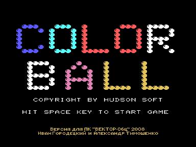
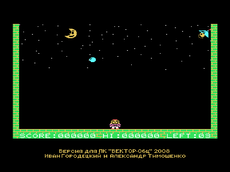

Игра COLOR BALL адаптирована с MSX.
Заново рекомпилированный вариант [Color Ball](../colball).
Суть игры проста - отбивать цветные шарики, которые с каждым отбиванием взлетают все выше и меняют цвет, а в итоге улетают совсем.

Данная версия адаптирована независимо от варианта ПО «Счетмаш» (1990 год) и имеет следующие отличия:

1. Большее быстродействие.
2. Цвета как на MSX (в варианте Счетмаша они были изменены).
3. Звук (музыка через AY) выводится через Sound Tracker или R-Sound 2.

Для запуска нужен обычный Вектор с КР580, квазидиск не требуется.

## Управление

Управление в игре - курсор и пробел.

## Авторы адаптации

- Версия для Вектора-06Ц - Иван Городецкий, г. Уфа, Россия, iig1@mail.ru
- Рекомпиляция игры с Z80 на КР580 - Александр Тимошенко, г. Чернигов, Украина, timsoft@mail.ru, [vector06c.narod.ru](http://vector06c.narod.ru)

## История версий

- Версия 1.0 - 12.10.2008: первоначальный вариант.
- Версия 1.1 - 17.10.2008: откорректировано программирование палитры для совместимости с ПК6128Ц.
