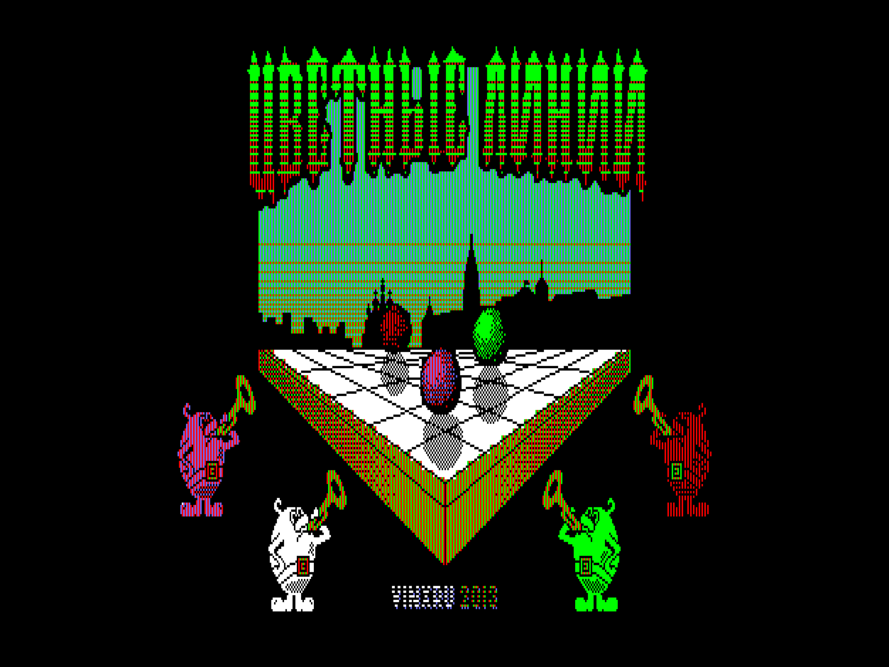
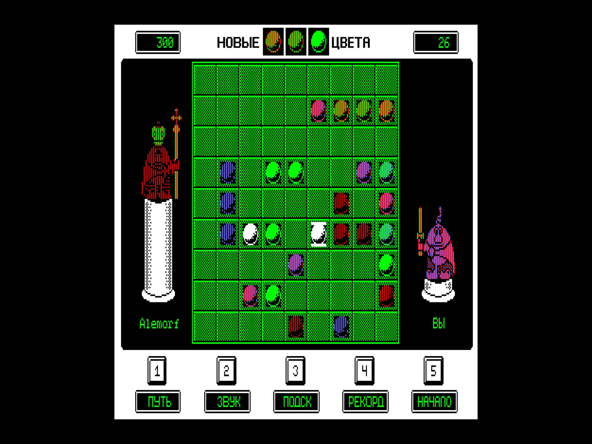

```
Игру "Цветные линии" [Алексей Морозов](../../authors/alemorf) написал в 2013 для Специалиста в 2013 году на языке Си и скомпилировал собственным компилятором.
В 2026 году я делаю собственный компилятор и в плане проверки что и как он может я попытался собрать игру для Вектор-06Ц.

Оригинальная игра заточена под разрешение Специалиста - 384x256 при 8 цветах.
У Вектора либо разрешения не хватает, либо цветов.
Я собрал две версии, но ни одна из них не выглядит хорошо.
Круче всего выглядела бы версия 256*256 при 16-ти цветах, но при условии, что графика будет отмасштабирована руками, а не автоматом как у меня.
Если вдруг кто-то захочет руками поправить графику, то я соберу новую версию. А пока имеем, что имеем.
```

© [Станислав Юдин](../../authors/cityacee)

См. также [Color Lines](../color_lines/) и [Color Lines](../demosfan/1999/color_lines).



