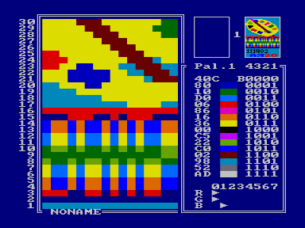
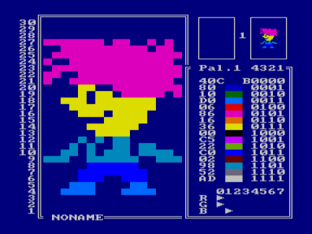

# Графический редактор COMAN

Редактор состоит из трёх независимых частей: редактора палитр, цветового и шестнадцатиричного редакторов.

## Редактор палитр

| Клавиши        | Действие                                                                                                                                                                             |
| -------------- | ------------------------------------------------------------------------------------------------------------------------------------------------------------------------------------ |
| `СС` + `1`…`9` | Выбрать палитру по номеру. Таблица цветов показывается в шестнадцатеричном виде и в цвете; активный цвет обозначен `C`. Для удобства также показаны шестнадцатеричные номера цветов. |
| `←` / `→`      | Выбрать режим `C` или `B` (активный цвет бордюра).                                                                                                                                   |
| `Пробел`       | Начать редактирование активного цвета или вернуться в режим `C`.                                                                                                                     |
| `АР2`          | Перейти в цветовой редактор.                                                                                                                                                         |

При редактировании цвета клавишами курсора выбираются основная составляющая и её значение на доступной шкале: для `C` — 7 единиц, для `B` — 3 единицы. Изменение отображается в шестнадцатеричном представлении цвета.

## Цветовой редактор

### Редактирование изображения

| Клавиши                     | Действие                                                                                                                                                                    |
| --------------------------- | --------------------------------------------------------------------------------------------------------------------------------------------------------------------------- |
| `АР2`                       | Перейти в редактор палитр, чтобы сменить палитру, изменить цвет бордюра или выбрать активный цвет.                                                                          |
| Клавиши курсора             | Переместить курсор в пределах рабочего окна.                                                                                                                                |
| `Пробел`                    | Закрасить точку под курсором активным цветом.                                                                                                                               |
| `R` / `L` + клавиши курсора | Перемещать курсор, закрашивая точки.                                                                                                                                        |
| `УС` + `C`                  | Очистить рабочее окно.                                                                                                                                                      |
| `УС` + `1`…`4`              | Показать выбранную плоскость экрана. Содержимое отображается временным изменением таблицы декодера цвета; выведенные шестнадцатеричные значения таблицы цветов не меняются. |
| `УС` + `I`                  | Инвертировать рабочее окно.                                                                                                                                                 |
| `УС` + `R`                  | Получить зеркальное изображение.                                                                                                                                            |
| `УС` + клавиши курсора      | Циклически сдвинуть экран.                                                                                                                                                  |
| `УС` + `F1`                 | Развернуть изображение в вертикальном направлении.                                                                                                                          |
| `УС` + `F2`                 | Сжать изображение в вертикальном направлении.                                                                                                                               |
| `УС` + `F4`                 | Развернуть изображение в горизонтальном направлении.                                                                                                                        |
| `УС` + `F5`                 | Сжать изображение в горизонтальном направлении.                                                                                                                             |
| `УС` + `H`                  | Перейти в шестнадцатиричный редактор.                                                                                                                                       |

Адреса экранных плоскостей:

| Плоскость | Адреса        |
| --------- | ------------- |
| 1         | `E000`–`FFFF` |
| 2         | `C000`–`DFFF` |
| 3         | `A000`–`BFFF` |
| 4         | `8000`–`9FFF` |

### Работа с магнитной лентой

| Клавиши    | Действие                                                                                                              |
| ---------- | --------------------------------------------------------------------------------------------------------------------- |
| `УС` + `N` | Переименовать рабочее поле. Ввод завершается клавишей `ВК` или при превышении максимальной длины имени — 11 символов. |
| `УС` + `O` | Записать изображение на магнитную ленту.                                                                              |
| `УС` + `P` | Считать изображение с магнитной ленты.                                                                                |
| `УС` + `M` | Считать изображение с магнитной ленты, сохранив текущую палитру.                                                      |

### Работа с памятью

Содержимое выбранного окна памяти и его номер отображаются в верхней правой части экрана.

| Клавиши        | Действие                                                 |
| -------------- | -------------------------------------------------------- |
| `СС` + `1`…`9` | Выбрать окно памяти по номеру.                           |
| `СС` + `→`     | Просмотреть следующее окно памяти.                       |
| `СС` + `←`     | Просмотреть предыдущее окно памяти.                      |
| `УС` + `S`     | Записать содержимое рабочего окна в текущее окно памяти. |
| `УС` + `L`     | Загрузить рабочее окно из текущего окна памяти.          |
| `УС` + `X`     | Обменять содержимое рабочего поля и окна памяти.         |

## Шестнадцатиричный редактор

| Клавиши          | Действие                                            |
| ---------------- | --------------------------------------------------- |
| Клавиши курсора  | Переместить курсор в пределах рабочего поля.        |
| `0`…`9`, `A`…`F` | Редактировать изображение в шестнадцатеричном виде. |

## Снимки экрана

