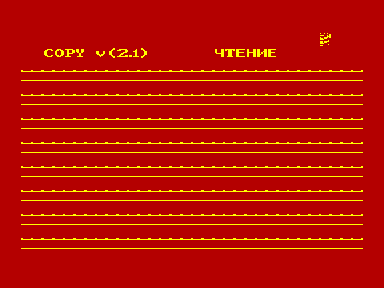
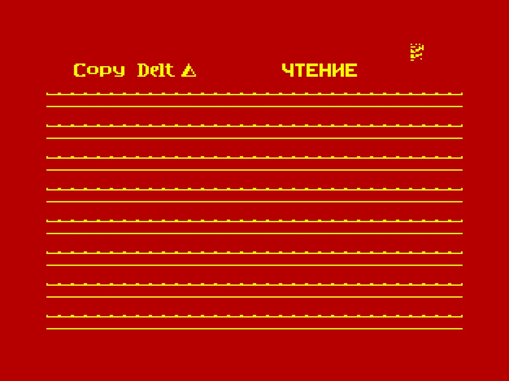
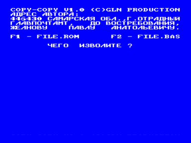
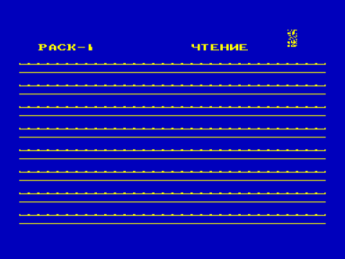
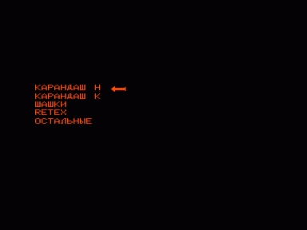
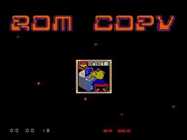
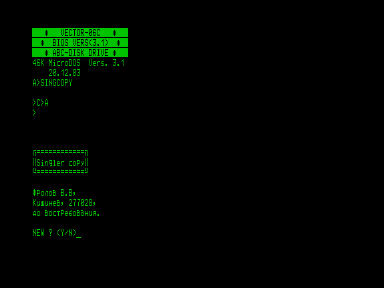
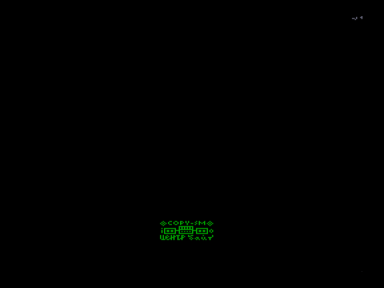
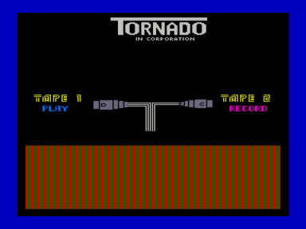
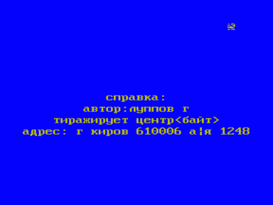

Программы копирования файлов и ROM для «Вектора-06Ц».

- [Copy 2.1](2.1)
- [Copy DeltΔ](Delta)
- [COPY-ALL](all)
- [COPY-COPY](copy)
- [Copy pack 1](pack1)
- [copyrom1](rom1)
- [ROM Copy](romcopy)
- [ROM Copy v2](romcopy_v2)
- [Copy S](s)
- [Singler copy](singcopy)
- [Copy-SM](sm)
- [Copy TORNADO](t)
- [COPY TF](tf)

