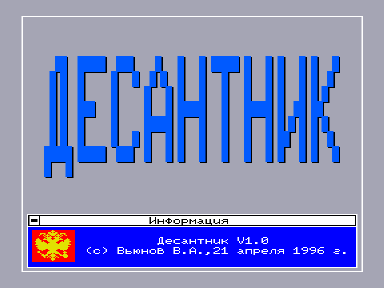
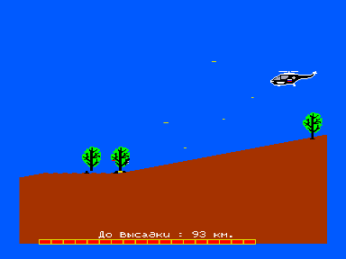

Игра «Десантник», работает только под ОС РДС, состоит из 2 частей, которые загружаются с диска.
Пароль для запуска 2й части (его можно узнать после успешного прохождения 1й части игры): «Blue Берет» (регистрозависимый).

В архиве загрузочные образы квазидиска EDD и FDD с системой RDS.
Для запуска игры в эмуляторе [http://bashkiria-2m.narod.ru/](http://bashkiria-2m.narod.ru/) подключить образы КД и FDD, затем, удерживая `F1`+`F2`, однократно нажать F11.
После загрузки программы нажать F12. После запуска РДС набрать «DESANT» и нажать `ВК`.

