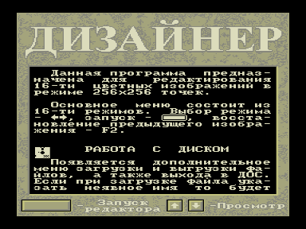
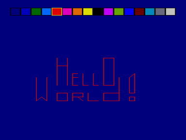

# Графический пакет «Дизайнер»

«Дизайнер» — графический редактор с набором утилит для работы с изображениями и знакогенераторами.

## Материалы

- [Образ дискеты](designer.fdd)
- [Исходные тексты](sources.7z)
- [Оригинальное описание](original.7z) (`designer.txt`, кодировка CP866)

## Состав пакета

| Файл           | Назначение                                                                                                            |
| -------------- | --------------------------------------------------------------------------------------------------------------------- |
| `DESIGNER.COM` | Графический редактор. Оригинальная дискета записывалась с защитой от копирования.                                     |
| `VTXT256.COM`  | Отображение текстового файла знакогенератором ZG4 в режиме 256 × 256 точек и выгрузка экранной области в формате SPR. |
| `VTXT512.COM`  | Отображение текстового файла знакогенератором ZG4 в режиме 512 × 256 точек и выгрузка экранной области в формате SPR. |
| `PEREDIR5.COM` | Извлечение графики из других программ.                                                                                |
| `GRFTOSPR.COM` | Преобразование GRF в SPR.                                                                                             |
| `SCRTOSPR.COM` | Преобразование SCR в SPR.                                                                                             |
| `RBR->SPR.COM` | Преобразование RBR в SPR.                                                                                             |
| `DEMO-SPR.COM` | Просмотр группы SPR-файлов.                                                                                           |
| `ZGEDITOR.COM` | Редактор знакогенераторов типов ZG1, ZG2 и ZG3.                                                                       |
| `*.ZG1`        | Набор знакогенераторов.                                                                                               |
| `*.ZG4`        | Набор знакогенераторов.                                                                                               |

## Скриншоты

## Исторические условия распространения

В оригинальном описании стоимость пакета составляла **5 долларов**. Условия и адреса ниже приведены как часть исторической документации, а не как актуальное предложение.

1. **При личной встрече** покупателю выдавалась одна дискета. Распространитель заносил её серийный номер и имя владельца в базу данных, а покупатель проверял читаемость файлов. При выходе новой версии или повреждении дискеты пакет можно было обменять за 10% стоимости — 50 центов.
2. **При заказе по почте** отправлялись две дискеты, одна из которых была резервной копией. По желанию покупателя их могли отправить в отдельных бандеролях. При выходе новой версии пакет можно было обменять за 10% стоимости — 50 центов.

Дискеты со вскрытым конвертом или несовпадающим серийным номером обмену не подлежали. Распространитель мог добавить к цене расходы на пересылку и дискеты.

### Официальные распространители по оригинальному описанию

- Кучеренко С. — 255240, Украина, Киевская обл., г. Вышгород
- Карпов Д. — 192260, Россия, Санкт-Петербург
- Михайлов А. — МД-2072, Республика Молдова
