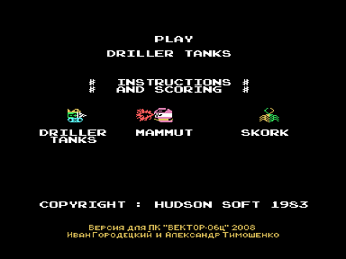
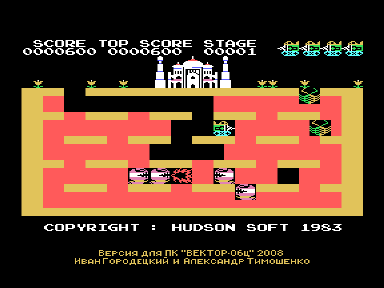

Игра DRILLER TANKS адаптирована с MSX.

Охранять дворец, уничтожая MAMMUTов и попутно набирая как можно больше очков, прорубая туннели и уничтожая SKORKов.
За каждые 20000 очков дают новый DRILLER TANK.

Для запуска нужен обычный Вектор с КР580, квазидиск не требуется.
Звук выводится через Sound Tracker или R-Sound 2.

## Управление

Управление в игре - курсор и пробел.

## Авторы адаптации

- Версия для Вектора-06Ц - Иван Городецкий, г. Уфа, Россия, iig1 at mail ru
- Рекомпиляция игры с Z80 на КР580 - Александр Тимошенко, г. Чернигов, Украина, timsoft at mail ru, [vector06c.narod.ru](http://vector06c.narod.ru)

## История версий

- Версия 1.0 - 05.10.2008: первоначальный вариант.
- Версия 1.1 - 17.10.2008: откорректировано программирование палитры для совместимости с ПК6128Ц.
