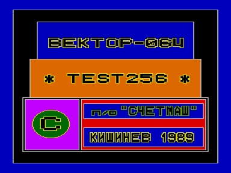
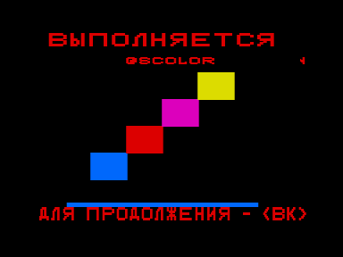

Программное обеспечение "Драйверы устройств" представляет собой пакет подпрограмм, выполняющих определенные функции, такие, как запись и чтение данных с магнитной ленты, работа с экраном дисплея, программирование цвета и музыки, ввод информации с клавиатуры и т.д.

В [Вектор-USER](../vector_user) №8 данный пакет был окрещен, как "некое окно для дураков в мир ВЕКТОРА", но тем не менее с его помощью были написаны первые, ставшие уже классическими, игры [Тетрис](../tetris), [Xonix](../xonix), [Штурм](../shturm), [Полет](../polet), [Йети](../jeti) и многие другие.

Комплект поставки:

drvdoc1.rom - описание ДУ (часть 1)

drvdoc2.rom - описание ДУ (часть 2)

driver.mon - драйвер для компоновки программы, загружается в монитор-отладчик по адресу 0100h

testdu.mon - тест драйверов устройств, загружается в монитор-отладчик по адресу 3000h

Драйверы устройств (описание).djvu - описание ДУ

Примечание: загрузить файлы в монитор-отладчик можно в [Эмулятор «Virtual Vector»](../virtual_vector), начиная с версии 5.64 (см. менеджер памяти).

