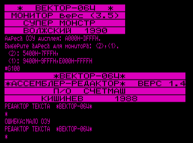

Для запуска ассемблер-редактора необходима среда монитора-отладчика.
Рекомендуется использовать [Эмулятор «Virtual Vector»](../virtual_vector) с загрузчиком [Загрузчик «Вектор-06ц» (32 Кб, TimSoft)](../bootloaders/boot45) (CPU -> Boot Manager -> TIMSoft Boot), в котором есть возможность загрузки монитора (удерживая `F4`, нажать `ВВОД`+`БЛК`).
Загрузка файла ассемблер-редактора осуществляется через менеджер памяти (File -> Memory Manager) с адреса 0100h, запуск командой `G100`.



## Файлы

- `EDASM.M01` - исправленная версия (русские буквы в EDASM, см. ниже);
- `EDASM_.M01` - оригинальная версия;
- `edasm.wav` - EDASM в формате монитора, загружается (в любую версию монитора-отладчика) командой `R`;
- `hello.wav` - Hello, world! в формате EDASM.

Если преобразовывать .m01 в wav с использованием [Конвертер ROM2WAV](../bin2wav/ramiros), то надо грузить монитором с поддержкой загрузки .rom, например [Монитор-отладчик «Супер-монстр 3.5»](../smon/3.5).
Загрузка .rom - директива `B`.

## Туториал «Hello, world!»

После загрузки монитора-отладчика и редактора-ассемблера командой `R` из файла edasm.wav:

1. Стартуем редактор: `G100`.
2. Загружаем файл: `АР2`+`I`.
3. Переходим в ассемблер: `СТР`.
4. Транслируем: `1`. Должно показать 0 ошибок.
5. Выходим в монитор: `УС`+`E`.
6. Запускаем программу: `C1800`.

Спасибо ivagor-у за подробную инструкцию и загружаемые wav-файлы.

## Русские буквы в EDASM

«Вектор-USER» №7.

В текстовом редакторе пакета EDASM в результате ошибочного определения конца файла становится невозможным правильный вывод на ленту текстов, содержащих символы с кодами больше 127, т. к. авторы проверяют только наличие в байте знакового (старшего) бита.
Предлагаемые исправления в коде редактора позволяют обойти этот недостаток:

```
00000975: 3C INR A
00000976: C8 RZ
00000977: 3D DCR A
00000978: 81 ADD C
00000979: 4F MOV C,A
0000097A: 88 ADC B
0000097B: 91 SUB C
```

П. Желнов, г. Отрадный

## См. также

- [Ассемблер-редактор (описание)](../asmed)
- [Monitor «HIGH»+EDASM](../monitor_debuger/monedasm) - готовая для загрузки сборка с ассемблером
