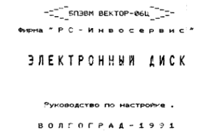
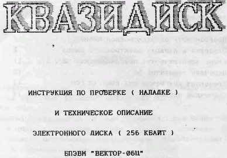
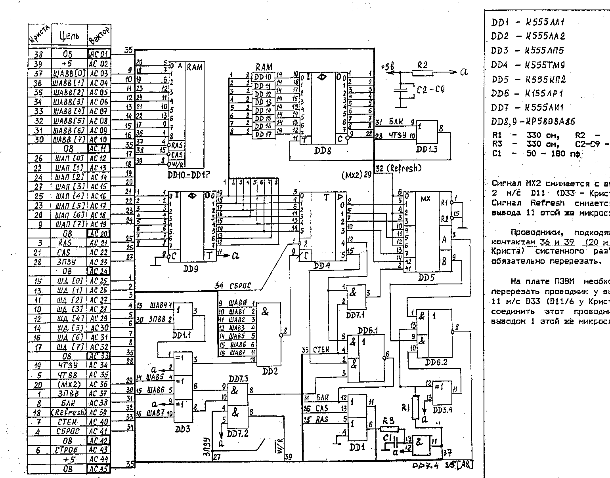
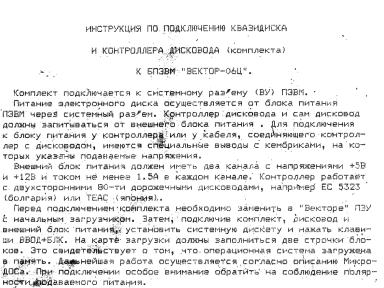

Электронные диски (квазидиски) для «Вектора-06Ц»: схемы, описания и инструкции по подключению.

- [Электронный диск (Руководство по настройке)](invoservis)
- [Квазидиск (Кишинев)](kishinev)
- [Квазидиск (Омск)](omsk)
- [Инструкция по подключению квазидиска и контроллера дисковода](unknown)

