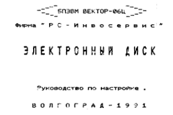

# Электронный диск «РС-Инвосервис»: руководство по настройке

Руководство фирмы «РС-Инвосервис» (Волгоград, 1991 г.) по электронному диску (квазидиску) для БПЭВМ «Вектор-06Ц»: общее описание и состав устройства, сведения для программиста, методика проверки и наладки. Объём текста — 8 страниц; на обложке надписи «БПЭВМ „ВЕКТОР-06Ц“», «Фирма „РС-Инвосервис“», «ЭЛЕКТРОННЫЙ ДИСК. Руководство по настройке», «ВОЛГОГРАД — 1991».

Квазидиск — дополнительное ОЗУ ёмкостью 256 Кбайт; версия операционной системы «МикроДОС» для «Вектора-06Ц» с одним электронным диском позволяет работать практически со всем программным обеспечением, разработанным в рамках этой ОС. Программные средства для работы с квазидиском в источнике предлагается заказывать по адресу: 407074, г. Волгоград-74, а/я 40, «РС-Инвосервис» (номер абонентского ящика и начертание марки фирмы в скане читаются неуверенно, см. «Замечания к источникам»).

В каталоге только скан руководства и уменьшенная копия обложки: схема, сборочный чертёж и временные диаграммы, на которые ссылается текст, в этот скан не входят.

## Источники

| Файл                                                                   | Что это                                                                                                                                       |
| ---------------------------------------------------------------------- | --------------------------------------------------------------------------------------------------------------------------------------------- |
| [ed.djvu](ed.djvu)                                                     | Скан руководства: 9 страниц (обложка + 8 страниц текста), 4081 × 6628 точек, 600 dpi, чёрно-белый (JB2), без текстового слоя и без метаданных |
| [invoservis-kvaz-tuning-manual.png](invoservis-kvaz-tuning-manual.png) | Уменьшенная копия обложки, 293 × 195 точек                                                                                                    |

Весь текст ниже набран по этому скану. Скан не имеет текстового слоя, поэтому текст распознан заново; места, которые читаются неуверенно, отмечены в разделе «Замечания к источникам».

## Устройство (стр. 1–2)

Конструктивно электронный диск (ЭД) представляет собой двустороннюю печатную плату и рассчитан на подключение к «ВЕКТОРУ» через разъём «ВУ» системного модуля. Питание ЭД осуществляется от блока питания ПЭВМ по каналу +5 В через разъём «ВУ» или от внешнего источника и должно составлять 5 В с допуском ±0,25 В; потребляемый ток — 0,55 А (±0,05 А).

Принципиальная электрическая схема ЭД, по перечню узлов из источника, включает следующие узлы:

| №   | Узел                                        | Микросхемы, элементы                                          | Назначение (по источнику)                                                                           |
| --- | ------------------------------------------- | ------------------------------------------------------------- | --------------------------------------------------------------------------------------------------- |
| 1   | Регистр инструкции                          | D7, D8, D10                                                   | хранение кода инструкции                                                                            |
| 2   | Дешифратор адреса порта ЭД                  | D1, D2.2                                                      | формирует строб записи кода инструкции в регистр инструкции                                         |
| 3   | Дешифратор адресного пространства A000–DFFF | D3.4, D5.3, D9.5, D9.4, R16                                   | обеспечивает формирование сигнала при обращении центрального процессора в это адресное пространство |
| 4   | Переключатель блоков (линеек ОЗУ ЭД)        | D11                                                           | выбор линейки                                                                                       |
| 5   | Формирователь сигналов CAS, WE для ИМС ОЗУ  | D6                                                            | управление микросхемами ОЗУ                                                                         |
| 6   | Формирователь сигнала БЛК                   | D2.1                                                          | активный уровень сигнала БЛК (лог. 0) означает выборку ЭД                                           |
| 7   | ОЗУ ЭД                                      | 32 ИМС К565РУ5, четыре линейки по 8 ИМС                       | хранение данных                                                                                     |
| 8   | Буфер шины данных                           | D12, D13                                                      | двунаправленная передача данных                                                                     |
| 9   | Узел обрамления ОЗУ ЭД                      | повторитель адреса D3, D4, R7–R14; повторитель RAS D9.1, D9.2 | согласование сигналов ОЗУ                                                                           |

### Таблица прошивки ПЗУ D6

Таблица 1 в источнике — прошивка ПЗУ D6, формирователя сигналов CAS и WE: восемь строк по четыре шестнадцатеричных байта. Ни строки, ни столбцы в тексте не подписаны и не пояснены; значения перенесены как есть, без интерпретации.

| Строка | 1   | 2   | 3   | 4   |
| ------ | --- | --- | --- | --- |
| 1      | FE  | FA  | F6  | FE  |
| 2      | FE  | FE  | FE  | FE  |
| 3      | 7C  | 7A  | 76  | 6E  |
| 4      | 7E  | 7E  | 7E  | 7E  |
| 5      | DC  | DA  | B6  | AE  |
| 6      | FE  | FE  | FE  | FE  |
| 7      | FC  | FA  | F6  | EE  |
| 8      | FE  | FE  | FE  | FE  |

## Программисту об электронном диске (стр. 2–4)

При работе в ОС «МикроДОС» объём ОЗУ ЭД распределяется следующим образом:

| Область           | Объём     |
| ----------------- | --------- |
| ОЗУ пользователя  | 234 Кбайт |
| «подэкранное» ОЗУ | 16 Кбайт  |
| контрольные суммы | 4 Кбайт   |
| каталог           | 2 Кбайт   |

Сумма совпадает с полной ёмкостью ЭД — 256 Кбайт; цифра в строке «контрольные суммы» в скане повреждена и восстановлена по этой сумме.

ОС имеет 64 точки входа в каталог. В порт ЭД записывается код инструкции, определяющий режим доступа к ЭД и номер одного из четырёх 64-килобайтных блоков, к которому разрешается доступ. Код инструкции состоит из 8 бит: `D7 D6 D5 D4 D3 D2 D1 D0`.

| Бит    | Назначение (по источнику)                                                   |
| ------ | --------------------------------------------------------------------------- |
| D1, D0 | биты, задающие номер блока при обращении к ЭД «как ОЗУ» («подэкранное» ОЗУ) |
| D3, D2 | биты, задающие номер блока при обращении к ЭД «как стек»                    |
| D4     | вкл/выкл режима ЭД «как стек»: 0 — режим отключён, 1 — режим включён        |
| D5     | вкл/выкл режима ЭД «как ОЗУ»: 0 — режим отключён, 1 — режим включён         |
| D7, D6 | значение этих битов безразлично                                             |

- В режиме ЭД «как ОЗУ» (D5=1, D4=0) в адресное пространство A000–DFFF центрального процессора БПЭВМ подключается память соответствующего блока ЭД: при обращении в программах пользователя (или системных) к ОЗУ БПЭВМ по этим адресам данные будут считываться (записываться) в ОЗУ ЭД, а не в ОЗУ БПЭВМ.
- В режиме ЭД «как стек» (D5=0, D4=1) при выполнении команд, обращающихся к стеку, данные будут считываться (записываться) из (в) ОЗУ ЭД, а не в ОЗУ БПЭВМ.
- Если в коде инструкции D5=1 и D4=1, то работают оба режима. При выполнении стековых операций в адресном пространстве A000–DFFF доступ будет обеспечен к блоку, заданному разрядами D3, D2 кода инструкции.

## Проверка и наладка (стр. 4–8)

### Приборы и программы

Для проверки и наладки ЭД нужны осциллограф с входом внешней синхронизации, тестер для измерения постоянных токов и напряжений, программы `KDNALAD.COM` и `TESTKD.COM`. Перед запуском программы наладки источник рекомендует предварительно ознакомиться с алгоритмом её работы; временная диаграмма основного цикла этой программы используется при проверках ниже.

### Порядок наладки

1. Начать с проверки правильности монтажа в соответствии со сборочным чертежом на ЭД. Особое внимание — правильности установки ИМС по ключу на корпусе.
2. Визуально проверить отсутствие в местах паек закороток припоем на соседние дорожки или контакты.
3. Тестером проверить отсутствие короткого замыкания между шиной +5 В и шиной 0 В.
4. Подключить ЭД к БПЭВМ через разъём «ВУ», включить питание БПЭВМ и проверить напряжение на плате ЭД. Если напряжение отличается от требуемого (5 ±0,25 В), установить необходимое при помощи потенциометра в блоке питания «ВЕКТОРА». Желательно также проверить значение тока, потребляемого квазидиском.
5. Нажать кнопки «ВВОД» и «БЛК» на БПЭВМ. Если при этом появилась обычная карта загрузки, то начало неплохое: ЭД, по крайней мере, не мешает работе «ВЕКТОРА».
6. Если карта загрузки не появилась и изображение на экране не изменилось, проверить, что контакты АС36 и АС39 на разъёме «ВУ» не соединены с шиной +5 В. Если соединены, разорвать эти связи, а выводы микросхем, на которые через эти контакты подавалось +5 В, замкнуть на землю в другом месте.
7. Если карта загрузки не появилась и после этого, при помощи осциллографа проверить сигнал «БЛК» (контакт АС38): он должен быть равен лог. 1. В противном случае проверить сигналы на входах формирователя сигнала «БЛК» (в тексте раздела — D2.2): на входах 03 и 04 должен быть лог. 0, так как регистр инструкции обнулён.
8. Если и после этого карта загрузки не появилась, проверить сигналы на всех контактах разъёма ЭД на наличие закороток с шиной питания или другими сигналами.
9. После появления карты загрузки отключить питание БПЭВМ и подключить к контакту 08 D1 вход осциллографа «внешняя синхронизация» — это понадобится при дальнейшей наладке ЭД.
10. Загрузить программу `KDNALAD.COM`. В результате её работы должен очиститься экран, а в верхней части должны появиться четыре одинаковые группы точек. Верхние две строчки каждой группы показывают код, который должен записываться в линейку из 8 ИМС ОЗУ, вторые две нижние — код, который считывается из этого же адреса этого же блока.
11. Если все четыре группы соответствуют рисунку, проверить осциллографом адресные сигналы, поступающие на ИМС КР565РУ5: сначала на резисторах R7–R14, затем непосредственно на входах ИМС. Если сигналы после адресных повторителей совпадают с сигналами после резисторов — нормально; если не совпадают, скорее всего сигнал адреса после резистора «сидит» на каком-то другом сигнале.

### Проверка регистра инструкции

Переключить осциллограф на внешнюю синхронизацию и добиться устойчивого изображения сигнала синхронизации (с выхода 08 D1). По листу с временной диаграммой основного цикла программы `KDNALAD.COM` проверить регистр инструкции:

- в момент времени t0 в регистр инструкции записывается код `55H`, поступающий с ШД7…ШД0. Если выход какого-либо триггера не соответствует временной диаграмме в этот момент, проверить сигналы, поступающие по ШД7…ШД0 на входы триггеров; наличие лог. 1 на входах «R» триггеров; сигнал с выхода 08 D1 на входах «C» триггеров; затем — не закорочены ли входы триггеров с другими сигналами;
- в момент времени t1 в регистр инструкции записывается код `0AAH`, то есть инверсный от `55H`;
- в интервале t2–t3 в регистр инструкции записывается код `10H` — режим «как стек» с обращением к четвёртому блоку; выходы регистров должны соответствовать временной диаграмме.

### Проверка записи и считывания ОЗУ ЭД

- Затем выполняется команда `PUSH` — запись в блок ОЗУ ЭД кодов `55H` и `0AAH`. В момент её выполнения на выходе 06 D2 должен появиться сигнал, инверсный сигналу «СТЕК» на контакте АС40 разъёма «ВУ». Сигналы на входах и выходах ПЗУ D6 должны соответствовать временной диаграмме для этого момента: на выходе 02 должен повториться сигнал CAS, поступающий из БПЭВМ по АС25, на выходе 06 — сигнал WE, поступающий из БПЭВМ по АС23.
- Если входные сигналы для D6 соответствуют временной диаграмме, но на выходах сигналы не соответствуют, проверить, не закорочены ли они с другими сигналами. Если закороток нет, а на выходах сигналы не те, которые должны быть, значит «прошивка» ПЗУ D6 неправильна и его надо заменить.
- Сигналы CAS, WE, RAS и адресные поступают на входы ИМС ОЗУ ЭД и обеспечивают запись в этот блок кода `55H` (по первым CAS, WE), затем кода `0AAH` (по вторым CAS, WE). Так как запись в КР565РУ5 производится в режиме «считывание — модификация — запись», на выходах этих ИМС в эти моменты появляется сигнал, соответствующий сигналу на входах данных этих ИМС.
- Если сигналы на выходах проверяемых ИМС ОЗУ не тождественны кодам `55H` и `0AAH`, приходящим на входы данных, проверить, не закорочены ли выходы ИМС ОЗУ с другими сигналами, и проверить наличие на выводах 15 D12, D13 уровня лог. 1 (сигнал управления направлением передачи буфером данных). Если закороток нет, направление передачи равно лог. 1, а выходы не соответствуют временной диаграмме — значит, эти ИМС бракованы.
- После команды `PUSH` выполняется команда `POP` — считывание в регистры микропроцессора содержимого ОЗУ ЭД из того же адреса, куда записали `PUSH`. При этом на шину данных разъёма (ШД7–ШД0) в момент низкого уровня сигнала на входах 15 D12, D13 поступают данные, выдаваемые блоком ОЗУ ЭД.
- В интервалах t3–t4, t4–t5, t5–t6 происходит выполнение операций, аналогичных описанным выше: сначала запись кода инструкции, затем запись в блок ОЗУ ЭД байтов данных `55H` и `0AAH` и считывание этих же байтов по тому же адресу того же блока.

### Проверка дешифратора адресного пространства

В интервале t6–t7 происходит запись в регистр инструкции кода `23H` — режим «как ОЗУ» с обращением к первому блоку. Затем выполняется команда `STA 0A000H`, при выполнении которой на выходе 06 D2 должен появиться сигнал с уровнем лог. 0, инверсный сигналу с выхода 08 D9.

Если сигнал на выходе 06 D2 не появляется в момент времени t7, проверить, что на выходе D4.2 уровень лог. 1, а на входе D5.2 — лог. 1. Если на входе D5.2 не лог. 1, проверить работу D9.5, D9.4, D3 (в скане номер корпуса читается неуверенно) и D5.4.

### Программа проверки ИМС ОЗУ ЭД

После того как все четыре группы точек на экране соответствуют приведённому рисунку, следует воспользоваться программой проверки ИМС ОЗУ ЭД `TESTKD.COM`. Программа ориентирована на поиск отказов динамического типа — отклонений в динамических параметрах ИМС ОЗУ, наводок на шины — и статического типа: короткое замыкание, обрывы на плате или в ИМС и др. Основная задача — выявление отказа ОЗУ с точностью до одной ИМС КР565РУ5.

Рекомендации источника при большом числе забракованных ИМС:

1. Не спешить заменять все ИМС подряд: ещё раз посмотреть временные диаграммы по `KDNALAD.COM` и попытаться найти то, что с первого раза не заметили.
2. Если отклонений не нашли, установить дополнительно у каждой ИМС фильтры по питанию — конденсаторы ёмкостью не менее 0,15 мкФ.
3. Если снова неудача, поднять напряжение питания по каналу +5 В до +5,25 В и ещё раз запустить тест `TESTKD.COM`.
4. Если и в этом случае брака много, заменить одну бракуемую микросхему ОЗУ и проверить работоспособность ЭД тестом `TESTKD.COM`; только если микросхема в этом месте браковаться перестала, заменять остальные бракованные микросхемы по одной.
5. Если брак повторился, весьма вероятно, что временные параметры ПЗУ D6 «ушли» за пределы допустимых, и ПЗУ необходимо заменить.
6. Если и это не помогло, остаётся заменить микросхемы, выполняющие функции повторителей адреса.

## Замечания к источникам

- Скан `ed.djvu` не имеет текстового слоя (только JB2-изображения страниц) и метаданных; весь текст README распознан заново. Абзацы и таблицы восстановлены по разметке страниц, разбивка на разделы соответствует заголовкам источника: «Общее описание квазидиска БПЭВМ „ВЕКТОР-06Ц“», «Программисту об электронном диске», «Проверка и наладка электронного диска». Порядковые номера разделов в скане сливаются с номерами страниц в боковом поле, поэтому в заголовках README оставлены только номера страниц источника (1–8).
- Скан — чёрно-белый, типографский набор низкого качества (шрифт с залитыми элементами), поэтому отдельные начертания распознаются неуверенно. Ниже перечислены все места, где чтение неоднозначно.
- Напряжение питания в источнике набрано как «5 (±0,25) В» — знак допуска и цифры в скане читаются неуверенно; ток — «0,55 (±0,05) А». Оба значения приведены как прочитаны.
- Адрес для заказа программных средств: «407074 г. Волгоград-74, а/я 40, „РС-Инвосервис“». Номер абонентского ящика в скане читается как 40 или 44, марка фирмы — как «РС»/«ЭС»; на обложке и в колонтитулах стоит «РС-Инвосервис».
- Перечень микросхем дешифратора адресного пространства в скане выглядит как «(D3.4, D5.3, D9.5, D9.4, R16)»; обозначение резистора R16 в этом перечне читается уверенно, но его роль в тексте не поясняется.
- Обозначение ИМС ОЗУ в источнике набрано по-разному: в перечне узлов схемы — «К565РУ5», в разделах наладки — «КР565РУ5». Оба написания оставлены как в скане.
- В разделе наладки формирователь сигнала «БЛК» обозначен D2.2, тогда как в перечне узлов схемы тот же узел назван D2.1. Оба написания приведены как в источнике.
- Номера контактов разъёма «ВУ» приведены как в скане: АС36 и АС39 (проверка замыкания на +5 В), АС38 (сигнал «БЛК»), АС40 (сигнал «СТЕК»), АС25 (CAS), АС23 (WE).
- В строке «контрольные суммы» карты ОЗУ цифра повреждена при печати; «4 Кбайт» восстановлено по сумме 234 + 16 + 4 + 2 = 256 Кбайт. Сама карта в источнике не комментируется.
- Счёт блоков в разделе наладки сквозной: код `23H` назван режимом «как ОЗУ» «с обращением к первому блоку», код `10H` — «как стек» «с обращением к четвёртому блоку». Раздел для программиста задаёт номер блока двумя разрядами без таблицы соответствия, поэтому связь «код ↔ номер блока» в README не пересчитывалась.
- Таблица прошивки ПЗУ D6 перенесена как есть: столбцы и строки в источнике не подписаны, пояснений к значениям нет. Спорные ячейки (в первой строке — знак «C»/«E») сверены по изображению отдельных ячеек скана.
- Рисунок с четырьмя группами точек (результат работы `KDNALAD.COM`) в источнике набран «звёздочками» и в README не воспроизводится; в тексте он описан словами.
- Схема ЭД, сборочный чертёж и лист временных диаграмм, на которые ссылается текст, в `ed.djvu` отсутствуют — в каталоге есть только сам скан руководства.
- Копия обложки в PNG (293 × 195) значительно меньше исходной страницы скана и пригодна только для общего представления о документе.

## Другие варианты

- [Инструкция по подключению квазидиска и контроллера дисковода](../unknown/README.md) — другой документ, схему и терминологию с руководством «Инвосервиса» смешивать не следует.
- [Квазидиск (Кишинёв)](../kishinev/README.md) — архив с текстовой редакцией описания квазидиска; там же лежит справка «Программисту об электронном диске», подписанная «По материалам фирмы „PC - Invoservise“, Усков И.М.».
- [Квазидиск (Омск)](../omsk/README.md) — описание, рекомендации и схема омского варианта.

Общий указатель раздела — [Квазидиски](../README.md).
