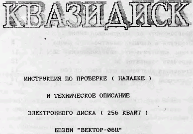

# Квазидиск (Кишинёв)

Электронный диск (ЭД, квазидиск) — дополнительное ОЗУ ёмкостью 256 КБ в составе БПЭВМ «Вектор-06Ц». Материалы варианта собраны в архиве [ed_kish_.zip](ed_kish_.zip): описание устройства, методика проверки и наладки, таблица прошивки формирователя CAS/WE, справка для программиста о порте 10h и исходный текст программы проверки. Всё изложенное ниже переведено из этого архива.

Документ описывает версию дисковой операционной системы МикроДОС-1 с одним электронным диском: она позволяет работать практически со всем программным обеспечением, разработанным для этой ОС. МикроДОС и сервисные утилиты записывают программы на квазидиск, копируют, переименовывают и запускают их оттуда. На диске можно хранить много файлов, ограничение одно — ёмкость 256 КБ. Информация не теряется при выполнении программ и перезапуске компьютера и пропадает только при выключении питания; после включения МикроДОС и нужные программы приходится загружать заново — это единственный недостаток электронного диска. Наибольший эффект даёт работа вместе с одним или двумя дисководами (для такой конфигурации в источнике упомянуты ОС MDOS-2, MDOS-3 и другие): программы быстро переписываются с дискеты на квазидиск, дискета и дисковод изнашиваются меньше, а запуск с квазидиска происходит практически мгновенно, как из ОЗУ компьютера.

## Материалы

| Файл                         | Что это                                                                                            |
| ---------------------------- | -------------------------------------------------------------------------------------------------- |
| [ed_kish_.zip](ed_kish_.zip) | Исходный архив (6,5 МБ, 10 файлов): описание в двух форматах, скан, схема, изображения и программы |
| [KDkish1.png](KDkish1.png)   | Изображение из подборки каталога (388 × 270)                                                       |

## Файлы архива

| Файл               | Размер | Что это                                                                                                                                                                      |
| ------------------ | ------ | ---------------------------------------------------------------------------------------------------------------------------------------------------------------------------- |
| `kdnalad.rtx`      | 10 КБ  | Основной текст: «Описание квазидиска ПЭВМ „Вектор 06Ц“», разделы «=1= Проверка и наладка ЭД» и «=2= Программисту об электронном диске». Кодировка CP866, переводы строк CRLF |
| `kdnalad.djvu`     | 568 КБ | Скан того же руководства: 15 страниц, 400 dpi, без текстового слоя                                                                                                           |
| `kd.doc`           | 1,9 КБ | Отдельная справка «Программисту об электронном диске» (CP866), подписана «По материалам фирмы „PC - Invoservise“, Усков И.М.»                                                |
| `kdnalad.asm`      | 671 Б  | Исходный текст программы проверки KDNALAD на ассемблере 8080 (`.org 100h`)                                                                                                   |
| `kdnalad.rom`      | 256 Б  | Двоичный дамп: первые 102 байта совпадают с кодом из `kdnalad.asm`, далее посторонние данные                                                                                 |
| `kdisk.re3`        | 256 Б  | Двоичный образ программы (переходы адресуют диапазон 0100h–01FFh); в тексте документа не описан                                                                              |
| `kdnalad_sch.jpg`  | 610 КБ | Лист схемы отдельным файлом — та же страница 12, что и в `kdnalad.djvu` (изображения совпадают); полутоновый скан 200 dpi, 1351 × 1943                                       |
| `kdnalad_sch2.jpg` | 2,8 МБ | Схема в высоком разрешении (3507 × 4778), снимок или скан                                                                                                                    |
| `kdnalad_mon.jpg`  | 1,2 МБ | Снимок 3399 × 2400; по имени файла относится к монтажу, ссылок в тексте нет                                                                                                  |
| `kdnalad_time.jpg` | 1,1 МБ | Снимок 3398 × 2422; по имени файла относится к временным диаграммам, ссылок в тексте нет                                                                                     |

## Устройство

Конструктивно квазидиск — двусторонняя печатная плата размером 140 × 150 мм; память организована на 32 корпусах микросхем К565РУ5. К системной шине «Вектора» плата подключается через 90-контактный разъём «ВУ» на задней стенке компьютера; питание +5 В поступает через этот же разъём либо от отдельного источника, например от блока питания дисководов.

Принципиальная схема ЭД состоит из следующих узлов:

| №   | Узел                                        | Микросхемы, элементы                                          | Назначение                                                         |
| --- | ------------------------------------------- | ------------------------------------------------------------- | ------------------------------------------------------------------ |
| 1   | Регистр инструкции                          | D7, D8, D10                                                   | хранение кода инструкции                                           |
| 2   | Дешифратор адреса порта ЭД                  | D1, D2.2                                                      | стробы записи кода инструкции                                      |
| 3   | Дешифратор адресного пространства A000–DFFF | D5.3, D5.4, D9.3, D9.4                                        | формирование сигнала при обращении процессора к этому пространству |
| 4   | Переключатель блоков (линеек ОЗУ ЭД)        | D11                                                           | выбор линейки                                                      |
| 5   | Формирователь сигналов CAS, WE              | D6                                                            | управление микросхемами ОЗУ                                        |
| 6   | Формирователь сигнала БЛК                   | D2.1                                                          | активный уровень (=1) означает выборку ЭД                          |
| 7   | ОЗУ ЭД                                      | 32 × К565РУ5                                                  | хранение данных                                                    |
| 8   | Буфер шины данных                           | D12, D13                                                      | двунаправленная передача данных                                    |
| 9   | Узел обрамления ОЗУ                         | повторитель адреса D3, D4, R7–R14; повторитель RAS D9.1, D9.2 | согласование сигналов                                              |

Таблица прошивки формирователя сигналов CAS, WE (строки в источнике не пронумерованы, значения приведены как есть):

| № строки | 00  | 08  | 10  | 18  |
| -------- | --- | --- | --- | --- |
| 1        | FE  | FA  | F6  | FE  |
| 2        | FE  | FE  | FE  | FE  |
| 3        | 7C  | 7A  | 76  | 6E  |
| 4        | 7E  | 7E  | 7E  | 7E  |
| 5        | DC  | DA  | B6  | AE  |
| 6        | FE  | FE  | FE  | FE  |
| 7        | FC  | FA  | F6  | EE  |
| 8        | FE  | FE  | FE  | FE  |

## Проверка и наладка

Для проверки и наладки ЭД нужны осциллограф с входом внешней синхронизации, тестер для измерения токов и напряжений, программа KDNALAD.COM и «программа проверки микросхем ОЗУ ЭД» TESTKD.COM (в источнике первый раз названа TNESTKD.COM; в архиве есть только исходный текст и дамп KDNALAD).

1. Начать с проверки правильности монтажа и перемычек между выводами микросхем. Тестером проверить отсутствие короткого замыкания между шиной +5 В и 0 В, качество пайки и разводку токопроводящих дорожек; щупами касаться ножек микросхем — так надёжнее.
2. Подключить ЭД к БПЭВМ, включить питание и замерить напряжение на шине +5 В; при отклонении от требуемого отрегулировать его в блоке питания, желательно проверить и потребляемый ЭД ток — 0,55 А.
3. Нажать ВВОД + БЛК. Появление обычной карты загрузки — хороший признак: ЭД не мешает работе компьютера.
4. Если карты нет, проверить на замыкание с 0 В контакты АС36 и АС39 разъёма «ВУ», а осциллографом или логическим пробником — сигнал БЛК (контакт АС38), который должен быть =1. Иначе проверить сигналы на входах формирователя БЛК: на входах 03 и 04 D2.1 должен быть уровень =0, так как регистр управляющего слова обнулён.
5. После появления карты загрузки подключить к контакту 08 D1 вход «внешняя синхронизация» осциллографа, загрузить KDNALAD.COM и запустить её. Экран очищается, в верхней части появляются четыре одинаковые группы точек; верхние две строчки показывают код, который должен записываться в линейку микросхем К565РУ5, нижние две — код, считанный из того же блока.
6. Если все четыре группы соответствуют рисунку, проверить осциллографом адресные сигналы: сначала на резисторах R7–R14, затем на входах микросхем К565РУ5.
7. Проверить регистр «управляющего слова» (РУС): в момент t0 в него записывается код 55H, в момент t1 — инверсный 0AAH. При несоответствии проверяются сигналы, поступающие по ШД на входы триггеров; наличие =1 на входах R триггеров; сигнал с 08 D1 на входах C триггеров.
8. Проверить запись и считывание ОЗУ ЭД по контрольным точкам (см. таблицу ниже). Запись в К565РУ5 идёт в режиме «считывание — модификация — запись»: на выходах микросхем в эти моменты появляется сигнал, соответствующий сигналам на входах. Если они не тождественны, проверить, не закорочены ли входы микросхем ОЗУ ЭД с другими сигналами; при отсутствии замыканий возможна неисправность микросхемы.
9. Проверить дешифратор адресного пространства: в интервале t6–t7 записывается код 23H («как ОЗУ» с обращением к первому блоку), затем выполняется команда `STA 0A000H`. На выходе 06 D2 должен появиться уровень лог.0, инверсный сигналу с выхода 08 D9. Если сигнала нет, проверяются D2, D9.3, D9.4, D5.3, D5.4.
10. Когда все группы точек на экране соответствуют рисунку, загрузить TESTKD.COM. Программа выявляет отказы динамического типа (отклонения в динамических параметрах ИМС ОЗУ, наводки на шины) и статического типа — отказ ОЗУ с точностью до одной микросхемы.
11. Для устранения наводок полезно у каждой микросхемы ОЗУ установить конденсаторы ёмкостью 0,068–0,1 мкФ. Иногда для устранения сбоев помогает поднять напряжение питания до 5,25 В.

| Момент | Код в РУС        | Что проверяется                                                                                                                                                                               |
| ------ | ---------------- | --------------------------------------------------------------------------------------------------------------------------------------------------------------------------------------------- |
| t0     | 55H (`01010101`) | запись в РУС и сигналы по ШД7…ШД0 на входах триггеров                                                                                                                                         |
| t1     | 0AAH             | запись инверсного кода                                                                                                                                                                        |
| t2–t3  | 10H              | режим «как в стек» с обращением к 4 блоку; по команде `PUSH` в ОЗУ ЭД пишутся коды 55H и 0AAH. На выходе 06 D2 должен появиться сигнал, инверсный сигналу «стек» на контакте А40 разъёма «ВУ» |
| t3–t6  | —                | команда `POP` (данные с ЭД выдаются на ШД7–ШД0 в момент низкого уровня на 15 D2, D13) и последующие операции, аналогичные описанным                                                           |
| t6–t7  | 23H              | режим «как ОЗУ», команда `STA 0A000H`; на выходе 06 D2 — лог.0, инверсный сигналу с 08 D9                                                                                                     |

## Программисту об электронном диске

При работе в ОС МикроДОС объём ОЗУ распределяется так:

| Область           | Объём  |
| ----------------- | ------ |
| ОЗУ пользователя  | 234 КБ |
| «подэкранное» ОЗУ | 16 КБ  |
| каталог           | 2 КБ   |

Доступ к ЭД идёт через порт `10h`: в него записывается байт, определяющий режим доступа к ЭД и номер одного из четырёх 64-килобайтных блоков, к которому разрешается доступ.

| Бит    | Назначение                                               |
| ------ | -------------------------------------------------------- |
| D0, D1 | номер блока при обращении к ЭД «как ОЗУ»                 |
| D2, D3 | номер блока при обращении к ЭД «как стек»                |
| D4     | вкл/выкл режима ЭД «как стек»: 0 — выключен, 1 — включён |
| D5     | вкл/выкл режима ЭД «как ОЗУ»: 0 — выключен, 1 — включён  |
| D6, D7 | не используются                                          |

- В режиме «как ОЗУ» (D5=1, D4=0) в адресное пространство A000–DFFFh процессора БПЭВМ подключается память соответствующего блока ЭД: при обращении к этим адресам данные записываются в ОЗУ ЭД, а не в ОЗУ БПЭВМ.
- В режиме «как стек» (D5=0, D4=1) при выполнении команд, обращающихся к стеку, данные выбираются из ОЗУ ЭД, а не из БПЭВМ. Таким образом, для полного использования ОЗУ ЭД необходим режим «как стек».
- Если установлены оба режима (D5=1, D4=1), то при выполнении стековых операций в адресах A000–DFFFh доступ обеспечивается к блоку, заданному разрядами D3, D2.

Номер 64-килобайтного блока задаётся инверсно:

| Код   | Блок |
| ----- | ---- |
| `11B` | 0    |
| `10B` | 1    |
| `01B` | 2    |
| `00B` | 3    |

Пример из источника: стандартная конфигурация МикроДОС работает в режиме `23h` (`00010011B`), что означает нулевой блок ЭД, работающий в режиме «как ОЗУ».

## Программа проверки KDNALAD

`kdnalad.asm` — полный листинг программы (ассемблер 8080, `.org 100h`, код занимает 102 байта). По листингу программа отключает прерывания, записывает 0 в порт `10h` (регистр управляющего слова), обнуляет указатель стека, заполняет нулями ОЗУ от 8000h до FFFFh, записывает слово 55AAh в четыре адреса (D8F1h, D1F1h, CAF1h, C3F1h), после чего в бесконечном цикле выдаёт в порт `10h` коды 55h, 0AAh, 10h, 14h, 18h, 1Ch, 23h, сопровождая их записью и чтением по адресам D8E9h, D1E9h, CAE9h, C3E9h, а также записью в A000h и чтением из DFFFh. Именно это и даёт на экране четыре группы точек, о которых говорит раздел наладки.

`kdnalad.rom` — 256-байтный дамп, первые 102 байта которого соответствуют коду из листинга. Готовых `.COM`-файлов (KDNALAD.COM, TESTKD.COM), которые упоминает текст, в архиве нет.

## Замечания к источникам

- Текст `kdnalad.rtx` перенесён полностью. Опечатки источника («TNESTKD.COM», «анологичные», «обращенмм») в README не воспроизводятся; исключение — имя программы проверки: в разделе наладки сохранены оба написания, TNESTKD и TESTKD.
- `kd.doc` — сокращённая редакция раздела «Программисту об электронном диске» с другой подписью: «По материалам фирмы „PC - Invoservise“, Усков И.М.». Она отличается от `kdnalad.rtx` картой ОЗУ: в `kd.doc` перечислены 234 КБ ОЗУ пользователя, 16 КБ «подэкранного» ОЗУ, 4 КБ контрольных сумм и 2 КБ каталога (в сумме 256 КБ), тогда как в `kdnalad.rtx` контрольные суммы не упомянуты и сумма составляет 252 КБ. Оба варианта приведены без изменений; какой из них соответствует конкретной версии МикроДОС, по архиву не установить.
- Скан `kdnalad.djvu` текстового слоя не имеет, поэтому текст README набран по `kdnalad.rtx`. Сверить скан постранично с текстовым файлом нельзя: соответствие разделов принято по совпадению имени файла и заголовков.
- `kdnalad_sch.jpg` — та же страница 12 скана, сохранённая отдельным файлом (изображения совпадают). Остальные снимки (`kdnalad_sch2.jpg`, `kdnalad_mon.jpg`, `kdnalad_time.jpg`) в состав скана не входят, ссылок на них в тексте документа нет, поэтому их содержание в README не пересказывается — только имена и размеры.
- `kdisk.re3` в документации варианта не упоминается. Файл начинается таблицей байтовых образцов, далее идёт код: адреса условных и безусловных переходов лежат внутри 0100h–01FFh, а вызовы адресованы подпрограммам в 07xx–08xx. То есть это 256-байтный образ программы для МикроДОС, рассчитанный на загрузку по 0100h; назначение по архиву не восстанавливается.
- В `kdnalad.rom` после кода программы лежат посторонние данные — вероятно, обрывки экранного буфера: многократно повторяется надпись «ОМСК», встречается строка «СПКБ ПРОМЫШЛЕННОЙ АВТОМАТИКИ» (регистр букв в исходных байтах смешанный; кодировка с признаком кириллицы в старшем бите). К кишинёвскому описанию эти данные отношения не имеют; файл следует считать снятым из памяти дампом, а не прошивкой ПЗУ.
- Номера блоков в разделе наладки названы по порядку, с первого: 23H — «первый блок», 10H — «4 блок». Таблица раздела «Программисту» задаёт номера инверсно и с нуля (`11B` — блок 0, `00B` — блок 3); при счёте с единицы оба описания согласуются. Коды в README не пересчитывались.
- Таблица прошивки CAS/WE в источнике набрана псевдографикой без пояснений: не указано, чему соответствуют столбцы 00, 08, 10, 18 и строки. Значения перенесены как есть, без интерпретации.
- Схема в README не воспроизводится: она есть только в виде сканов (`kdnalad.djvu`, `kdnalad_sch.jpg`, `kdnalad_sch2.jpg`).

## Другие варианты

- [Электронный диск (руководство по настройке)](../invoservis/README.md) — материал фирмы «Инвосервис», из которого взята подписанная Усковым И.М. справка `kd.doc`.
- [Квазидиск (Омск)](../omsk/README.md).
- [Инструкция по подключению квазидиска и контроллера дисковода](../unknown/README.md).

