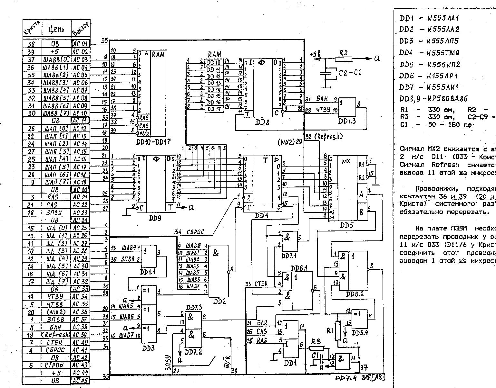

# Квазидиск «Омск», модель 2

Схема, описание функционирования и рекомендации по подключению квазидиска «Омск», модель 2, к ПЭВМ «Вектор-06Ц» и «Криста-2». Автор и дата в документах не указаны.

Каталог содержит два текстовых документа и изображение схемы:

| Файл                               | Содержание                                                               |
| ---------------------------------- | ------------------------------------------------------------------------ |
| [ed_omsk.txt](ed_omsk.txt)         | «Описание функционирования квазидиска „Омск“, модель 2»                  |
| [ed_omsk_rek.txt](ed_omsk_rek.txt) | «Рекомендации по подключению квазидиска к ПЭВМ „Вектор-06Ц“, „Криста-2“» |
| [ed_omsk.gif](ed_omsk.gif)         | Схема квазидиска (растровое изображение 1539 × 1207)                     |

Тексты ниже полностью повторяют оба документа; исходные файлы — в кодировке CP866 с переводами строк CRLF. Нумерация пунктов, обозначения микросхем и разъёмов, а также историческая орфография оригинала сохранены; редакторские уточнения вынесены в раздел [«Примечания к тексту»](#примечания-к-тексту).

Материалы относятся именно к омскому варианту квазидиска и не взаимозаменяемы с другими конструкциями: см. [Электронный диск (Руководство по настройке)](../invoservis), [Квазидиск (Кишинёв)](../kishinev) и [Инструкция по подключению квазидиска и контроллера дисковода](../unknown).



## Описание функционирования квазидиска «Омск», модель 2

Квазидиск состоит из следующих узлов: ОЗУ (DD10–DD17), усилителя записи (DD9), усилителя считывания (DD8), регистра режима (DD4), селектора регистра режима (DD2, DD1.1, DD3.1), селектора подэкранного ОЗУ (DD3.2, DD3.3, DD7.3), коммутатора страниц (DD6) и дополнительного коммутатора (DD5).

### Регистр режима

Управляет режимами работы квазидиска регистр режима. Он доступен со стороны процессора по записи как порт `10H`.

Младшие 4 бита регистра режима (выводы 2, 5, 7, 10) определяют номер зоны квазидиска, доступной соответственно как подэкранное ОЗУ или как стек. Старшие биты (выводы 12, 15) единичным значением разрешают доступ соответственно как к стеку и как к подэкранному ОЗУ (по адресам `A000H`–`DFFFH`).

### Запись и считывание

Процессы записи информации в ОЗУ квазидиска и считывания её отличаются лишь тем, что при записи компьютер устанавливает низкий уровень сигнала `/ЗПЗУ` (конт. 27 разъёма). Этот уровень устанавливается после отрицательного фронта сигнала `CAS`, и на выходах м/с ОЗУ при этом присутствует ранее содержавшаяся там информация. Поскольку сигнал `/ЧТЗУ` во время записи имеет высокий уровень, усилитель считывания отключён, и информация с выходов м/с ОЗУ не проходит на шину данных и не искажает записываемую информацию.

### Установка адреса и регенерация

Рассмотрим процесс установки адреса. Как известно, м/с динамического ОЗУ (в частности, используемые РУ7) требуют периодической регенерации хранящейся в них информации. В «Векторе» регенерацию внутреннего ОЗУ производит видеоконтроллер. Однако последний производит регенерацию только по 256 адресам, что позволяет использовать только м/с РУ5, т.к. РУ7 требуют регенерации по 512 адресам. Для обеспечения регенерации РУ7 внесены небольшие изменения в схему «Вектора».

Процесс регенерации состоит в том, что на адресные входы ОЗУ подаётся адрес (байта из видеоОЗУ компьютера), затем через промежуток времени следует отрицательный фронт сигнала `RAS`. Сигнал `CAS` на ОЗУ электронного диска при регенерации не подаётся. В первую очередь необходимо для обеспечения регенерации вывести из компьютера сигнал, который будет подаваться на 9-й адресный вход РУ7 (выв. 1). В качестве такого сигнала выбран сигнал, «следующий» за тем, который подаётся на 8-й адресный вход. Для того, чтобы отличить обращение к ОЗУ для регенерации (в диске на РУ5 в этом нет необходимости: выборка нужной зоны производится подачей сигнала `CAS` на одну из 4-х линеек, а в диске на РУ7 зона выбирается адресным битом), требуется сигнал `MX2`, равный 0 при регенерации и 1 при обращении от процессора. Сигнал `MX2` управляет работой коммутатора страниц — при низком уровне на его выходах присутствует сигнал регенерации 9-го адресного входа.

Необходимость в дополнительном коммутаторе вызвана ошибкой разработчиков «Вектора». Изначально квазидиск планировалось использовать как «расширение стека». Поэтому на разъём компьютера выведен сигнал `СТЕК`, равный 1 при обращении к стеку. Если стековые операции разрешены, то на выв. 3 DD7.1 устанавливается высокий уровень, и при `MX2=1` на выходы DD5 проходят сигналы с DD4/7 и DD4/10 — номер зоны при обращении к стеку. Если же `СТЕК=0`, `MX2=1`, то на выходах DD5 — номер зоны «подэкранного ОЗУ».

Однако сигнал `СТЕК` появляется на системном разъёме после сигнала `RAS`. Следовательно, сигналом `RAS` должны стробироваться 9 бит адреса, а компьютер выдаёт только 8 (по линиям `ШАП[0]`–`ШАП[7]`). Поэтому в схему квазидиска был введён дополнительный коммутатор DD5. Учитывается, что разряд `ШАП[7]` в момент действия сигнала `CAS` передаёт на адресные входы ОЗУ разряд `A14`. Разряд `A14` не передаётся на линии `ШАП` во время действия сигнала `RAS`, но в то же время он постоянно присутствует на линии `ШАВВ[6]`. Поэтому дополнительный коммутатор подаёт его на адресные входы ОЗУ во время действия сигнала `RAS` при условии, что `MX2=1` (иначе подаётся сигнал регенерации). Это даёт возможность во время действия сигнала `CAS` произвести выбор нужной зоны двумя битами, проходящими с коммутаторов на адресные входы.

Важную роль в работе квазидиска играет сигнал `БЛК`. Отрицательный уровень этого сигнала запрещает обмен информацией между процессором и внутренним ОЗУ компьютера. Квазидиск вырабатывает его, если идентифицирует обращение к своему ОЗУ, и соответствующее обращение разрешено регистром режима.

### Порядок установки адреса

Итак, установка адреса происходит в следующем порядке:

1. Компьютер устанавливает `MX2=1`, выдаёт на `ШАВВ` старшую половину адреса, на `ШАП` — «первую часть» адреса.
2. Квазидиск анализирует содержимое `ШАВВ` на предмет попадания адресов в диапазон `0A0H`–`0DFH`, т.е. подэкранного ОЗУ. Если да, и бит 5 регистра режима = 1, то вырабатывается сигнал `БЛК=0`. На адресные входы ОЗУ подаются 9 бит адреса, 9-й бит сформирован дополнительным коммутатором.
3. Компьютер устанавливает `RAS=0`.
4. Компьютер выдаёт на `ШАП` «вторую часть» адреса.
5. Компьютер выставляет корректное значение сигнала `СТЕК`, тем самым становится известным номер зоны квазидиска. Если `СТЕК=1` и бит 4 регистра режима = 1, то вырабатывается сигнал `БЛК=0` и активной зоной считается зона, определяемая битами 2 и 3 регистра режима (зона стека). Также в этот момент устанавливается корректное значение сигналов `ЗПЗУ`, `ЧТЗУ`. Нулевое значение `ЧТЗУ` разрешает работу усилителя считывания. Сигнал `БЛК=0` определяет направление передачи от ОЗУ к ПК.
6. Компьютер устанавливает (при условии, что `БЛК=0`) `CAS=0`. Происходит выбор зоны ЭД и обмен информацией.
7. Компьютер устанавливает `MX2=0`, `RAS=CAS=1`. Исходное состояние.
8. Компьютер устанавливает на `ШАП` и дополнительном сигнале (`Refresh`) адрес регенерации. Через промежуток времени устанавливается `RAS=0`. Цикл регенерации.
9. Компьютер устанавливает `RAS=1`. Затем процесс повторяется.

**Примечание.** В модели «Омск-1» не использовался дополнительный коммутатор, вместо этого в схему вносились изменения для того, чтобы обеспечить поступление сигнала `СТЕК` до сигнала `RAS`.

## Рекомендации по подключению квазидиска к ПЭВМ «Вектор-06Ц», «Криста-2»

> Festina lente
> (торопись медленно)

Предполагается, что Начальный Загрузчик (микросхема ПЗУ D9, у «Кристы» DD23) в ПЭВМ заменён. Иначе работа с квазидиском гораздо менее эффективна.

1. Осмотрите внимательно изделие — все ли припаяно, ничего не оторвалось, не сломалось?
2. Проверьте с помощью «цешки» или мультиметра отсутствие замыкания между цепями питания (общий и +5 В, общий и +12 В).
3. Перережьте дорожки у контактов 36 и 39 (у «Кристы» — 20 и 18) системного разъёма. На контакт 36 заведите сигнал со 2-й ноги м/с D11 (D6 «Вектор-06Ц-02», DD33 у «Кристы»). На 39 контакт — с 11-й ноги этой же м/схемы. D11 — это К155КП2, самая ближняя к процессору из всех КПшек.

   Сразу же проверьте — идёт ли на 21 контакт разъёма «ВУ» сигнал `RAS` с 14-й ноги м/сх D34 (это 580ВА86 рядом с м/с К580ВИ53). Дело в том, что на каждом третьем «Векторе» этот сигнал либо не доходит до 14-й ноги D34, либо идёт почему-то на 15-ю ногу.

4. Как теперь сам квазидиск подключить к ПЭВМ? Есть несколько способов:
   - припаять к нему ответную часть системного разъёма. Тогда либо Вы займёте разъём, либо придётся сооружать переходник. Второй вариант более умный;
   - соединить «навсегда» квазидиск с ПЭВМ. Это замечательный вариант для «Кристы», поскольку у неё достаточно места для него рядом с системным разъёмом (над м/сх ПЗУ, рядом с динамиком). У «Вектора» квазидиск закроет процессор. Это плохо;
   - соединить квазидиск с контроллером НГМД. Это самый лучший вариант, если есть контроллер.

   Итак, выберите какой-либо вариант и —

5. Подключите квазидиск к ПЭВМ, включите ПЭВМ и убедитесь, что он не мешает работе компьютера. Выключите ПЭВМ.
6. Проверить квазидиск можно Тестом Устройств «Вектора». Но он не даст диагностику ошибок, если таковые будут. Нужна спец. программа `TESTBEST`. Предположим, она у Вас есть и Вы её запустили.

   Должна появиться картинка из четырёх блоков по 8 полос в блоке. Каждая из полос в блоке представляет соответствующую микросхему. Если возникают проблемы с какой-то из микросхем, над соответствующей полосой появляется крест.

7. Если картинка не появилась, а на экране что-то елозит и изредка появляется и эта картинка и тут же исчезает — явно не проходит питание на квазидиск. Иначе может быть лишь в случае, если к-либо м/схема либо «сдохла», либо не запитана (имеются в виду обслуживающие м/схемы, т.е. все, кроме РУ7). Но это почти исключено. Если тест работает, но бракует м/схемы — смотри пункт 11.
8. Итак, этот тест прошёл нормально. Делаем последнюю проверку. Для этого нам надо отформатировать новую дискету и сгенерировать на неё ДОС, работающую с квазидиском:

   ```text
   A>SYSGEN DOS201.COM A:100 <ВК>
   ```

9. Ну вот теперь загрузитесь уже с этой, новой дискеты — т.е. нажмите ВВОД-БЛК. Всё нормально? Предположим — да. Тогда загрузитесь опять, но теперь при загрузке удерживайте клавишу «УС». Несколько секунд у Вас будет экран пуст — это форматируется квазидиск. Теперь введите очень простую команду:

   ```text
   A>8 <ВК>
   ```

   `8` — это команда проверки квазидиска на сбои. Если проверка прошла без замечаний — можете считать, что Ваши мучения окончились. Если вылезла куча ошибок — читай пункт 11.

10. Этот пункт для тех, у кого нет дисковода. Операционную систему необходимо загрузить с магнитофона и выполнить команду:

    ```text
    A>1 45 OS.COM
    ```

    Теперь система у Вас находится на квазидиске и при перезапуске ПЭВМ произойдёт загрузка системы с квазидиска. Всё остальное как в п. 9.

11. В чём могут быть причины неустойчивой работы диска или того, что он вообще не работает?

    Самая первая и основная причина — Вы чего-то напутали с контактами 36 и 39 (см. пункт 3) или с подсоединением квазидиска к системному разъёму.

    Другие причины:

    - питание. Попробуйте порегулировать от 4,7 до 5,4 В;
    - на системный разъём не приходят необходимые сигналы. Бывает и на заводе брак.

Удачи Вам!

## Примечания к тексту

- Оба документа сохранились только как текстовые файлы в CP866; даты, автор и выходные данные в них не указаны, поэтому атрибуция в шапке страницы — «автор не установлен».
- В описании регистра режима говорится о младших 4 битах (выводы 2, 5, 7, 10) и старших битах (выводы 12, 15), а в перечислении шагов адресации используются номера бит 4 и 5 (разрешение доступа к стеку и подэкранному ОЗУ) и биты 2, 3 (номер зоны стека). Нумерация в тексте приведена так, как в оригинале, без унификации.
- В шаге 2 указаны значения `0A0H`–`0DFH` на шине старшей половины адреса `ШАВВ`; выше приведён полный диапазон адресов `A000H`–`DFFFH`.
- Схема в каталоге присутствует только как растровый GIF; обозначения на ней в текстовые документы не переносились.
