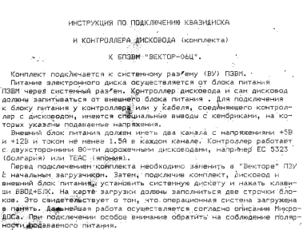

Инструкция на одну страницу: подключение комплекта «квазидиск + контроллер дисковода» к БПЭВМ «Вектор-06Ц» — распределение питания, порядок включения и проверки при сбоях.

Скан — [instr_ed_fdc.djvu](instr_ed_fdc.djvu). Копия низкого качества: фон зашумлён, часть символов и цифр читается неуверенно, поэтому в пересказе ниже не приводятся значения, которые в ней не распознаются однозначно (номинал тока блока питания, обозначения контактов, ёмкость подстроечного конденсатора).

## Подключение и питание

- Комплект подключается к системному разъёму ПЭВМ.
- Питание электронного диска осуществляется от блока питания ПЭВМ через системный разъём; контроллер дисковода и сам дисковод должны запитываться от внешнего блока питания.
- Для подключения к блоку питания на контроллере или на кабеле, соединяющем контроллер с дисководом, есть специальные выводы с маркировкой, на которой указаны подаваемые напряжения.
- Внешний блок питания должен иметь два канала — +5 В и +12 В — с оговорённым минимальным током в каждом канале.
- Контроллер рассчитан на односторонние и двусторонние дисководы; в тексте в качестве примеров названы дисководы ЕС (Болгария) и TEAC (Япония).
- При подключении особое внимание следует обратить на соблюдение полярности подаваемого питания.

## Порядок включения

К комплекту подключают дисковод и внешний блок питания, устанавливают системную дискету и нажимают клавиши `ВВОД`+`БЛК`. На карте загрузки должны высветиться две строчки блоков — это признак того, что операционная система загружена в память. Дальнейшая работа ведётся по описанию операционной системы.

## Если комплект не работает

- Обращение к дисководу есть, но карта загрузки не выполняется — расположение головок дисковода не совпадает с эталонным (дискета записана на эталонном дисководе). Нужно попробовать загрузиться с другого дисковода.
- Загрузка прошла нормально, но после запуска системы пошли сбои — возможны два варианта.

  Первый: в некоторых модификациях «Векторов» изготовители «забыли» вывести на системный разъём отдельные сигналы (незаведённый разряд шины данных, незаведённый сигнал). У разных заводов возможны свои варианты; в этом случае нужно проверить осциллографом наличие сигналов на всех выводах разъёма.

  Второй: процессор «Вектора» работает на пределе своих возможностей по тактовой частоте. Если достался экземпляр с не очень хорошим процессором, то после прогрева (в тексте — через 5–20 минут после включения) он перестаёт успевать обмениваться данными с электронным диском и происходит сбой. Единственное спасение в этом случае — снимать у «Вектора» крышку и ставить вентилятор.

- Система загрузилась и работает нормально — первым делом надо отформатировать дискеты, поставить на них систему и сделать копии системных дискет.
- При форматировании или при установке системы появляется большое количество ошибок даже на новых дискетах — нужно подобрать конденсатор на плате контроллера. Его ёмкость определяется временными параметрами дисковода и подбирается в некотором диапазоне.

См. также [Электронный диск (Руководство по настройке)](../invoservis), [Квазидиск (Кишинев)](../kishinev) и [Квазидиск (Омск)](../omsk)

