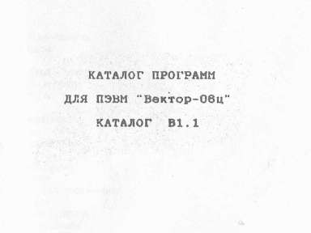

Каталог ПО кооператива «Электрон» (Москва, 1990, В1.1)

См. также [Каталог «Электрон» (Москва) В1.3](../1992)

## Обложка

КООПЕРАТИВ «ЭЛЕКТРОН»

КАТАЛОГ ПРОГРАММ
ДЛЯ ПЭВМ «Вектор-06ц»

КАТАЛОГ В1.1

МОСКВА
ОКТЯБРЬ 1990 г.

## Условия приобретения программ

1. Кооператив поставляет программы на магнитных носителях /кассетах, дисках/ Заказчика. Предприятиям и организациям программы могут быть поставлены на магнитных носителях Кооператива. Заказы принимаются не менее чем на 5 программ.

2. Кассета, присылаемая Заказчиком, не должна иметь перегибов, разрывов и других дефектов. На кассете не должно быть никаких записей.

3. При выполнении Заказчиком условий п. 2 Кооператив гарантирует запись, но не несёт ответственности за ошибки, допущенные авторами программ.

4. Цена копии любого файла, входящего в каталог, при оплате гражданами наличным расчётом — 8 руб.

   Для организаций, предприятий и кооперативов цена увеличивается в [неразборчиво].

   На одну кассету /60 минут/ может быть записано около 20 программ.

5. Для оформления заказа Вам необходимо:
   - перечислить соответствующую сумму по адресу: 103498, г. Москва, Зеленоградское отделение Жилсоцбанка, р/с 481216, кооперативу «Электрон»;
   - выслать бандеролью кассеты и квитанцию об оплате по адресу: 103489, г. Москва, корп. 705, кооперативу «Электрон»;
   - заполнить и выслать вместе с кассетой 2 бланка заказов на программное обеспечение, где указать: тип ПЭВМ, название раздела каталога /системные, игровые и т. п./, номер программы по каталогу, название программы, свой адрес и фамилию.

6. Заказы выполняются в течение месяца со дня получения квитанции и кассеты. Кооператив не несёт ответственности за задержку получения заказа по вине почты.

7. Предприятиям и организациям для оплаты заказов высылаются счета согласно гарантийным письмам или договорам.

8. Кооператив «Электрон» предлагает авторам программ для ПЭВМ: ДВК, УК-НЦ, БК 0010-01, РК-86, Ямаха, Микроша, Специалист, Спектрум, Агат, Атари, Партнёр, Вектор, Коммодор, Львов, Правец-8Д и IBM заключить с ним договоры на условиях выплаты процентов от реализации авторских программ. Возможен обмен программами.

9. Телефон кооператива: 536-12-81, с 12 до 18 часов /кроме выходных и праздничных дней/.

   Кооператив не даёт консультаций по программированию.

10. Копирование авторских программ, входящих в настоящий каталог, допускается только с разрешения авторов программ.

## 1. Системные программы

Столбец «Тип» воспроизводит пометки оригинала.

| №   | Название             | Тип |
| --- | -------------------- | --- |
| 1   | COPY                 | ROM |
| 2   | ТЕСТ ТЕХПРОГОНА      | ROM |
| 3   | ТЕСТ ТЕХУСТРОЙСТВ    | ROM |
| 4   | МОНИТОР              | ROM |
| 5   | ЭЛЕКТРОННЫЕ КУБИКИ   | ROM |
| 6   | СХЕМА N1, ПРИЛОЖЕНИЕ | —   |
| 7   | СХЕМА N2, ПРИЛОЖЕНИЕ | —   |
| 8   | СХЕМА N3, ПРИЛОЖЕНИЕ | —   |

**ПАКЕТ ПРОГРАММ — 32 руб.**

| №   | Название                  | Тип |
| --- | ------------------------- | --- |
| 9   | ЭМУЛЯТОР РК-86, «МИКРОША» | ROM |
| 10  | BASIC V2.5                | ROM |
| 11  | EDASM                     | ROM |

### Компилирующая система ЛС-Паскаль 2.1 «КОМПАС»

Среда программирования на целочисленном диалекте Паскаля. Встроенные процедуры позволяют использовать графику, трёхголосый синтезатор и др. возможности ПЭВМ; предусмотрены обращения к ОЗУ и вызов п/программ в кодах. Имеется диалоговый отладчик программ и возможность получения автономно загружаемых программ в кодах.

| №   | Название     | Тип |
| --- | ------------ | --- |
| 12  | PASCAL-DOC1  | MON |
| 13  | PASCAL-DOC2  | MON |
| 14  | PASCAL-DOC3  | MON |
| 15  | PASLIB       | MON |
| 16  | ГЕНЕРАТОР-P  | ROM |
| 17  | КОМПИЛЯТОР-P | ROM |

Против пп. 12–14 в каталоге стоит пометка «ОПИСАНИЕ», рядом — пояснение: «вводятся из монитора…», «…отладчика и запускаются…» (часть строки обрезана по краю листа).

Исходные тексты в формате редактора «КОМПАС»:

| №   | Название | Тип |
| --- | -------- | --- |
| 18  | DEMO1    | —   |
| 19  | DEMO2    | —   |
| 20  | TEST1    | —   |
| 21  | TEST2    | —   |

**Пакет программ — 80 руб.** Автор: Лейди Софт (Чикин Д. О.).

## 2. Игровые программы в кодах

Все программы раздела отмечены как ROM.

| №   | Название  |
| --- | --------- |
| 1   | ПОЖАРНИК  |
| 2   | БЛИЗНЕЦЫ  |
| 3   | СРАЖЕНИЕ  |
| 4   | RISE OUT  |
| 5   | WAPP      |
| 6   | PAIRS     |
| 7   | КСОНИКС   |
| 8   | ПОЛЕТ     |
| 9   | ШТУРМ     |
| 10  | ШАХМАТЫ   |
| 11  | ТЕТРИС    |
| 12  | ПАРОВОЗИК |
| 13  | ДЖУНГЛИ   |
| 14  | ЙЕТИ      |

## 3. Игровые программы BASIC 2.5

### Пакет программ «Музыкальный редактор»

**Цена пакета — 24 руб.** Автор: Парилов О. В.

| №   | Название                                      | Тип            |
| --- | --------------------------------------------- | -------------- |
| 1   | МУЗЫКАЛЬНЫЙ РЕДАКТОР                          | BAS            |
| 2   | HELP — прочтение неуверенное (в скане «НЕГР») | [неразборчиво] |
| 3   | ИНФОРМАЦИЯ                                    | BAS            |

Остальные программы раздела (номера 4–27, вне пакета):

| №   | Название                                                       | Тип |
| --- | -------------------------------------------------------------- | --- |
| 4   | БОДРОСТЬ                                                       | BAS |
| 5   | ОЧКО                                                           | BAS |
| 6   | КОСМОС                                                         | BAS |
| 7   | ОТГАДАЙ СЛОВО                                                  | BAS |
| 8   | МЕТКИЙ СТРЕЛОК                                                 | BAS |
| 9   | ВОЛЕЙБОЛ                                                       | BAS |
| 10  | КАЛАХ                                                          | BAS |
| 11  | ХОККЕЙ                                                         | BAS |
| 12  | РЕВЕРСИ                                                        | BAS |
| 13  | ТОРПЕДНАЯ АТАКА                                                | BAS |
| 14  | ДЫХАТЕЛЬНАЯ ГИМНАСТИКА                                         | BAS |
| 15  | УДАВЧИК                                                        | BAS |
| 16  | БЛОК ИГР: РЕВЕРСИ, ПЕРЕХВАТЧИК, МИНЫ, ХАНОЙСКАЯ БАШНЯ, УДАВЧИК | BAS |
| 17  | ДОКЕР                                                          | BAS |
| 18  | УДАРЕНИЕ                                                       | BAS |
| 19  | ХАНОЙСКАЯ БАШНЯ                                                | BAS |
| 20  | КОМПЬЮТЕРНАЯ ОХОТА                                             | BAS |
| 21  | В ДУРАКА                                                       | BAS |
| 22  | МОРСКОЙ БОЙ                                                    | BAS |
| 23  | ТЕННИС                                                         | BAS |
| 24  | ОХОТА НА ЛИС                                                   | BAS |
| 25  | РАЦИОНАЛЬНОЕ ПИТАНИЕ                                           | BAS |
| 26  | РИСК ИНФАРКТА МИОКАРДА                                         | BAS |
| 27  | ОПРОСНИК РОЗЕ                                                  | BAS |

### Пакет программ для научно-технических расчётов

**Цена пакета — 66 руб.**

В основу положен «Справочник по алгоритмам и программам на языке Бейсик для персональных ЭВМ», Дьяконов В. П., изд-во М.: Наука, 1987 г.

Все программы пакета — тип BAS.

| №    | Название    |
| ---- | ----------- |
| 28.1 | РАСЧЕТЫ Н/Т |
| 29.2 | РАСЧЕТЫ Н/Т |
| 30.3 | РАСЧЕТЫ Н/Т |
| 31.4 | РАСЧЕТЫ Н/Т |
| 32.5 | РАСЧЕТЫ Н/Т |
| 33.6 | РАСЧЕТЫ Н/Т |
| 34.7 | РАСЧЕТЫ Н/Т |

| №   | Название           | Тип |
| --- | ------------------ | --- |
| 35  | МИННОЕ ПОЛЕ        | BAS |
| 36  | ПЕРЕХВАТЧИК        | BAS |
| 37  | БИЛЛИАРД           | BAS |
| 38  | ХОЛОДНО-ГОРЯЧО     | BAS |
| 39  | МАРСИАНСКИЙ ДЕСАНТ | BAS |
| 40  | СЛОВА              | BAS |
| 41  | ЧАСЫ               | BAS |
| 42  | ЦВЕТНЫЕ ПОЛОСЫ     | BAS |

## 4. Игровые программы BASIC 2.5, адаптированные с РК-86

Все программы раздела — тип BAS.

| №   | Название                                      | Тип |
| --- | --------------------------------------------- | --- |
| 1   | ГОСУДАРСТВО                                   | BAS |
| 2   | МОНЕТЫ                                        | BAS |
| 3   | [неразборчиво: «…АМА …ТТМС РНОС…»]            | BAS |
| 4   | ПРЕЗИДЕНТ                                     | BAS |
| 5   | КРЕСТИКИ-НОЛИКИ                               | BAS |
| 6   | АНГЛО-РУССКИЙ СЛОВАРЬ                         | BAS |
| 7   | ОРЕГОНСКАЯ ТРОПА                              | BAS |
| 8   | ТЕСТ ТЕМПЕРАМЕНТА                             | BAS |
| 9   | КАЗИНО                                        | BAS |
| 10  | КУБИК 4*4*4                                   | BAS |
| 11  | РИСОВАНИЕ                                     | BAS |
| 12  | ЧЕРНЫЙ ДЖЕК                                   | BAS |
| 13  | ПАКЕТ ПРОГРАММ                                | BAS |
| 14  | ОЧКО                                          | BAS |
| 15  | БЛОХА                                         | BAS |
| 16  | РАЛЛИ                                         | BAS |
| 17  | ВЕЧНЫЙ КАЛЕНДАРЬ                              | BAS |
| 18  | БЫКИ-КОРОВЫ                                   | BAS |
| 19  | ТЕСТ                                          | BAS |
| 20  | МОРСКОЙ БОЙ 5*5                               | BAS |
| 21  | ТОРПЕДНАЯ АТАКА                               | BAS |
| 22  | НАЙТИ ЧЕРТА                                   | BAS |
| 23  | ВЕРТОЛЕТ                                      | BAS |
| 24  | ТЕСТ «РЕАКЦИЯ»                                | BAS |
| 25  | ПЛОЩАДЬ ФИГУР                                 | BAS |
| 26  | ТЕМНИЦА ДЬЯВОЛА                               | BAS |
| 27  | НИМ                                           | BAS |
| 28  | УБЕЙ КРОКОДИЛА                                | BAS |
| 29  | МОРСКОЙ БОЙ                                   | BAS |
| 30  | КАЛЕНДАРЬ СПРАВОЧНИК                          | BAS |
| 31  | [неразборчиво: «…СТАМС…САЕ»]                  | BAS |
| 32  | ПОСАДКА САМОЛЕТА                              | BAS |
| 33  | КРЕСТИКИ-НОЛИКИ                               | BAS |
| 34  | НОМЕРКИ                                       | BAS |
| 35  | КАРТЫ 36/52                                   | BAS |
| 36  | ПОДВОДНЫЙ КЛАД                                | BAS |
| 37  | КОРСАРЫ                                       | BAS |
| 38  | МИННОЕ ПОЛЕ                                   | BAS |
| 39  | ИППОДРОМ                                      | BAS |
| 40  | ПЯТНАШКИ                                      | BAS |
| 41  | СПИЧКИ                                        | BAS |
| 42  | ПИРОГ                                         | BAS |
| 43  | РЕВЕРСИ                                       | BAS |
| 44  | УГАДАЙ ЧИСЛО                                  | BAS |
| 45  | ДАТЫ                                          | BAS |
| 46  | КОДИРОВЩИК                                    | BAS |
| 47  | КАЛОРИЙНОСТЬ                                  | BAS |
| 48  | ABCD — прочтение неуверенное (в скане «АВСР») | BAS |
| 49  | ТЕСТ АЛКОГОЛЬ                                 | BAS |
| 50  | РУССКАЯ РУЛЕТКА                               | BAS |

## Примечания к скану

- Каталог получен побитовым сканированием без текстового слоя; часть строк по правому краю листа обрезана, поэтому в тексте «Условий» возможны пропуски отдельных слов.
- Цифры (почтовый индекс, номер р/с, кратность наценки для организаций, количество программ в заказе) читаются неуверенно.
- Некоторые названия и имена файлов читаются неуверенно; сомнительные места отмечены в тексте.
- Разделы и нумерация программ соответствуют каталогу; цены пакетов указаны в рублях.
