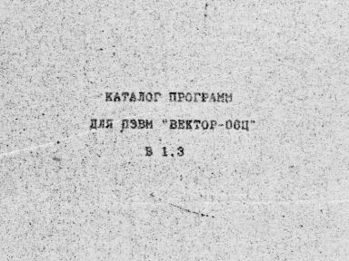

Каталог ПО кооператива «Электрон» (Москва, 1992, В1.3)

См. также [Каталог «Электрон» (Москва) В1.1](../1990)

## Титульный лист

> КООПЕРАТИВ «ЭЛЕКТРОН»
>
> КАТАЛОГ ПРОГРАММ
>
> для ПЭВМ «ВЕКТОР-06Ц»
>
> В 1.3
>
> Москва
>
> Февраль 1992 г.

## Условия приобретения программ

1. Кооператив поставляет программы на магнитных носителях /кассетах или дисках/ Заказчика. Предприятиям и организациям программы могут быть поставлены на магнитных носителях Кооператива. Заказы принимаются не менее чем на 5 программ.
2. Кассета, присылаемая Заказчиком, не должна иметь перегибов, растяжений и других дефектов. На кассете не должно быть никаких записей.
3. При выполнении Заказчиком условий п. 2 Кооператив гарантирует качество записи, но не несет ответственности за ошибки, допущенные авторами программ.
4. Цена копии любого файла, входящего в каталог, при оплате гражданами за наличный расчет — 28 руб.
   Для организаций, предприятий и кооперативов при оплате по безналичному расчету цена копии любого файла увеличивается в 2,5 раза.
5. На одну кассету 90 минут [?] может быть записано около 20 программ.
6. Для оформления заказа Вам необходимо:
   - перечислить соответствующую сумму по адресу: 103498, г. Москва, Зеленоградское отделение Мосбизнесбанка, р/с 461216, кооперативу «Электрон»;
   - выслать бандеролью кассеты и квитанцию об оплате по адресу: 103868 [?], г. Москва, Зеленоград, корп. 705 [?], кооперативу «Электрон»;
   - заполнить и выслать вместе с кассетой 2 бланка заказов на программное обеспечение, где указать:
     - тип ПЭВМ,
     - название раздела каталога /системные, игровые и т.п./,
     - номер программы по каталогу,
     - название программы,
     - свой точный почтовый адрес и фамилию.
7. Заказы выполняются в течение месяца со дня получения квитанции и кассеты. Кооператив не несет ответственности за задержку получения заказа по вине почты.
8. Предприятиям и организациям для оплаты заказов высылаются счета согласно гарантийным письмам или договорам.
9. Кооператив «Электрон» предлагает авторам программ для ПЭВМ: ДВК, УК-НЦ, БК-0010-01, РК-86 (32к), Микроша, Специалист, Синклер-Спектрум, Агат, Атари, Партнер, Вектор, БК-0011, Львов, Правец-64, Корвет, Поиск и IBM-PC заключить с ним договоры на условиях выплаты процентов от реализации авторских программ. Возможен обмен программами.

   Телефон кооператива: 536-12-61 с 12 до 18 часов (кроме выходных и праздничных дней).
   Кооператив не дает консультаций по программированию.

10. Копирование программ, входящих в каталоги авторских программ, допускается только с разрешения авторов программ!

## Системные программы

Номер раздела на скане читается неуверенно (по последовательности разделов — первый). Справа от названия в каталоге указан тип файла: «ROM» — программа в машинном коде, «BAS» — программа на Бейсике.

| №   | Название                                           | Тип |
| --- | -------------------------------------------------- | --- |
| 1   | ТЕСТ … ПРОГОНА [?]                                 | ROM |
| 2   | ТЕСТ ТЕХУСТРОЙСТВ                                  | ROM |
| 3   | МОНИТОР                                            | ROM |
| 4   | ЭЛЕКТРОННЫЕ КУБИКИ                                 | ROM |
| 5   | СХЕМА №1. ПРИЛОЖЕНИЕ                               |     |
| 6   | СХЕМА №2. ПРИЛОЖЕНИЕ                               |     |
| 7   | СУММА № … ПРИЛОЖЕНИЕ [?]                           |     |
| 9   | ЭМУЛЯТОР РК-86 «МИКРОША»                           | ROM |
| 10  | БЕЙСИК 2.5                                         | ROM |
| 13  | РАБОЧИЕ — 1 (ИСХОДНЫЕ ТЕКСТЫ … ИЗ КОМПИЛЯТОРА) [?] |     |
| —   | … РАБОЧИЕ — 2 (ОРГАНИЗАЦИЯ ОТЛАДЧИКА) [?]          |     |
| 14  | … ОПИСАНИЕ … [?]                                   |     |
| 15  | … [?]                                              | ROM |
| 16  | ГЕНЕРАТОР-B                                        | ROM |
| 17  | КОМПИЛЯТОР-P                                       | ROM |
| 18  | ИСХОДНЫЕ ТЕКСТЫ В ФОРМАТЕ РЕДАКТОРА «КОМПАС»       |     |
| 19  | P2P201 [?]                                         |     |
| 20  | СРМО2 [?]                                          |     |
| 21  | ТЕСТ2                                              |     |
| 22  | КОМСТВАЗИ [?]                                      |     |
| 23  | ДРАЙВЕРЫ УСТРОЙСТВ                                 | ROM |
| 24  | ТЕСТ ДРАЙВЕРОВ                                     | ROM |
| 25  | БЕЙСИК-КОРВЕТ                                      |     |
| 26  | COPY 2.2 [?]                                       | ROM |

Отдельным блоком в разделе описан пакет:

> КОМПИЛЯТИВНАЯ СИСТЕМА АС-МАСКАЛЬ 2.1 «КОМПАС»
>
> Среда программирования на Бейсик-диалекте … [?]. Встроенные процедуры позволяют использовать графику, трехголосый синтезатор и др. возможности ПЭВМ; предусмотрены обращения к … [?] в виде п/программ в кодах. Имеется диалоговый отладчик программ и возможность сочленения … [?] загружаемым программам в кодах.

## 2. Игровые программы в машинном коде

Все позиции раздела — в машинном коде (ROM).

| №   | Название          | Автор / пометка     |
| --- | ----------------- | ------------------- |
| 1   | ПОЖАРНИК          |                     |
| 2   | БЛИЗНЕЦЫ          |                     |
| 3   | СРАЖЕНИЕ          |                     |
| 4   | [нрзб]            |                     |
| 5   | НАЯР [?]          |                     |
| 6   | РАТИО [?]         |                     |
| 7   | КСОНИКС           |                     |
| 8   | ПОЛЕТ             |                     |
| 9   | МШТЧРМ [?]        |                     |
| 10  | ШАХМАТЫ           |                     |
| 11  | ТЕТРИС            |                     |
| 12  | ПАРОВОЗИК         |                     |
| 13  | ДЖУНГЛИ [?]       |                     |
| 14  | ЙЕТИ              |                     |
| 15  | [нрзб]            |                     |
| 16  | СЕЙФСОРТЕР [?]    |                     |
| 17  | ЕРВ1С [?]         |                     |
| 18  | КИРАН [?]         |                     |
| 20  | ОРГАН             |                     |
| 21  | СТОП              |                     |
| 22  | КНЯЗЬ [?]         |                     |
| 23  | КЛАД              |                     |
| 23А | СРАЖЕНИЕ-2        |                     |
| 24  | ВЕКТОР РИСЧЕТ [?] |                     |
| 26  | РЕКЛАМА           |                     |
| 27  | ХХ20.06 [?]       |                     |
| 28  | ПИТОН             |                     |
| 29  | ХИМИЯ             |                     |
| 30  | МУМИЯ             |                     |
| 31  | ВСТоВ5 [?]        |                     |
| 32  | КИРАН-2М [?]      |                     |
| 33  | КЛАД2             |                     |
| 34  | [нрзб]            |                     |
| 35  | СПЕКТР            | авт. КУЗНЕЦОВ       |
| 36  | ИНСТРУКЦИЯ        |                     |
| 37  | ТАНКОДРОМ         |                     |
| 38  | ЧАСЫ              |                     |
| 39  | АДСКОК [?]        | авт. ЛЕБЕДЕВ А.З.   |
| 40  | АНИМАТОР          |                     |
| 41  | МАСТЕР [?]        | авт. МИМИС [?] К.М. |
| 42  | БЫЛКЕ [?]         | авт. ТИМОШЕНКО А.В. |

## 3. BASIC-программы

Нумерация сквозная, 1–198. Справа от названия указан тип файла «BAS».

### Пакет программ «Музыкальный редактор»

| №   | Название                   |
| --- | -------------------------- |
| 1   | МУЗЫКАЛЬНЫЙ РЕДАКТОР (BAS) |
| 2   | HELP [?]                   |
| 3   | ИНФОРМАЦИЯ (BAS)           |

Указана «цена пакета программ».

### Игры и тесты

| №   | Название               | Автор / пометка                                      |
| --- | ---------------------- | ---------------------------------------------------- |
| 4   | РАДОСТЬ                |                                                      |
| 5   | ОЧКО                   |                                                      |
| 6   | КОСМОС                 |                                                      |
| 7   | ОТГАДАЙ СЛОВО          |                                                      |
| 8   | МЕТКИЙ СТРЕЛОК         |                                                      |
| 9   | ВОЛЕЙБОЛ               |                                                      |
| 10  | КАЛАХ                  |                                                      |
| 11  | ХОККЕЙ                 |                                                      |
| 12  | РЕВЕРСИ                |                                                      |
| 13  | ТОРПЕДНАЯ АТАКА        |                                                      |
| 14  | ДЫХАТЕЛЬНАЯ ГИМНАСТИКА |                                                      |
| 15  | УДАВЧИК                |                                                      |
| 16  | БЛОК ИГР               | РЕВЕРСИ, ПЕРЕХВАТЧИК, МИНЫ, ХАНОЙСКАЯ БАШНЯ, УДАВЧИК |
| 17  | ДОКЕР                  |                                                      |
| 18  | УДАРЕНИЕ               |                                                      |
| 19  | ХАНОЙСКАЯ БАШНЯ        |                                                      |
| 20  | КОМПЬЮТЕРНАЯ ОХОТА     |                                                      |
| 21  | В ДУРАКА               |                                                      |
| 22  | МОРСКОЙ БОЙ            |                                                      |
| 23  | ТЕННИС                 |                                                      |
| 24  | ОХОТА НА ЛИС           |                                                      |
| 25  | РАЦИОНАЛЬНОЕ ПИТАНИЕ   |                                                      |
| 26  | РИСК ИНФАРКТА МИОКАРДА |                                                      |
| 27  | ОПРОСНИК РОЗЕ          |                                                      |

### Пакет программ для инженерно-технических расчетов

> В основу положен справочник по алгоритмам и программам на языке Бейсик для персональных ЭВМ. Поляков В.Н. Изд-во М.: Наука, 1987 г. [?]

| №    | Название    |
| ---- | ----------- |
| 28.1 | РАСЧЕТЫ Н/Т |
| 29.2 | РАСЧЕТЫ Н/Т |
| 30.3 | РАСЧЕТЫ Н/Т |
| 31.4 | РАСЧЕТЫ Н/Т |
| 32.5 | РАСЧЕТЫ Н/Т |
| 33.6 | РАСЧЕТЫ Н/Т |
| 34.7 | РАСЧЕТЫ Н/Т |

Номера позиций пакета читаются неуверенно: возможно, это семь вариантов одной программы (28.1–28.7). Далее в каталоге снова указана «цена пакета программ».

| №   | Название               |
| --- | ---------------------- |
| 35  | МИННОЕ ПОЛЕ            |
| 36  | ПЕРЕХВАТЧИК            |
| 37  | БИЛЛИАРД               |
| 38  | ХОЛОДНО-ГОРЯЧО         |
| 39  | МАРСИАНСКИЙ ДЕСАНТ [?] |
| 40  | ЧАСЫ                   |
| 41  | ЦВЕТНЫЕ ПОЛОСЫ         |
| 42  | ПЕРЕСТРОЙКА            |
| 43  | ВЫБОР «САВАТ» [?]      |

Далее указан автор: ВОРОБЬЕВ.

| №   | Название                            | Автор / пометка        |
| --- | ----------------------------------- | ---------------------- |
| 46  | ЗНАКОГЕНЕРАТОР                      |                        |
| 47  | ФАРАОН                              |                        |
| 48  | МИНОТАВР                            |                        |
| 49  | ТЕСТ ОБЩЕНИЯ                        |                        |
| 50  | БИОРИТМЫ                            |                        |
| 51  | ТЕТРИС                              |                        |
| 52  | ШАШКИ                               | авт. ХАЗИЕВ [?]        |
| 53  | МЕТЕОРИТНЫЙ ПОЯС [?]                |                        |
| 54  | РЕШЕНИЕ ПРИМЕРОВ-1                  |                        |
| 55  | РЕШЕНИЕ ПРИМЕРОВ-2                  |                        |
| 56  | НЕМЕЦКИЙ ЯЗЫК                       |                        |
| 57  | РУССКИЙ ЯЗЫК                        |                        |
| 58  | СОГИ-2 [?]                          |                        |
| 59  | СПОРТЛОТО                           |                        |
| 60  | ТЕСТ … [?]                          |                        |
| 61  | МАТЕМАТИКА [?]                      |                        |
| 62  | ТЕСТ ДЛЯ СУПРУГОВ                   |                        |
| 63  | ПАМЕ САРМЕСТЕ [?]                   |                        |
| 64  | ЛИКЕТЬ [?]                          |                        |
| 65  | … ЖИЗНИ [?]                         |                        |
| 66  | МЕТЕОРИТНЫЙ ПОЯС 2.0 [?]            |                        |
| 67  | КАЛЕНДАРЬ + ГОРОСКОП                |                        |
| 68  | СТРАСТИ [?]                         |                        |
| 69  | STAR MAP [?]                        |                        |
| 70  | СЧАСТЬЕ [?]                         |                        |
| 71  | СОКРОВИЩЕ                           |                        |
| 72  | ТАРЗАНЬИ БЕГА [?]                   |                        |
| 73  | ПОКЕР                               |                        |
| 74  | БИБЛИОГРАФ [?]                      |                        |
| 75  | БИОРИТМОТЕСТ                        |                        |
| 76  | ХАРАКТЕР                            |                        |
| 77  | КОММУНИКАБЕЛЬНОСТЬ                  |                        |
| 78  | ВОЙНА В ГОРАХ                       |                        |
| 79  | ПРОГЛОТ [?]                         |                        |
| 80  | ГОРОСКОП 1                          |                        |
| 82  | ТЕСТ ДЛЯ МУЖЧИН                     |                        |
| 83  | БОМБАРДИРОВКА                       |                        |
| 84  | ПОКЕР-2                             |                        |
| 85  | КУБИК-РУБИК                         |                        |
| 86  | УМНОЖЕНИЕ [?]                       |                        |
| 87  | ЧЕЛОВЕЧКИ                           |                        |
| 88  | МАССАЖ [?]                          |                        |
| 89  | [нрзб]                              |                        |
| 90  | СЛОВАРЬ                             |                        |
| 91  | ВРАЩАЮЩИЙСЯ КВАДРАТ                 |                        |
| 92  | ЛОГИКА                              |                        |
| 93  | КУБИКИ                              |                        |
| 94  | ГАММА                               |                        |
| 95  | КОШКА-МЫШКА [?]                     |                        |
| 96  | ПОКЕР                               |                        |
| 97  | ПОДВОДНЫЙ МИР                       |                        |
| 98  | КОСТИ                               |                        |
| 99  | ГОНКИ ПО ЛАБИРИНТУ                  |                        |
| 100 | ЛАБИРИНТ                            |                        |
| 101 | СЛАЛОМ                              |                        |
| 102 | МИНИ РЕДАКТОР                       |                        |
| 103 | ТОРНАДО                             | авт. ГИНАТУЛИН Д.А.    |
| 104 | КОРОЛЕВСКИЙ САДОВНИК                | авт. ТОКАРЕВ А.И.      |
| 105 | ЛОГИКА ЦВЕТА                        | авт. ТОКАРЕВ А.И.      |
| 106 | ПАКЕТ ИГР                           | авт. СКИДАН В.Ф.       |
| 107 | АСТРО                               | авт. СКИДАН В.Ф.       |
| 108 | ЗВЕЗДНЫЙ СТРАННИК                   | авт. СКИДАН В.Ф.       |
| 109 | ДОМБО                               |                        |
| 110 | ПЕЧЕРА                              |                        |
| 111 | МОЛНИЯ                              |                        |
| 112 | ПАУК [?]                            |                        |
| 113 | ОБОРОНА                             |                        |
| 114 | ГОНКА                               |                        |
| 115 | КОСИЛКА                             |                        |
| 116 | КЛАД                                |                        |
| 117 | СПОРТЛОТО 99                        |                        |
| 118 | ЗАЯЦ                                |                        |
| 119 | НЛО                                 |                        |
| 120 | ГАДАЛКА                             |                        |
| 121 | ПУШКА                               |                        |
| 122 | МАРИКИ [?]                          |                        |
| 123 | ЖИЗНЬ                               |                        |
| 124 | ФРУКТЫ                              |                        |
| 125 | ДРАЗНИЛКА                           |                        |
| 126 | ЗОДИАК [?]                          |                        |
| 127 | ФАРАОН-3                            |                        |
| 128 | МИННОЕ ПОЛЕ                         |                        |
| 129 | ЭРОТИК-М                            |                        |
| 130 | ЭРОТИК-Ж                            |                        |
| 131 | ТЕСТ-КАПИТАН                        |                        |
| 132 | [нрзб]                              |                        |
| 133 | В ДУРАКА                            |                        |
| 134 | ЛАБИРИНТ                            |                        |
| 135 | СВЕР [?]                            |                        |
| 136 | РАСЧЕТ СТАБИЛИЗАТОРОВ               |                        |
| 137 | БЕГОНОК                             |                        |
| 138 | УГАДАЙ НОТУ                         |                        |
| 139 | УГАДАЙ-КА                           |                        |
| 140 | ИППОДРОМ                            |                        |
| 141 | ПСКОС [?]                           |                        |
| 142 | ОТКРЫТКА                            |                        |
| 143 | БАЗА АЛЬФА [?]                      |                        |
| 144 | ГРАФИЧЕСКИЙ РЕДАКТОР РС-1           |                        |
| 145 | ТУРНИР                              | авт. ЯНЧЕВ [?]         |
| 146 | ГРАФ. РЕДАКТОР РС-11                |                        |
| 147 | ГРАФ. РЕДАКТОР РС-12                |                        |
| 148 | ГРАФ. РЕДАКТОР РС-13                |                        |
| 149 | КАЗИНО                              |                        |
| 150 | ОБОРОНА                             |                        |
| 151 | ПАУК [?]                            |                        |
| 152 | ПРЫГ-СКОК                           |                        |
| 153 | СЕКРЕТНЫЙ КОД                       |                        |
| 154 | ВЕЧНЫЙ КАЛЕНДАРЬ                    |                        |
| 155 | БАХ ПРЕЛЮДИЯ                        |                        |
| 156 | ГОРОДКИ                             |                        |
| 157 | ГЕНИЙ                               |                        |
| 158 | МИННОЕ ПОЛЕ                         |                        |
| 159 | МОЗАИКА                             |                        |
| 160 | ОЧКО                                |                        |
| 161 | ПИТОН                               |                        |
| 162 | ПВО                                 |                        |
| 163 | ШАРИКИ                              |                        |
| 164 | РАСЧЕТ КОНТУРА                      |                        |
| 165 | АЛМАЗ                               |                        |
| 166 | ЗНАК                                | авт. ХИСМАТУЛОВ Р. [?] |
| 167 | КОСИЛКА                             | авт. ХИСМАТУЛОВ Р. [?] |
| 168 | КАМНИ                               | авт. ХИСМАТУЛОВ Р. [?] |
| 169 | БОМБАРДИРОВЩИК                      | авт. ХИСМАТУЛОВ [?]    |
| 170 | [нрзб]                              | авт. КУРАНОВ В.В.      |
| 171 | ПИТОН                               | авт. КУРАНОВ В.В.      |
| 172 | ПИФ-ПАФ                             | авт. КУРАНОВ В.В.      |
| 173 | НАШЕСТВИЕ                           | авт. КУРАНОВ В.В.      |
| 174 | ПОЛЕ ЧУДЕС                          | авт. КУРАНОВ В.В.      |
| 175 | ХОККЕЙ                              | авт. КУРАНОВ В.В.      |
| 176 | ИНСТРУКЦИЯ                          |                        |
| 177 | СОВЕТЫ [?]                          | авт. КУРАНОВ В.В.      |
| 178 | Б-КР [?]                            | авт. КУРАНОВ В.В.      |
| 179 | МУЗ. РЕДАКТОР                       |                        |
| 180 | МЕЛОДИИ + РИТМЫ [?]                 | авт. КИРЕЕВ М.Л.       |
| 181 | МОРЗЕ                               | авт. КИРЕЕВ М.Л.       |
| 182 | ФУНКЦИОНАЛЬНОЕ НАЗНАЧЕНИЕ МИКРОСХЕМ | авт. КИРЕЕВ М.Л.       |
| 183 | 155 АГ-МД                           | авт. КИРЕЕВ М.Л.       |
| 184 | 155 ДК-ТМ                           | авт. КИРЕЕВ М.Л.       |
| 185 | 155 ИЕ-КП                           | авт. КИРЕЕВ М.Л.       |
| 186 | [нрзб]                              | авт. ПАСТОВЕЦКИЙ В.В.  |
| 187 | ХИРОМАНТИЯ                          |                        |
| 188 | ГРАФ. РЕДАКТОР 1                    | авт. РОДИОНОВ В.В.     |
| 189 | ГРАФ. РЕДАКТОР 2                    | авт. РОДИОНОВ В.В.     |
| 190 | ГРАФ. РЕДАКТОР 3                    | авт. РОДИОНОВ В.В.     |
| 191 | PIC.PIC [?]                         | авт. РОДИОНОВ В.В.     |
| 192 | BRASE … [?]                         | авт. ТИМОШЕНКО А.В.    |
| 193 | ТАК-ТИКЛЬ [?]                       | авт. ТИМОШЕНКО А.В.    |
| 194 | СОЛИТЕР                             | авт. ТИМОШЕНКО А.В.    |
| 195 | СЛОН                                | авт. ТИМОШЕНКО А.В.    |
| 196 | КАРТИННАЯ ГАЛЕРЕЯ                   | авт. ТИМОШЕНКО А.В.    |
| 197 | ТАКСИ [?]                           | авт. ТИМОШЕНКО А.В.    |
| 198 | ЧЕЛОВЕЧКИ                           | авт. ТИМОШЕНКО А.В.    |

Перед позициями 188–191 в каталоге стоит строка «ПАКЕТ ГРАФИЧЕСКИЙ РЕДАКТОР».

## 4. Адаптированные с РК-86

| №   | Название              |
| --- | --------------------- |
| 1   | ГОСУДАРСТВО           |
| 2   | МАКЕТЫ [?]            |
| 3   | AMAZING … [?]         |
| 4   | ПРЕЗИДЕНТ             |
| 5   | КРЕСТИКИ-НОЛИКИ 3     |
| 6   | АНГЛО-РУССКИЙ СЛОВАРЬ |
| 7   | ОРЕГОНСКАЯ ТРОПА      |
| 8   | ТЕСТ ТЕМПЕРАМЕНТА     |
| 9   | КАЗИНО                |
| 10  | [нрзб] ДОНА [?]       |
| 11  | РИСОВАНИЕ             |
| 12  | ЧЕРНЫЙ ДЖЕК           |
| 13  | ПАКЕТ ПРОГРАММ        |
| 14  | ОЧКО                  |
| 15  | БЛОКА [?]             |
| 16  | РАЛЛИ                 |
| 17  | ВЕЧНЫЙ КАЛЕНДАРЬ      |
| 18  | БЫКИ-КОРОВЫ           |
| 19  | ТЕСТ                  |
| 20  | МОРСКОЙ БОЙ           |
| 21  | ТОРПЕДНАЯ АТАКА       |
| 22  | НАЙТИ ЧЕРТА           |
| 23  | ВЕРТОЛЕТ              |
| 24  | ТЕСТ «РЕАКЦИЯ»        |
| 25  | ПЛОЩАДЬ ФИГУР         |
| 26  | ТЕМНИЦА … [?]         |
| 27  | НИМ                   |
| 28  | УБЕЙ КРОКОДИЛА        |
| 29  | МОРСКОЙ БОЙ           |
| 30  | КАЛЕНДАРЬ-СПРАВОЧНИК  |
| 31  | [нрзб]                |
| 32  | ПОСАДКА САМОЛЕТА      |
| 33  | КРЕСТИКИ-НОЛИКИ       |
| 34  | НОМЕРКИ               |
| 35  | КАРТЫ 36/52           |
| 36  | ПОДВОДНЫЙ КЛАД        |
| 37  | КОРСАРЫ               |
| 38  | МИННОЕ ПОЛЕ           |
| 39  | ИППОДРОМ              |
| 40  | ПЯТНАШКИ              |
| 41  | СПИЧКИ                |
| 42  | ПИРОГ                 |
| 43  | РЕВЕРСИ               |
| 44  | УГАДАЙ ЧИСЛО          |
| 45  | ДАТЫ [?]              |
| 46  | КОДИРОВЩИК            |
| 47  | КАЛОРИЙНОСТЬ          |
| 48  | АВС [?]               |
| 49  | ТЕСТ АЛКОГОЛЬ         |
| 50  | РУССКАЯ РУЛЕТКА       |

## Примечания

- Скан — плохая копия машинописного/матричного оригинала: буквы слипаются, часть строк обрезана, поэтому приведённый текст восстановлен по нескольким прочтениям. Пометка `[?]` означает неуверенное прочтение, `[нрзб]` — нечитаемое место, `…` — пропуск нечитаемых слов.
- В каталоге справа от названия стоит тип файла; в разделах 1 и 2 он читается как «ROM», в разделах 3 и 4 — как «BAS». В разделе 4 столбец типа также присутствует, но в таблице выше опущен.
- Нумерация в разделах имеет пропуски и повторы (например, 23А в разделе 2, позиция 45 в разделе 3, повторяющиеся названия ПОКЕР, МИННОЕ ПОЛЕ, ОБОРОНА). Так в оригинале.
- Позиции 169–198 раздела 3 сгруппированы по авторам; автор указан в конце строки.
- Дата на титульном листе — февраль 1992 г.; версия каталога — В1.3.
