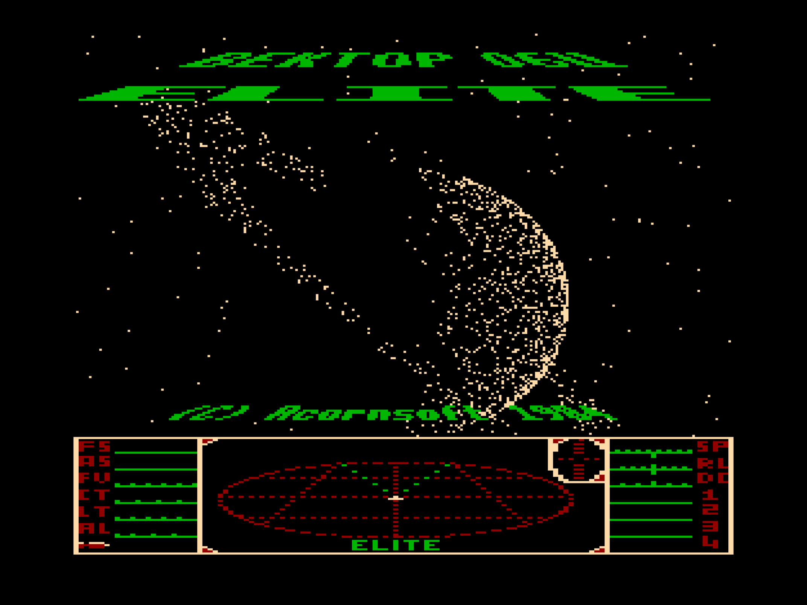
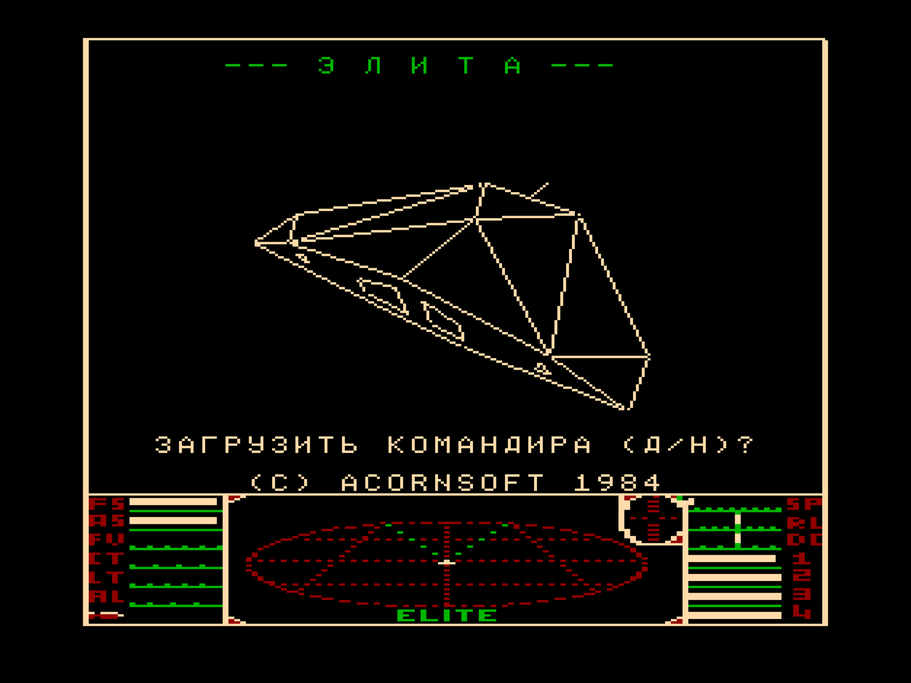

Elite — компьютерная игра, космический симулятор с открытым миром и элементами экономической стратегии, выпущенная Acornsoft в 1984 году для компьютеров BBC Micro и Acorn Electron, после чего была портирована на многие другие платформы.
Большая часть портов вышла под торговой маркой Firebird. Первая игра из серии Elite.

Название игры отражает одну из целей игрока — достичь высшего боевого рейтинга Elite, начав с Harmless и пройдя через ступени Mostly Harmless, Poor, Average, Above Average, Competent, Dangerous, Deadly.

Elite открыла целый новый жанр игр — космических симуляторов с элементами торговли (англ. space trading).
Игры этого жанра сочетают космические битвы с системой перевозки по принципу «покупай дёшево, продавай дорого», причём выигрыш от продажи используется для улучшения космического корабля.

Первая версия игры была разработана студентами Кэмбриджского университета Дэвидом Брэбеном и Иэном Беллом.
Разработка началась в 1982 году, и в 1984 были завершены две версии игры для компьютера BBC Micro: для базового варианта компьютера (на ленте) и для BBC Micro с диском.
Версия для ленты умещалась всего в 22 Кб свободной памяти; компьютер с диском имел немного больше памяти, что позволило вместить несколько секретных миссий и больший набор кораблей.
Игра была портирована на Acorn Electron и в сентябре 1984 года игра вышла под маркой Acornsoft сразу в трёх вариантах.

Позже были выпущены порты для ZX Spectrum (1985), Commodore 64 (1985), Apple II (1986), Amstrad CPC (1986), Atari ST (1988), Amiga (1988) и MSX (1988).
Свободная модель игры и революционная трёхмерная графика послужили причинами огромного успеха игры (по некоторым оценкам, количество проданных копий игры для BBC Micro было сравнимо с количеством самих проданных компьютеров — 150 тысяч), портирования её на все домашние компьютеры того времени и появления множества сиквелов и клонов.

Вселенная Elite состоит из восьми галактик по 256 планет в каждой.
На ранних этапах разработки игры её создатели намеревались ограничиться несколькими звёздными системами с продуманным расположением планет, однако в скором времени стало ясно, что подобные планы потребуют огромного по тем временам количества данных, создавая непосильную нагрузку на память компьютера.
Вместо этого игра интенсивно использует математические алгоритмы процедурной генерации: их применение позволяло закодировать большую галактику в коротком наборе цифр, а затем каждый раз восстанавливать ее в неизменном виде, используя этот код в качестве начального значения (англ. seed) для генератора псевдослучайных чисел — при создании галактик и планет генератор проходит те же самые этапы по порядку, начиная с того же начального значения, и таким образом получает точно такие же значения.

Текстовые описания планет собираются случайным образом из таблицы подстановок.
Такой подход потенциально мог бы создавать вселенную колоссальных размеров — до 248, или приблизительно 282 триллионов уникальных галактик; однако при ограниченном количестве начальных свойств слишком большой мир означал бы, что игрок часто бы сталкивался с одними и теми же повторяющимися комбинациями.
Разработчики предпочли ограничить мир игры 8 галактиками.

Версия для БПЭВМ «Вектор-06Ц» работает на i8080 с частотой 3 МГц, использует две плоскости экрана и звук ВИ53, без квазидиска и AY.
Основа — кассетная Elite для BBC Micro, перенесённая на i8080; в порт добавлены элементы дисковой BBC, правила и миссии ZX Spectrum 48K, тексты Elite Legend и русский перевод.
Исходный код и подробное описание порта находятся в [репозитории проекта](https://github.com/reqw41/elite-v06c).

Правила и миссии взяты из версии для ZX 48K. Что получилось в сравнении с ней:

- Обзор 256×192 вместо 256×128 (полный экран 256x256).
- Цвет: обзор бежевый, солнце, лазер и взрывы красные, панель в 4 цвета. На ZX — один цвет на окно.
- 31 тип объектов вместо 19: Anaconda с Worm, Boa, Gecko, Cobra Mk I, станция Dodo и другие.
- 5 миссий вместо 3: три из ZX и две из дисковой BBC.
- 25 особых систем с подсказками — на ZX их нет.
- Стыковочный компьютер ведёт корабль в док, а не стыкует мгновенно.
- Охотники за наградой нападают только на беглеца. На ZX из-за ошибки в коде — почти всегда.
- Звук ВИ53 в три голоса вместо бипера и «Голубой Дунай» на заставке.
- Перевод на русский (планеты на английском).
- По замеру в полёте 19–22 кадра в секунду против примерно 10 версии ZX48K.

## Фвйлы

Все образы загружаются с адреса 0100h и подходят для запуска на Векторе Турбо+ из CP/M (`ELITE -V T3`).

| Файл                               | Версия                                            |
| ---------------------------------- | ------------------------------------------------- |
| [elite.rom](elite.rom)             | Цветная, английский текст                         |
| [elite-ru.rom](elite-ru.rom)       | Цветная, русский текст; названия планет латиницей |
| [elite-merid.rom](elite-merid.rom) | Цветная, планета с меридианами и кратером         |
| [elite-bw.rom](elite-bw.rom)       | Чёрно-белая с двойным буфером, английский текст   |
| [elite-bw-ru.rom](elite-bw-ru.rom) | Чёрно-белая с двойным буфером, русский текст      |

В чёрно-белой версии вторая плоскость используется как буфер: готовый кадр показывается без мерцания, но весь экран одного цвета.
На MiSTer образ можно положить в `games/VECTOR06/`; в Emu80 запустить, например, командой `Emu80qt --platform vector --run elite-ru.rom`.

## Управление

В полёте используются русские обозначения клавиш Вектора:

| Действие                                            | Клавиши      |
| --------------------------------------------------- | ------------ |
| Крен и тангаж                                       | Стрелки      |
| Огонь                                               | Пробел       |
| Разгон / тормоз                                     | Я / ТАБ      |
| Ракета: цель / пуск / снять                         | Ц / Р / С    |
| ECM, бомба, спасательная капсула                    | Е, Б, К      |
| Автопилот стыковки: включить / отключить            | А / О        |
| Прыжок к планете, гиперпрыжок, галактический прыжок | П, Г, УС + Г |
| Маскировка после миссии                             | М            |
| Виды вперёд, назад, влево, вправо                   | F1–F4        |
| Пауза                                               | СТР          |

F1–F5 в доке открывают вылет, покупку, продажу, оборудование и галактическую карту; СС + F1–F5 — ближнюю карту, данные системы, цены, статус и груз.
Поддерживается джойстик «П»: в полёте он управляет креном, тангажом, огнём и разгоном.
Командира можно сохранить на магнитофон.
Подробности — в [описании управления](https://github.com/reqw41/elite-v06c/blob/main/docs/CONTROLS.md).

См. также [Процедурная заставка к Elite](../elite_intro)

