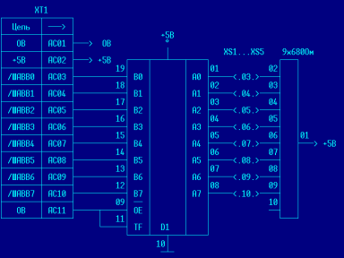

# Плата EPOS

**EPOS** (Extension Plugs Of System bus) — плата расширения системной шины компьютера «Вектор-06Ц». Она позволяет одновременно подключить к разъёму «ВУ» до пяти устройств, например электронный диск, контроллер НГМД, часы или Sound Tracker.

Размер платы — **115 × 150 мм**. Её можно подключить непосредственно к разъёму «ВУ» или гибким многожильным кабелем и разместить дополнительные устройства в отдельном корпусе.

## Подключение и размещение

На плате предусмотрены вход XT1 и пять разъёмов устройств XS1–XS5. При прямом подключении используется вилка XT1; при подключении кабелем, согласно исходному описанию, вилку к плате не припаивают, а подключают кабель через отверстия XT1.

Авторы рекомендуют 45-жильный кабель длиной 0,5 м. В качестве альтернативы предлагается разрезать метровый 28-жильный кабель пополам и отделить лишние жилы от одного из кусков. Использовать кабель длиннее 0,5 м авторы считают нецелесообразным.

Базовый вариант описан как печатная плата с установленными деталями и перемычками, но без кабеля и разъёмов СНП34. Упомянут и вариант с тремя розетками, припаянным кабелем и вилкой. Это описание исторической комплектации, а не предложение о продаже.

## Схема

В архиве схема разделена на две части. Обозначения сигналов и контактов ниже сохранены по оригиналу; `/` обозначает черту над сигналом в исходной схеме.

### D1: адресные линии ввода-вывода

| XT1  | Цепь   | Вывод D1 B | Вывод D1 A | Контакт XS1–XS5 |
| ---- | ------ | ---------: | ---------: | --------------: |
| АС03 | /ШАВВ0 |         19 |          1 |               3 |
| АС04 | /ШАВВ1 |         18 |          2 |               4 |
| АС05 | /ШАВВ2 |         17 |          3 |               5 |
| АС06 | /ШАВВ3 |         16 |          4 |               6 |
| АС07 | /ШАВВ4 |         15 |          5 |               7 |
| АС08 | /ШАВВ5 |         14 |          6 |               8 |
| АС09 | /ШАВВ6 |         13 |          7 |               9 |
| АС10 | /ШАВВ7 |         12 |          8 |              10 |

XT1 АС01 и АС11 соединены с общим проводом, АС02 — с +5 В. Выводы D1 9 (OE) и 11 (TF) подключены к общему проводу, вывод 10 — к общему проводу, питание — +5 В. Линии к XS1–XS5 подтянуты к +5 В через резисторную сборку 9 × 680 Ом; её десятый вывод отмечен чертой в оригинале.

### D2: управляющие сигналы

| XT1  | Цепь          | Вывод D2 B | Вывод D2 A | Контакт XS1–XS5 |
| ---- | ------------- | ---------: | ---------: | --------------: |
| АС23 | /ЗПЗУ         |         19 |          1 |              23 |
| АС35 | /ЧТВВ         |         18 |          2 |              35 |
| АС36 | /СБ.СИС       |         17 |          3 |              36 |
| АС37 | /ЗПВВ         |         16 |          4 |              37 |
| —    | Не подключено |         15 |          5 |               — |
| АС39 | /ВВ.СИС       |         14 |          6 |              39 |
| АС40 | СТЕК          |         13 |          7 |              40 |
| АС41 | /СБРОС        |         12 |          8 |              41 |

XT1 АС45 соединён с общим проводом, АС44 — с +5 В. D2: вывод 20 — +5 В, выводы 9 (OE), 10 и 11 (TF) — общий провод. Линия /ЗПЗУ на стороне XS подтянута к +5 В отдельным резистором; номинал в текстовой схеме не указан. Следующие шесть подключённых линий подтянуты сборкой 9 × 680 Ом. Ещё два вывода сборки в оригинале обозначены `1<` и `2<`, а десятый отмечен чертой; их назначение в текстовой схеме не пояснено.

В примечании Д. Карпова сказано, что на плате можно обойтись без буферов и резисторов. Типы D1 и D2 и точная схема перемычек для такого варианта в архивных текстах не указаны. Расположение деталей и перемычек следует сверять с оригиналами и сканом платы.

## Разъём ISA

В исходном описании отмечено, что на плату подходит разъём ISA. Однако получающаяся шина описана как ограниченный вариант, пригодный для PC-карт, работающих по протоколу последовательного порта, в частности модема. Полную совместимость с ISA источник не обещает. Упомянутая схема подключения ISA в архиве отдельно не обнаружена.
