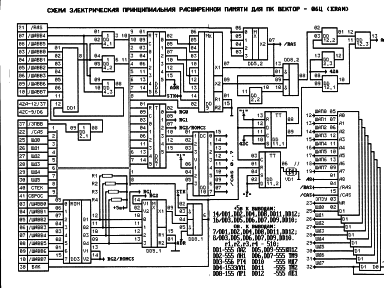
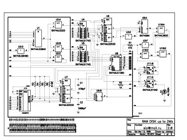
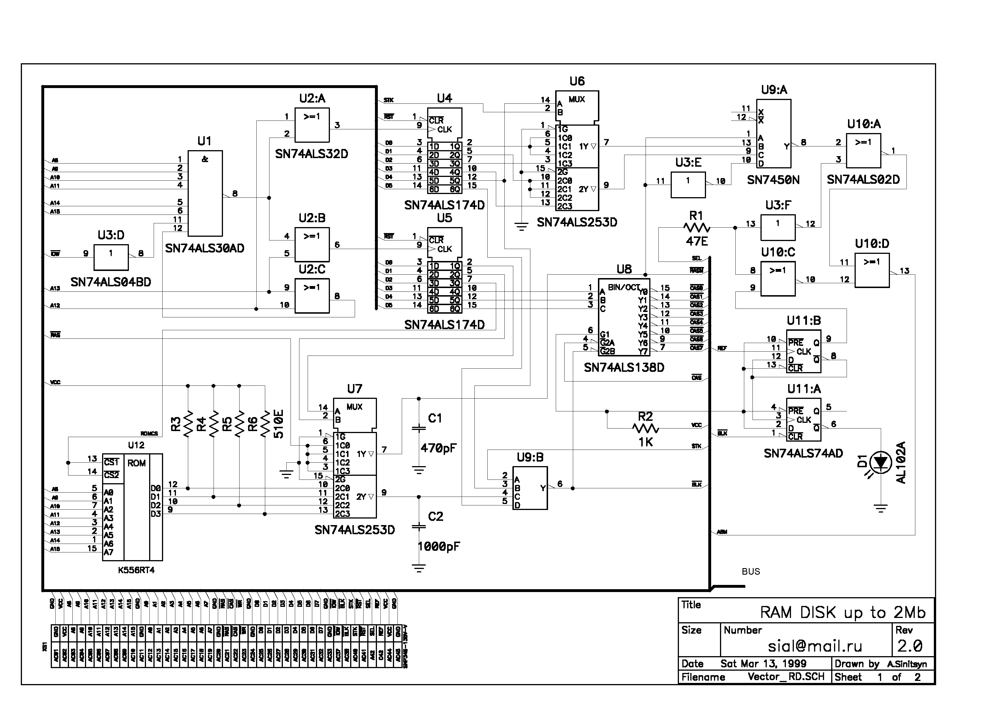
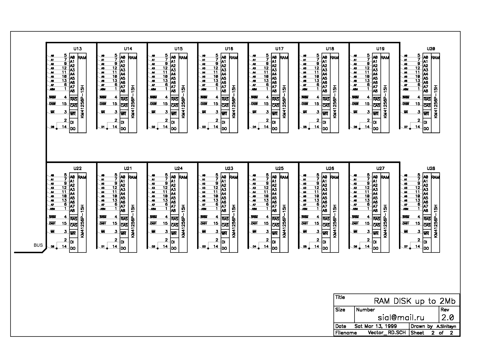

# Расширенная память ERAM для «Вектор-06Ц»

ERAM — расширение оперативной памяти для ПК «Вектор-06Ц», совместимое со стандартом квазидиска МикроДОС. Описанная конструкция допускает установку от 256 Кбайт до 2 Мбайт памяти. Программная поддержка расширения есть в [CP/M-59](../cpm/59).



## Версии устройства

Существуют несколько версий ERAM. Имеющаяся печатная плата разведена под первую версию. Вторая устраняет её недостатки и отличается заменой одной микросхемы; для её сборки плату необходимо доработать. Третья модификация опубликована в «Вектор-USER», работает аналогично второй и содержит на одну микросхему меньше, но из-за отличий не помещается на старой плате без существенной переделки. Все версии программно совместимы и реализуют стандарт ERAM.

Далее описана сборка второй версии на плате, разведённой под первую.

## Доработка компьютера

> Изменения, согласно оригинальному описанию, не гарантируют пользователям МикроДОС работу других аппаратных расширений, кроме контроллера дисковода МикроДОС.

Для вывода сигналов на 90-контактный разъём внешних устройств:

1. Соедините вывод 9 D6 (155ИЕ5) с контактом C42 разъёма.
2. Соедините вывод 12 D37 с контактом A42 через резистор 47–100 Ом. Резистор устанавливается непосредственно на вывод микросхемы.
3. Замените D36 (155РЕ3) на микросхему с прошивкой из раздела [«Прошивки ПЗУ»](#прошивки-пзу).
4. Разрежьте дорожку к D33/11 и соедините её с D33/1.

Если контакт 42 использовать невозможно, автор предлагает задействовать другие контакты, например 36 или 39, и соответственно изменить подключения на плате ERAM.

## Доработка платы ERAM

### Перед монтажом компонентов

Разрежьте или отсоедините следующие дорожки:

- Дорожку от A42 разъёма — непосредственно у контакта: она отходит от него в двух направлениях, и её целостность необходимо сохранить.
- Дорожку от D12/2.
- Дорожку между D12/9 и контактом AC38 разъёма.
- Дорожку между D12/9 и D11/6. В источнике указано резать рядом с контактом 6 **D12**; обозначение следует сверить со схемой, поскольку в том же пункте назван D11/6.
- Все дорожки от выводов D13, кроме 8 и 16.

Также желательно, но не обязательно, отсоединить дорожки от D4/8, D4/9 и D9/9.

### После монтажа компонентов

Соедините проводами:

- D11/2 с AC40, D11/6 с AC38;
- D12/9 с A42;
- D13/1 с C42;
- D13/12 и D13/13 с землёй (D13/8), а также D13/9 с D13/12;
- D13/3 с D12/2;
- D13/4, D13/5 и D13/7 между собой.

## Детали и монтаж

Комплект микросхем указан на принципиальной схеме. Для 256 Кбайт необходимы восемь микросхем К565РУ7, для 512 Кбайт — шестнадцать. Автор рекомендует исполнения с буквами К, А или Б и не рекомендует РУ7Г.

| Компонент                     | Номинал или примечание                                        |
| ----------------------------- | ------------------------------------------------------------- |
| R1–R4                         | 510–620 Ом                                                    |
| C2                            | 1000 пФ; при диагностике «ОШИБКА СТЕКА» — 500–1000 пФ         |
| Блокировочные конденсаторы    | 0,047–0,1 мкФ, желательно на каждой или большинстве микросхем |
| Конденсатор типа КМ           | 1 мкФ между выводом питания D6/16 (РТ4) и землёй              |
| Электролитический конденсатор | 50 мкФ, необязателен; можно установить внизу платы            |
| Разъём                        | 90-контактные вилка и розетка для подключения к компьютеру    |

Монтаж производится по монтажной схеме. **R5–R7 и C3, C4 не устанавливаются.** При подключении к компьютеру микросхемы РУ7 расположены сверху над разъёмом, все детали обращены от компьютера. Входная вилка находится сверху, со стороны пайки микросхем; выходная розетка — снизу, со стороны установки деталей.

Плата разведена под 512 Кбайт. Для увеличения объёма микросхемы РУ7 устанавливают вторым этажом: все выводы совпадают, кроме сигналов CAS от D7. Нулевая линейка памяти расположена в верхнем ряду платы. При установке нескольких линеек необходимо усилить проводами дорожки питания РУ7.

| Линейка по 256 Кбайт | Вывод D7 для CAS |
| -------------------- | ---------------- |
| 0                    | 9                |
| 1                    | 10               |
| 2                    | 11               |
| 3                    | 12               |
| 4                    | 7                |
| 5                    | 6                |
| 6                    | 5                |
| 7                    | 4                |

Минимальная конфигурация — одна линейка (256 Кбайт), максимальная — восемь (2048 Кбайт).

### Подбор C1 и проверка

Автор описывает следующий способ подбора C1 после сборки:

1. Установить C1 ёмкостью от 100 пФ и включить компьютер с платой.
2. Если на экране появляются «мусорные точки», увеличивать ёмкость до их исчезновения. Это нижняя граница.
3. Продолжать увеличивать ёмкость, пока плата не перестанет запускаться. Это верхняя граница.
4. Выбрать среднее значение между границами. По описанию, плата обычно работает в широком диапазоне 1000–8000 пФ.

Для проверки предлагается использовать тест квазидиска из Монитора тестов базового ПО или, в зависимости от контроллера дисковода, запустить CP/M-59 либо МикроДОС. При появлении «мусорных точек» повторите подбор C1. При сообщении теста квазидиска «ОШИБКА СТЕКА» автор рекомендует C2 ёмкостью 500–1000 пФ.

## Управление: стандарт ERAM

Для управления используются порты ввода-вывода `10h` и `20h`. Память делится на сегменты по 256 Кбайт, каждый из которых состоит из страниц по 64 Кбайт. Назначение битов порта `10h` совпадает со стандартом квазидиска МикроДОС; его соответствующие биты выбирают страницу, в которой происходит подмена ОЗУ.

| Биты порта `20h` | Назначение                                                                 |
| ---------------- | -------------------------------------------------------------------------- |
| 0–1              | Вид окна подмены ОЗУ; по источнику, зависит от значения бита 5 порта `10h` |
| 2                | `0` — окно задаётся битами 0–1; `1` — полная подмена `0000h–FFFFh`         |
| 3–5              | Номер сегмента по 256 Кбайт, до восьми сегментов                           |
| 6–7              | Резерв                                                                     |

При сброшенном бите 2 порта `20h` биты 0–1 задают окно:

| Значение битов 1–0 | Диапазон адресов |
| ------------------ | ---------------- |
| `0`                | `A000h–DFFFh`    |
| `1`                | `8000h–DFFFh`    |
| `2`                | `8000h–FFFFh`    |
| `3`                | `0100h–7FFFh`    |

ERAM совместима с квазидиском МикроДОС и программами для него. Дополнительные режимы позволяют программам использовать больший объём памяти. Согласно источнику, для этого в МикроДОС необходимо изменить внутренние драйверы квазидиска: стандартная ОС не использует более 256 Кбайт.

## Прошивки ПЗУ

Данные ниже приведены из `edd2m.txt` в архиве. Адреса и значения указаны в шестнадцатеричном виде.

### U12 — КР556РТ4

```text
00: F4 F4 F4 F4 F4 F4 F4 F4 F4 F4 F4 F4 F4 F4 F4 F4
10: F4 F4 F4 F4 F4 F4 F4 F4 F4 F4 F4 F4 F4 F4 F4 F4
20: F7 F7 F7 F7 F7 F7 F7 F7 F7 F7 F7 F7 F7 F7 F7 F7
30: F7 F7 F7 F7 F7 F7 F7 F7 F7 F7 F7 F7 F7 F7 F7 F7
40: F7 F7 F7 F7 F7 F7 F7 F7 F7 F7 F7 F7 F7 F7 F7 F7
50: F7 F7 F7 F7 F7 F7 F7 F7 F7 F7 F7 F7 F7 F7 F7 F7
60: F6 F6 F6 F6 F6 F6 F6 F6 F6 F6 F6 F6 F6 F6 F6 F6
70: F6 F6 F6 F6 F6 F6 F6 F6 F6 F6 F6 F6 F6 F6 F6 F6
80: F8 F8 F8 F8 F8 F8 F8 F8 F8 F8 F8 F8 F8 F8 F8 F8
90: F8 F8 F8 F8 F8 F8 F8 F8 F8 F8 F8 F8 F8 F8 F8 F8
A0: F8 F8 F8 F8 F8 F8 F8 F8 F8 F8 F8 F8 F8 F8 F8 F8
B0: F8 F8 F8 F8 F8 F8 F8 F8 F8 F8 F8 F8 F8 F8 F8 F8
C0: F8 F8 F8 F8 F8 F8 F8 F8 F8 F8 F8 F8 F8 F8 F8 F8
D0: F8 F8 F8 F8 F8 F8 F8 F8 F8 F8 F8 F8 F8 F8 F8 F8
E0: F8 F8 F8 F8 F8 F8 F8 F8 F8 F8 F8 F8 F8 F8 F8 F8
F0: F8 F8 F8 F8 F8 F8 F8 F8 F8 F8 F8 F8 F8 F8 F8 F0
```

### D36 — К155РЕ3

```text
00: 00 00 00 00 00 00 00 00
08: 9D DD D9 D9 DB 9A DB DB
10: 05 0D 09 23 07 07 17 15
18: 9D 07 07 07 07 07 07 07
```

В приложении отмечено, что D36 работает в пограничном режиме: для устойчивой работы может потребоваться подбор экземпляра или охлаждение. Там же для соединения D37/12 с A42 указан резистор 47 Ом; основное описание допускает 47–100 Ом.

## Схемы



### Схема, лист 1



### Схема, лист 2


