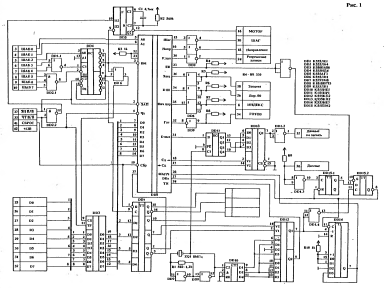
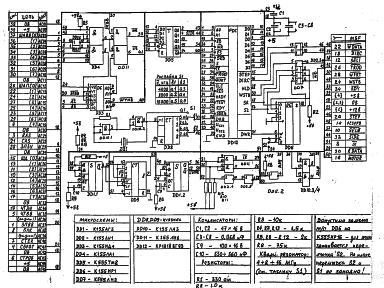
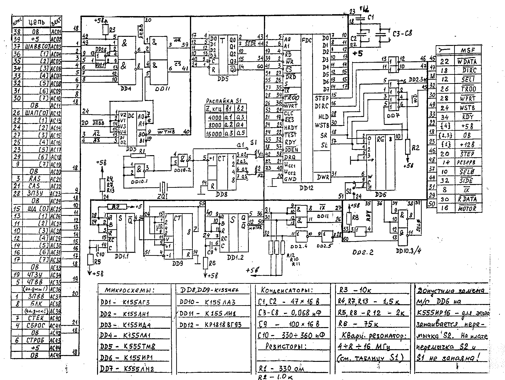
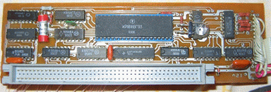

Контроллеры дисковода для «Вектора-06Ц» разных производителей: схемы и описания.

- [Контроллер дисковода (Астрахань)](astrahan)
- [Контроллер дисковода (Беларусь)](belarus)
- [Контроллер дисковода (COMAN)](coman)
- [Переделка контроллера дисковода фирмы «Coman»](coman_mod)
- [Контроллер дисковода (Омск)](controller_omsk)
- [Контроллер дисковода (Кишинев)](invoservis)
- [Контроллер дисковода](omsk)
- [Контроллер дисковода (Волжский вариант)](volgski)

