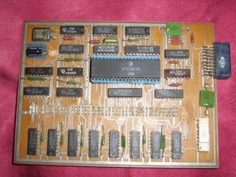
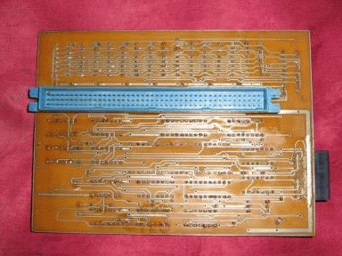

В начале 90-х годов, на заводе «Прогресс» в Астрахани, группой энтузиастов был разработан контроллер ГМД совмещенный с КД. Так как МикроДос без КД не работала (она грузилась в КД), было принято решение ввести в контроллер «усеченный» КД объёмом 16Кб, на восьми РУ6, этого достаточно для работы ОС.

[CPM-39](../../cpm/39) и [МикроДОС 28](../../microdos/yanus) работают с КГМД и без дополнительной памяти. Добавлялся загрузчик на РТ5, на «родной» нога в ногу напаивался ещё один с прошивкой «загрузки с диска» (кроме ног CS 18+19), т.е. можно грузиться или с кассеты, или с диска.

Начальству завода «Прогресс» выпуск контроллера был не интересен, серийно он не производился, дальше опытных образцов дело не пошло. В последствии стал прообразом КНГМД для Вектор-6128. Допускается установка памяти РУ5, но ввиду их дефицита применялись РУ6. Контроллер совместим со стандартными ОС.

Информацию предоставил dumon (форум zx.pk.ru).

